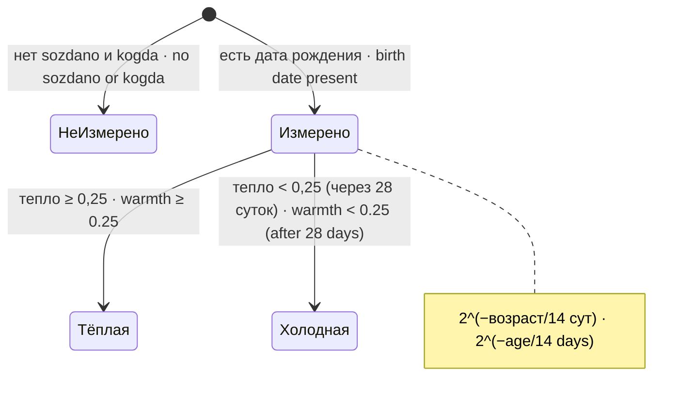

# Устройство · Architecture

Как устроен `dsh-pamyat-byudzhet` внутри: служба, отбор, сводка, тепло и вывод. Настройки — [SETTINGS.md](SETTINGS.md), проверки и стенды — [GUARDS.md](GUARDS.md).

How `dsh-pamyat-byudzhet` works inside: the service, selection, summary, warmth and output. Settings — [SETTINGS.md](SETTINGS.md), checks and stands — [GUARDS.md](GUARDS.md).

## Файлы · Files

| Файл · File | Что внутри · Contents |
|---|---|
| `src/index.js` | плагин cordis: схема `Config`, проверка чисел `vzyatChislo`, `apply` (строка подъёма, служба `byudzhetPamyati`), `krik` (вывод в stderr) · the cordis plugin: `Config` schema, number check `vzyatChislo`, `apply` (start-up line, `byudzhetPamyati` service), `krik` (stderr output) |
| `src/otbor.js` | `PORYADKI`, `otobrat` (сортировка + жадный проход), `svodkaOtbrosa` (причины и свойства) · `PORYADKI`, `otobrat` (sorting + greedy pass), `svodkaOtbrosa` (reasons and properties) |
| `src/mera.js` | `SIMVOLOV_NA_EDINICU`, `ocenit` (цена записи), `sverit` (сверка с платформой) · `SIMVOLOV_NA_EDINICU`, `ocenit` (record cost), `sverit` (reconciliation with the platform) |
| `src/teplo.js` | `teplo` (тепло одной записи), `raspredelenie` (распределение и входы касаний), гипотезы `POLURASPAD_MS`, `POROG_HOLODNOJ`, `VES_KASANIYA` · `teplo` (one record's warmth), `raspredelenie` (distribution and touch inputs), hypotheses `POLURASPAD_MS`, `POROG_HOLODNOJ`, `VES_KASANIYA` |

## Служба · The service

```mermaid
flowchart TB
  A["apply(ctx, config)"] --> V["vzyatChislo: predel ≥ 0, 0 ≤ porogVery ≤ 1<br/>негодное → «ОТКЛОНЕНО», прежнее годное · invalid → \"ОТКЛОНЕНО\", previous valid"]
  V --> L["krik: «подъём: предел …, порядок …, порог веры …»"]
  L --> Z{"predel = 0?"}
  Z -->|"да · yes"| Z0["krik: «предел равен нулю …»"]
  Z --> P["ctx.provide('byudzhetPamyati', { edinicy, ocenit, sverit, otobrat })"]
  Z0 --> P
```

Служба отдаёт четыре функции. `edinicy()` честно называет единицы («оценка наша», 4 символа на единицу) и объясняет, почему не токены. `ocenit` и `sverit` — из `src/mera.js` без обёртки. `otobrat(vopros)` — главная: отбор под предел с печатью.

The service exposes four functions. `edinicy()` honestly names the units ("оценка наша", 4 characters per unit) and explains why not tokens. `ocenit` and `sverit` come from `src/mera.js` unwrapped. `otobrat(vopros)` is the main one: selection under the limit with printing.

## Поток одного отбора · Flow of one selection

```mermaid
sequenceDiagram
  participant R as Вызывающий · Caller
  participant S as byudzhetPamyati.otobrat
  participant O as otbor.otobrat
  participant E as stderr
  R->>S: { zapisi, predel?, poryadok?, porogVery? }
  S->>O: настройки вызова или служебные · call or service settings
  O->>O: проверка списка, предела, порядка (иначе исключение) · validate list, limit, order (else exception)
  O->>O: сортировка: svezhest — по −sozdano; vera — по −vera (null = −0,5) · sort
  O->>O: жадный проход: cena + ocenit(z) ≤ predel · greedy pass
  O->>O: svodkaOtbrosa: причины, свойства, raspredelenie(zapisi)
  O-->>S: { podnyato, otbrosheno, svodka }
  opt отброшено > 0 · dropped > 0
    S->>E: «поднято НЕ ВСЁ … ПРИЧИНЫ … Из них …»
  end
  S->>E: «касания В ЭТОМ ОТБОРЕ …» или «касания: поля НЕТ …»
  S->>E: «тепло (прибор, на отбор НЕ влияет): …»
  S-->>R: { podnyato, otbrosheno, svodka }
```

## Сводка · The summary (`svodka`)

| Поле · Field | Значение · Meaning |
|---|---|
| `prosili`, `podnyato`, `otbrosheno` | сколько записей просили, подняли, отбросили · records requested, raised, dropped |
| `cena`, `predel` | цена поднятого и предел, в единицах «оценка наша» · cost of the raised and the limit, in "оценка наша" units |
| `poryadok`, `edinicy` | порядок и название единиц · order and the unit name |
| `prichiny` | строки причин отброса: «N НЕ ВЛЕЗАЮТ ЦЕЛИКОМ …», «N не поместились в остаток …» · reason strings: "does not fit at all", "did not fit the remainder" |
| `svoystva` | свойства отброшенных: вера ниже порога, неизмеренная вера, холодные (тепло < `POROG_HOLODNOJ`, 0,25), неизмеренное тепло · properties of the dropped: low confidence, unmeasured confidence, cold (warmth < `POROG_HOLODNOJ`, 0.25), unmeasured warmth |
| `teplo` | распределение тепла: `izmereno`, `neizmereno`, `min`, `mediana`, `max`, `holodnyh`, `porog`, `poluraspad_sutok`, входы касаний `kasanij_pole_est`, `kasalis_hot_raz`, `poslednee_kasanie`, `ves_kasaniya`, и `vliyaet_na_otbor: false` · warmth distribution and touch inputs |

## Ключи порядка · Order keys

| Порядок · Order | Ключ сортировки · Sort key | Граница · Boundary |
|---|---|---|
| `svezhest` | `−(sozdano ?? kogda)` (новые впереди) · newest first | без `sozdano` и `kogda` ключ 0: запись встаёт в конец, в порядке входа · without `sozdano` and `kogda` the key is 0: the record goes to the end, in input order |
| `vera` | `−vera`; `null`/нет поля → −0,5 · missing → −0.5 | неизмеренная идёт после высоких, но перед низкими · unmeasured goes after high but before low |

Сортировка устойчивая (JavaScript `Array.prototype.sort`): при равных ключах сохраняется порядок входа.

The sort is stable (JavaScript `Array.prototype.sort`): equal keys keep the input order.

## Тепло · Warmth



Тепло = `2^(−возраст / 14 суток)`; из будущего — 1. Время рождения — `sozdano`, иначе `kogda`. Состояние «холодная» ничего не отсекает: тепло печатается, а в порядке не участвует (`vliyaet_na_otbor: false`). Вес касаний `VES_KASANIYA = 0`.

Warmth = `2^(−age / 14 days)`; from the future — 1. Birth time is `sozdano`, otherwise `kogda`. The "cold" state cuts nothing: warmth is printed but takes no part in ordering (`vliyaet_na_otbor: false`). Touch weight `VES_KASANIYA = 0`.

Условие пересмотра — любое из трёх: пересечение опознавателей двух соседних выдач памяти станет больше нуля (проверяется по журналу службы: `journalctl -u <служба агента> --grep 'welcome-брифинг вставлен'`, сравнить два последних перечня); порядок отбора перестанет быть свежестью; история дорастёт до трёх полураспадов (42 суток).

The revision condition — any of three: the intersection of identifiers of two neighbouring memory deliveries becomes greater than zero (checked in the service log: `journalctl -u <agent service> --grep 'welcome-брифинг вставлен'`, compare the two latest lists); the selection order stops being freshness; the history grows to three half-lives (42 days).

## Вывод · Output

Все строки идут через `krik(s)` = `console.error('[dsh-pamyat-byudzhet <версия>] ' + s)`. Версия читается из `package.json` один раз при загрузке (не прочиталась — «версия неизвестна»). `ctx.logger` намеренно не используется: в cordis 4.0.1 его встроенный приёмник держит сообщения в кольцевом буфере внутри процесса.

All lines go through `krik(s)` = `console.error('[dsh-pamyat-byudzhet <version>] ' + s)`. The version is read from `package.json` once at load (if unreadable — "версия неизвестна", version unknown). `ctx.logger` is deliberately not used: in cordis 4.0.1 its built-in sink keeps messages in an in-process ring buffer.

## Многократный apply · Repeated apply

Платформа зовёт `apply` несколько раз на один подъём (замер: 3) и снова при горячей загрузке настройки. Поэтому `apply` не заводит процессных ресурсов, а «прежнее годное» значение чисел хранится на уровне модуля (`prezhneeGodnoe`) — одно на процесс. Каждый вызов публикует службу заново; строка подъёма печатается при каждом вызове.

The platform calls `apply` several times per start-up (measured: 3) and again on a hot settings reload. So `apply` creates no process-level resources, and the "previous valid" number values are kept at module level (`prezhneeGodnoe`) — one per process. Every call publishes the service again; the start-up line is printed on every call.
