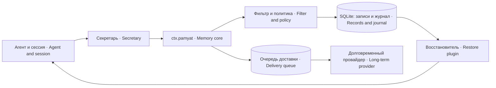

# dsh-pamyat-core — Operational agent memory

The local DSH memory core: SQLite records, a decision journal, input filtering, approval policy, relationships between knowledge items, and a delivery queue for long-term storage.

## Why it exists

A session can end or be compacted while a verified decision needs to survive. Empty memory can mean four different things: no records yet, a policy refusal, rejected input, or unavailable storage. The core retains both data and decision reasons so an engineer can distinguish these states.

The core works without an external memory service. A long-term provider is an additional layer; a secretary extracts knowledge from conversations, and a restore plugin selects it for a new turn. These packages use `ctx.pamyat`, rather than another copy of the local database.

## System placement



## Installation and requirements

**Where to install from.** npm provides `3.1.2` (checked on 2026-10-15 with `npm view dsh-pamyat-core version`). By the owner's decision of 2026-10-14, changes after publication are maintained locally and are not republished to npm. For the current local edition, pack the selected source revision with `npm pack <tree>/packages/dsh-pamyat-core`, then run `npm install ./dsh-pamyat-core-<version>.tgz`.

Requirements: Node.js 22+ with working `node:sqlite`, a DSH deployment with peer ranges Cordis `^4.0.1` and Schemastery `^3.18.1`, and a database directory writable by the platform account. SQLite is built into Node; no separate database server or native npm driver is required. Older Node builds may require a startup flag for built-in SQLite; verify the import first.

```sh
node --input-type=module -e "import('node:sqlite').then(() => console.log('SQLite available'))"
npm pack <дерево>/packages/dsh-pamyat-core   # актуальная локальная редакция из дерева · current local edition from the tree
npm install ./dsh-pamyat-core-<версия>.tgz
```

In a development directory, load the package through DSH's normal plugin configuration. `npm install` makes it available to Node; it does not activate it in a profile or create persistent agent memory by itself.

## Quick start

Add one plugin row and configure a separate database and a stable logical agent name. The example path is neutral: create it with permissions for your platform account, and do not use another agent's directory.

```yaml
- name: dsh-pamyat-core
  id: memory-core
  config:
    agent: example-agent
    putBazy: /var/lib/example-memory/core.db
    chtenieSkolko: 20
    otvechayushchegoNet: false
    otvechatNaSprosRazresheniya: false
    isklyuchitSessii: []
```

After loading, find the version and database path in platform stderr. Then call the service from integration code: `ctx.get('pamyat').dostupna()` must return `true`. Verify persistence by writing a `fakt` record, reading its returned ID, and reading the database again after a restart. Plugin registration alone does not prove that a record was saved.

```js
const memory = ctx.get('pamyat');
if (!memory.dostupna()) throw new Error(memory.pochemuNedostupna());
const id = memory.zapisat({
  klass: 'fakt',
  soderzhim: 'Интеграционная проверка хранилища · Storage integration check',
  istochnik: 'example:integration-check',
});
console.log(id, memory.poIstochniku('example:integration-check'));
```

This is an integration example for a plugin developer, not an additional model tool. The core exposes `pamyat_otnoshenie` and `pamyat_ocenit` to the model; the secretary or another integration writes records through the service.

## Settings

| Key | Purpose |
|---|---|
| `putBazy`, `agent` | Database and logical agent boundary |
| `sprashivat` | Classes requiring approval |
| `klassyZnaniy` | Knowledge classes for retrieval and delivery |
| `chtenieSkolko` | Default retrieval count |
| `otvechayushchegoNet` | Explicit absence of an approval channel |
| `otvechatNaSprosRazresheniya` | Approval-granting request handler |
| `isklyuchitSessii` | Session prefixes excluded from memory |
| `sledPodyomov` | External startup-wrapper trace |
| `predelZnakov`, `predelyZnakovPoKlassam` | Legacy compatibility, not an active size limit |
| `maskirovatObrazcy` | Secret-sample masking on writes, on by default |
| `zhurnalSkolko` | Removed from Config (A-N-1870): never read; ignored in a profile |
| `koren` | Not read (A-N-1870): the long-term delivery root is always `agent`; a profile key changes nothing |

Types, defaults, examples, and consequences are documented in [SETTINGS](docs/SETTINGS.md). Do not confuse the absence of an approval channel with granting every approval request: these are different settings with different effects.

## How it works

Before a write, the core checks database availability and filter health. It normalizes and validates fields, recognizes known secret formats, removes service artifacts, and retains diagnostic annotations. Masking is not proof that no secret remains: detection is limited to the implemented patterns and heuristics.

Policy is determined by the knowledge class. By default, `ogranichenie` and `navyk` require approval; an empty `sprashivat` restores that default. A human refusal, cancelled request, missing channel, and unknown result remain distinct. On a node without an approver, records may be accepted with an explicit `bez_podtverzhdeniya` annotation.

A knowledge record and its local decision journal are written to the same SQLite database under a SAVEPOINT. A failure at either step rolls back that local group. Delivery to an external provider is separate from the local transaction: the network cannot participate in this SAVEPOINT.

If the provider is installed but delivery fails, the record remains local and enters a queue. If no provider is installed, no queue item is created: the journal explicitly records local-only storage. An ambiguous `moglo-dojti-bez-id` outcome is not retried by writing: the previous attempt may already have created a record. If the long-term layer supports body search (`poTelu`) and the body is at least 80 characters long, the queue pass searches for it in the agent's root: exactly one match removes the item from the queue as delivered, several matches are journaled as `dubl` and the item waits for an operator. A queue pass makes at most one eligible write attempt per item; the attempt budget is accumulated in the database across passes. Exhausted items remain distinguishable. The core has no timer of its own: a queue pass is started by the calling integration or by the core itself after a confirmed delivery of a new record, at most once an hour per process and never overlapping.

Event-derived trust and numeric `vera` are separate layers. Cancellation, lost support, refinement, and confirmation determine a trust state at read time. A model rating is accepted only for a welcome record issued in the current process, once per issuance; `null` means no measurement, not zero trust.

Sessions excluded by `isklyuchitSessii` are classified by the shared service. Restore, long-term injection, and secretary integrations must consult that service at their entry points. The core's model tools also refuse excluded sessions; a configuration entry alone cannot replace a missing consumer integration.

## Verification and operations

`npm test` runs all `test/stend-*.mjs` files through the shared runner. Exit `0` means success, `1` a mismatch, and `2` insufficient visibility; one blind test does not stop the others. Some contract tests require adjacent packages or external data: report missing prerequisites rather than treating them as successful checks.

Trust-state count for an external watcher — `node src/schet-doveriya.mjs <агент>=<absolute path to pamyat.db> [...]`. The agent name is `[a-z][a-z0-9_-]*`, the path absolute; otherwise «ОТКАЗ: формат …» (refusal: format) and exit 2 before any database is read. The database is opened read-only (`readOnly`), the schema is not migrated. One line per database: `доверие <агент>: знаний N · <state> N · … · otmenena_id [...]`; a database that could not be read gives `доверие <агент>: СЛЕПОТА — …; это «не измерено», не ноль` (blindness: not measured, not zero), and the remaining databases are still counted. Exit `0` — all counted, `2` — invalid arguments or at least one database unreadable. The command neither schedules runs nor sends alerts; trust state is not a test of knowledge truth.

Diagrams, contracts, and tables are in [ARCHITECTURE](docs/ARCHITECTURE.md); guards, callers, and limits are in [GUARDS](docs/GUARDS.md); diagnosis is in [TROUBLESHOOTING](docs/TROUBLESHOOTING.md).

## Limitations

This is a logical memory boundary, not operating-system isolation. Anyone with access to the SQLite file can read or modify records. The core does not encrypt the database, replace backups, install external systemd monitors, or guarantee semantic truth. Evaluate the built-in filter separately against your own data.

## License and authorship

MIT (`"license": "MIT"` in `package.json`, text in [LICENSE](LICENSE); the file is not listed in `files`, but npm adds it to the package archive by itself); Iia-arg team. Source and family documentation: [system repository](https://github.com/iia-arg/dsh-plugins). In the source tree, adjacent packages document the provider, secretary, and restore integration separately.

## Refusal, queue and diagnostic contracts

Approval classifications are `otkazano-chelovekom`, `otmeneno`, `net-kanala`, `net-sluzhby`, `net-agenta`, and `ne-predyavleno`. The four external outcomes are allowed-once/rejected/cancelled/unavailable; not-supported/no-agent/ne-predyavleno are names of OURS for situations before contacting approval, not additional platform replies.

The queue distinguishes `ne-otpravleno`, `ne-najdeno`, `moglo-dojti-id-est`, and `moglo-dojti-bez-id`. Without an identifier, arrival is not decidable by machine using a blind retry: there is no address for an independent read, and another write may create a duplicate. Such an outcome is therefore never retried by writing. If the layer supports `poTelu` and the body is at least 80 characters long, the pass searches for the whole body in the agent's root: one match removes the item as delivered, several are marked `dubl`; without `poTelu`, with a short body, or with zero or several matches, operator reconciliation is needed. A known ID enables read-back.

`vera` retains absence deliberately: empty is not zero, and null means never measured. Its number is derived from ratings; receipt or issuance is not automatically a rating.

In the integration in use, a logger EXISTS: `ctx.logger` is created for every Context by Cordis, but its presence does not prove that an exporter reads the ring buffer. The core therefore reports through console.error. `test/stend-krik-zvuchit.mjs` checks actual stderr output; separately verify the stderr-to-readable-log path in your deployment.

Table names, literal upstream outcomes, and mandatory refusal of unknown input are NOT configurable. Changing these invariants requires a new data contract rather than a cosmetic switch.

```js
const memory = ctx.get('pamyat');
console.log(memory.dostupna(), memory.reshit('fakt'));
console.log(memory.prochitat({ skolko: 1 }), memory.svodka());
memory.otmetitOtkaz({
  klass: 'fakt', priroda: 'example-diagnostic',
  pochemu: 'Тестовая отметка журнала · Fixture journal event',
  istochnik: 'example:diagnostic',
});
```

The last call writes a journal event, not knowledge; run it against a test database. The earlier `zapisat` example demonstrates a knowledge write separately from reading and summary.

## Verified operating system

Documentation checks and the named stands for this candidate ran on Linux. Other operating systems and file/process-operation portability were not separately verified; memory and secret directories need the designated account's access policy.
