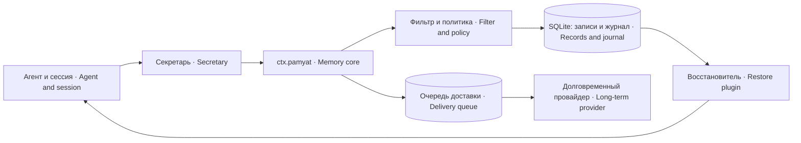

# dsh-pamyat-core — оперативная память агента · Operational agent memory

Локальное ядро памяти DSH: SQLite-записи, журнал решений, фильтрация входа, политика подтверждения, отношения между знаниями и очередь доставки в долговременный слой.

The local DSH memory core: SQLite records, a decision journal, input filtering, approval policy, relationships between knowledge items, and a delivery queue for long-term storage.

## Зачем нужно · Why it exists

Сессия может закончиться или сжаться, а проверенное решение должно остаться. При этом пустая память может означать четыре разных вещи: записей ещё нет, запись запрещена политикой, вход отвергнут фильтром или хранилище недоступно. Ядро сохраняет данные и причины отдельно, чтобы инженер мог различить эти состояния.

A session can end or be compacted while a verified decision needs to survive. Empty memory can mean four different things: no records yet, a policy refusal, rejected input, or unavailable storage. The core retains both data and decision reasons so an engineer can distinguish these states.

Ядро работает без внешней службы памяти. Долговременный провайдер — дополнительный слой; секретарь выделяет знания из диалогов, а восстановитель выбирает их для нового хода. Эти пакеты используют службу `ctx.pamyat`, не вторую копию локальной базы.

The core works without an external memory service. A long-term provider is an additional layer; a secretary extracts knowledge from conversations, and a restore plugin selects it for a new turn. These packages use `ctx.pamyat`, rather than another copy of the local database.

## Место в системе · System placement



## Установка и требования · Installation and requirements

**Откуда ставить.** Пакет публикуется в npm выпуском 3.1.2 (порядок и окно — по решению владельца). До выхода в реестре npm лежит старая редакция `0.1.0-alpha.*` (замер 10.10.2026, `npm view dsh-pamyat-core version`): `npm install dsh-pamyat-core` поставит её, а не описанную здесь. До выпуска ставьте из дерева исходников: `npm pack <дерево>/packages/dsh-pamyat-core` и затем `npm install ./dsh-pamyat-core-<версия>.tgz`.

**Where to install from.** The package is published to npm with release 3.1.2 (order and window — by the owner's decision). Until then the npm registry holds an old `0.1.0-alpha.*` edition (measured 10.10.2026, `npm view dsh-pamyat-core version`): `npm install dsh-pamyat-core` installs that one, not the one described here. Until the release, install from the source tree: `npm pack <дерево>/packages/dsh-pamyat-core`, then `npm install ./dsh-pamyat-core-<версия>.tgz`.

Нужны Node.js 22+ с рабочим `node:sqlite`, DSH с peer-диапазонами Cordis `^4.0.1` и Schemastery `^3.18.1`, каталог базы с правом записи у пользователя платформы. SQLite встроен в Node; отдельный сервер базы и нативный npm-драйвер не нужны. На старых сборках Node поддержка встроенного SQLite может требовать флага запуска; сначала проверь импорт ниже.

Requirements: Node.js 22+ with working `node:sqlite`, a DSH deployment with peer ranges Cordis `^4.0.1` and Schemastery `^3.18.1`, and a database directory writable by the platform account. SQLite is built into Node; no separate database server or native npm driver is required. Older Node builds may require a startup flag for built-in SQLite; verify the import first.

```sh
node --input-type=module -e "import('node:sqlite').then(() => console.log('SQLite available'))"
npm pack <дерево>/packages/dsh-pamyat-core   # до выпуска 3.1.2 — из дерева · until release 3.1.2 — from the tree
npm install ./dsh-pamyat-core-<версия>.tgz
```

В каталоге разработки пакет подключается обычным механизмом плагинов DSH. Команда `npm install` делает пакет доступным Node, но сама не включает его в профиль и не создаёт постоянную память агента.

In a development directory, load the package through DSH's normal plugin configuration. `npm install` makes it available to Node; it does not activate it in a profile or create persistent agent memory by itself.

## Быстрый старт · Quick start

Добавь одну строку плагина и задай отдельную базу и стабильное логическое имя агента. Пример пути нейтральный: создай его с правами пользователя своей платформы, не используй каталог другого агента.

Add one plugin row and configure a separate database and a stable logical agent name. The example path is neutral: create it with permissions for your platform account, and do not use another agent's directory.

```yaml
- name: dsh-pamyat-core
  id: memory-core
  config:
    agent: example-agent
    putBazy: /var/lib/example-memory/core.db
    chtenieSkolko: 20
    otvechayushchegoNet: false
    otvechatNaSprosRazresheniya: false
    isklyuchitSessii: []
```

После загрузки найди в stderr платформы строку версии и путь базы. Затем вызови службу из интеграционного кода: `ctx.get('pamyat').dostupna()` должна вернуть `true`. Проверь сохранение записью класса `fakt`, чтением возвращённого id и отдельным чтением базы после перезапуска. Проверка регистрации плагина не доказывает сохранение записи.

After loading, find the version and database path in platform stderr. Then call the service from integration code: `ctx.get('pamyat').dostupna()` must return `true`. Verify persistence by writing a `fakt` record, reading its returned ID, and reading the database again after a restart. Plugin registration alone does not prove that a record was saved.

```js
const memory = ctx.get('pamyat');
if (!memory.dostupna()) throw new Error(memory.pochemuNedostupna());
const id = memory.zapisat({
  klass: 'fakt',
  soderzhim: 'Интеграционная проверка хранилища · Storage integration check',
  istochnik: 'example:integration-check',
});
console.log(id, memory.poIstochniku('example:integration-check'));
```

Это пример интеграции для разработчика плагина, а не обещание нового инструмента модели. В ядре модели выдаются `pamyat_otnoshenie` и `pamyat_ocenit`; обычную запись вызывает секретарь или другая интеграция через службу.

This is an integration example for a plugin developer, not an additional model tool. The core exposes `pamyat_otnoshenie` and `pamyat_ocenit` to the model; the secretary or another integration writes records through the service.

## Настройки · Settings

| Ключ · Key | Назначение · Purpose |
|---|---|
| `putBazy`, `agent` | База и логическая граница агента · Database and logical agent boundary |
| `sprashivat` | Классы, требующие подтверждения · Classes requiring approval |
| `klassyZnaniy` | Классы настоящих знаний для выдачи и доставки · Knowledge classes for retrieval and delivery |
| `chtenieSkolko` | Число записей при обычном чтении · Default retrieval count |
| `otvechayushchegoNet` | Объявление отсутствия канала подтверждения · Explicit absence of an approval channel |
| `otvechatNaSprosRazresheniya` | Разрешающий обработчик запросов подтверждения · Approval-granting request handler |
| `isklyuchitSessii` | Префиксы сессий, исключённых из памяти · Session prefixes excluded from memory |
| `sledPodyomov` | След внешней обёртки загрузки · External startup-wrapper trace |
| `predelZnakov`, `predelyZnakovPoKlassam` | Устаревшая совместимость, не действующий предел · Legacy compatibility, not an active size limit |
| `maskirovatObrazcy` | Маска образцов секретов на пути записи, по умолчанию включена · Secret-sample masking on writes, on by default |
| `zhurnalSkolko` | Снят из Config (A-N-1870): не читался никогда; в профиле игнорируется · Removed from Config: never read; ignored in a profile |
| `koren` | Не читается (A-N-1870): корень долговременной доставки — всегда `agent`; ключ в профиле ничего не меняет · Not read (A-N-1870): the long-term delivery root is always `agent`; a profile key changes nothing |

Подробные типы, умолчания, примеры и последствия находятся в [SETTINGS](docs/SETTINGS.md). Не путай отсутствие канала подтверждения с разрешением всех запросов: это разные настройки и разные последствия.

Types, defaults, examples, and consequences are documented in [SETTINGS](docs/SETTINGS.md). Do not confuse the absence of an approval channel with granting every approval request: these are different settings with different effects.

## Как работает · How it works

Перед записью ядро проверяет доступность базы и исправность фильтра. Оно нормализует и проверяет поля, распознаёт известные формы секретов, очищает служебные остатки и сохраняет диагностические отметки. Маскирование не является доказательством отсутствия секретов: распознавание ограничено реализованными шаблонами и эвристиками.

Before a write, the core checks database availability and filter health. It normalizes and validates fields, recognizes known secret formats, removes service artifacts, and retains diagnostic annotations. Masking is not proof that no secret remains: detection is limited to the implemented patterns and heuristics.

Политика определяется классом. По умолчанию `ogranichenie` и `navyk` требуют подтверждения; пустой `sprashivat` возвращает это умолчание. Отказ человека, отмена вопроса, отсутствие канала и неизвестный результат не объединяются в одно состояние. На узле без отвечающего знания могут приниматься с явной отметкой `bez_podtverzhdeniya`.

Policy is determined by the knowledge class. By default, `ogranichenie` and `navyk` require approval; an empty `sprashivat` restores that default. A human refusal, cancelled request, missing channel, and unknown result remain distinct. On a node without an approver, records may be accepted with an explicit `bez_podtverzhdeniya` annotation.

Запись знания и её локальный журнал решения выполняются в одной SQLite-базе под SAVEPOINT. Ошибка на любом шаге откатывает эту локальную группу. Доставка внешнему провайдеру отдельна от локальной транзакции: сеть нельзя включить в этот SAVEPOINT.

A knowledge record and its local decision journal are written to the same SQLite database under a SAVEPOINT. A failure at either step rolls back that local group. Delivery to an external provider is separate from the local transaction: the network cannot participate in this SAVEPOINT.

Если провайдер смонтирован, но доставка не удалась, запись остаётся локально и попадает в очередь. Если провайдер вообще не смонтирован, очередь не создаётся: журнал явно отмечает локальное сохранение без долговременного слоя. Неопределённый исход `moglo-dojti-bez-id` не повторяется записью: предыдущая попытка могла уже создать запись. Если долговременный слой умеет искать по телу (`poTelu`), а тело не короче 80 знаков, проход очереди ищет его в корне агента: ровно одна находка снимает запись с очереди как доставленную, несколько — отметка `dubl` в журнале, и запись ждёт оператора. За один проход очереди выполняется не более одной допустимой попытки записи на строку; предел попыток накоплен в базе между проходами. Исчерпанные записи остаются различимыми. Своего таймера у ядра нет: проход очереди запускает вызывающая интеграция либо само ядро — после подтверждённой доставки новой записи, не чаще раза в час на процесс и без наложения проходов.

If the provider is installed but delivery fails, the record remains local and enters a queue. If no provider is installed, no queue item is created: the journal explicitly records local-only storage. An ambiguous `moglo-dojti-bez-id` outcome is not retried by writing: the previous attempt may already have created a record. If the long-term layer supports body search (`poTelu`) and the body is at least 80 characters long, the queue pass searches for it in the agent's root: exactly one match removes the item from the queue as delivered, several matches are journaled as `dubl` and the item waits for an operator. A queue pass makes at most one eligible write attempt per item; the attempt budget is accumulated in the database across passes. Exhausted items remain distinguishable. The core has no timer of its own: a queue pass is started by the calling integration or by the core itself after a confirmed delivery of a new record, at most once an hour per process and never overlapping.

Доверие по событиям и числовая `vera` — разные слои. Отмена, потеря опоры, уточнение и подтверждение формируют состояние доверия при чтении. Оценка модели применяется только к записи приветствия, выданной в текущем процессе, один раз на конкретную выдачу; `null` означает отсутствие измерения, а не нулевую веру.

Event-derived trust and numeric `vera` are separate layers. Cancellation, lost support, refinement, and confirmation determine a trust state at read time. A model rating is accepted only for a welcome record issued in the current process, once per issuance; `null` means no measurement, not zero trust.

Исключённые по `isklyuchitSessii` сессии распознаются общей службой. Восстановитель, долговременная подача и секретарь должны спрашивать эту службу на своих входах. Прямые модельные инструменты ядра также отказывают для исключённой сессии; отсутствие интеграции потребителя нельзя заменить одной строкой настройки.

Sessions excluded by `isklyuchitSessii` are classified by the shared service. Restore, long-term injection, and secretary integrations must consult that service at their entry points. The core's model tools also refuse excluded sessions; a configuration entry alone cannot replace a missing consumer integration.

## Проверки и эксплуатация · Verification and operations

`npm test` вызывает все файлы `test/stend-*.mjs` через общий обходчик. Код `0` означает зелёный результат, `1` — расхождение, `2` — слепоту; слепота одного стенда не обрывает остальные. Часть контрактных стендов требует соседние пакеты или внешние данные: их отсутствие нужно указать, а не считать зелёным результатом.

`npm test` runs all `test/stend-*.mjs` files through the shared runner. Exit `0` means success, `1` a mismatch, and `2` insufficient visibility; one blind test does not stop the others. Some contract tests require adjacent packages or external data: report missing prerequisites rather than treating them as successful checks.

Счёт состояний доверия для внешнего сторожа — `node src/schet-doveriya.mjs <агент>=<абсолютный путь к pamyat.db> [...]`. Имя агента — `[a-z][a-z0-9_-]*`, путь — абсолютный; иначе «ОТКАЗ: формат …» и код 2 до чтения баз. База открывается только на чтение (`readOnly`), схема не мигрирует. На каждую базу — строка `доверие <агент>: знаний N · <состояние> N · … · otmenena_id [...]`; база не прочиталась — `доверие <агент>: СЛЕПОТА — …; это «не измерено», не ноль`, остальные базы считаются дальше. Код `0` — сосчитаны все, `2` — неверные доводы или хоть одна база не прочиталась. Команда не планирует запуски и не шлёт тревог; состояние доверия — не проверка истинности знания.

Trust-state count for an external watcher — `node src/schet-doveriya.mjs <агент>=<absolute path to pamyat.db> [...]`. The agent name is `[a-z][a-z0-9_-]*`, the path absolute; otherwise «ОТКАЗ: формат …» (refusal: format) and exit 2 before any database is read. The database is opened read-only (`readOnly`), the schema is not migrated. One line per database: `доверие <агент>: знаний N · <state> N · … · otmenena_id [...]`; a database that could not be read gives `доверие <агент>: СЛЕПОТА — …; это «не измерено», не ноль` (blindness: not measured, not zero), and the remaining databases are still counted. Exit `0` — all counted, `2` — invalid arguments or at least one database unreadable. The command neither schedules runs nor sends alerts; trust state is not a test of knowledge truth.

Схемы, контракты и таблицы находятся в [ARCHITECTURE](docs/ARCHITECTURE.md); защиты, вызывающие и ограничения — в [GUARDS](docs/GUARDS.md); диагностика — в [TROUBLESHOOTING](docs/TROUBLESHOOTING.md).

Diagrams, contracts, and tables are in [ARCHITECTURE](docs/ARCHITECTURE.md); guards, callers, and limits are in [GUARDS](docs/GUARDS.md); diagnosis is in [TROUBLESHOOTING](docs/TROUBLESHOOTING.md).

## Границы · Limitations

Это логическая граница памяти, не изоляция операционной системы. Пользователь с доступом к SQLite-файлу может читать или менять записи. Ядро не шифрует базу, не заменяет резервное копирование, не устанавливает внешние systemd-сторожа и не гарантирует семантическую истинность знания. Встроенный фильтр требует отдельной оценки на твоих данных.

This is a logical memory boundary, not operating-system isolation. Anyone with access to the SQLite file can read or modify records. The core does not encrypt the database, replace backups, install external systemd monitors, or guarantee semantic truth. Evaluate the built-in filter separately against your own data.

## Лицензия и авторство · License and authorship

MIT (`"license": "MIT"` в `package.json`, текст — [LICENSE](LICENSE); в `files` файл не назван, но npm кладёт его в архив пакета сам); Iia-arg team. Исходники и общая документация семейства: [репозиторий системы](https://github.com/iia-arg/dsh-plugins). В рабочем дереве соседние пакеты описывают провайдер, секретаря и восстановление отдельно.

MIT (`"license": "MIT"` in `package.json`, text in [LICENSE](LICENSE); the file is not listed in `files`, but npm adds it to the package archive by itself); Iia-arg team. Source and family documentation: [system repository](https://github.com/iia-arg/dsh-plugins). In the source tree, adjacent packages document the provider, secretary, and restore integration separately.

## Договоры отказа, очереди и диагностики · Refusal, queue and diagnostic contracts

Природы подтверждения: `otkazano-chelovekom`, `otmeneno`, `net-kanala`, `net-sluzhby`, `net-agenta`, `ne-predyavleno`. Первые четыре внешних исхода — allowed-once/rejected/cancelled/unavailable; пред-исходы not-supported/no-agent/ne-predyavleno — НАШИ имена для ситуаций до обращения к службе, а не дополнительные ответы платформы.

Approval classifications are `otkazano-chelovekom`, `otmeneno`, `net-kanala`, `net-sluzhby`, `net-agenta`, and `ne-predyavleno`. The four external outcomes are allowed-once/rejected/cancelled/unavailable; not-supported/no-agent/ne-predyavleno are names of OURS for situations before contacting approval, not additional platform replies.

Очередь различает `ne-otpravleno`, `ne-najdeno`, `moglo-dojti-id-est`, `moglo-dojti-bez-id`. Без опознавателя вопрос «сохранилось ли» неразрешим автоматическим повтором: не получен адрес предмета для отдельного чтения, а повторная запись может создать дубль. Поэтому записью такой исход не повторяется. Если слой умеет `poTelu` и тело не короче 80 знаков, проход ищет тело целиком в корне агента: одна находка снимает запись как доставленную, несколько — отметка `dubl`; без `poTelu`, при коротком теле, при нуле или нескольких находках нужна сверка оператором. С id возможен read-back.

The queue distinguishes `ne-otpravleno`, `ne-najdeno`, `moglo-dojti-id-est`, and `moglo-dojti-bez-id`. Without an identifier, arrival is not decidable by machine using a blind retry: there is no address for an independent read, and another write may create a duplicate. Such an outcome is therefore never retried by writing. If the layer supports `poTelu` and the body is at least 80 characters long, the pass searches for the whole body in the agent's root: one match removes the item as delivered, several are marked `dubl`; without `poTelu`, with a short body, or with zero or several matches, operator reconciliation is needed. A known ID enables read-back.

Поле `vera` сохраняет пустоту намеренно: пустота — не ноль. Число вычисляется из оценок; событие получения/выдачи записи не становится оценкой автоматически.

`vera` retains absence deliberately: empty is not zero, and null means never measured. Its number is derived from ratings; receipt or issuance is not automatically a rating.

В применяемой интеграции логгер ЕСТЬ: `ctx.logger` создаётся Cordis для Context, но наличие метода не доказывает, что установлен вывод буфера. Поэтому сообщения ядра идут через console.error. Способ контроля — `test/stend-krik-zvuchit.mjs`, проверяющий фактический звук stderr; в собственной установке отдельно проверь путь от stderr до читаемого журнала.

A logger is created for every Context by Cordis, but its presence does not prove that an exporter reads the ring buffer. The core therefore reports through console.error. `test/stend-krik-zvuchit.mjs` checks actual stderr output; separately verify the stderr-to-readable-log path in your deployment.

Имя таблицы, буквальный исход чужого протокола и обязательный отказ при неизвестном вводе НЕ является пользовательской настройкой. Эти инварианты NOT configurable: их изменение потребовало бы нового контракта данных, а не косметического переключателя.

Table names, literal upstream outcomes, and mandatory refusal of unknown input are NOT configurable. Changing these invariants requires a new data contract rather than a cosmetic switch.

```js
const memory = ctx.get('pamyat');
console.log(memory.dostupna(), memory.reshit('fakt'));
console.log(memory.prochitat({ skolko: 1 }), memory.svodka());
memory.otmetitOtkaz({
  klass: 'fakt', priroda: 'example-diagnostic',
  pochemu: 'Тестовая отметка журнала · Fixture journal event',
  istochnik: 'example:diagnostic',
});
```

Последняя строка примера пишет отметку журнала, а не знание; запускай её на тестовой базе. Предыдущий пример `zapisat` показывает запись знания отдельно от её чтения и сводки.

The last call writes a journal event, not knowledge; run it against a test database. The earlier `zapisat` example demonstrates a knowledge write separately from reading and summary.

## Проверенная ОС · Verified operating system

Документационные проверки и названные стенды этого кандидата выполнялись на Linux. Поддержку иной ОС и переносимость файловых/процессных операций отдельно не проверяли; каталог памяти и секретов должен быть доступен только назначенной учётке.

Documentation checks and the named stands for this candidate ran on Linux. Other operating systems and file/process-operation portability were not separately verified; memory and secret directories need the designated account's access policy.
