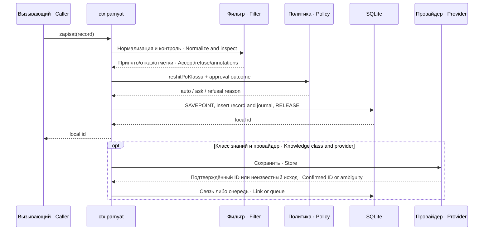
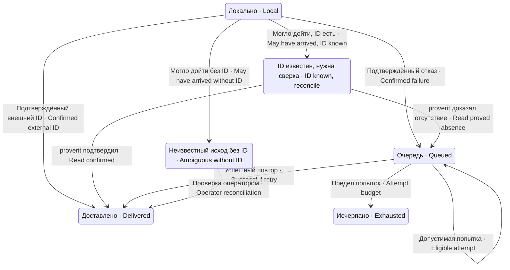

# Устройство и контракты · Architecture and contracts

## Слои и владельцы данных · Layers and data ownership

`index.js` связывает платформу, конфигурацию и службу `pamyat`. `hranilishche.js` отвечает за SQLite и миграции, `zhurnal.js` — за решения, `politika.js` — за необходимость подтверждения, `filtr-vhoda.js` — за проверку и маскирование входа. Чистые помощники доверия не вызывают сеть и не изменяют записи при вычислении состояния.

`index.js` binds the platform, configuration, and `pamyat` service. `hranilishche.js` owns SQLite and migrations, `zhurnal.js` records decisions, `politika.js` determines approval requirements, and `filtr-vhoda.js` validates and masks input. Pure trust helpers do not call the network or mutate records while deriving their state.

| Исходник · Source | Ответственность · Responsibility | Потребитель · Consumer |
|---|---|---|
| `index.js` | Служба, запись и инструменты · Service, write pipeline and tools | Секретарь, восстановитель, модель · Secretary, restore plugin, model |
| `hranilishche.js` | SQLite, миграции, отношения, очередь · SQLite, migrations, relationships, queue | `index.js`, диагностические CLI · Service and diagnostic CLIs |
| `filtr-vhoda.js` | Очистка, секреты, маска, контроль исправности · Cleaning, secrets, masking, health canary | Вход записи и внешняя модель · Write input and external-model integrations |
| `politika.js` | Решение auto/ask и разбор подтверждения · Auto/ask decision and approval result classification | Конвейер записи · Write pipeline |
| `zhurnal.js` | Журнал и сверка счёта · Journal and count reconciliation | Состояние и диагностика · Status and diagnosis |
| `doverie.js` | Приоритет событий доверия · Trust-event precedence | Чтение и поиск · Retrieval and search |
| `privratnik.js` | Опциональный разрешающий обработчик approval/request · Optional approval-granting handler | Служба подтверждения платформы · Platform approval service |
| `sobytiya-sessii.js` | Совместимый доступ к событиям · Compatible session event access | Семейство плагинов памяти · Memory plugin family |
| `podtverdit-znanie.mjs` | Явное подтверждение записи оператором · Explicit operator confirmation | Ручное обслуживание · Manual maintenance |
| `schet-doveriya.mjs` | Read-only отчёт состояний доверия · Read-only trust-state report | Внешний планировщик/оператор · External scheduler/operator |

## Один проход записи · One write pass

Возвращённый локальный id не доказывает доставку в долговременную память. Внешняя доставка завершается асинхронно, а локальный журнал и очередь сохраняют её исход. SQLite SAVEPOINT защищает совместную локальную запись знания и отметок, но не HTTP/MCP-запрос провайдеру.

A returned local ID does not prove delivery to long-term memory. External delivery completes asynchronously, while the local journal and queue retain its outcome. A SQLite SAVEPOINT protects the local knowledge-and-annotations write, not the provider's HTTP/MCP request.

## Хранилище · Storage

| Таблица · Table | Содержание · Contents | Инвариант · Invariant |
|---|---|---|
| `zapisi` | Знание, источник, класс, агент, время, оценки и отметки · Knowledge, source, class, agent, time, ratings and annotations | Локальный id относится к одной записи · A local ID identifies one record |
| `zhurnal` | События решений записи и доставки · Write and delivery decision events | Число событий не равно числу знаний · Event count is not record count |
| `ochered_dolgovremennogo` | Ожидающие доставки, попытки, причина, исчерпание · Pending delivery, attempts, reason and exhaustion | Неизвестный исход не повторяется автоматически · Ambiguous delivery is not retried automatically |
| `nastrojki` | Миграционные рубежи и диагностические отсечки · Migration boundaries and diagnostic baselines | Отсутствие рубежа не заменяется нулём · A missing boundary is not replaced by zero |
| `svyaz_omega` | Локальный id ↔ внешние идентификаторы · Local-to-external identity links | Один внешний id может связывать несколько локальных знаний · One external ID may link multiple local records |

Миграции добавляют отсутствующие столбцы, сохраняют прежние записи и устанавливают рубежи для интерпретации новых полей. Поле, которого не было в старом формате, нельзя объявлять измеренным отрицательным результатом. Сделай резервную копию базы до обновления версии; этот пакет сам не управляет системой резервного копирования.

Migrations add missing columns, retain existing records, and establish boundaries for interpreting new fields. A field absent from an older format must not be reported as a measured negative result. Back up the database before a version upgrade; this package does not manage the backup system.

## Отношения и числовые оценки · Relationships and numeric ratings

`otmenyaet` допустим к действующим знаниям `reshenie`, `poryadok`, `ogranichenie`, `vyvod`, `urok`; к `fakt`, `nablyudenie`, `oshibka` применяется уточнение. Отношение проверяется по существованию записей и области агента; повторное одинаковое утверждение различается от новой связи.

`otmenyaet` applies to active knowledge classes `reshenie`, `poryadok`, `ogranichenie`, `vyvod`, and `urok`; `fakt`, `nablyudenie`, and `oshibka` use refinement. Relationship validation checks record existence and agent scope; repeating the same assertion is distinguished from adding a new link.

Приоритет вычисляемого доверия: `otmenena` → `oprovergnuta` → `otmetka-negodna` → `utochnena` → `podtverzhdena` → `bez-podtverzhdeniya` → `obychnaya`. Первое применимое правило побеждает. Выдача сама по себе не является проверкой, а возраст не доказывает устаревание.

Derived trust precedence is `otmenena` → `oprovergnuta` → `otmetka-negodna` → `utochnena` → `podtverzhdena` → `bez-podtverzhdeniya` → `obychnaya`. The first applicable rule wins. Showing a record is not a verification, and age alone does not prove obsolescence.

Для модельных оценок `pomoglo` переводится в `helped`, `podvelo` в `harmful`, `ustarelo` в `stale`. Формула веры — `clamp((80 + 20×helped − 35×harmful − 15×stale)/100, 0, 1)`. Нет списка оценок либо негодный исход — `null`, не `0`. Одна оценка допускается на момент выдачи; подпись связывает агента, сессию и выдачу. Причина обязательна и проверяется JavaScript-длиной 20–400, не счётом пользовательских графем.

Model ratings map `pomoglo` to `helped`, `podvelo` to `harmful`, and `ustarelo` to `stale`. Trust is `clamp((80 + 20×helped − 35×harmful − 15×stale)/100, 0, 1)`. Missing ratings or an invalid outcome yield `null`, not `0`. One rating is allowed per issuance timestamp; its signature binds the agent, session, and issuance. A reason is required and validated using JavaScript length 20–400, not user-perceived grapheme count.

## Состояния внешней доставки · External delivery states

Неизвестный исход и исчерпанная очередь не равны потере локального знания. `dostavitOtlozhennoe` возвращает счётчики доставленного, ожидающего руки и исчерпанного; интеграция должна читать и показывать отчёт. Наличие метода без вызывающего таймера не образует работающую защиту.

Ambiguous delivery and an exhausted queue do not mean the local record was lost. `dostavitOtlozhennoe` reports delivered, operator-pending, and exhausted counts; the integration must read and expose this report. A method without a timer caller does not constitute an operational guard.

## Договоры платформы · Platform contracts

Служба содержит `dostupna`, `pochemuNedostupna`, `zapisat`, `prochitat`, `poIstochniku`, `svodka`, методы отношений, выдачи/оценки и очереди. Доступ к событиям предоставляется через `sobytiyaSessii`, `nasledovano`, `eSvodkaSzhatiya`: старый `events` и новый `snapshotEvents()` различаются от отсутствия журнала (`undefined`).

The service provides `dostupna`, `pochemuNedostupna`, `zapisat`, `prochitat`, `poIstochniku`, `svodka`, relationship, issuance/rating, and queue methods. Session helpers `sobytiyaSessii`, `nasledovano`, and `eSvodkaSzhatiya` support both legacy `events` and newer `snapshotEvents()` and distinguish them from an unavailable journal (`undefined`).

Инструменты регистрируются через настоящий `defineTool` платформы. Ядро ждёт службу `tools` до 30 проверок с паузой одна секунда; если она не появилась, пишет диагностический отказ. Это ограниченное ожидание регистрации, не бесконечное обслуживание.

Tools are registered through the platform's real `defineTool`. The core waits for `tools` for at most 30 checks separated by one second; if it does not appear, a diagnostic refusal is emitted. This is a bounded registration wait, not continuous servicing.

## Справочник службы · Service reference

Эти методы предназначены интеграциям DSH. Они не все превращаются в модельные инструменты; имя зарегистрированного инструмента и метод службы — разные интерфейсы. Вызовы записи и диагностические CLI выполняй только на согласованной базе.

These methods are for DSH integrations. They are not all exposed as model tools; a registered tool name and a service method are different interfaces. Run writes and diagnostic CLIs only against an explicitly chosen database.

| Метод · Method | Вход и смысл · Input and purpose | Результат и граница · Result and boundary |
|---|---|---|
| `dostupna()` | Проверить локальный слой · Check local availability | Boolean; не проверяет сеть · Does not test the network |
| `pochemuNedostupna()` | Получить причину открытия · Get initialization reason | Причина или null · Reason or null |
| `sessiyaIsklyuchena(sid)` | Проверить префикс сессии · Check session prefix | Совпавший префикс или null; работает без базы · Matched prefix or null; independent of database |
| `reshit(klass)` | Вычислить политику · Derive class policy | auto/ask, не итог доступности записи · Not a complete write-eligibility result |
| `zapishet(klass, options)` | Можно ли писать без человека · Can write without a person | Учитывает узел без отвечающего; не подтверждает содержимое · Considers approver-less operation; does not validate content |
| `zamaskirovatVhod(tekst)` | Защитить вход внешней модели · Mask external-model input | Маска известных находок, без записи · Masks recognized matches without storing |
| `istolkovat(ishod, kanalEst)` | Разобрать подтверждение · Classify approval | Сохраняет разные причины отказа · Preserves distinct refusal causes |
| `zapisat(zapis)` | Знание с klass/soderzhim/istochnik · Record with class, content and source | Локальный id; внешняя доставка отдельна · Local ID; separate external delivery |
| `prochitat(vopros)` | Отбор знаний агента · Retrieve agent knowledge | Записи в настроенных классах; параметры чтения могут менять отбор · Configured classes; call arguments may alter selection |
| `poIstochniku(istochnik)` | Найти по источнику · Look up source | Данные локального источника, не семантическое подтверждение · Local source data, not semantic verification |
| `ustanovitOtnoshenie({id,vid,k,kto})` | Связать новое знание со старым · Relate new and old knowledge | Проверка области/класса/автора, отказ с кодом · Scope/class/author validation and coded refusal |
| `otmetitKasanie({ids,povod,kogda})` | Зафиксировать выдачу/обращение · Record issuance or access | `{otmecheno, otkaz}`; сохраняет счёт/время в базе, выдача не означает проверку · Stores counts/time in the database; issuance is not verification |
| `ocenitVydannoe({id,ishod,pochemu,sessiya})` | Оценка использованной выдачи · Rate an applied issuance | Числовая вера и число событий; ограничения текущего процесса · Numeric trust/event count with process-local eligibility |
| `blizhajshaya({klass,soderzhim,skolko})` | Лексическое сходство · Lexical similarity | Объект с ishod=sravneno/ne-s-chem/sravnit-nechem; не семантический дубль · Result object with a classified outcome, not semantic equivalence |
| `blizhajshieDejstvuyushchie(vopros)` | Сходство действующих записей · Similar active records | Не доказывает отмену/тождество · Does not prove cancellation or identity |
| `doverieDlyaMem(memIds)` | Связать внешние id с локальным доверием · Map external IDs to local trust | Внешний id может иметь несколько локальных связей · External IDs may have several local links |
| `otmetitOtkaz({klass,priroda,pochemu,istochnik})` | Отметить решение без вставки знания · Record a decision without inserting knowledge | Событие журнала, не запись знания · Journal event, not a knowledge record |
| `svodka()` | Состояние решений/счёта · Decision/count summary | Историческая разница отделена от новой · Historical discrepancy is separate from new discrepancy |
| `ocheredDostavki(vopros)` | Прочитать ожидающие доставки · Read pending delivery | Пустая очередь не доказывает доставку каждой записи · Empty queue does not prove every record was delivered |
| `dostavitOtlozhennoe(options)` | Повторить допустимые попытки · Retry eligible items | Отчёт; без-ID/исчерпанные пропускаются, с-ID сначала сверяются · Report; no-ID/exhausted skipped, known-ID reconciled first |
| `statusOtnosheniya(id)`, `ktoOtmenil(id)` | Проверить отношения · Inspect relationships | Учитывают миграционный рубеж · Account for migration boundary |
| `vidnaVOmega(id)` | Сверить активную внешнюю выдачу · Reconcile active external visibility | true/false/null; null — не удалось доказать видимость · null means visibility could not be established |

`blizost` использует множества достаточно длинных слов и сравнивает лексику; перевод, синонимы и короткие тексты могут дать низкое сходство или `null`. Решение о дублировании/противоречии принимает вызывающий, а не эта метрика.

`blizost` compares sets of sufficiently long words. Translations, synonyms, and short text can produce low similarity or `null`. The caller determines duplication or contradiction; this metric does not.

При `moglo-dojti-id-est` ядро сначала вызывает `proverit` с внешним id и образцом. Подтверждённое наличие закрывает очередь; доказанное отсутствие допускает повтор записи. Неизвестный исход проверки или отсутствие метода у старого провайдера не дают права создавать дубль.

For `moglo-dojti-id-est`, the core first calls `proverit` with the external ID and expected content. Confirmed presence closes the queue; proven absence permits another write. An inconclusive read or an older provider without this method does not authorize a duplicate.

Внешний id сам по себе не достаточен для `svyaz_omega`: ядро записывает связь только при `sozdana===true`. Ответ `sozdana=false` (склейка) или отсутствие этого признака могут означать доставку без локальной связи. Для внешнего id без такой связи `doverieDlyaMem` возвращает `null`: это отсутствие наблюдаемого локального доверия, а не нулевая вера.

An external ID alone does not establish `svyaz_omega`: the core writes a link only when `sozdana===true`. `sozdana=false` (a merge) or a missing flag may mean delivery without a local link. For an external ID without this link, `doverieDlyaMem` returns `null`: unobserved local trust, not zero confidence.
