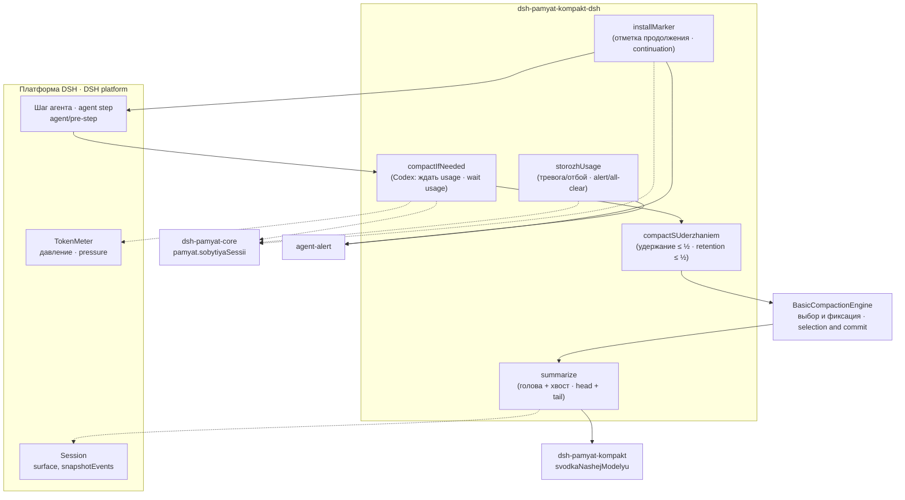
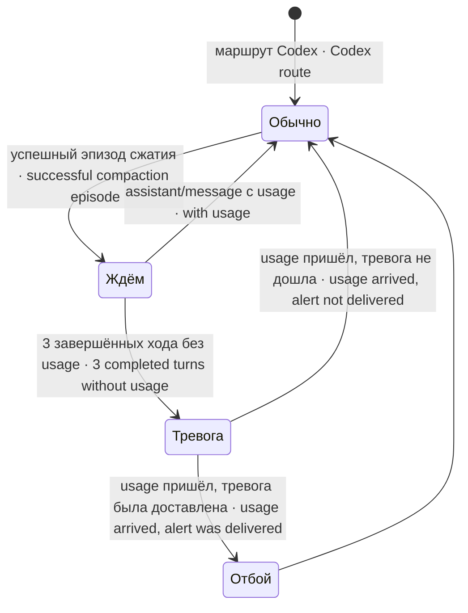
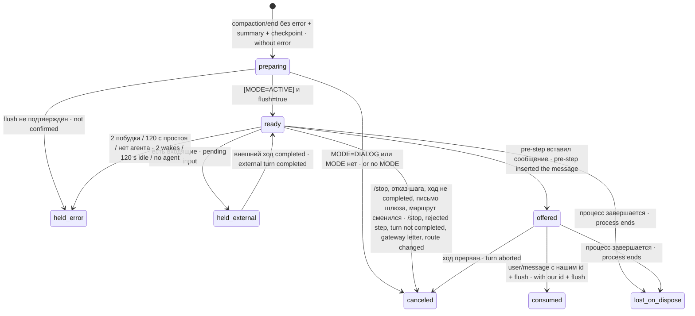

# Устройство · Architecture — dsh-pamyat-kompakt-dsh

## Состав · Components

| Файл · File | Что внутри · What is inside |
|---|---|
| `index.mjs` | движок `NashaSvodka` (наследник `BasicCompactionEngine`), сводка с хвостом, удержание ≤ ½ поверхности, ожидание свежего usage на маршруте Codex, сторож usage с тревогой и отбоем · the `NashaSvodka` engine (a `BasicCompactionEngine` subclass), summary with tail, retention ≤ ½ surface, waiting for fresh usage on the Codex route, the usage watchdog with alert and all-clear |
| `marker-step.mjs` | отметка продолжения после сжатия: фазы, побудка, вставка, аудит журнала при старте · the post-compaction continuation marker: phases, wake-up, insertion, journal audit at start-up |
| `continuation-mode.mjs` | чтение файла режима Codex-маркера · reading the Codex marker mode file |
| `stend-*.mjs` | 18 стендов (см. GUARDS.md) · 18 stands (see GUARDS.md) |

Код загружается так: платформа создаёт движок сжатия из пресета агента → `index.mjs` разрешает пакет сжатия платформы от исполняемого файла платформы (`process.argv[1]`), при ошибке — от себя (`import.meta.url`), иначе громкий отказ с обеими причинами, и соседний `dsh-pamyat-kompakt` по имени от себя → в конструкторе подключаются сторож usage и отметка продолжения.

Loading goes like this: the platform creates the compaction engine from the agent preset → `index.mjs` resolves the platform compaction package from the platform executable (`process.argv[1]`), on error — from itself (`import.meta.url`), otherwise a loud refusal naming both causes, and the sibling `dsh-pamyat-kompakt` by name from itself → the constructor attaches the usage watchdog and the continuation marker.

## Взаимодействие · Interaction



## Поток одного сжатия · Flow of one compaction

```mermaid
sequenceDiagram
  participant A as Агент · Agent (pre-step)
  participant E as NashaSvodka
  participant B as BasicCompactionEngine
  participant K as dsh-pamyat-kompakt
  participant L as API модели · model API
  A->>E: compactIfNeeded(agent, "pressure")
  alt маршрут Codex и ждём usage · Codex route and waiting for usage
    E-->>A: null + «давление НЕИЗВЕСТНО» · "pressure UNKNOWN"
  else
    E->>E: R = окно × retainRatio; M = min(R, ⌊S/2⌋)
    E->>B: compactIfNeeded с подставным retainTokens = M · with substitute retainTokens = M
    B->>B: выбор диапазона · range selection
    B->>E: summarize(голова · head)
    E->>E: vhodSHvostom: хвост + сверка стыка · tail + joint check
    E->>K: svodkaNashejModelyu(проза головы, проза хвоста, signal)
    K->>L: HTTPS
    L-->>K: сводка · summary
    K-->>E: текст · text
    E-->>B: summary (+ строка о хвосте · tail line)
    B->>B: фиксация · commit (compaction/summary, checkpoint, end)
    B-->>E: результат · result
    E-->>A: результат (Codex: дальше ждать usage · then wait for usage)
  end
```

## Удержание · Retention

| Обозначение · Symbol | Смысл · Meaning |
|---|---|
| R | удержание платформы: `retainTokens` или `⌊окно × retainRatio⌋` · platform retention: `retainTokens` or `⌊window × retainRatio⌋` |
| S | токены поверхности (`tokenMeter.measure().surfaceTokens`) · surface tokens |
| M | наше удержание `min(R, ⌊S × 0.5⌋)` · our retention |
| T | порог `⌊окно × thresholdRatio⌋` (для диагностики) · threshold (for diagnostics) |

| Случай · Case | Платформа · Platform | Пакет · Package |
|---|---|---|
| S ≥ 2R | выбирает хвост R · selects tail R | то же, побайтно · the same, byte-for-byte |
| R < S < 2R | хвост R · tail R | хвост ⌊S/2⌋ (меньше) · tail ⌊S/2⌋ (smaller) |
| S ≤ R | `null`: сжатия нет · no compaction | хвост ⌊S/2⌋, сжатие идёт · tail ⌊S/2⌋, compaction happens |
| ниже порога · below threshold | `null` | `null`, без строк · no lines |
| давление ≥ T, но выбрать нечего · pressure ≥ T but nothing to select | `null` молча · silently | `null` + строка с причиной · a line with the reason |

Подстановка устроена так: на время синхронной части `super.compactIfNeeded` поле `this.config` заменяется замороженной копией, где `retainTokens` — геттер, отмечающий прочтение. Сразу после вызова прежний конфиг возвращается. Если геттер не прочитан, платформа выбирала с R, и в журнал уходит строка «платформа НЕ прочла подстановку удержания».

The substitution works like this: for the synchronous part of `super.compactIfNeeded` the field `this.config` is replaced with a frozen copy where `retainTokens` is a getter that records being read. Right after the call the original config is restored. If the getter was not read, the platform selected with R, and the line "платформа НЕ прочла подстановку удержания" ("the platform did NOT read the retention substitute") goes to the log.

## Ожидание свежего usage · Waiting for fresh usage



«Ждём» определяется по журналу сессии с конца: если раньше успешной пары `compaction/summary` + `compaction/end` (без `error`, один `compactionId`) встретился ответ модели с `usage` — уже не ждём. Это долговечное состояние: повторное открытие сессии не стирает ожидание. Пока ждём, `compactIfNeeded` по давлению возвращает `null` и печатает «давление после сжатия НЕИЗВЕСТНО»; после самого сжатия цикл повторов платформы останавливается сразу после успешной фиксации.

"Waiting" is determined from the session journal walking backwards: if a model response with `usage` appears before a successful `compaction/summary` + `compaction/end` pair (no `error`, same `compactionId`), we are no longer waiting. This is durable state: reopening the session does not erase the wait. While waiting, a pressure `compactIfNeeded` returns `null` and prints "давление после сжатия НЕИЗВЕСТНО" ("pressure after compaction UNKNOWN"); right after the compaction itself the platform's retry loop is stopped as soon as the commit succeeds.

Метки тревог — файлы `<ключ>.json` в `<DSH_HOME или ~/.dsh>/kompakt-dsh/usage-alerts/` (каталог 0700, файлы 0600). Ключ — sha256 от сессии, времени её создания и пары seq эпизода. Метка создаётся с флагом `wx` до отправки (`status: reserved` → `command_ok` | `command_failed`), отбой пишется в ту же метку (`otboj: reserved` → `command_ok` | `command_failed`). Поэтому перезапуск процесса не повторяет ни тревогу, ни отбой.

Alert marks are `<key>.json` files in `<DSH_HOME or ~/.dsh>/kompakt-dsh/usage-alerts/` (directory 0700, files 0600). The key is sha256 of the session, its creation time and the episode's seq pair. The mark is created with the `wx` flag before sending (`status: reserved` → `command_ok` | `command_failed`); the all-clear is written into the same mark (`otboj: reserved` → `command_ok` | `command_failed`). So a process restart repeats neither the alert nor the all-clear.

## Отметка продолжения · Continuation marker



Каждая смена фазы — строка журнала `[continuation-marker] {"agent","key","session","compactionId","phase","reason","run"}` (в журнале — с приставкой `[kompakt-dsh <версия>]`; с 1.1.31 аудит берёт только строки этой полной формы с начала строки). Фазы `held_error` и `lost_on_dispose` дают одну попытку тревоги владельцу (сначала строка `alert-attempt`, потом исход). Вытеснение отметки новым эпизодом записывается своей фазой `superseded` с причиной «superseded by next compaction».

Every phase change is a log line `[continuation-marker] {"agent","key","session","compactionId","phase","reason","run"}` (in the journal — with the prefix `[kompakt-dsh <version>]`; since 1.1.31 the audit takes only lines of this full form from the line start). The phases `held_error` and `lost_on_dispose` give one alert attempt to the owner (first an `alert-attempt` line, then the outcome). A marker superseded by a new episode is recorded with its own phase `superseded` and the reason "superseded by next compaction".

Аудит при старте: один раз на имя агента в процессе пакет читает журнал своей службы за 7 дней (имя службы — из реестра агентов), находит отметки прежних запусков, не дошедшие до `consumed`/`canceled`, и шлёт по каждой одну тревогу. Это диагностика, а не восстановление: задача не возобновляется. С 1.1.29 после успешного аудита сохраняется курсор конца журнала службы, и следующий старт читает только записи после него (не дальше 7 дней). С 1.1.30 курсор сверяется с прошлым запуском службы по сообщению systemd «Started» (_PID=1): курсор позже него не принимается, окно — от прошлого запуска; так курсор, подделанный в доме агента, не скрывает отметок прежнего запуска. С B-N-1969 поиск сужен полем `SYSLOG_IDENTIFIER` (у части агентов в том же юните идёт поток чужих строк: zarya 10.10 — 7 сут без поля дольше 30 с, с полем 6,4 с). Идентификатор берётся у службы — `SyslogIdentifier`, иначе basename пути `ExecStart`, — а не зашит. До поиска пакет пишет строку «маяк аудита»; если отметок с полем 0, последняя строка `[kompakt-dsh` без поля (обычно этот маяк) обязана быть подписана тем же идентификатором, иначе аудит — слепота с тревогой, а не «0 отметок».

Start-up audit: once per agent name per process the package reads its own service journal for 7 days (the service name comes from the agent registry), finds markers of earlier runs that never reached `consumed`/`canceled`, and sends one alert for each. This is diagnostics, not recovery: the task is not resumed. Since 1.1.29 a successful audit saves the cursor of the service journal's end, and the next start reads only the entries after it (at most 7 days back). Since 1.1.30 the cursor is checked against the previous service start from the systemd "Started" message (_PID=1): a cursor later than it is not accepted, the window starts at the previous start; so a cursor forged in the agent's home cannot hide the previous run's markers. Since B-N-1969 the search is narrowed by the `SYSLOG_IDENTIFIER` field (some agents have a stream of foreign lines in the same unit: zarya 10.10 — 7 days without the field take over 30 s, with it 6.4 s). The identifier comes from the service — `SyslogIdentifier`, otherwise the basename of the `ExecStart` path — not hard-coded. Before the search the package writes a «маяк аудита» (audit beacon) line; with 0 markers under the field, the latest `[kompakt-dsh` line without the field (normally that beacon) must be labelled with the same identifier, otherwise the audit is blindness with an alert, not "0 markers".

## Экспорт · Exports

| Модуль · Module | Имя · Name | Что это · What it is |
|---|---|---|
| index.mjs | `default`, `NashaSvodka` | движок сжатия · the compaction engine |
| index.mjs | `pristavka(imya)` | приставка строки журнала `[имя версия]` · log line prefix |
| index.mjs | `vhodSHvostom(input, agent, pm)` | хвост и причина отказа `{ hvost, pochemu }` · tail and refusal reason |
| index.mjs | `STROKA_HVOSTA` | начало строки о хвосте (общий литерал с dsh-pamyat-restore) · start of the tail line (shared literal) |
| index.mjs | `DOLYA_POVERHNOSTI`, `uderzhanieOtPoverhnosti(R, S)` | 0.5 и `min(R, ⌊S × 0.5⌋)` |
| index.mjs | `marshrutCodex(target)` | признак маршрута Codex · Codex route predicate |
| index.mjs | `pomoshchnikYadra(ctx)`, `sobytiyaDlyaUsage(session, pm, skazat)` | доступ к журналу сессии · session journal access |
| index.mjs | `zhdyomUsage(session, pm, skazat)`, `poslednijEpizod(session, pm, skazat)` | ожидание usage и последний эпизод `{ summarySeq, endSeq }` · usage wait and last episode |
| index.mjs | `PREDEL_USAGE_HODOV`, `storozhUsage(ctx, opts)` | 3 и сторож usage · 3 and the usage watchdog |
| marker-step.mjs | `installMarker(ctx, opts)` | подключить отметку продолжения → `{ state(session), dispose() }` · attach the continuation marker |
| continuation-mode.mjs | `MODE_FILE`, `codexMarkerEnabled(agent, file)` | путь файла режима и проверка · mode file path and check |
