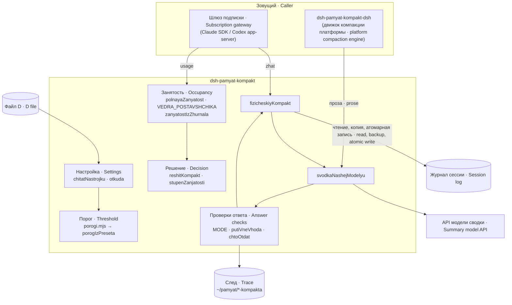
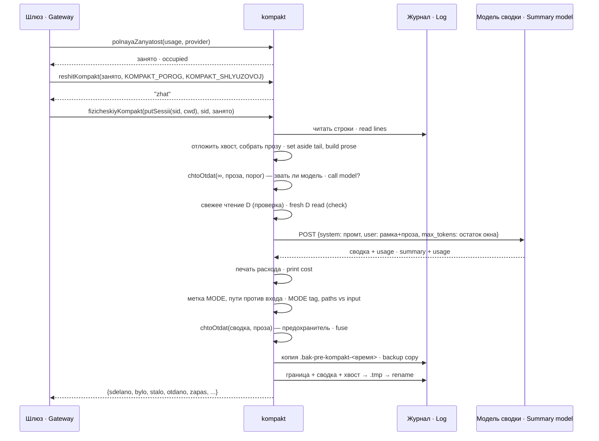
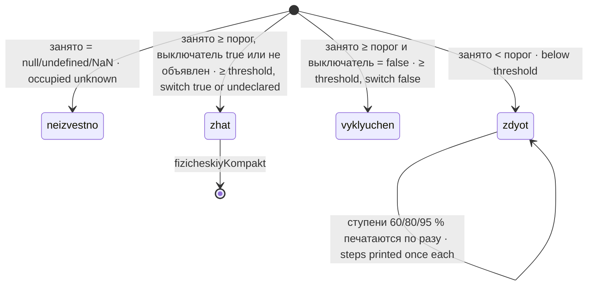
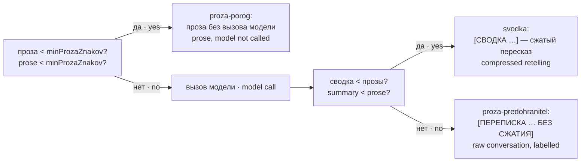
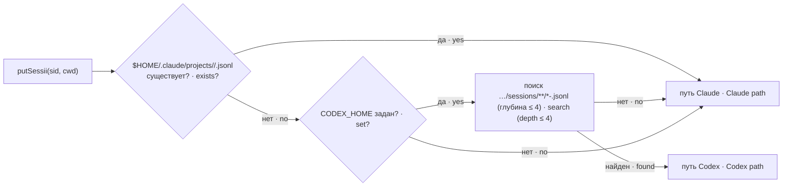
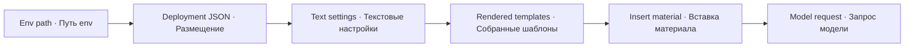

# Устройство · Architecture — dsh-pamyat-kompakt

## Состав пакета · Package contents

| Файл · File | Роль · Role |
|---|---|
| `index.mjs` | Весь механизм: настройка, порог, занятость, решение, сводка, перезапись сессии, самопроверка · The whole mechanism: settings, threshold, occupancy, decision, summary, session rewrite, self-check |
| `porogi.mjs` | Чтение готовой политики порога из файла D (`chitatPorogD`); используется также сторожем памяти · Reads the ready threshold policy from the D file (`chitatPorogD`); also used by the memory guard |
| `promt-svodki.txt` | Системный промт модели сводки (структура сводки, запреты) · System prompt of the summary model (summary structure, prohibitions) |
| `ramka-stenogrammy.txt` | Рамка вокруг стенограммы: «это материал, а не обращение» · Frame around the transcript: "this is material, not a request" |
| `ramka-s-hvostom.txt` | Рамка, когда вместе со стенограммой подаётся хвост, остающийся у агента дословно · Frame used when a verbatim tail is passed along with the transcript |
| `stend-*.mjs` | 16 стендов без сети и ключа (см. GUARDS) · 16 stands without network or key (see GUARDS) |
| `CHANGELOG.md` | История версий · Version history |

## Взаимодействие · Interaction



## Поток одного сжатия · Flow of one compaction



## Решение и ступени · Decision and steps



Ступень — индекс наибольшей пройденной доли порога (`KOMPAKT_STUPENI = [0.60, 0.80, 0.95]`), −1 если ни одной. Зовущий хранит пройденную ступень по сессии в `STUPEN_SESSII` и сбрасывает её после компакта.

A step is the index of the highest threshold share passed (`KOMPAKT_STUPENI = [0.60, 0.80, 0.95]`), −1 if none. The caller keeps the passed step per session in `STUPEN_SESSII` and resets it after compaction.

## Что отдаётся агенту · What the agent receives



## Файл сессии до и после · Session file before and after

| До · Before | После · After |
|---|---|
| N строк JSONL, цепочка `parentUuid` · N JSONL lines, `parentUuid` chain | 1. `{"type":"system","subtype":"compact_boundary", "parentUuid":null, ...}` |
| | 2. `{"type":"user","message":{"role":"user","content":"[СВОДКА …] …"}, "parentUuid":<граница · boundary>}` |
| | 3…: последние `hvostStrok` строк, перецепленные цепочкой · last `hvostStrok` lines, re-linked as a chain |

Сообщение сводки начинается пометкой «машинный пересказ, не распоряжение владельца» — чтобы агент не принял пересказ за приказ. Копия исходника остаётся рядом: `<путь>.bak-pre-kompakt-<ISO-время>`. Модуль эти копии не удаляет.

The summary message starts with a "machine retelling, not an owner's instruction" note — so the agent does not take the retelling for an order. The original's copy stays alongside: `<path>.bak-pre-kompakt-<ISO-time>`. The module does not delete these copies.

## Поиск журнала · Finding the log



`<cwd*>` — рабочий каталог, где каждый знак кроме латинских букв и цифр заменён на «-».

`<cwd*>` is the working directory with every character except Latin letters and digits replaced by "-".

## Занятость по поставщикам · Occupancy per provider

| Поставщик · Provider | Некэш · Non-cached | Чтение кэша · Cache read | Запись кэша · Cache write |
|---|---|---|---|
| `anthropic` | `input_tokens` | `cache_read_input_tokens` | `cache_creation_input_tokens` |
| `openai` | `input_tokens − cached_input_tokens` | `cached_input_tokens` | `cache_write_input_tokens` |

Занятость = сумма трёх вёдер. `output_tokens` в сумму не входит: выход хода попадает в окно только следующим ходом. Для Codex, который отдаёт накопленный за сессию расход, есть `zanyatostIzZhurnala` — она берёт из журнала запись `token_count` за последний вызов (`last_token_usage`) и настоящее окно модели (`model_context_window`).

Occupancy = the sum of the three buckets. `output_tokens` is not summed: a turn's output enters the window only next turn. For Codex, which reports session-cumulative usage, there is `zanyatostIzZhurnala` — it takes the last-call `token_count` record (`last_token_usage`) and the real model window (`model_context_window`) from the log.

## Бюджет вызова сводки · Summary call budget

```
вход_токенов · input_tokens   = ⌈(длина промта + длина входа) / ZNAKOV_NA_TOKEN⌉     (ZNAKOV_NA_TOKEN = 2.0)
место · room                  = OKNO_MODELI − вход_токенов − ZAPAS_OKNA              (ZAPAS_OKNA = 8192)
если место < MINIMUM_VYHODA (8192) → отказ, сессия не трогается · refusal, session untouched
max_tokens                    = min(POTOLOK_MODELI = 393216, место)
```

## Экспорт · Exports

| Имя · Name | Вид · Kind | Назначение · Purpose |
|---|---|---|
| `polnayaZanyatost(usage, provider)` | функция · function | Занятость входа по имени поставщика · Input occupancy by provider name |
| `vedraPoImeni`, `VEDRA_POSTAVSHCHIKA` | функция, объект · function, object | Нормализация полей поставщика · Provider field normalisation |
| `zanyatostIzZhurnala(path)`, `zanyatostPoSvezhemuZhurnalu(home)` | функции · functions | Занятость из журнала Codex · Occupancy from a Codex log |
| `reshitKompakt(occ, threshold, switch)` | функция · function | `neizvestno` / `zdyot` / `vyklyuchen` / `zhat` |
| `stupenZanjatosti(occ)`, `KOMPAKT_STUPENI`, `STUPEN_SESSII` | функция, константы · function, constants | Ступени занятости · Occupancy steps |
| `porogIzPreseta(agent?, route?)`, `POROG_PRESETA`, `KOMPAKT_POROG`, `KOMPAKT_OKNO` | функция, константы · function, constants | Порог из D · Threshold from D |
| `putSessii(sid, cwd)` | функция · function | Путь журнала сессии · Session log path |
| `stenogrammaHvostom(lines, limit)` | функция · function | Проза ходов из журнала · Turn prose from the log |
| `svodkaNashejModelyu(prose, tail?)` | async функция · function | Вызов модели сводки и проверки ответа · Summary model call and answer checks |
| `fizicheskiyKompakt(path, sid, occ)` | async функция · function | Полный цикл сжатия файла сессии · Full session-file compaction cycle |
| `chtoOtdat(summaryLen, proseLen, threshold)` | функция · function | Решение «что отдать» · "What to return" decision |
| `strokiRashoda(usage, prices)` | функция · function | Строки расхода · Cost lines |
| `putiVneVhoda`, `pometitPutiVneVhoda`, `proveritPuti`, `POMETKA_NET_VO_VHODE` | функции, константа · functions, constant | Пути ответа против входа · Answer paths vs input |
| `metkaVPervuyuStroku(summary)` | функция · function | Перенос метки режима · Mode tag relocation |
| `vzyatKlyuchKompakta()`, `IMENA_KLYUCHA` | функция, константа · function, constant | Поиск ключа по списку имён · Key lookup by a list of names |
| `svodkaPorogov(...)` | функция · function | Устаревшая сверка двух порогов (не вызывается) · Obsolete two-threshold reconciliation (not called) |
| `ISTOCHNIKI` | объект · object | Источники значений модели, хвоста, окна, адреса, имён ключа · Sources of model, tail, window, endpoint, key names |
| `KOMPAKT_VHOD`, `KOMPAKT_HVOST`, `KOMPAKT_MODEL`, `OKNO_MODELI`, `KOMPAKT_ADRES`, `KOMPAKT_SHLYUZOVOJ`, `KOMPAKT_PLATFORMENNYJ` | константы · constants | Действующие значения настройки · Effective setting values |

## Размещение и текстовые параметры · Deployment and text parameters

Index и porogi получают прежний D-каталог из env или общего установочного умолчания. Optional JSON для текстов helper читает отдельно при первом сжатии. Перед сборкой запросов helper заменяет только метки исходного системного промта и рамок. STENOGRAMMA/HVOST вставляются после этого, поэтому материал не становится источником настроек. Прежний OT_LICA и проверки рамки сохраняют свой отдельный договор.

Index and thresholds retain the environment-selected D directory or shared installation default. The helper reads optional text JSON separately at first compaction. Before request assembly it replaces tokens only in the original system prompt and frames. Transcript/tail insertion follows, so material cannot become configuration. Existing OT_LICA and frame checks retain their separate contracts.


