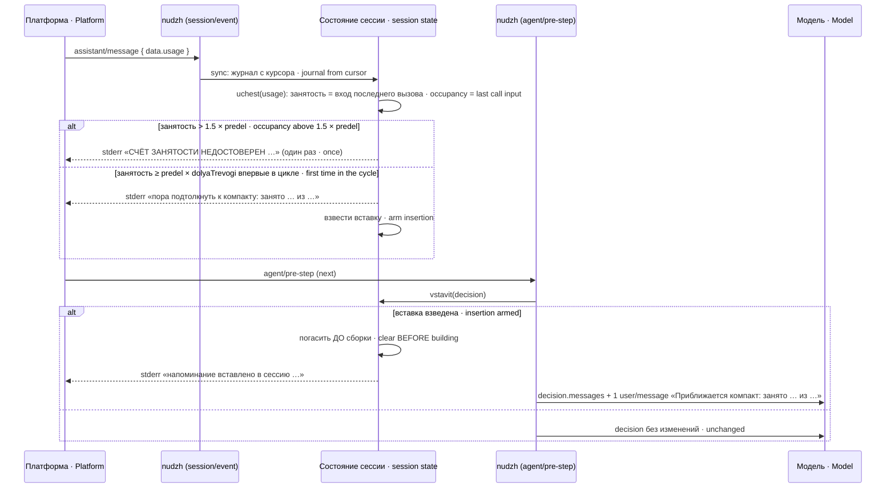
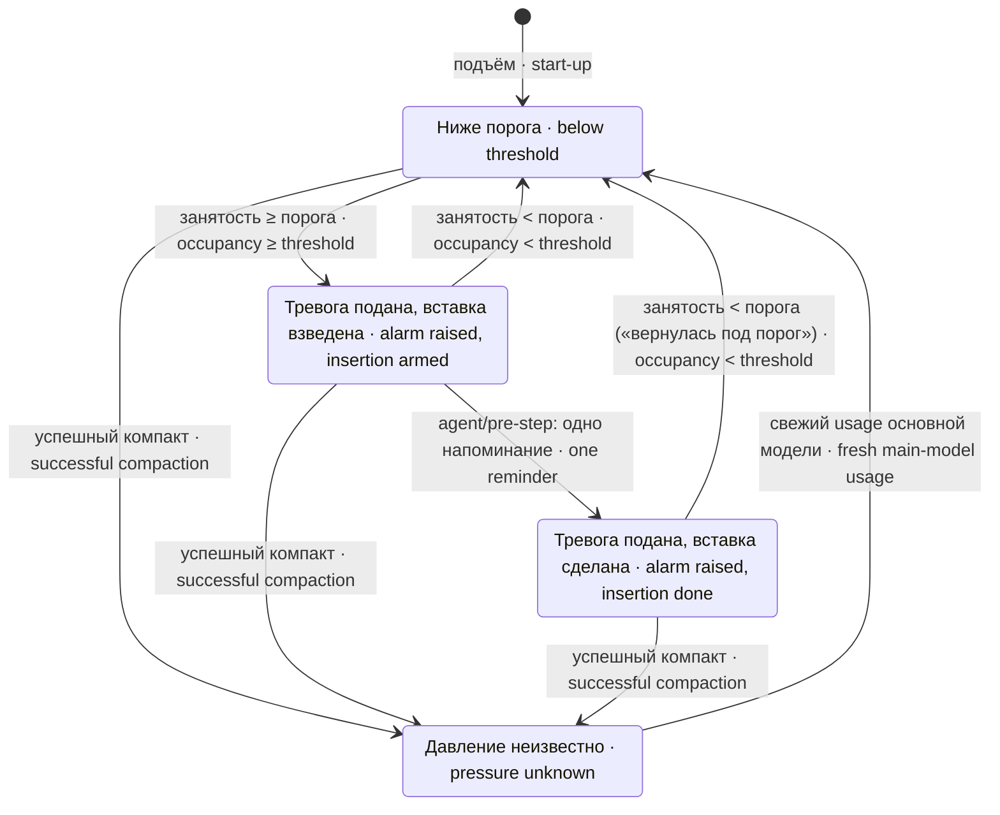
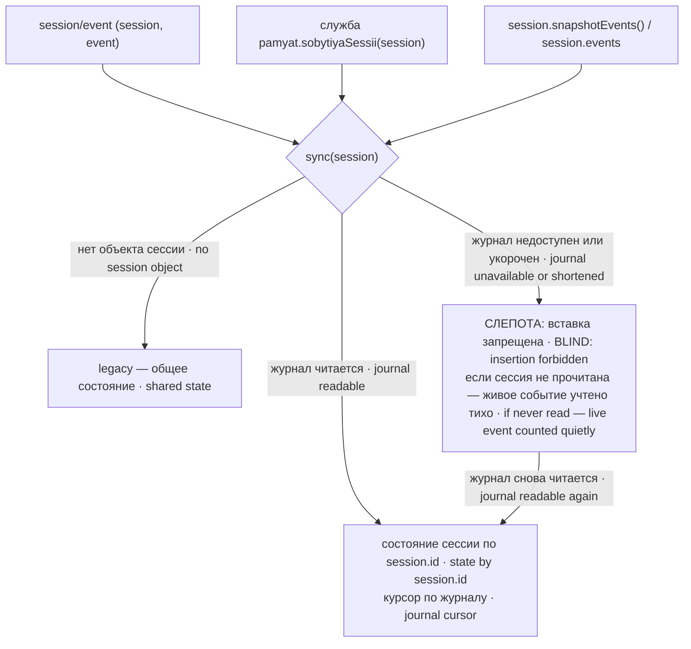

# Устройство · Architecture

Как устроен `dsh-pamyat-nudzh` внутри: файлы, служба, поток событий, цикл тревоги и состояние по сессиям. Всё сказанное снято с кода `src/index.js` и `src/schet.js` этой редакции.

How `dsh-pamyat-nudzh` works inside: files, the service, the event flow, the alarm cycle and per-session state. Everything here is taken from the code of `src/index.js` and `src/schet.js` of this revision.

## Файлы · Files

| файл · file | роль · role |
|---|---|
| `src/index.js` | плагин cordis: схема настроек `Config`, проверка порогов, состояние сессии `novoeSostoyanie`, служба `nudzhPamyati`, обработчики `session/event` и `agent/pre-step` · the cordis plugin: settings schema, threshold checks, session state, the service and the two handlers |
| `src/schet.js` | арифметика расхода: `raskhodVyzova(usage)` и копилка `zavestiSchet()` · spend arithmetic: `raskhodVyzova(usage)` and the accumulator `zavestiSchet()` |
| `test/stend-*.mjs` | восемь стендов, см. [GUARDS.md](GUARDS.md) · eight stands, see [GUARDS.md](GUARDS.md) |

## Служба · The service

При монтаже `apply(ctx, config)` проверяет пороги, печатает строку подъёма, публикует службу `ctx.nudzhPamyati` и подписывается на `session/event` и `agent/pre-step`. Процессных ресурсов (таймеров, слушателей `process`, сокетов) пакет не заводит: платформа зовёт `apply` несколько раз на один подъём (замер: 3).

On mount `apply(ctx, config)` checks the thresholds, prints the start-up line, publishes the `ctx.nudzhPamyati` service and subscribes to `session/event` and `agent/pre-step`. The package creates no process-wide resources (timers, `process` listeners, sockets): the platform calls `apply` several times per start-up (measured: 3).

| метод · method | вход · input | выход · output |
|---|---|---|
| `uchest` | `usage`, `session?` | без сессии — итог общего состояния; с сессией — ничего (учёт через журнал) · without a session — the total of the shared state; with a session — nothing (counted via the journal) |
| `itog` | `session?` | `neMenshe` (сумма, нижняя оценка · sum, lower bound), `zanyato` (занятость или `null` · occupancy or `null`), `vhod`, `vyhod`, `izNihRassuzhdenie`, `uchtenoVyzovov`, `bezChisla`, `polnyj` |
| `hvatitLi` | `session?` | `sostoyanie`: `porog-pereyden` или · or `neizvestno` (+ `pochemu`) и числа полноты · and completeness numbers |
| `raskhodVyzova` | `usage` | `vhod = inputTokens + cacheReadTokens + cacheWriteTokens`, `vyhod = outputTokens`, `vsego`, `izNihRassuzhdenie = reasoningTokens` |

`raskhodVyzova` бросает исключение, если `usage` не объект или поле не является неотрицательным конечным числом; отсутствующее поле считается нулём. Копилка `uchest(usage)` при `usage` `undefined` или `null` не бросает, а увеличивает `bezChisla`: отсутствие числа — незнание, а не ноль.

`raskhodVyzova` throws if `usage` is not an object or a field is not a non-negative finite number; a missing field counts as zero. The accumulator's `uchest(usage)` with `usage` `undefined` or `null` does not throw but increments `bezChisla`: a missing number is ignorance, not zero.

## Поток одного шага · Flow of one step

Напоминание собирается штатной фабрикой `createUserMessage` из `@deepseek-ai/dsh-llm/message` с источником `{ kind: 'plugin:dsh-pamyat-nudzh', form: 'snapshot' }`. Собранное вручную сообщение без поля `id` платформа сочла бы устаревшей записью. Решение `reject` и оборванный шаг (`signal.aborted`) пакет не трогает.

The reminder is built with the standard factory `createUserMessage` from `@deepseek-ai/dsh-llm/message` with source `{ kind: 'plugin:dsh-pamyat-nudzh', form: 'snapshot' }`. A hand-built message without an `id` field would be treated by the platform as an obsolete record. A `reject` decision and an aborted step (`signal.aborted`) are left alone.

## Цикл тревоги · The alarm cycle

Порог — `predel × dolyaTrevogi`, сравнение `≥`. Отметки пути печатаются до разбора тревоги, по одной на отметку за цикл, и сбрасываются вместе с тревогой. Счётчик шагов между тревогой и возвратом ведётся, пока тревога подана, и печатается в строке «вернулась под порог» как нижняя граница: шаги, оборванные до обработчика, в него не попадают.

The threshold is `predel × dolyaTrevogi`, compared with `≥`. Path marks are printed before the alarm analysis, one per mark per cycle, and are reset together with the alarm. The step counter between the alarm and the return runs while the alarm is raised and is printed in the "вернулась под порог" line as a lower bound: steps cut off before the handler are not counted.

«Успешный компакт» — это `compaction/summary` и затем `compaction/end` с тем же `compactionId` и без поля `error`. `compaction/end` без предшествующей сводки или с ошибкой давление не сбрасывает. Расход сводки (`usage` у `compaction/summary`) идёт только в сумму, занятость окна им не обновляется.

A "successful compaction" is `compaction/summary` followed by `compaction/end` with the same `compactionId` and no `error` field. A `compaction/end` without a preceding summary or with an error does not reset the pressure. The summary's spend (`usage` on `compaction/summary`) goes into the sum only; window occupancy is not updated by it.

## Состояние по сессиям · Per-session state

Журнал читается так: служба `pamyat` ядра памяти (`sobytiyaSessii`), иначе `session.snapshotEvents()`, иначе `session.events`. Унаследованная часть (`inheritedEventCount` или `seedLength`) отрезается: её расход принадлежит родительской сессии. Первый проход по журналу идёт тихо (восстановление), дальше события печатают как обычно. Негодное событие (например, отрицательное поле usage) учитывается как вызов без числа, давление становится неизвестным, а в stderr уходит «СЛЕПОТА nudzh: событие seq=…».

The journal is read like this: the memory core's `pamyat` service (`sobytiyaSessii`), otherwise `session.snapshotEvents()`, otherwise `session.events`. The inherited part (`inheritedEventCount` or `seedLength`) is cut off: its spend belongs to the parent session. The first pass over the journal is quiet (a restore), after that events print as usual. An invalid event (for example a negative usage field) counts as a call without a number, the pressure becomes unknown, and "СЛЕПОТА nudzh: событие seq=…" goes to stderr.

Если журнал недоступен, сессия становится слепой: вставка в неё запрещена, `itog(session).zanyato` и `hvatitLi(session)` дают `null` и «неизвестно». Если сессия ещё ни разу не была прочитана, живое событие учитывается тихо и помечает состояние «без якоря»; при первом удачном чтении журнала счёт начинается с нуля, чтобы не учесть событие дважды.

If the journal is unavailable, the session becomes blind: insertion into it is forbidden, `itog(session).zanyato` and `hvatitLi(session)` give `null` and "unknown". If the session has never been read yet, the live event is counted quietly and marks the state as unanchored; on the first successful journal read counting restarts from zero so the event is not counted twice.

## Вывод · Output

Все строки идут через `console.error` с приставкой `[dsh-pamyat-nudzh <версия>]`; версия читается из своего `package.json`, при сбое — «версия неизвестна». Перечень строк и их смысл — [GUARDS.md](GUARDS.md).

All lines go through `console.error` prefixed with `[dsh-pamyat-nudzh <version>]`; the version is read from our own `package.json`, on failure — "версия неизвестна" (version unknown). The list of lines and their meaning — [GUARDS.md](GUARDS.md).

## Многократный apply · Repeated apply

Каждый вызов `apply` заводит своё состояние и свою службу; «прежнее годное» значение порогов хранится на уровне модуля и общее для всех вызовов в процессе. Отсюда граница: если разные узлы одного процесса зададут разные пороги, «прежним годным» станет последнее принятое у любого из них. Проба 04.10: после `apply` с `predel: 1000` второй `apply` на другом подставном ctx с `predel: -1` напечатал «действует 1000 (прежнее годное)».

Every `apply` call creates its own state and its own service; the "previous valid" threshold value is stored at module level and shared by all calls in the process. Hence the boundary: if different nodes of one process set different thresholds, the "previous valid" becomes the last one accepted from any of them. Probe of 04.10: after `apply` with `predel: 1000`, a second `apply` on another fake ctx with `predel: -1` printed "действует 1000 (прежнее годное)".
