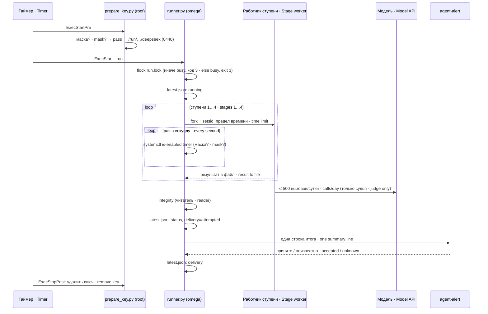
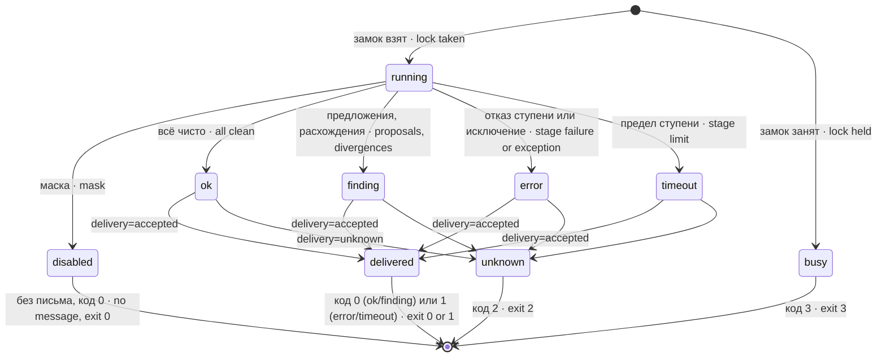
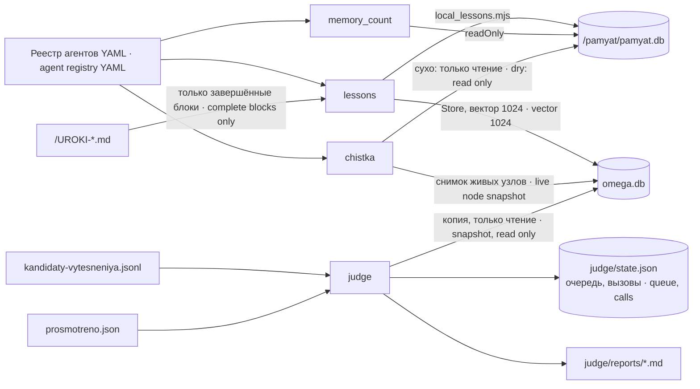
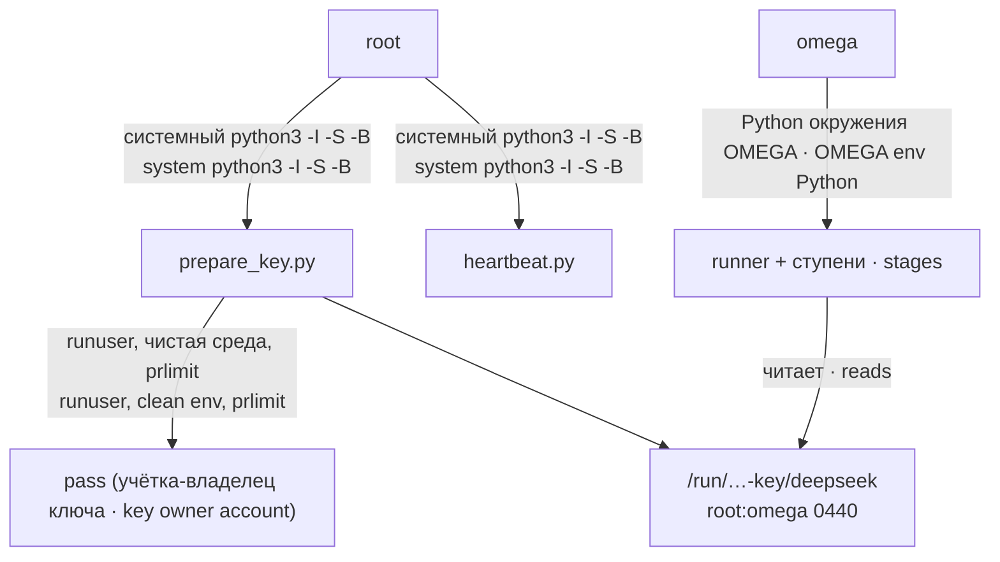

# Архитектура · Architecture — dsh-pamyat-obsluzhivanie

## Состав · Components

| Файл · File | Кто исполняет · Runs as | Что делает · What it does |
|---|---|---|
| `src/runner.py` | `omega` | единственный зовущий: замок, ступени, отчёт, итог · the only caller: lock, stages, report, summary |
| `src/memory_count.py` + `.mjs` | `omega` | ступень 1: счёт локальной памяти через ядро · stage 1: local memory count via the core |
| `src/lessons.py` | `omega` | ступень 2: уроки из файлов · stage 2: lessons from files |
| `src/local_lessons.mjs` | `omega` (Node) | локальная запись урока настоящим ядром · local lesson write via the real core |
| `src/lessons_store.py` | `omega` | точная запись в OMEGA и читатель целостности · exact OMEGA write and the integrity reader |
| `src/chistka.py` | `omega` | ступень 3: стирание старого текста (сухая по умолчанию) · stage 3: old text erasure (dry by default) |
| `src/judge.py` | `omega` | ступень 4: судья пар, очередь, лимит вызовов · stage 4: pair judge, queue, call limit |
| `src/svyazat_zadnim.py` | omega, вручную · manually | разовая связка/сухая проверка/откат; namerenie.sluzhba требуется перед --v-boj · one-off link/dry check/rollback; service key required before apply |
| `src/prosmotreno.py` | `omega`, вручную · by hand | отметки «просмотрено человеком» · "reviewed by a human" marks |
| `src/heartbeat.py` | root (копия · copy) | внешняя проверка живости · external liveness check |
| `src/prepare_key.py` | root (копия · copy) | ключ модели в `/run` до старта, удаление после · model key into `/run` before start, removal after |
| `systemd/*.service`, `*.timer` | systemd | расписание и границы службы · schedule and service bounds |

## Один прогон · One run

Каждая ступень — отдельный процесс с собственной группой (`setsid`). По концу ступени, по пределу или по маске runner шлёт группе `SIGTERM`, ждёт до 3 секунд и добивает `SIGKILL`: потомки, игнорирующие TERM, не переживают свою ступень.

Each stage is a separate process with its own group (`setsid`). At the end of a stage, on timeout or on a mask, runner sends the group `SIGTERM`, waits up to 3 seconds and finishes with `SIGKILL`: descendants that ignore TERM do not outlive their stage.

## Пределы времени · Time limits

| Что · What | Предел · Limit |
|---|---|
| служба целиком (юнит) · whole service (unit) | 60 мин + 90 с остановки · 60 min + 90 s stop |
| счёт памяти · memory count | 60 с на ступень, 5 с на базу · 60 s per stage, 5 s per DB |
| уроки · lessons | 900 с |
| чистка · cleanup | 900 с |
| судья · judge | 1800 с; один вызов модели — 30 с · one model call — 30 s |
| доставка итога · summary delivery | 90 с |

## Состояния прогона · Run states

Общий статус собирается так: начальное значение — статус судьи; рост очереди, пары с секретом, длинные пары или записи без векторов превращают `ok` в `finding`; затем любая ступень (уроки, аудит очереди, целостность, чистка, счёт) со статусом `error`/`timeout` делает итог `error`, а со статусом `finding` — превращает `ok` в `finding`.

The overall status is assembled as follows: it starts as the judge's status; queue growth, pairs with secrets, over-long pairs or records without vectors turn `ok` into `finding`; then any stage (lessons, queue audit, integrity, cleanup, count) with `error`/`timeout` makes the result `error`, and one with `finding` turns `ok` into `finding`.

## Потоки данных · Data flows

Что где хранится в каталоге состояния (по умолчанию `<state-dir>`, каталоги 0700, файлы 0600, запись атомарная):

What is stored in the state directory (default `<state-dir>`, directories 0700, files 0600, atomic writes):

| Путь · Path | Что · What |
|---|---|
| `latest.json` | последний отчёт прогона — его читает heartbeat · the last run report — heartbeat reads it |
| `runs/<run_id>.json` | отчёт каждого прогона · every run's report |
| `runs/<run_id>.{count,lessons,chistka,worker}.json` | результат работника каждой ступени · each stage worker's result |
| `run.lock` | замок прогона · run lock |
| `lessons.json` | закреплённые начала файлов, квитанции уроков, курсоры · pinned file prefixes, lesson receipts, cursors |
| `judge/state.json` | очередь пар, попытки, суточные вызовы · pair queue, attempts, daily calls |
| `judge/prosmotreno.json` | отметки человека · human marks |
| `judge/vydacha-<день>.json` | недельная выдача с текстами памяти, 0600; при отказе доставки остаётся · weekly payload with memory texts, 0600; retained after delivery refusal |
| `judge/reports/*.md` | отчёты судьи для человека · judge reports for a human |
| `chistka.json` | выключатель боевой чистки (кладёт человек) · real-cleanup switch (placed by a human) |
| `chistka/<агент>-<мс>.db` | страховки чистки, 3 последние на агента · cleanup backups, last 3 per agent |

Замок писателя уроков `uroki-exact-writer.lock` лежит рядом с `omega.db`, а не в каталоге состояния: два прогона с разными `--state-dir` всё равно не пишут уроки одновременно.

The lesson writer's lock `uroki-exact-writer.lock` sits next to `omega.db`, not in the state directory: two runs with different `--state-dir` still never write lessons at the same time.

## Права и учётные записи · Privileges and accounts

Root исполняет только две отдельные копии со стандартной библиотекой, системным Python с `-I -S -B`: так root не исполняет ничего из каталогов, куда может писать не-root. Основная работа идёт под `omega`, без sudo во время работы.

Root runs only two separate copies with the standard library, under system Python with `-I -S -B`: this way root executes nothing from directories writable by a non-root user. The main work runs as `omega`, with no sudo at runtime.
