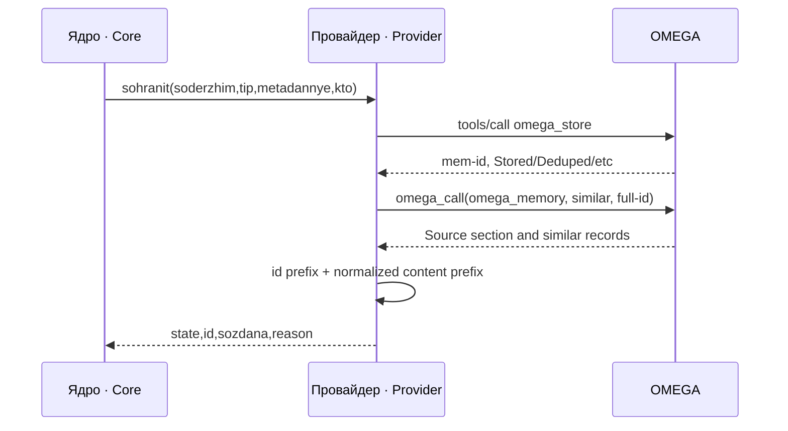
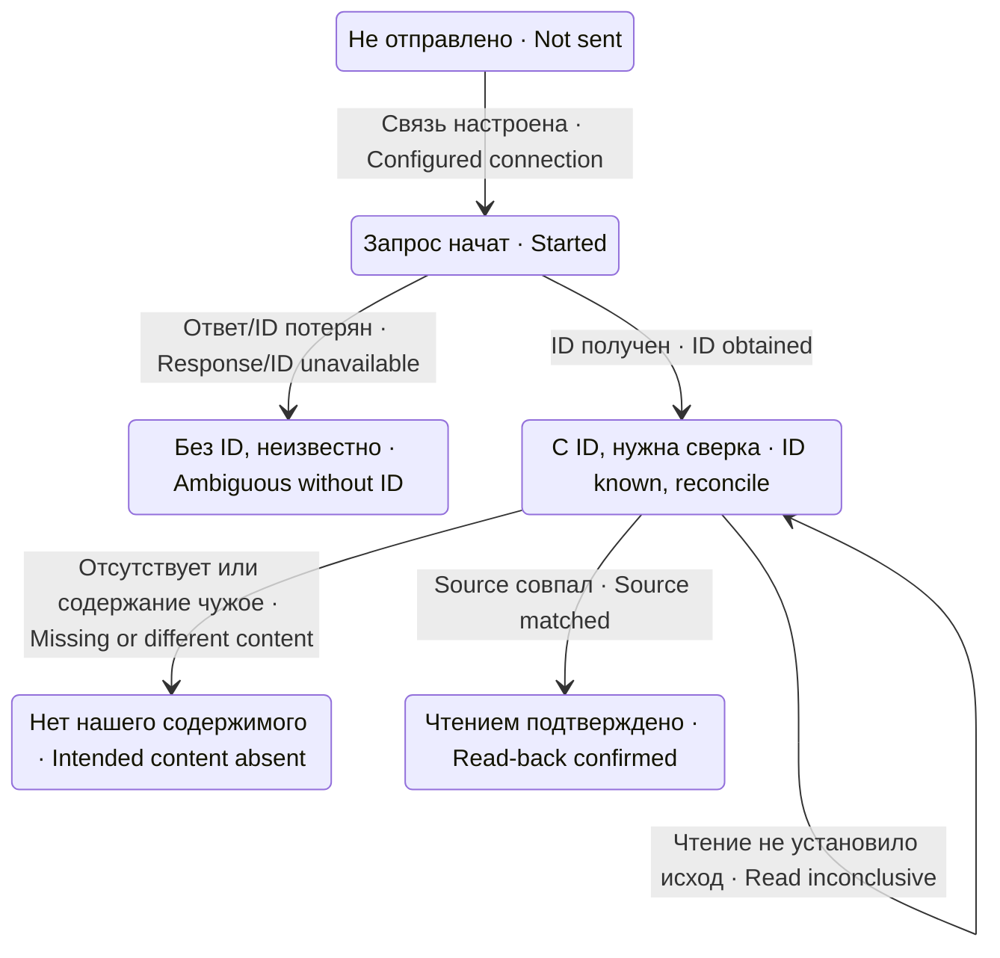
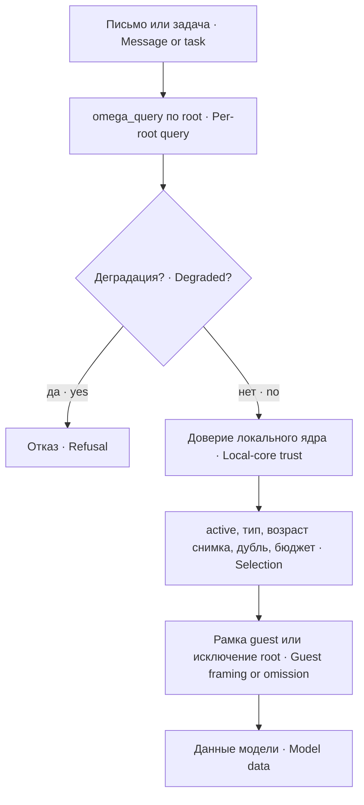

# Протокол, состояния и потоки · Protocol, states and flows



`svyaz.js` отправляет JSON-RPC `tools/call` POST. Ответ разбирается построчно как SSE `data:` или JSON-строка с result/error; первая подходящая полезная строка используется. Полное множество JSON-RPC-ответов и все варианты streaming-протокола не реализуются этим разборщиком.

`svyaz.js` sends a JSON-RPC `tools/call` POST. Replies are parsed line by line as SSE `data:` or JSON lines with result/error; the first useful payload is used. This parser does not implement every JSON-RPC or streaming variation.

Запрос bearer-ключа строится в процессе, не передаётся дочернему curl. Пакет читает secret из env по имени в Config и хранит его в замыкании соединения. Защитить env и память процесса должен установщик; это не обещание отсутствия ключа в environ.

The bearer header is constructed in-process rather than passed to a child curl command. The package reads the secret from the configured env name and retains it in a connection closure. Environment and process-memory protection are deployment responsibilities; this is not a promise that environ contains no key.



| API · Method | Результат · Result | Читатель · Reader |
|---|---|---|
| `dostupna()` / `pochemuNedostupna()` | Настройка связи, не network-health · Connection configuration, not network health | Ядро/оператор · Core/operator |
| `sohranit({soderzhim,tip,metadannye,kto})` | Пять состояний доставки плюс id/sozdana/pochemu · Five delivery states and identity/creation/reason | Конвейер ядра/очередь · Core write pipeline/queue |
| `proverit({id,obrazec})` | `est/net/ne-proveryali` | Retry-сверка ядра · Core retry reconciliation |
| `aktivnye({tekst,koren})` | `zapisi` либо `otkaz` · Records or refusal | Видимость записи ядра · Core record-visibility check |
| `pamyatPoSmyslu.najti(tekst, options)` | `vydano/otseyano` либо `otkaz` · Selected/rejected records or refusal | Автоподача и инструмент · Injection and tool |
| `pamyat_po_smyslu` | Текст с id, статусом и превью · IDs, status and previews | Модель в текущем scope · Model in current scope |

Внешний полный id нужен для чтения, но `Source` может показывать только его начало. Сверяется префикс id и нормализованное начало содержимого до 40 знаков только внутри секции Source; похожие записи ниже не являются подтверждением. Отсутствие образца даёт неизвестный результат. Иная разметка OMEGA требует нового контракта, а не угадывания парсером.

Read-back needs the full external ID, while `Source` may show only its prefix. The ID prefix and up to 40 normalized content-prefix characters are checked only within Source; similar records below it do not confirm delivery. A missing sample is inconclusive. Different OMEGA formatting requires a new contract rather than parser guessing.

`Stored` означает `sozdana=true`; `Deduped/Reconfirmed/Evolved` — `false`, иной текст — `null`. Этот признак независим от доставки. Ядро может отказаться связать локальное доверие с существующей внешней записью даже при подтверждённой доставке.

`Stored` yields `sozdana=true`; `Deduped/Reconfirmed/Evolved` yield `false`, and unfamiliar text yields `null`. This flag is independent of delivery. The core may refuse to link local trust to an existing external record even after successful delivery.

## Выдача и гостевые корни · Retrieval and guest roots



Автоподача запускается из `agent/pre-step` после `next()`, если решение не reject и сигнал не отменён. Письмо должно иметь подходящий источник и длину; уже поданные id хранятся в Map текущего процесса. После перезапуска защита повторной выдачи не сохраняется. Инструмент Б остаётся доступным при `avto=false`, если `vkl=true` и регистрация/доставка модели состоялись.

Automatic injection runs in `agent/pre-step` after `next()`, provided the decision is not reject and the signal is not aborted. A message needs an eligible source and sufficient length; already-injected IDs are retained in an in-process Map. This deduplication does not survive restart. Tool B remains available with `avto=false` when `vkl=true` and registration/model exposure succeed.

Многокорневой поиск делает отдельные root-ограниченные запросы, перемежает ранги и исключает повторные id. Отказ части root (поиск не состоялся) даёт частичный результат с пометкой «НЕПОЛНО» и именами немых root — в журнале и в ответе модели; деградация любого root и отказ всех root отвергают результат целиком (A-N-1727). В режиме `obertka` guest-текст сплющен и отмечен недоверенным по root запроса; в `vne` дополнительные guest-корни не запрашиваются. Собственный root включается всегда; в однокорневом режиме guest-классификация не применяется. Текст гостя не определяет его доверенный статус.

Multi-root retrieval uses separate root-constrained queries, interleaves ranks, and removes duplicate IDs. A failure of some roots yields a partial result marked incomplete with the silent roots named, in the journal and in the model answer; degradation of any root or failure of all roots rejects the result (A-N-1727). In `obertka` mode, guest text is flattened and marked untrusted by query root; `vne` omits additional guest roots. The configured own root is always included; single-root retrieval does not apply guest classification. Guest text does not decide its trust classification.

`keyword-only mode` означает деградацию, для которой фильтр root может не соблюдаться: выдача отказывается целиком. Auto также отвергает запись без связи доверия ядра; запросный режим допускает её с предупреждением. Мёртвые состояния `otmenena/oprovergnuta/otmetka-negodna` отсекаются в обоих режимах.

`keyword-only mode` indicates degradation where root filtering may not hold, so retrieval refuses the entire result. Auto also rejects records without a core trust link; task-driven retrieval may show them with a warning. Dead states `otmenena/oprovergnuta/otmetka-negodna` are filtered in both modes.


## Прямой поиск и ответственность вызывающего · Direct retrieval and caller responsibilities

pamyatPoSmyslu.najti(tekst, options) принимает rezhim/vseKorni/uzhe/skolko/sid. Без политики ядра прямой поиск отказывает до HTTP. При переданном sid проверяет исключение этой сессии; без sid вызывающий обязан проверить привязку сессии. Прямой service по-прежнему не усекает вход автоматически. aktivnye требует ту же доступную политику; proverit проверяет доставку известного id и не создаёт записи.

`pamyatPoSmyslu.najti(tekst, options)` accepts `rezhim`, `vseKorni`, `uzhe`, `skolko`, and `sid`. Direct retrieval refuses before HTTP without core policy and checks session exclusion when sid is supplied. Without sid, callers must prove session eligibility. Direct calls still do not truncate tekst automatically. aktivnye requires the same available policy and uses the primary 10,000 ms timeout. proverit verifies delivery of an existing id without creating a record.

## Эталон разметки и известные края проверки · Response fixtures and known parser edges

Синтетический ответ ниже соответствует распознаваемому Source и следующей похожей записи. Идентификаторы — искусственные примеры. Проверяется `includes` для первых 40 UTF-16 единиц нормализованного образца внутри Source, а не совпадение только начала Source.

The synthetic reply below matches the recognized Source and following similar-record boundary. IDs are artificial fixtures. Confirmation uses `includes` for the first 40 UTF-16 units of the normalized sample within Source; it does not require the beginning of Source to match.

```text
**Source:** `mem-11111111` — Example retained knowledge
with a second line.
## 1. [decision] `mem-22222222` (similarity: 0.5)
Another example, not confirmation of the Source.
```

Граница похожей записи распознаёт `## N. [type] ` + `mem-id` в backticks или старую форму `N. ` + `mem-id`; заголовок внутри самого знания не должен обрывать Source. Поиск `omega_query` ожидает отдельные блоки следующей формы и обрезает хвост Active Constraints.

The similar-record boundary recognizes `## N. [type] ` plus a backticked `mem-id`, or the older `N. ` plus `mem-id` form; a heading within knowledge must not truncate Source. `omega_query` expects separate blocks shaped as below and removes the Active Constraints tail.

```text
## 1. [decision] `mem-11111111` (str: 0.8) [active]
Example preview text
*2030-01-01T12:00Z*
```

Известные ограничения: regex отсутствия записи проверяет весь ответ ДО выделения Source, поэтому похожая строка `Memory ` + backticked `mem-id` + ` not found.` внутри знания может ошибочно дать `ne-najdeno`, даже для другого id. Образец из одних пробелов проходит проверку truthiness, нормализуется в пустую строку и затем может дать ложное `dostavleno`. Это найденные границы текущей реализации, не исправления документационного такта; для безопасной интеграции заранее отклоняй пустой после нормализации образец и не считай парсер полным доказательством содержания.

Known limits: the absence regex checks the whole reply BEFORE isolating Source, so a matching `Memory ` plus backticked `mem-id` plus ` not found.` line inside knowledge may incorrectly yield `ne-najdeno`, even for another ID. A whitespace-only sample passes truthiness, normalizes to an empty string, and may yield a false `dostavleno`. These are observed implementation boundaries, not fixes in this documentation task; reject samples empty after normalization and do not treat this parser as full content proof.
