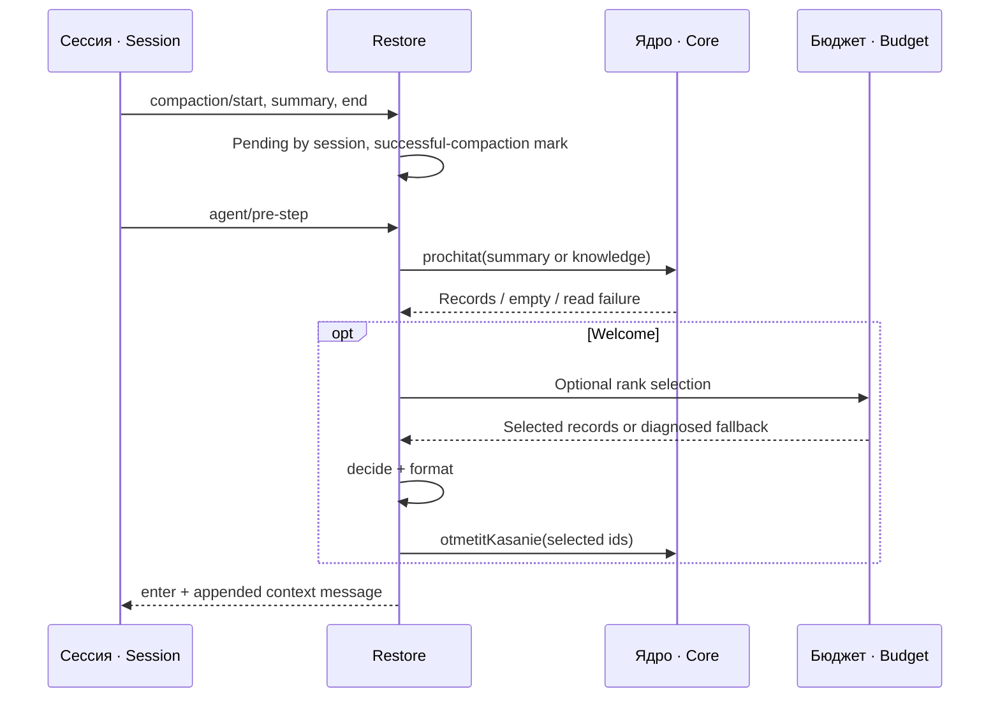
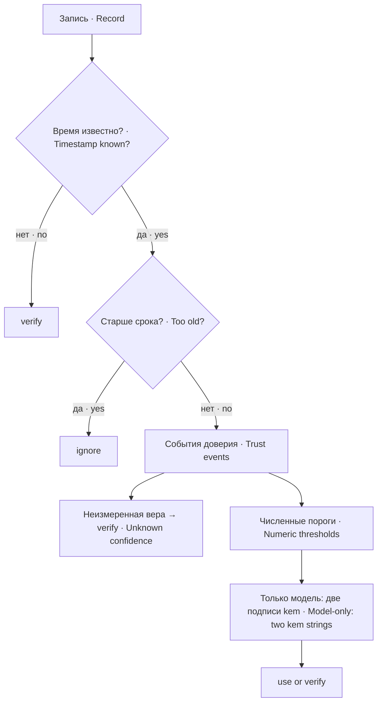
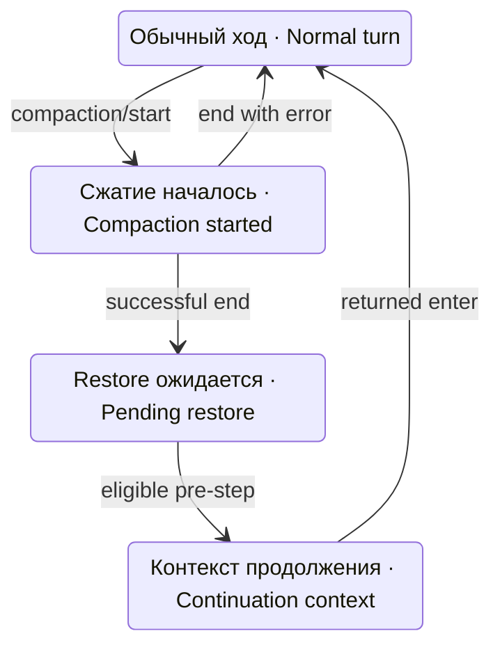

# Устройство и порядок отбора · Architecture and selection order

`readRecords` получает службу ядра через get, проверяет доступность, массив результата и переводит поля `klass/sozdano/vera/istochnik` в представление восстановителя. Null при отказе не равен пустому массиву. Запрос latest-summary идёт отдельно по klassSvodki, а не по месту сводки среди десяти последних знаний.

`readRecords` gets the core service, checks availability and array output, then adapts `klass/sozdano/vera/istochnik` into restore records. Null for a failure is not an empty list. Latest-summary lookup is a separate klassSvodki query, not a search within ten recent knowledge records.

## Решение welcome · Welcome decisions

Порядок — часть контракта: неизвестное время→verify; возраст больше ignoreAfterMs→ignore; затем события доверия. Для известных свежих времён отмена→ignore с видимой строкой; опровержение/негодная отметка/уточнение→verify; human confirmation→use. Только потом проверяются неизмеренная вера, нижний/верхний порог и происхождение оценок модели.

Order is part of the contract: unknown timestamp→verify; age above ignoreAfterMs→ignore; then trust events. With known fresh time, cancellation→ignore with a visible notice; refutation/invalid annotation/refinement→verify; human confirmation→use. Only then are unmeasured confidence, numeric thresholds and model-rating provenance examined.

Низкая вера сначала проверяется по ignore-порогу, затем use-порогу. Для model-only оценок одна положительная выдача не позволяет use даже при высоком числе; нужны две разные полные строки kem; независимость выдач гарантирует только корректный протокол ядра. Негодный JSON оценок даёт verify. Это процедура интерпретации, не строгая валидация любых произвольных чисел, поступивших мимо ядра.

Low confidence is tested against ignore before use. A single helped issuance is insufficient for model-only use even with a high numeric value; two distinct full kem strings are needed; independence of issuance depends on the core protocol. Invalid rating JSON yields verify. This is an interpretation procedure, not strict validation of arbitrary numbers supplied outside the core.

## Бюджеты и след выдачи · Budgets and issuance evidence

Предварительный `byudzhetPamyati.otobrat` необязателен. Если сервиса нет, он бросил ошибку или вернул негодный список, restore продолжает с исходными записями и диагностикой. Это ранжирующий отбор, отдельный от текстового welcomeBudget.

The preliminary `byudzhetPamyati.otobrat` is optional. Missing service, thrown error or invalid output falls back to original records with diagnosis. This is ranking selection, distinct from textual welcomeBudget.

Текстовый отбор допускает первую строку сверх остатка; последующие невместившиеся записи считаются отдельно. Видимые notices отмены собираются по всей выборке, идут в конец вне бюджета; первые 3 поимённые и перечень остальных не являются поданным содержимым и не получают касание. Служебная рамка/наставление и добавленная сводка также не ограничены общим 800 пределом.

Text selection permits the first line to exceed remaining budget, while later non-fitting records are counted separately. Visible cancellation notices are collected across the selection and placed at the end outside the budget; three detailed notices and the remaining-ID list are not content issuance and receive no access mark. Framing/instructions and an added summary also lie outside a total 800 ceiling.

Инъекция содержит source.kind=`plugin:dsh-pamyat-restore`, form=snapshot и sections с ids записей. След use идёт поимённо в журнал, verify/ignore — счётчиками причин; модель получает пометки и инструкцию оценки. `otmetitKasanie({ids,povod:'vydacha-agentu'})` вызывается до возврата сообщения; отказ касания не отменяет контекст. Запись факта касания сама по себе не доказывает durable-коммит сообщения.

Injection contains source.kind=`plugin:dsh-pamyat-restore`, form=snapshot and sections carrying record IDs. Logs name use items and count verify/ignore reasons; the model receives annotations and rating instructions. `otmetitKasanie({ids,povod:'vydacha-agentu'})` runs before message return; access-write refusal does not cancel context. A recorded access does not itself prove durable message commit.

## Сжатие, поверхность и восстановление · Compaction, surface and restoration

CompactionId связывает начало/конец и собственную сводку. Для собственного provider при совпадении id добавляется побуждение без повторной вставки; эта pending-ветка не проверяет фактическую поверхность. В остальных случаях latest-summary может оказаться старше рубежа; предупреждение видит модель, а не только оператор. Отсутствие времени даёт предупреждение «не сверено», не утверждение свежести.

CompactionId links start/end and the custom summary. A provider/compactionId match selects only a continuation prompt; pending restoration does not independently inspect surface presence. Otherwise the latest summary may predate the boundary; the model sees that warning, not merely the operator. Missing time yields unverified-age wording rather than claimed freshness.

Успех сжатия также отмечается атомарно через временный файл, fsync, rename и fsync каталога; поле scope связывает свидетель с настроенным путём отметок. Отдельный процессный набор welcomeDano и диск частоты выполняют разные роли. Повреждение частотного файла или ошибка его записи может разрешить повтор после подъёма.

Successful compaction is also recorded using a temporary file, fsync, rename and directory fsync; scope binds the evidence to the configured mark path. The in-process welcomeDano set and the disk frequency map serve different purposes. Corrupt frequency marks or failed persistence may permit a repeat after startup.

## Границы выборки, попытки и полной сводки · Selection, attempt and whole-summary limits

readRecords использует `prochitat({skolko:10,...vopros})`; отдельный запрос summary задаёт 1. Поиск доверия/ранжирование работают с уже полученной выборкой. Договор дополнительного бюджета синхронный: `otobrat({zapisi})`→`{podnyato:[...]}`. Promise или негодная форма дают диагностический fallback без этого отбора, не расширение входа.

readRecords calls `prochitat({skolko:10,...vopros})`; the separate summary call sets1. Trust and ranking operate on that retrieved subset. The additional-budget contract is synchronous: `otobrat({zapisi})`→`{podnyato:[...]}`. A Promise or invalid shape gives a diagnosed fallback without this ranking, not a larger input.

PendingRestore удаляется до чтения summary. WelcomeDano и diskmark устанавливаются до чтения знаний. Если читатель отказывает, следующая pre-step не повторяет тот же прочитанный повод автоматически. Новый успешный compaction может снова поставить pending; периодический welcome для того же sid process set не организует.

PendingRestore is deleted before the summary read. WelcomeDano and its diskmark are set before knowledge retrieval. Reader failure does not automatically retry the same consumed trigger on the next pre-step. A new successful compaction can set pending again; the process set does not organize periodic welcome for the same sid.

В welcome полная сводка читается отдельно и вставляется вне decide, возраста и доверия строк знаний. В pending-restore сводку сравнивают с временным рубежом и предупреждают при старом/неизвестном времени; это не доказательство точного соответствия summary текущей сессии. Выборка latest по классу не содержит отдельного session-фильтра.

Welcome separately reads and attaches the full summary outside knowledge-line decide, age and trust. Pending restoration compares summary time with its temporal boundary and warns on old/unknown time; this does not prove exact correspondence to the current session. Latest-by-class retrieval has no separate session filter.

Способ определения поверхности различается: pending своего компактора узнаётся по событиям provider/id; welcome отдельно использует svodkaNaPoverhnosti. Telegram-v2 не принимает глобальную сводку после чужого compaction; welcome получает — знания без сводки компакта, предел `welcomeInterval` на сессию (A-N-1719, B-N-1762); совпавший собственный compaction допускает побуждение. Эти условия не являются одной общей проверкой поверхности.

Surface handling differs: pending custom compaction is recognized by provider/id events; welcome separately uses svodkaNaPoverhnosti. Telegram-v2 rejects a global summary after another compactor; it does receive welcome — knowledge without the compaction summary, with the per-session `welcomeInterval` limit (A-N-1719, B-N-1762); a matching custom compaction permits a continuation prompt. These are not one universal surface check.
