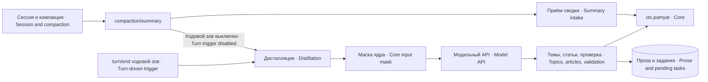

# dsh-pamyat-secretary — сводки и дистилляция знаний · Summaries and knowledge distillation

**Версия:** 3.1.2

Секретарь DSH сохраняет сводку вытесняемой истории в локальную память и, при отдельном включении, извлекает знания через модельный API с проверяемой ссылкой на исходные события.

The DSH secretary saves a summary of displaced history into local memory and, when separately enabled, extracts knowledge through a model API with traceable source-event references.

## Зачем нужен · Purpose

Сжатие беседы сохраняет оперативный контекст, но не превращает каждое утверждение в устойчивое знание. Сводка может содержать временные планы, отменённые идеи и служебный шум. Секретарь сохраняет её отдельным классом, а для решений, уроков и фактов использует отдельный конвейер с происхождением, фильтром и журналом исходов.

Conversation compaction preserves working context but does not turn every statement into durable knowledge. A summary can contain temporary plans, cancelled ideas and service noise. The secretary retains it as a separate class and uses a distinct pipeline for decisions, lessons and facts, with provenance, filtering and outcome logs.

Пакет не пишет в сессию саму сводку: она уже произведена механизмом компакции. Он подписывается на событие, читает исходный диапазон и пишет через `ctx.pamyat`. Нужен `inject=['pamyat']`: самостоятельная копия хранилища или фильтра ядра не создаётся.

The package does not write into the session to insert its summary: compaction has already produced it. It subscribes to events, reads the source range and writes through `ctx.pamyat`. `inject=['pamyat']` is required; it creates no independent copy of core storage or filtering rules.



## Установка и быстрый старт · Installation and quick start

Нужен Node с экспортом `node:zlib.zstdDecompressSync`: в ветке 22 это 22.15.0+. Статический импорт выполняется даже при выключенной дистилляции ([официальная документация](https://nodejs.org/download/release/v22.15.1/docs/api/zlib.html#zlibzstddecompresssyncbuffer-options)). Нужны также peer Cordis `^4.0.1`, Schemastery `^3.18.1`, локальное ядро памяти и поддерживаемые события DSH. Для `npm test` нужен POSIX shell. Сжатые журналы читаются встроенным zstd, не внешним decompressor; системная диагностика использует journalctl при вызове соответствующего читателя. Поле `engines` в `package.json` — `>=22.15.0`; на нестандартной сборке Node проверь экспорт до установки.

Node must export `node:zlib.zstdDecompressSync`, available in the 22 branch from 22.15.0. The static import runs even with distillation disabled ([official documentation](https://nodejs.org/download/release/v22.15.1/docs/api/zlib.html#zlibzstddecompresssyncbuffer-options)). Also required are peer Cordis `^4.0.1`, Schemastery `^3.18.1`, the local memory core, and supported DSH session events. `npm test` needs a POSIX shell. Compressed logs use built-in zstd, not an external decompressor; system diagnostics use journalctl when that reader is invoked. The `engines` field in `package.json` is `>=22.15.0`; on a non-standard Node build verify the export before installing.

```sh
npm install ./dsh-pamyat-secretary-<версия · version>.tgz   # архив пакета (npm pack) · package archive
# из реестра — только после публикации; сейчас там старое поколение 0.1.0-alpha.* · from the registry only after publication; it now holds the old 0.1.0-alpha.* generation
# npm install dsh-pamyat-secretary
```

Начни с локальных сводок без платного вызова. Ядро должно быть подключено раньше через зависимость `pamyat`; каталог непринятых данных выдели отдельно и защити правами пользователя платформы.

Start with local summary capture and no paid calls. The core must be available through the `pamyat` dependency; provision a separate rejected-data directory protected by the platform account's permissions.

```yaml
- name: dsh-pamyat-secretary
  id: memory-secretary
  config:
    vklyuchen: true
    klass: svodka-kompakcii
    putOtklonennyh: /var/lib/example-memory/pending
    distillyaciya: false
    komandaTrevogi: ''
```

Проверь строку подъёма, проведи тестовое сжатие и отдельно прочти запись по её источнику через ядро. Сводка и знания — разные результаты; «сводка записана» не означает, что дистилляция была включена или успешно завершилась.

Inspect the startup message, compact a test session and independently retrieve the stored record by source through the core. Summary and knowledge outcomes differ; summary stored does not mean distillation was enabled or completed.

Для дистилляции нужен источник событий (они передаются прямо из сессии; файлового fallback нет, `putZhurnala` снят и на готовность не влияет), один источник ключа, `model` и доступ к поддерживаемому HTTP endpoint. Строка подъёма называет включённую дистилляцию готовой, только если назван источник ключа (`klyuchFajl`, `klyuchPass` или `klyuchOkruzhenie`); иначе она пишет «ВКЛЮЧЕНА, НО НЕ ГОТОВА». По умолчанию `distillyaciya=false`: платный API включается явно. Не помещай значение ключа в config или argv; `klyuchFajl`, `klyuchPass`, `klyuchOkruzhenie` задают только адрес источника. Значения находятся в памяти процесса, а env-источник также доступен окружению процесса.

Distillation needs source events (passed directly from the session; there is no file fallback, `putZhurnala` was removed and does not affect readiness), one key source, `model`, and access to a compatible HTTP endpoint. The startup line reports enabled distillation as ready only when a key source is named (`klyuchFajl`, `klyuchPass` or `klyuchOkruzhenie`); otherwise it says «ВКЛЮЧЕНА, НО НЕ ГОТОВА» (enabled but not ready). `distillyaciya=false` is the default: paid API use is explicit. Never put the key value in config or argv; `klyuchFajl`, `klyuchPass`, and `klyuchOkruzhenie` identify its source. Values reside in process memory; an env-based source is also present in the process environment.

## Настройки · Settings

| Группа · Group | Основные ключи · Keys |
|---|---|
| Сводка · Summary | `vklyuchen`, `klass`, `putOtklonennyh` |
| Дистилляция · Distillation | `distillyaciya`, `rassuzhdeniya`, `model`, `adres` |
| Источник ключа · Key source | `klyuchFajl`, `klyuchPass`, `klyuchOkruzhenie` |
| Бюджет и окна · Budget and windows | `maxTokenovTem`, `maxTokenovStati`, `predelTem`, `minTokenov`, `razmerOkna`, `predelOkon`, `hvost` |
| Отношения · Relationships | `sudPovtor.vkl` |
| Ходовой вызов · Turn-driven triggering | `hodovojZov.vkl`, `porogZnakov`, `neudachPodryad`, `pauzaMinut` |
| Тревоги · Alerts | `komandaTrevogi` |

Полная таблица каждого поля, источники данных и оперативные выключатели находятся в [SETTINGS](docs/SETTINGS.md). «0» у выходного бюджета и «0» у минимального входа имеют разные смыслы; читай действие конкретного потребителя, не только имя поля.

Every field, data source, and live switch is documented in [SETTINGS](docs/SETTINGS.md). Zero for an output budget and zero for a minimum input are different decisions; read the actual consumer behavior rather than inferring from the name.

## Как работает · Operation

При `compaction/summary` сначала разбирается и сохраняется сводка. Неожиданный сбой приёма останавливает этот проход; выключенная дистилляция не отменяет уже обработанную сводку. Синхронная ошибка сборки дистилляции и последующий асинхронный отказ имеют отдельные следы.

On `compaction/summary`, the summary is parsed and saved first. An unexpected intake failure stops that pass; disabling distillation does not undo the handled summary. A synchronous assembly error and a later asynchronous distillation failure have separate diagnostic traces.

Дистиллятор читает выбранные seq-события, речь и разрешённый хвост, затем маскирует вход внешней модели методом ядра. Если маски нет, вызов не начинается. Текущий диапазон может быть целым или разбитым на окна; ограничение числа окон сохраняет отброшенный материал как отдельный предмет, а не объявляет его обработанным.

The distiller reads selected seq events, speech and an allowed tail, then masks model-bound input using the core method. Without that mask, no call starts. A range can be whole or split into windows; a window-count limit retains omitted material separately rather than claiming it was processed.

Модель выбирает темы, затем пишет отдельную статью по каждой. JSON-разбор и проверка классов отделены от успеха транспорта. Ответ выбора тем, который не разобрался как JSON-массив (проза), сохраняется отдельно — файлом `proza-*` в каталоге `putOtklonennyh`; без каталога stderr пишет, что сырой ответ НЕ сохранён. Непустая статья с stop_reason=max_tokens получает отказ до суда и записи (исход statya-oborvana): она не сдвигает «воду» и допускает повтор. `[предположение]` остаётся видимой отметкой неопределённости. Решение о записи и фильтр выполняет ядро.

The model first chooses topics and then writes an article for each. JSON parsing and class validation are separate from transport success. Invalid prose (a topic-selection reply that does not parse as a JSON array) is retained separately as a `proza-*` file in `putOtklonennyh`; without that directory stderr reports that the raw reply was NOT saved. A nonempty article with stop_reason=max_tokens is refused before judgment and storage; statya-oborvana prevents watermark advancement and permits retry. `[предположение]` remains an explicit uncertainty marker. The core owns write policy and filtering.

При сравнении с прежними знаниями рассматриваются действующие кандидаты. Модельное решение об отмене требует подходящего класса; доказанно более новая запись защищена, но неизвестное время источника само по себе отмену не запрещает; обрезанный кандидат понижает отмену до уточнения. Обычный суд отмены/уточнения от этого флага не зависит; `sudPovtor.vkl` добавляет режим распознавания повтора и отключён по умолчанию. Суд модели не равен независимой человеческой приёмке.

Comparison uses active previous knowledge candidates. A model cancellation verdict requires an eligible class; a proven newer record is protected, but unknown source time alone does not block cancellation; a truncated candidate downgrades cancellation to refinement. Ordinary cancellation/refinement judgment is independent of this flag; `sudPovtor.vkl` adds repeat recognition and is disabled by default. Model judgment is not independent human acceptance.

Прерывание процесса оставляет метку/задание в защищённом каталоге. Автоповтор делает ограниченную попытку только для среза, для которого счётчик окон 1–64 вернул 0; частичная или неизвестная запись, обнаруженная счётчиком окон 1–64, не допускает полного автоматического повтора; записи вне этого диапазона счётчик не видит. Ходовой зов отслеживает новое окно речи после конца хода и сдвигает сохранённую «воду» только по допустимому исходу.

Process interruption leaves a marker/task in a protected directory. Automatic retry performs a bounded attempt only for a slice whose window 1–64 counter returned 0; partial or unknown writing detected by the window 1–64 counter prevents full automatic retry; records outside that range are not observed. Turn-driven triggering selects new speech after turn end and advances the persisted high-water mark only for an eligible result.

## Что доказано и что не доказано · What is and is not proven

Стендом можно подтвердить МЕХАНИЗМ записи и сохранение происхождения; СОДЕРЖАНИЕ не доказано этим успехом. Модель может ошибиться в выделении темы или оценке знания. Нужны реальные сравнения с источником и дальнейшие события доверия ядра.

A stand may report “MECHANISM proven” for storage and provenance within its fixture; CONTENT is not proven by that success. The model can misidentify a topic or misjudge knowledge. Real source comparisons and later core trust events remain necessary.

Пакет использует свой транспорт диагностики `console.error`, чтобы сообщение не оставалось в буфере непрочитанного логгера. Подключённый logger сам по себе не доказывает читателя; [GUARDS](docs/GUARDS.md) называет, кто должен видеть stderr, задания и исходы вызовов.

The package uses its own transport for diagnostics, `console.error`, rather than leaving messages in an unread logger buffer. A logger's presence does not prove there is a reader; [GUARDS](docs/GUARDS.md) identifies readers for stderr, tasks and call outcomes.

## Проверки, границы и авторство · Checks, limits and authorship

`npm test` проходит все `test/stend-*.mjs`. [ARCHITECTURE](docs/ARCHITECTURE.md) содержит потоки и состояния; [GUARDS](docs/GUARDS.md) — предмет и предел каждой защиты; [TROUBLESHOOTING](docs/TROUBLESHOOTING.md) — восстановление. Части стендов нужны соседние пакеты и внешние данные: отсутствие предмета — слепота, а не зелёный результат. Например, в `stend-hodovogo-zova` проба 5 читает копию журнала сессии из переменной `STEND_ZHURNAL_KODERA` (`.jsonl` или `.zstd`; сжатый журнал стенд распаковывает внешним `zstdcat`) и без переменной слепа; проба 6 импортирует маску из пакета `dsh-pamyat-core` и без него слепа.

`npm test` runs all `test/stend-*.mjs`. [ARCHITECTURE](docs/ARCHITECTURE.md) covers flows and states; [GUARDS](docs/GUARDS.md) covers each guard's scope and bound; [TROUBLESHOOTING](docs/TROUBLESHOOTING.md) covers recovery. Some stands need neighboring packages and external data: an absent subject is insufficient visibility, not success. For example, in `stend-hodovogo-zova` probe 5 reads a copy of a session journal from the `STEND_ZHURNAL_KODERA` variable (`.jsonl` or `.zstd`; the stand unpacks a compressed journal with the external `zstdcat`) and is blind without it; probe 6 imports the mask from the `dsh-pamyat-core` package and is blind without it.

Секретарь не гарантирует истинность вывода модели, отсутствие всех секретов после эвристической маски или внешнюю доставку после локальной записи. Он не устанавливает внешние systemd-сторожа и не создаёт резервную копию базы. Изолированные сессии требуют рабочего метода исключения ядра и корректной интеграции каждого consumer.

The secretary guarantees neither model-output truth, detection of every secret by a heuristic mask, nor external delivery after a local write. It installs no external systemd monitors and creates no database backup. Isolated sessions require a working core exclusion method and correctly integrated consumers.

MIT (`"license": "MIT"` в `package.json`, текст — [LICENSE](LICENSE); в `files` файл не назван, но npm кладёт его в архив пакета сам); Iia-arg team. Общая документация и исходники: [dsh-plugins](https://github.com/iia-arg/dsh-plugins).

MIT (`"license": "MIT"` in `package.json`, text in [LICENSE](LICENSE); the file is not listed in `files`, but npm adds it to the package archive by itself); Iia-arg team. Shared documentation and source: [dsh-plugins](https://github.com/iia-arg/dsh-plugins).

Проверка обязательной возможности Node не вызывает API:

This Node capability check makes no API request:

```sh
node --input-type=module -e "import { zstdDecompressSync } from 'node:zlib'; console.log(typeof zstdDecompressSync)"
```

## Проверенная ОС · Verified operating system

Документационные проверки и названные стенды этого кандидата выполнялись на Linux. Поддержку иной ОС и переносимость файловых/процессных операций отдельно не проверяли; каталог памяти и секретов должен быть доступен только назначенной учётке.

Documentation checks and the named stands for this candidate ran on Linux. Other operating systems and file/process-operation portability were not separately verified; memory and secret directories need the designated account's access policy.
