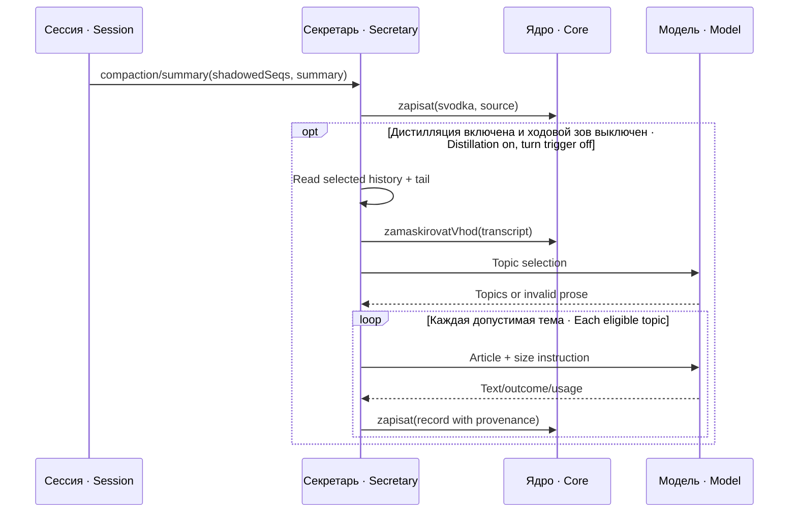
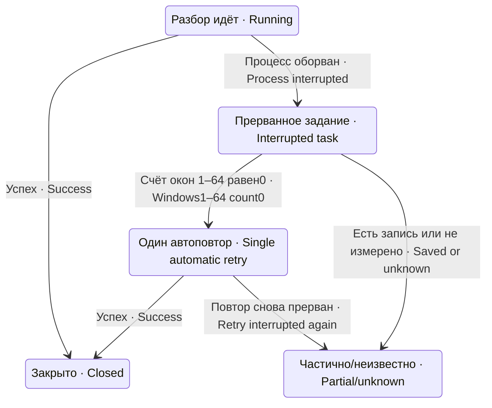

# Структура, события и состояние · Structure, events and state

| Файл · File | Роль · Responsibility |
|---|---|
| `index.js` | Подписки, readiness, сводка, состояние/метки и команды · Subscriptions, readiness, summary, markers and commands |
| `razbor-sobytiya.js` | Разбор входного события сводки · Parse incoming summary event |
| `chtenie-zhurnala.js` | Извлечь исходные seq и речь · Read source seq range and speech |
| `distill-shov.js` | Окна, темы, статьи, кандидаты/отношения, статистика · Windows, topics, articles, candidates/relations and stats |
| `distillyaciya.js` | Ключ, один HTTP вызов, ограниченный networkretry, JSONparse · Key, HTTPcall, bounded retry and parsing |
| `promty.js` | Классы и шаблоны запросов модели · Classes and model request templates |
| `distill-srez.js` | Ручной срез, чтение журнала, закрытие заданий · Manual slice, recovery reading and task closure |
| `avtopovtor.js` | Ограниченная попытка прерванного среза · Bounded retry of interrupted slices |
| `hodovoj-zov.js` | Порог речи, вода, пауза/сериализация · Speech threshold, high-water mark, pause/serialization |

Источник хранится в форме `<session>#<seq-start>-<seq-end>` с возможным `#oknoN`. Это ссылка на исходный диапазон, а не полная копия исходного журнала. Самостоятельной verbatim-проверки статьи по источнику нет: сохраняется адрес выбранных seq. Отбор речи и служебных вставок не является доказательством содержания.

Provenance is stored as `<session>#<seq-start>-<seq-end>`, optionally with `#oknoN`. It addresses the source range rather than copying the entire journal. There is no independent verbatim article-to-source verification: selected seq addresses are retained. Speech/service-event selection does not prove content.

## Маска, хвост и модель · Masking, tail and model

Перед внешним вызовом голова и выбранный хвост проходят `ctx.pamyat.zamaskirovatVhod`. Отсутствие маски или её отказ дают отдельный исход `net-maski`. Это защита известных форм секретов, не доказательство полной конфиденциальности текста. Reasoning-блоки исходной модели являются черновиком, а не самостоятельным подтверждением.

Before external calls, the head and selected tail pass through `ctx.pamyat.zamaskirovatVhod`. Missing/refused masking produces `net-maski`. This guards known secret forms, not complete confidentiality. Source-model reasoning is draft material rather than independent evidence.

`hvost=vse` добавляет полный разрешённый хвост при разборе тем и статей; `temy` предназначен для выбора тем без такого же расширения статьи; `net` не добавляет хвост. Окна при `razmerOkna=0` не дробятся; положительный размер меняет глубину контекста, а cap окон оставляет отдельный след потерянной части. Эти числа не равны точному счёту токенов сервера.

`hvost=vse` adds the full eligible tail for topics and articles; `temy` is for topic selection without the same article expansion; `net` omits it. `razmerOkna=0` keeps an unsplit range; a positive size changes context depth, while a window cap retains a separate trace of omitted material. These values are not exact server token counts.

Ответ API различает HTTP 402 (баланс), 401/403(ключ), временные 408/425/429/5xx и другие отказы. Расход `usage`, stop_reason и наличие text проверяются отдельно: исчерпание max_tokens на thinking не означает пустую тему. Проза без корректного JSON не является списком тем и не записывается для разбора.

API outcomes distinguish HTTP 402(balance), 401/403(key), transient 408/425/429/5xx and other failures. `usage`, stop_reason and text presence are checked separately: max_tokens exhausted on thinking is not an empty topic. Prose without valid JSON is not a topic list and is retained for inspection.

## Отношения и суд · Relationships and judgment

Классы извлечения: reshenie, urok, ogranichenie, oshibka, poryadok, nablyudenie, fakt. Они согласуются со списком ядра и его реальным `zapishet`, а не только с ответом `reshit`. Потенциальные противоречия проверяются по действующим записям, происхождению и допустимому классу отмены. Кандидат длиннее 8000 знаков обрезается с отметкой; по нему отмена понижается до уточнения.

Extraction classes are reshenie, urok, ogranichenie, oshibka, poryadok, nablyudenie, fakt. They are reconciled with the core class list and actual `zapishet`, not merely `reshit`. Potential contradictions are checked against active records, provenance and cancellation-eligible classes. A candidate longer than 8000 characters is shown truncated with a marker; cancellation based on it is downgraded to refinement.

Суд рассматривает до 5 кандидатов с отдельным бюджетом 32768. Модель может ошибиться: JSON/schema/time проверки сужают ошибочные действия, но не доказывают истинность вердикта. Обычный суд отмены/уточнения не требует `sudPovtor.vkl`; флаг добавляет вердикт ПОВТОРЯЕТ и условия пропуска повторной вставки, не меняя источник кандидатов.

Judgment examines up to 5 candidates with a separate 32768 budget. Models may err: JSON/schema/time checks constrain wrong actions without proving verdict truth. Ordinary cancellation/refinement judgment does not require `sudPovtor.vkl`; the flag adds ПОВТОРЯЕТ and repeat-skipping conditions without changing the candidate source.

## Прерывание и повтор · Interruption and retry

Метку живого разбора сопоставляют с процессом/срезом; при старте устаревшая метка превращается в задание. Одна попытка автоповтора отмечается при фактическом запуске, не при планировании. Начальная задержка 120000 мс; занятый разбор допускает 3 проверки занятости с 2 отсрочками, затем задание остаётся для чтения оператором. Частично записанный срез нельзя повторять целиком, потому что тема и окно могут выбраться заново.

A live marker is tied to process/slice; startup turns an obsolete marker into a task. A single retry attempt is recorded at actual launch rather than scheduling. Initial delay is 120000 ms; busy distillation allows 3 busy checks with 2 deferrals, then leaves the task for an operator. Repeating a partially written slice wholesale can reselect topics/windows and duplicate knowledge.

Ходовой зов слушает turn/end, выбирает окно после сохранённой воды и только при достаточной речи зовёт дистиллятор. Пока другой разбор жив, нового вызова нет. Успех сдвигает воду; нейтральный already-run не считается обычным успехом. После 3 неудач — пауза 360 минут и тревога при первом достижении порога; после паузы снова нужен подходящий event.

Turn-driven triggering listens to turn/end, selects a range after the high-water mark and invokes distillation only after sufficient speech. Another live distillation prevents a new call. Success advances water; an already-run outcome is neutral rather than ordinary success. Three failures trigger a 360 minute pause and an alert at the initial threshold; resumption still requires an eligible event.

## Команды · Commands

`/svodka-prinyat` читает указанный файл и передаёт сводку ядру — только обычный файл внутри `putOtklonennyh` (имя без пути ищется там же; ссылки разворачиваются до сверки, ссылка наружу — отказ); прочее — отказ без чтения; `/distill-srez` работает с явно выбранным прошлым срезом через текущий обработчик. Они регистрируются через службу commands. Ответ команды не заменяет проверку сохранившейся записи, задания или прочитанного Source.

`/svodka-prinyat` reads a specified file and hands a summary to the core — only a regular file inside `putOtklonennyh` (a bare name is looked up there; links are resolved before the check, a link pointing outside is refused); anything else is refused without reading; `/distill-srez` selects a prior slice for the current handler. They are registered through commands. A command response does not replace checking a persisted record/task or retrieved Source.

Конец алгоритма не равен сохранённому state: успешная строка сдвига печатается только после сохранения первичного файла воды. Отказ чтения/разбора не сбрасывает состояние; после снятия порчи следующий вызов читает его заново. Отсутствующий файл при старте допускает новую воду, поэтому удаление целого файла между перезапусками требует отдельной сверки обработанного диапазона.

Algorithm completion is not persisted state: advancement is reported only after saving the primary watermark file. Read/parse failure does not reset state; the next call rereads it after repair. An absent file at startup permits initial state, so complete deletion between restarts requires an independent processed-range check.

## Фактические границы конвейера · Observed pipeline boundaries

В обычном входе живые события передаются в `zapisi_po_seq`; файл не читается. Ключ `putZhurnala` снят (A-N-1870), строка готовности его не требует. При заведённом ходовом зове сводка компакции сохраняется, а модельный разбор зовётся только ходовым входом с принудительным `hvost='net'`. Обычный хвост существует лишь при соответствующем `compaction/start` после головы; иначе используется только голова.

Normal entry passes live events into `zapisi_po_seq`, so no file is read. The `putZhurnala` key was removed (A-N-1870); the readiness line does not require it. With turn triggering installed, compaction summaries still persist, while model distillation is called by the turn path with forced `hvost='net'`. A normal tail requires a matching `compaction/start` after the head; otherwise only the head is used.

Маска применяется к голове, хвосту и всему запросу суда через tekstSuda, включая исходные записи кандидатов. Обе попытки суда используют одну маскированную строку. KONEC_STATI остаётся инструкцией модели, не подтверждённым маркером ответа. Непустой max_tokens увеличивает oborvannyh/otkazov, не записывается и даёт неуспешный statya-oborvana; механическая статистика не доказывает полноту остальных статей.

Masking covers the head, tail and entire tekstSuda judgment request, including source candidate records. Both judgments use one masked string. KONEC_STATI remains a model instruction rather than a validated response marker. Nonempty max_tokens increments oborvannyh/otkazov, is not written and produces unsuccessful statya-oborvana; mechanical statistics do not prove other articles complete.

Счёт `zapisanoPoSrezu` проверяет только окна 1–64. При неограниченном числе окон запись окна 65 или дальше может остаться невидимой, а ноль счётчика разрешить ошибочный полный повтор. Это ограниченная область измерения, не доказательство отсутствия всех записей среза. Неизвестное время источника также не блокирует otmenyaet: охрана отсекает доказанно более новую запись.

`zapisanoPoSrezu` checks only windows 1–64. With unlimited windows, a record in window 65 or later may be invisible and the zero counter may authorize an incorrect full repeat. This is a bounded observation, not proof that no slice records exist. Unknown source time likewise does not block otmenyaet: the guard rejects a proven newer record.

Обычный суд работает при подходящем классе и методах ядра независимо от `sudPovtor.vkl`. Последняя строка ответа имеет форму НЕТ либо ОТМЕНЯЕТ: id / УТОЧНЯЕТ: id / УСТАРЕЛА: id; при включённом повторе добавляется ПОВТОРЯЕТ: id. Отмена, признание новой статьи устаревшей и повтор требуют второго мнения. Пропуск повторной вставки требует ещё видимого внешнего двойника и сохранённого файла; хранение таких файлов ограничено 30 сутками/500 файлами, уборка выполняется при последующем пропуске.

Ordinary judgment runs for eligible classes and core methods independently of `sudPovtor.vkl`. The final response line is НЕТ or ОТМЕНЯЕТ: id / УТОЧНЯЕТ: id / УСТАРЕЛА: id; repeat mode adds ПОВТОРЯЕТ: id. Cancellation, deeming the new article obsolete, and repetition require a second opinion. Skipping repeat insertion also requires an externally visible duplicate and a retained file; retention is bounded to 30 days/500 files, cleaned on a later skip.

## Двухшаговая команда восстановления · Two-step recovery command

Сначала `/distill-srez <session> <seq>` показывает цену среза. Затем тот же вызов с `da` запускает разбор: `/distill-srez <session> <seq> da`. Предварительно названная цена хранится в текущем обработчике; после пересоздания обработчика её нужно запросить снова. Вызов без da не зовёт платную модель, но обнаружение уже обработанного среза может закрыть задание.

First, `/distill-srez <session> <seq>` shows the slice estimate. Then `/distill-srez <session> <seq> da` starts it. The shown estimate is retained by the current handler; after rebuilding the handler, request it again. Without da no paid model is called, but detection of an already processed slice can close a task.

## Отказ на границе модели и воды · Model and watermark boundary refusal

Голова, хвост и полный запрос суда (включая кандидатов) проходят одну маску; второе мнение получает ту же маскированную строку. Нет метода, достигнут предел, исключение или негодная форма ответа маски — net-maski, без суда и записи этой статьи. Уже исполненные более ранние запросы этим не отменяются.

The head, tail and complete judgment request, including candidates, use the same mask; the second opinion receives the identical masked string. A missing method, exhausted limit, exception or invalid mask response produces net-maski without judgment or writing this article. Earlier completed requests are not undone.

Непустой max_tokens даёт statya-oborvana: статья не записывается, счёт otkazov/oborvannyh сохраняется, общий результат неуспешен для ходового читателя. Уже записанные другие темы остаются; повтор всего частичного окна требует существующей сверки дублей и не объявляется независимой транзакцией.

A nonempty max_tokens response produces statya-oborvana: the article is not written, otkazov/oborvannyh remain counted, and the turn consumer treats the result as unsuccessful. Previously written topics remain; retrying a partial window relies on existing deduplication and is not an atomic transaction.
