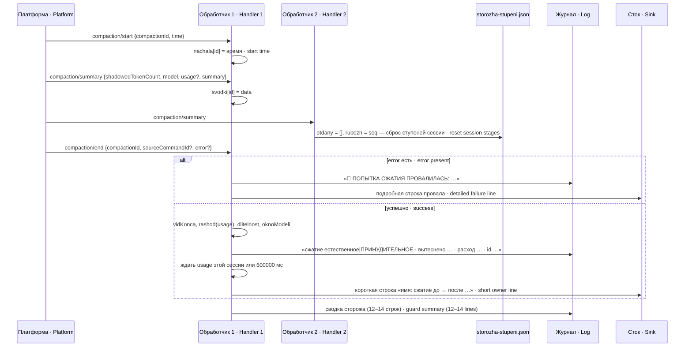
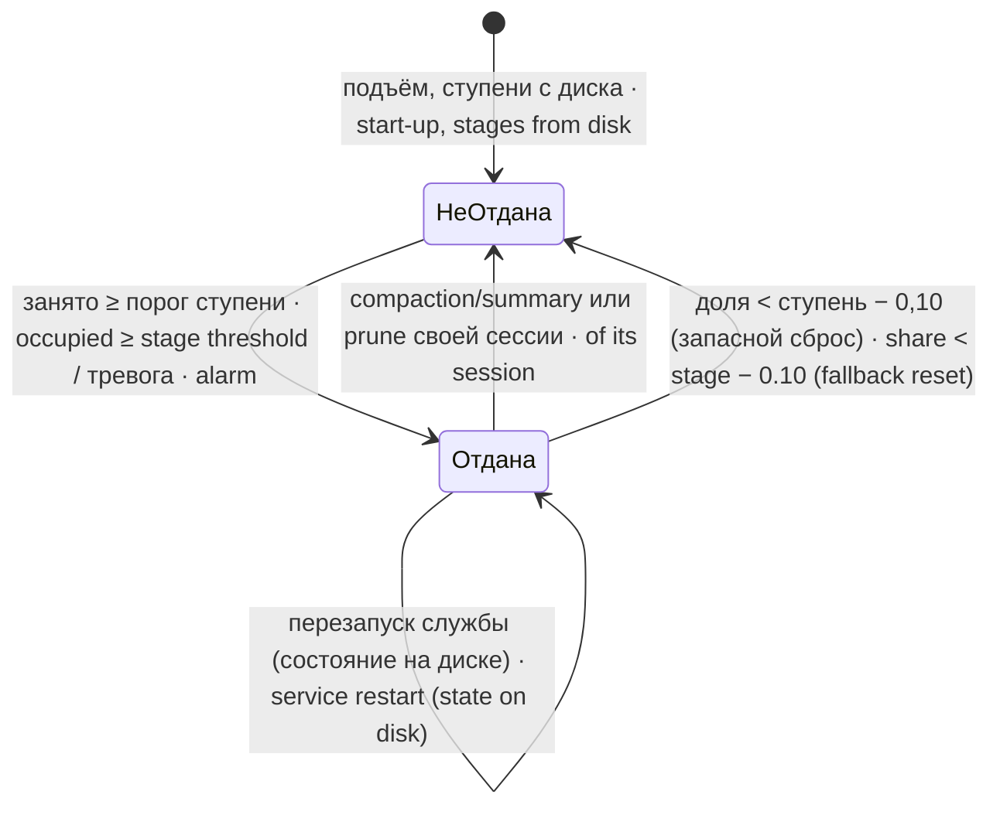
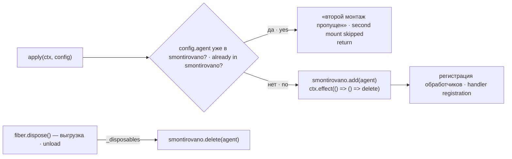

# Устройство · Architecture

Документ описывает, как устроен `dsh-pamyat-storozha` внутри: какие события он слушает, что хранит, что печатает и в каком порядке. Настройки — в [SETTINGS.md](SETTINGS.md), сторожа и стенды — в [GUARDS.md](GUARDS.md).

This document describes how `dsh-pamyat-storozha` works inside: which events it listens to, what it stores, what it prints and in which order. Settings are in [SETTINGS.md](SETTINGS.md), guards and stands in [GUARDS.md](GUARDS.md).

## Файлы · Files

| Файл · File | Что внутри · Contents |
|---|---|
| `src/index.js` | плагин cordis: схема настроек `Config`, перечень сторожей `STOROZHA`, колонки описания `KOLONKI_OPISANIYA`, `apply` (оба обработчика, сводка, хранение ступеней), `otdat` (журнал + сток), `pechat` (единая печать) · the cordis plugin: settings schema `Config`, guard list `STOROZHA`, description columns `KOLONKI_OPISANIYA`, `apply` (both handlers, summary, stage storage), `otdat` (log + sink), `pechat` (single print point) |
| `src/vidy-szhatiya.js` | чистые функции без состояния: `vidKonca` (вид по `compaction/end`), `rashod` (расход вызова), `davlenie` (давление на контекст), `neznakomyePolya`, `dlitelnost` · pure stateless functions: `vidKonca` (kind from `compaction/end`), `rashod` (call spend), `davlenie` (context pressure), `neznakomyePolya`, `dlitelnost` |
| `test/stend-*.mjs` | 15 mjs-стендов и 5 отдельных sh-стендов, см. [GUARDS.md](GUARDS.md) · 15 mjs stands and 5 separate sh stands, see [GUARDS.md](GUARDS.md) |

## Взаимодействие · Interaction

```mermaid
flowchart TB
  subgraph Proc["Процесс агента DSH · DSH agent process"]
    EV["session/event<br/>(compaction/*, turn/*, ответы с usage · responses with usage)"]
    subgraph St["dsh-pamyat-storozha · apply()"]
      H1["Обработчик 1 · Handler 1<br/>разбор сжатий · compaction parsing"]
      H2["Обработчик 2 · Handler 2<br/>заполнение, ходы, охват · fill, turns, coverage"]
      SV["svodkaStorozha()<br/>сводка · summary"]
      OT["otdat()<br/>журнал + сток · log + sink"]
      PE["pechat()<br/>«[имя версия] …» · \"[name version] …\""]
    end
    RC["session.requestContext()<br/>окно, провайдер, модель · window, provider, model"]
  end
  EV --> H1
  EV --> H2
  H1 -->|"вид, объём, расход · kind, volume, spend"| OT
  H1 --> SV
  H2 -->|"ступень · stage"| OT
  H2 -->|"turn/end: 1-й и каждый 10-й · 1st and every 10th"| SV
  RC --> H1
  RC --> H2
  PD["dsh-pamyat-kompakt/porogi.mjs<br/>chitatPorogD(KOMPAKT_AGENT, route)"] --> H2
  FS[("storozha-stupeni.json")] <--> H2
  SV --> PE
  OT --> PE
  OT -->|"/bin/sh -c komandaStoka (stdin)"| SINK["Внешний сток · External sink"]
  PE --> LOG["ctx.logger.info / console.log<br/>журнал службы · service log"]
```

Оба обработчика регистрируются в одном `apply` и делят общий счёт `schet`, карту сессий и ссылку на печать сводки. Сводка объявлена после обработчиков, поэтому ссылка `pechatSvodki` сначала заглушка, а настоящая функция подставляется в конце `apply` — так обработчик, зарегистрированный раньше объявления, не падает во временной мёртвой зоне `let`.

Both handlers are registered in one `apply` and share the `schet` counters, the session map and the summary-print reference. The summary is declared after the handlers, so the `pechatSvodki` reference is a stub at first and the real function is assigned at the end of `apply` — this way a handler registered before the declaration does not fail in the `let` temporal dead zone.

## Поток одного сжатия · Flow of one compaction



`compaction/prune` идёт короче: одна строка «ОБРЕЗКА без модели …» в журнал и сток, сводка, и во втором обработчике — тот же сброс ступеней сессии.

`compaction/prune` is shorter: one line "ОБРЕЗКА без модели …" (prune without a model) to the log and sink, the summary, and in the second handler the same reset of the session's stages.

## Ступень заполнения · Fill stage

На любом событии, кроме `compaction/summary` и `compaction/prune`, второй обработчик берёт `event.data.usage` и считает давление `inputTokens + cacheReadTokens + cacheWriteTokens` (выход не входит). Нет `usage` или `inputTokens` — замер пропускается.

On any event except `compaction/summary` and `compaction/prune`, the second handler takes `event.data.usage` and computes the pressure `inputTokens + cacheReadTokens + cacheWriteTokens` (output excluded). No `usage` or `inputTokens` — the measurement is skipped.

База ступеней — готовый номинальный порог D для маршрута requestHeader/config или requestContext. Если D не прочитан, берётся окно платформы, иначе predel; только отсутствие всех трёх даёт слепоту. Доля окна показывается, когда оно объявлено платформой или задано predel; окно из D не выдаётся за объявление платформы.

The stage base is the ready nominal D threshold for the current route. Without D, use the platform window or fallback predel; only absence of all three is blindness. The D window is not presented as a platform declaration.

Порог ступени — `floor((база × round(ступень × 100) + 99) / 100)`, то есть целое с округлением вверх. Ступень отдаётся, если занято ≥ её порога и она ещё не в `otdany` этой сессии. Все ступени, перейдённые одним замером, — одно сообщение.

A stage threshold is `floor((base × round(stage × 100) + 99) / 100)`, i.e. an integer rounded up. A stage is reported if the occupied amount ≥ its threshold and it is not yet in this session's `otdany`. All stages crossed by one measurement give one message.



## Хранение отданных ступеней · Storage of reported stages

Путь — `STOROZHA_STUPENI_FAJL`, иначе `$DSH_HOME/storages/storozha-stupeni.json`, иначе только память процесса (строка подъёма говорит «только память» и предупреждает о повторе после подъёма). Файл читается один раз при монтаже и переписывается при каждом изменении: запись во временный `<путь>.<pid>.tmp` и `rename`.

The path is `STOROZHA_STUPENI_FAJL`, otherwise `$DSH_HOME/storages/storozha-stupeni.json`, otherwise process memory only (the start-up line says "только память", memory only, and warns about a repeat after restart). The file is read once at mount time and rewritten on every change: write to a temporary `<path>.<pid>.tmp` and `rename`.

```json
{
 "v": 1,
 "sessii": {
  "<id сессии · session id>": { "otdany": [0.85], "rubezh": 1234, "kogda": "2026-01-01T00:00:00.000Z" }
 }
}
```

`otdany` — уже отданные ступени, `rubezh` — `seq` (или `time`) события сжатия, которым они сброшены в последний раз, `kogda` — время последнего изменения. Файл в другом формате или нечитаемый — начинаем с пустого и говорим об этом в строке подъёма. Запись не удалась — одна строка «отданные ступени НЕ сохранены» за жизнь процесса.

`otdany` — stages already reported, `rubezh` — the `seq` (or `time`) of the compaction event that last reset them, `kogda` — time of the last change. A file in another format or unreadable — we start empty and say so in the start-up line. A failed write — one line "отданные ступени НЕ сохранены" (reported stages NOT saved) per process lifetime.

## Сводка и её такт · The summary and its cadence

Сводка печатается: после каждого завершённого сжатия (успешного и проваленного), после каждой обрезки, на первом `turn/end` после подъёма и затем на каждом десятом `turn/end`. Счёт живёт в памяти процесса (`schet`) и обнуляется перезапуском. Знаменатель — `turn/start`.

The summary is printed: after every finished compaction (successful and failed), after every prune, on the first `turn/end` after start-up and then on every tenth `turn/end`. The count lives in process memory (`schet`) and is reset by a restart. The denominator is `turn/start`.

## Страж одиночного монтажа · Single-mount guard



Ключ — имя агента, а не объект `ctx`: платформа даёт каждому монтажу свой `ctx`. Снятие ключа повешено на `ctx.effect`, потому что в cordis 4.0.1 выгрузка зовёт только `_disposables` волокна, а события `'dispose'` нет; вернуть функцию очистки из `apply` нельзя — cordis зовёт `apply` через `new`. Цена ключа по имени: два безымянных агента в одном процессе схлопнутся в один.

The key is the agent name, not the `ctx` object: the platform gives each mount its own `ctx`. Key removal hangs on `ctx.effect`, because in cordis 4.0.1 unloading calls only the fiber's `_disposables` and there is no `'dispose'` event; returning a cleanup function from `apply` does not work — cordis calls `apply` with `new`. Price of a name key: two nameless agents in one process collapse into one.

## Единая печать · Single print point

Все строки пакета проходят через `pechat(ctx, s)`, которая приставляет `[dsh-pamyat-storozha <версия>]` (версия читается из `package.json` один раз при загрузке; не прочиталась — «версия неизвестна»). Печать идёт в `ctx.logger.info`, а если функции нет — в `console.log`; возвращаемое значение логгера не используется. Исключение печати глушится: монтаж важнее строки о нём.

All package lines go through `pechat(ctx, s)`, which prepends `[dsh-pamyat-storozha <version>]` (the version is read from `package.json` once at load; if unreadable — "версия неизвестна", version unknown). Output goes to `ctx.logger.info`, and if the function is absent — to `console.log`; its return value is ignored. A print exception is swallowed: mounting matters more than the line about it.
