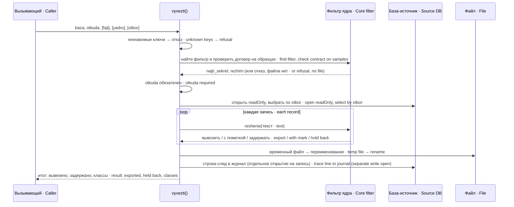
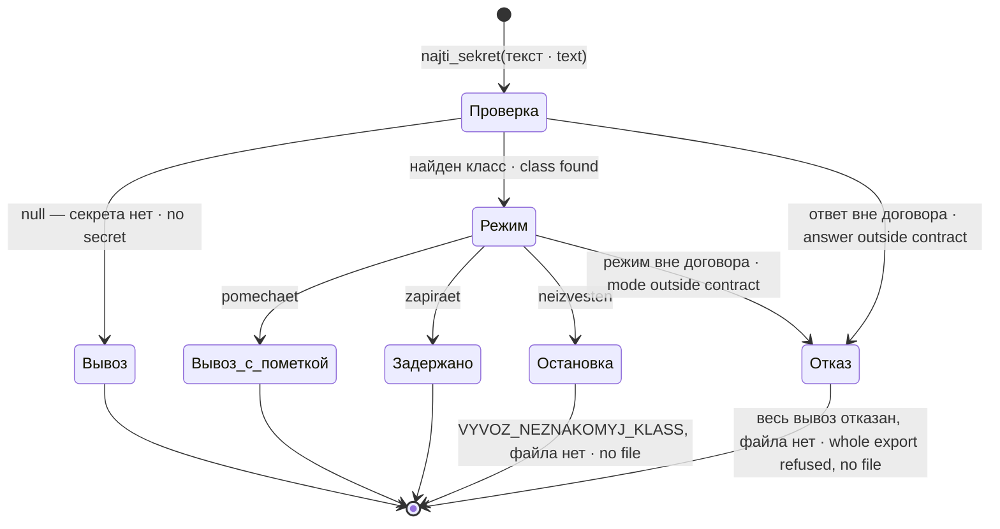
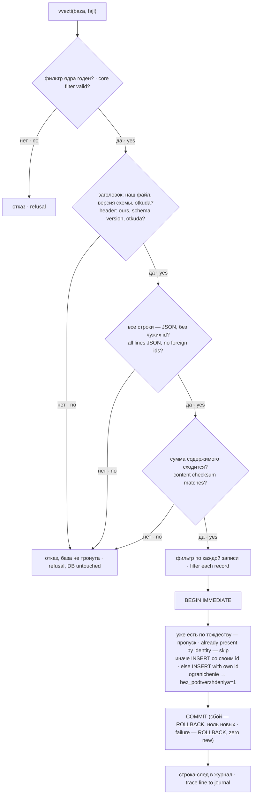

# Архитектура · Architecture — dsh-pamyat-vyvoz

## Состав · Components

| Файл · File | Что делает · What it does |
|---|---|
| `src/index.js` | общий вход: реэкспорт API · public entry: API re-exports |
| `src/vyvoz.js` | `vyvezti()` — вывоз в файл JSONL, `otchyot()` — отчёт без содержимого · export to JSONL, report without content |
| `src/vvoz.js` | `vvezti()` — ввоз в базу одной транзакцией, `otchyot_vvoza()` · import in one transaction, import report |
| `src/yadro.js` | `vzyat_filtr()` — найти фильтр ядра и проверить договор; `reshenie()` — решение по одной записи · find the core filter and check its contract; per-record decision |
| `src/shema.js` | версия схемы, перечень полей, что не вывозится и почему, заголовок, сумма содержимого · schema version, field list, what is not exported and why, header, content checksum |
| `src/zhurnal.js` | строка-след операции в журнале базы · operation trace line in the database journal |
| `bin/vyvoz-pamyati.mjs` | CLI вывоза для человека · export CLI for humans |

## Вывоз · Export



Договор с ядром проверяется до открытия базы: без годного фильтра база даже не читается. Файл пишется во временный и переименовывается целиком — обрыв не оставит полуфайл с верным заголовком. Без `fajl` файла нет вовсе: это проба, но строка-след в журнал всё равно пишется (исход `tolko-otchyot`).

The core contract is checked before the database is opened: without a valid filter the database is not even read. The file is written to a temporary name and renamed as a whole — a crash leaves no half-file with a valid header. Without `fajl` there is no file at all: it is a probe, but a trace line is still written to the journal (outcome `tolko-otchyot`).

## Решение по записи · Per-record decision



Ответ ядра вне договора — не «пропустить запись», а отказ всей операции: значение такого ответа в сообщение не попадает («значение скрыто»). Режим `neizvesten` при вывозе тоже останавливает всё: класс ядру известен, а пакету нет, значит под вопросом вся раскладка. При ввозе та же запись просто отклоняется и не вставляется.

A core answer outside the contract does not "skip the record" — it refuses the whole operation; the value of such an answer never reaches the message ("value hidden"). The `neizvesten` mode on export also stops everything: the class is known to the core but not to the package, so the whole layout is in question. On import the same record is simply rejected and not inserted.

## Ввоз · Import



Все проверки файла идут до открытия базы-приёмника. Тождество записи — «агент + источник + время создания» (без поля `agent` в базе — «источник + время»). Поля, которых нет в схеме приёмника, и поля вне перечня `POLYA` не размещаются — пакет называет их громко через `krik`.

All file checks happen before the target database is opened. Record identity is "agent + source + creation time" (without an `agent` field in the database — "source + time"). Fields missing from the target schema and fields outside the `POLYA` list are not stored — the package names them loudly via `krik`.

## Файл вывоза · Export file

Формат — JSONL. Первая строка — заголовок, дальше одна строка на запись, без `id`.

Format: JSONL. The first line is the header, then one line per record, without `id`.

```json
{"vyvoz":"dsh-pamyat","versiya_shemy":2,"polya":["agent","klass","soderzhim","..."],"otkuda":"my-agent","uzel":"<host>","kogda":1790000000000,"zapisej":55,"zaderzhano":1,"ne_vyvozitsya":{"id":"…","zhurnal":"…"},"summa":"sha256:…"}
{"agent":"my-agent","klass":"fakt","soderzhim":"…","istochnik":"…","sozdano":1789000000000}
```

Поля заголовка и записи с их смыслом — в [SETTINGS.md](SETTINGS.md#fajl).

Header and record fields with their meaning: [SETTINGS.md](SETTINGS.md#fajl).

## Границы текущего ввоза · Current import boundaries

Имена CLI и вложенный otbor проверяются до отбора. Пометка pometka_filtra остаётся метаданными файла, а не полем приёмной БД; данные договора POLYA снова проходят фильтр получателя. Проверка существования приёмника предшествует открытию SQLite на запись.

CLI names and nested selection are validated before selection. The annotation remains file metadata; every contract field is filtered again. Receiver existence is checked before opening SQLite for writes.
