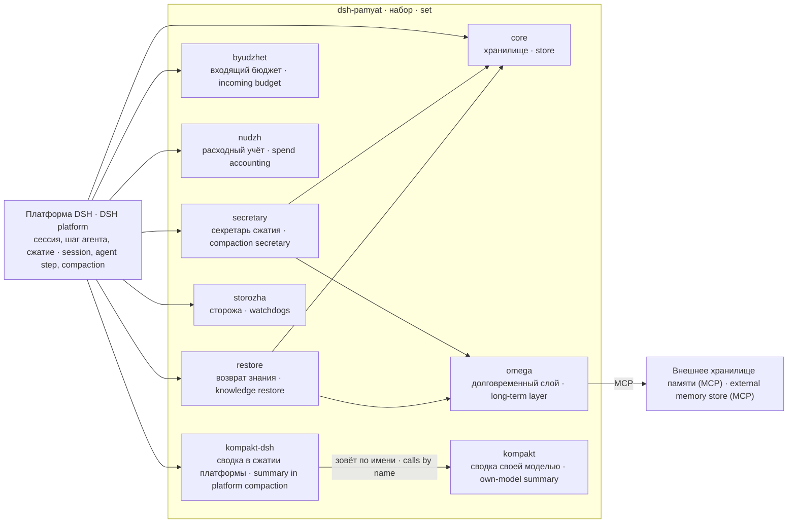

# dsh-pamyat · набор памяти агента · agent memory set

**Версия:** 3.1.10

> Набор `dsh-pamyat` 3.1.10 — девять пакетов памяти агента в точных версиях, проверенных вместе: список с номерами — ниже, суммы предметов — в `sostav.json`. · The `dsh-pamyat` set 3.1.3 is nine agent memory packages at exact versions checked together: the list with versions is below, subject checksums are in `sostav.json`.

**Одно имя для девяти пакетов памяти агента, собранных и проверенных вместе — в точных версиях и с суммой каждого.**

**One name for nine agent-memory packages that were built and verified together — at exact versions, with a checksum for each.**

## Зачем нужно · Why it exists

Память агента на платформе DSH (DeepSeek Harness) собрана не из одного модуля, а из девяти: хранилище, долговременный слой, секретарь сжатия, бюджеты, сторожа и сама компакция. Каждый выпускается отдельно, и у каждого свой номер версии. Если ставить их по одному, у двух людей под одинаковыми словами «память агента» окажутся разные наборы — и расходиться они будут молча, без единой ошибки.

Agent memory on the DSH (DeepSeek Harness) platform is not one module but nine: a store, a long-term layer, a compaction secretary, budgets, watchdogs and the compaction itself. Each ships separately with its own version number. Installed one by one, two people saying "agent memory" end up with different sets — and those sets drift apart silently, without a single error.

Этот метапакет не содержит рабочего кода. Он закрепляет **какие** девять пакетов, **в каких точных версиях** и **с какими суммами содержимого** работают вместе, и даёт стенд, который сверяет это объявление с фактом на диске. Имя, за которым у разных людей разные наборы, хуже отсутствия имени — поэтому набор проверяется, а не просто перечисляется.

This metapackage contains no runtime code. It pins **which** nine packages, **at which exact versions** and **with which content checksums** work together, and ships a stand that checks that declaration against the facts on disk. A name that means different sets to different people is worse than no name — so the set is verified, not merely listed.

## Состав · Composition

Таблица ниже — не пересказ, а копия `sostav.json`; стенд проверяет, что оба описания (`README.md` и `README.en.md`) называют ровно этих членов и ровно эти версии.

The table below is not a retelling but a copy of `sostav.json`; the stand checks that both descriptions (`README.md` and `README.en.md`) name exactly these members at exactly these versions.

    dsh-pamyat-core        3.1.3             хранилище, журнал решений, политика записи · store, decision journal, write policy
    dsh-pamyat-omega       3.1.3             долговременная память через MCP с подтверждением · long-term memory over MCP with delivery confirmation
    dsh-pamyat-secretary   3.1.3             сводки сжатия → записи памяти · compaction summaries → memory records
    dsh-pamyat-byudzhet    3.1.3             входящий бюджет: что поднимать в контекст · incoming budget: what to lift into context
    dsh-pamyat-nudzh       3.1.3             расходный учёт: не пора ли сжимать · spend accounting: is it time to compact
    dsh-pamyat-restore     3.1.3             возврат знания после сжатия и брифинг · knowledge restore after compaction and briefing
    dsh-pamyat-storozha    3.1.8             сторож памяти: ступени заполнения, оповещение о сжатии · memory watchdog: fill stages, compaction notice
    dsh-pamyat-kompakt-dsh 3.1.4             своя сводка внутри сжатия платформы · own summary inside the platform compaction
    dsh-pamyat-kompakt     3.1.2             счёт окна и сводка своей моделью (ставится каталогом) · window count and summary by own model (installed as a directory)

Пакеты, которые вызываются вручную или по таймеру и не грузятся в каждую сессию агента (вывоз и ввоз памяти, ночное обслуживание), в набор не входят: у них свой цикл выпуска.

Packages that run by hand or on a timer rather than inside every agent session (memory export/import, nightly maintenance) are not part of the set: they have their own release cycle.

## Место в системе · Place in the system



Метапакет сам ни во что не встраивается: платформа грузит члены набора как обычные плагины. Набор отвечает только за то, чтобы рядом стояли совместимые версии. Стрелки внутри набора показывают основные направления данных по описаниям членов; точные вызовы — в документации каждого члена.

The metapackage plugs into nothing by itself: the platform loads the members as ordinary plugins. The set only guarantees that compatible versions stand side by side. Arrows inside the set show the main data directions as described by the members; exact calls are in each member's documentation.

## Установка · Installation

Требования: Node.js ≥ 22 (`engines.node >=22` объявляют члены core, omega и secretary, у остальных поля `engines` нет; стенд проверен на Node.js 24 и npm 11), платформа DSH 0.2 (члены объявляют `@deepseek-ai/cordis ^4.0.1` и `@deepseek-ai/dsh-llm ^0.1.1-rc.2 || ^0.2.0-rc.2`), Linux с `bash`, `tar`, `sha256sum`.

Requirements: Node.js ≥ 22 (`engines.node >=22` is declared by the core, omega and secretary members; the others have no `engines` field; the stand was run on Node.js 24 and npm 11), DSH platform 0.2 (members declare `@deepseek-ai/cordis ^4.0.1` and `@deepseek-ai/dsh-llm ^0.1.1-rc.2 || ^0.2.0-rc.2`), Linux with `bash`, `tar`, `sha256sum`.

Зависимости набора — точные пины членов выбранного состава (`package.json` и `sostav.json`); они не обязаны совпадать с последними редакциями соседних пакетов. В npm доступна редакция `3.1.4` (замер 15.10.2026, `npm view dsh-pamyat version`). По решению владельца от 14.10.2026 изменения после публикации ведутся локально и в npm не выкладываются. Для локального состава `npm install <дерево>/packages/dsh-pamyat` бесполезен: npm ставит локальный каталог ссылкой и завершается кодом 0, не поставив ни одного члена (0 из 9). Члены ставятся по отдельности из дерева с `--install-links` (команда ниже) или из архивов `npm pack` каждого члена. Без `--install-links` npm кладёт члены ссылками, и импорт 8 из 9 падает с `ERR_MODULE_NOT_FOUND`: ссылка ищет зависимости у себя в дереве. `dsh-pamyat-kompakt-dsh` при любом способе установки отказывает при импорте своим названным отказом. Замер Зари 10.10.2026: npm 11, чистый каталог, `--ignore-scripts`. Набор ни одному агенту не подключён; полка архивов служит только сверке сумм.

The set's dependencies pin the members of the selected composition (`package.json` and `sostav.json`); they need not be the latest editions of the sibling packages. npm provides `3.1.4` (checked on 2026-10-15 with `npm view dsh-pamyat version`). By the owner's decision of 2026-10-14, changes after publication are maintained locally and are not republished to npm. For the local composition `npm install <дерево>/packages/dsh-pamyat` is useless: npm links the local directory and exits with code 0 without installing a single member (0 of 9). Install members one by one from the tree with `--install-links` (command below) or from each member's `npm pack` archive. Without `--install-links` npm places the members as links, and importing 8 of 9 fails with `ERR_MODULE_NOT_FOUND`: a link looks for dependencies in its own tree. `dsh-pamyat-kompakt-dsh` refuses at import with its own named refusal whatever the install method. Measured by Zarya on 10.10.2026: npm 11, clean directory, `--ignore-scripts`. The set is attached to no agent; the archive shelf serves only checksum verification.

```bash
# локальный состав — члены из дерева, не ссылками · local composition — members from the tree, not as links
D=<путь-к-дереву · path-to-tree>/packages
npm install --install-links $D/dsh-pamyat-core $D/dsh-pamyat-omega $D/dsh-pamyat-secretary $D/dsh-pamyat-byudzhet $D/dsh-pamyat-nudzh $D/dsh-pamyat-restore $D/dsh-pamyat-storozha $D/dsh-pamyat-kompakt-dsh $D/dsh-pamyat-kompakt
```

При выпуске в реестр зависимости переводятся на точные версии реестра; диапазоны (`^`, `~`, `x`) запрещены пробой стенда.

When released to the registry, dependencies switch to exact registry versions; ranges (`^`, `~`, `x`) are rejected by a stand probe.

## Быстрый старт · Quick start

```bash
cd <путь-к-дереву · path-to-tree>/packages/dsh-pamyat
STEND_POLKA=<полка-архивов · archive-shelf> STEND_PLAGINY=<каталог-плагинов · plugins-dir> npm test
```

Работает — значит, последняя строка `итог: 11 из 11` и код возврата 0. Код 2 — стенду нечем проверять (не заданы `STEND_POLKA`/`STEND_PLAGINY` или нет соседних пакетов), это не поломка набора. Код 1 — объявление разошлось с фактом; какая проба покраснела, написано словами. Подробно — в [docs/GUARDS.md](docs/GUARDS.md).

It works when the last line reads `итог: 11 из 11` ("total: 11 of 11") and the exit code is 0. Exit code 2 means the stand has nothing to check against (no sibling packages or shelf) — not a broken set. Exit code 1 means the declaration and the facts diverged; the failing probe says why in words. Details: [docs/GUARDS.md](docs/GUARDS.md).

## Настройки · Settings

| Где · Where | Что · What | Подробно · Details |
|---|---|---|
| `package.json` → `dependencies` | точные версии членов · exact member versions | [SETTINGS](docs/SETTINGS.md#dependencies) |
| `sostav.json` → `sostav[]` | версия, сумма, число файлов члена · member version, checksum, file count | [SETTINGS](docs/SETTINGS.md#sostav) |
| `sostav.json` → `kak_schitano` | инструмент и его сумма · tool and its checksum | [SETTINGS](docs/SETTINGS.md#kak_schitano) |
| переменные · variables `STEND_POLKA`, `STEND_PLAGINY` (обязательны · required), `STEND_BOJ` | полка архивов, каталог плагинов, с какой установкой сверять версии · archive shelf, plugins directory, which installation to compare versions with | [SETTINGS](docs/SETTINGS.md#stend_boj) |

## Как работает · How it works

**Объявление.** `sostav.json` хранит для каждого члена имя, версию, «сумму предмета» (16 знаков sha256 по составу публикации пакета) и число файлов. `package.json` объявляет те же версии зависимостями. Ни одно из этих чисел не пишется рукой: их снимает инструмент `summa-predmeta-2`.

**Declaration.** `sostav.json` stores, per member, its name, version, "subject checksum" (16 hex digits of sha256 over the package's published file list) and file count. `package.json` declares the same versions as dependencies. None of these numbers is typed by hand: the `summa-predmeta-2` tool produces them.

**Один способ — один файл.** Сумма предмета считается по составу публикации пакета, и способ этот легко пересказать словами — именно поэтому его здесь не пересказываем: две добросовестные реализации по словам дали разные числа на одних и тех же пакетах (порядок полей в строке, завершающий перевод строки, локаль сортировки). Способ существует ровно в одном экземпляре — файле `summa-predmeta-2`, — а у самого файла есть сумма в `sostav.json`. Сверьте сумму файла, запустите его — получите то же число.

**One method, one file.** The subject checksum is computed over the package's published file list, and the method is easy to retell in words — which is exactly why it is not retold here: two honest implementations from words produced different numbers on the same packages (field order in the line, trailing newline, sort locale). The method exists in exactly one copy, the `summa-predmeta-2` file, and that file itself has a checksum in `sostav.json`. Check the file's checksum, run it — you get the same number.

**Проверка, а не декларация.** Стенд `test/stend-sostava.mjs` распаковывает архив каждого члена с полки, считает его сумму тем же инструментом и сверяет с объявленной; сверяет версии с установленными плагинами; проверяет, что README называют тех же членов в тех же версиях. Разойтись объявлению и факту можно только с красной пробой.

**Verification, not declaration.** The stand `test/stend-sostava.mjs` unpacks each member's archive from the shelf, computes its checksum with the same tool and compares it with the declared one; compares versions with the installed plugins; checks that the READMEs name the same members at the same versions. Declaration and facts can diverge only with a red probe.

**Слепота отдельно от поломки.** Если рядом нет соседних пакетов или полки архивов, стенд не говорит «набор сломан»: он завершается кодом 2 «проверять нечем» и называет причину. Провал по существу (код 1) всегда перебивает слепоту.

**Blindness is not breakage.** Without sibling packages or the archive shelf the stand does not claim "the set is broken": it exits with code 2 "nothing to check against" and names the reason. A substantive failure (code 1) always overrides blindness.

## Сторожа и проверки · Guards and checks

Один стенд из одиннадцати проб; коды возврата 0 / 1 / 2. Сам по расписанию не запускается — его зовёт тот, кто собирает или принимает набор (у авторов — ночной обход стендов). Полный перечень проб, что каждая ловит и чего не ловит — в [docs/GUARDS.md](docs/GUARDS.md).

One stand with eleven probes; exit codes 0 / 1 / 2. It does not run on a schedule by itself — whoever builds or accepts the set runs it (the authors run it in a nightly stand sweep). The full list of probes, what each catches and what it misses: [docs/GUARDS.md](docs/GUARDS.md).

## Границы · Limits

- «11 из 11» значит, что учёт сходится, а **не** что набор годен: годность каждого члена проверяют стенды самих членов.
- Пакет ничего не исполняет в сессии агента и не заменяет установку членов по отдельности.
- Пути полки архивов и каталога установленных плагинов стенд берёт только из `STEND_POLKA` и `STEND_PLAGINY`: не заданы — код 2 до всех проб. В `dependencies` — точные номера (A-N-1873), путей полки там больше нет. Без соседних пакетов стенд честно даёт код 2; если соседи найдены, а полки, каталога установленных плагинов или работающего npm нет, пробы пишут «СЛЕПОТА» и стенд тоже даёт код 2 — см. [docs/GUARDS.md](docs/GUARDS.md#kody).
- Сумма инструмента закреплена: любая правка `summa-predmeta-2` на месте краснеет пробой. Менять инструмент можно только новым именем файла.

- "11 of 11" means the accounting adds up, **not** that the set is fit: each member's fitness is checked by its own stands.
- The package executes nothing inside an agent session and does not replace installing members one by one.
- The stand takes the archive-shelf and installed-plugins paths only from `STEND_POLKA` and `STEND_PLAGINY`: unset — exit 2 before any probe. `dependencies` hold exact versions (A-N-1873); there are no shelf paths there any more. Without sibling packages the stand honestly exits with code 2; if siblings are found but the shelf, the installed-plugins directory or a working npm is missing, the probes say "СЛЕПОТА" (blindness) and the stand also exits 2 — see [docs/GUARDS.md](docs/GUARDS.md#kody).
- The tool checksum is pinned: any in-place edit of `summa-predmeta-2` turns a probe red. Change the tool only under a new file name.

## Документация · Documentation

[Архитектура · Architecture](docs/ARCHITECTURE.md) · [Настройки · Settings](docs/SETTINGS.md) · [Сторожа · Guards](docs/GUARDS.md) · [Неполадки · Troubleshooting](docs/TROUBLESHOOTING.md) · [Изменения · Changelog](CHANGELOG.md)

## Лицензия и авторы · License and authors

Авторы — команда Iia-arg. Исходники семейства: <https://github.com/iia-arg/dsh-plugins> (каталог `packages/dsh-pamyat`). Лицензия — MIT: `"license": "MIT"` в `package.json`, текст — [LICENSE](LICENSE). Файл LICENSE в `files` не назван, но npm кладёт его в архив пакета сам.

Authors: the Iia-arg team. Family sources: <https://github.com/iia-arg/dsh-plugins> (directory `packages/dsh-pamyat`). License: MIT — `"license": "MIT"` in `package.json`, text in [LICENSE](LICENSE). LICENSE is not listed in `files`, but npm adds it to the package archive by itself.
