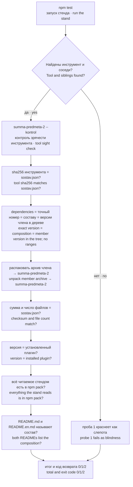
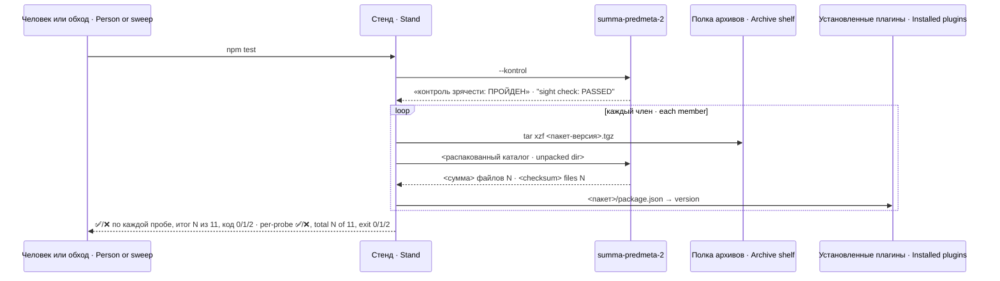
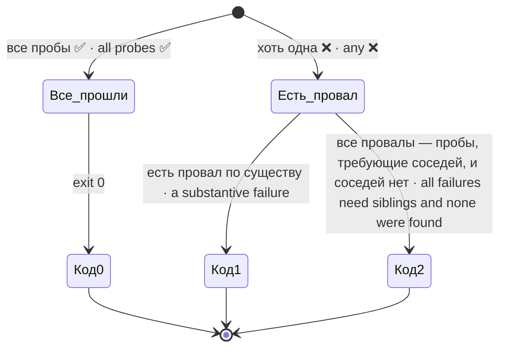

# Устройство · Architecture — dsh-pamyat

## Из чего состоит пакет · What the package is made of

| Файл · File | Роль · Role |
|---|---|
| `package.json` | объявляет членов набора зависимостями в точных версиях · declares the members as dependencies at exact versions |
| `sostav.json` | для каждого члена: версия, сумма предмета, число файлов; способ счёта · per member: version, subject checksum, file count; how it was counted |
| `summa-predmeta-2` | единственная реализация способа счёта суммы предмета (bash) · the only implementation of the subject-checksum method (bash) |
| `test/stend-sostava.mjs` | стенд: сверяет объявление с фактом, 11 проб · the stand: checks declaration against facts, 11 probes |
| `README.md`, `README.en.md` | описание; оба обязаны называть состав поимённо и поверсионно · description; both must list the composition by name and version |

В пакете нет кода, который исполняется в сессии агента. Всё, что в нём «работает», — это стенд и инструмент счёта, и оба запускаются человеком или обходом стендов.

The package has no code that runs inside an agent session. Everything that "runs" in it is the stand and the counting tool, and both are started by a person or by a stand sweep.

## Поток проверки · Verification flow

## Один прогон · One run

## Как стенд находит соседей · How the stand finds its siblings

Стенд не знает заранее, где он запущен, и пробует раскладки по очереди. Инструмент и соседние пакеты ищутся **отдельно** — это разные вопросы, и у получателя пакета из реестра они лежат в разных местах.

The stand does not know in advance where it runs and tries layouts in turn. The tool and the sibling packages are looked up **separately** — they are different questions, and for someone installing from a registry they live in different places.

| Что ищется · What | Где пробуется, по порядку · Tried where, in order |
|---|---|
| `summa-predmeta-2` | внутри пакета → рядом с пакетом → в корне дерева · inside the package → next to it → at the tree root |
| соседи (`dsh-pamyat-core/package.json`) · siblings | родительский каталог (ящик поставки, `node_modules`) → дерево `packages/` · parent dir (delivery box, `node_modules`) → `packages/` tree |

Найденное печатается первыми строками прогона: без этого непонятно, о какой раскладке говорят числа.

What was found is printed in the first lines of the run: otherwise it is unclear which layout the numbers describe.

## Решение о коде возврата · Exit-code decision

Провал не считается «по существу» в двух случаях: проба требует соседей, а дерева семейства нет, — или сама проба назвала провал «СЛЕПОТА» (нет полки, каталога установки, инструмент сумм или `npm pack` не исполнились). Всё остальное — по существу. Расхождение важнее слепоты — хоть один провал по существу даёт код 1; одни слепые провалы — код 2.

A failure is not "substantive" in two cases: the probe needs siblings and the family tree is not found — or the probe itself named the failure "СЛЕПОТА" (blindness: no shelf, no installation directory, the checksum tool or `npm pack` did not run). Everything else is substantive. Divergence outranks blindness — a single substantive failure yields exit code 1; blind failures alone yield exit code 2.

⚠️ Следствие этого правила: если соседи найдены, а нет полки архивов или каталога установленных плагинов, проба пишет «СЛЕПОТА», по существу не считается, и стенд возвращает 2, если других провалов нет (см. [GUARDS.md](GUARDS.md#kody)).

⚠️ A consequence of this rule: if siblings are found but the archive shelf or the installed-plugins directory is missing, the probe says "СЛЕПОТА" (blindness), is not counted as substantive, and the stand exits with 2 when there are no other failures (see [GUARDS.md](GUARDS.md#kody)).

## Временные файлы · Temporary files

Стенд распаковывает архивы во временный каталог и убирает его на любом выходе: обычном, падении пробы, `process.exit`, SIGTERM и SIGINT. От SIGKILL не защищает ничто.

The stand unpacks archives into a temporary directory and removes it on any exit: normal, a failing probe, `process.exit`, SIGTERM and SIGINT. Nothing protects against SIGKILL.
