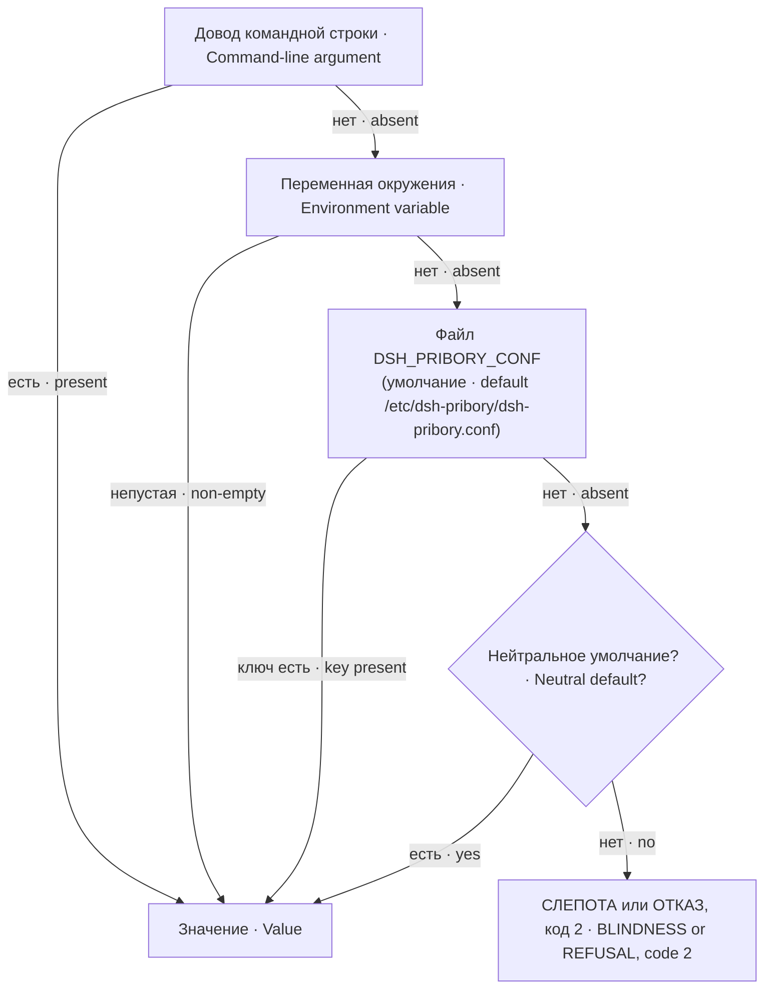
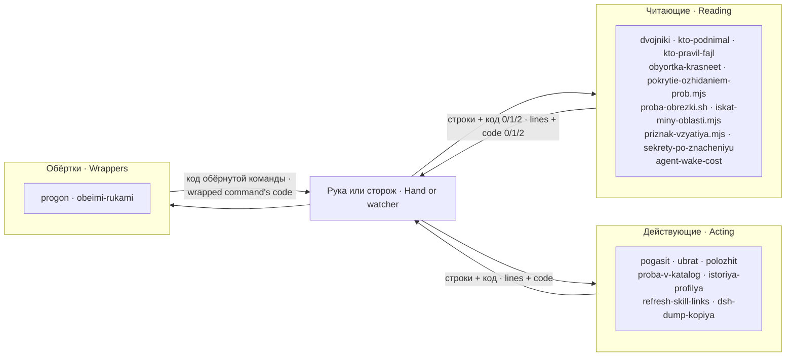
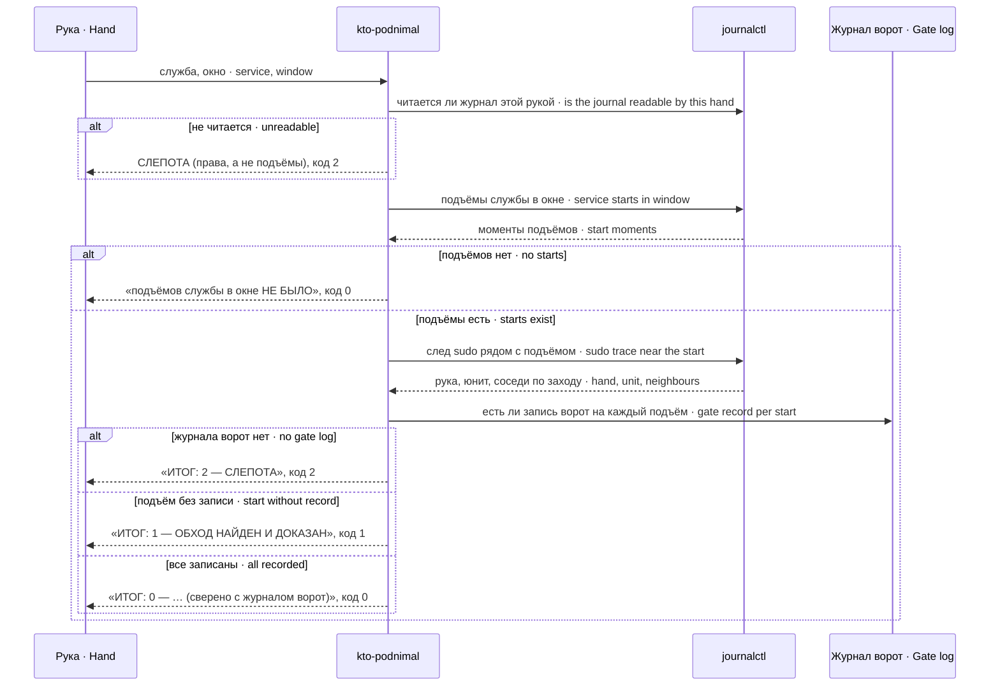

# Устройство · Architecture

Пакет — набор из двадцати самостоятельных приборов в `bin/`. Общего процесса, службы или состояния у них нет: каждый прибор запускается рукой или сторожем, отвечает строками вывода и кодом возврата и завершается. Общее у них одно — файл настройки и порядок, в котором прибор ищет значение.

The package is a set of twenty standalone tools in `bin/`. They share no process, service or state: each tool is run by a hand or a watcher, answers with output lines and an exit code, and exits. The only shared thing is the settings file and the order in which a tool looks up a value.

## Порядок значения · Value lookup order

Файл читается построчно: `КЛЮЧ=значение`, строка с `#` в начале — комментарий, пробелы и табуляции по краям ключа и значения срезаются, при повторе ключа действует последнее вхождение. Разборщик написан трижды — на bash, Python и Node — и копии в модулях одного языка побайтно равны; это проверяет `test/stend-nastrojki.sh`.

The file is read line by line: `KEY=value`, a line starting with `#` is a comment, spaces and tabs around the key and value are trimmed, and for a repeated key the last occurrence wins. The parser is written three times — in bash, Python and Node — and the copies inside modules of one language are byte-identical; `test/stend-nastrojki.sh` checks that.

Пустая переменная окружения ведёт себя по-разному в зависимости от языка модуля: в bash (`${X:-…}`) пустая строка проваливается в файл, в Node (`??`) пустая строка остаётся значением. Это касается `PS_KATALOG` и `FILTR_PUT` у `sekrety-po-znacheniyu`.

An empty environment variable behaves differently by module language: in bash (`${X:-…}`) an empty string falls through to the file, in Node (`??`) an empty string stays the value. This applies to `PS_KATALOG` and `FILTR_PUT` of `sekrety-po-znacheniyu`.

## Три рода приборов · Three kinds of tools

Читающие ничего не меняют и отвечают по контракту `0` — сошлось, `1` — найдено расхождение, `2` — проверять нечем (слепота). Действующие меняют только то, что названо точно: порт или юнит, каталог внутри разрешённого корня, файл по пути, каталог ссылок скиллов. Обёртки исполняют чужую команду и добавляют к её ответу то, что рука обычно теряет: настоящий код возврата или сверку ответов двух учёток.

Reading tools change nothing and answer by the contract `0` — matches, `1` — a divergence found, `2` — nothing to check with (blindness). Acting tools change only what is named exactly: a port or unit, a directory inside an allowed root, a file by path, the skill link directory. Wrappers run someone else's command and add what a hand usually loses: the real exit code or a comparison of two accounts' answers.

## Поток одного вызова: `kto-podnimal` · One call: `kto-podnimal`

## Где лежат строки вывода · Output lines

Строки вывода — на русском языке, и это интерфейс: сторожа и стенды разбирают их как текст («сверено с журналом ворот», «СЛЕПОТА», «ОБХОД НАЙДЕН»). Переименование такой строки ломает читающего молча, поэтому строки не переводятся.

Output lines are in Russian, and they are an interface: watchers and stands parse them as text. Renaming such a line breaks the reader silently, so the lines are not translated.
