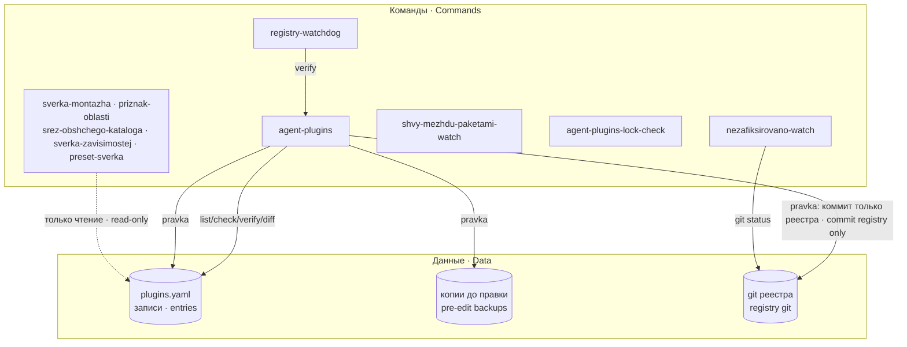
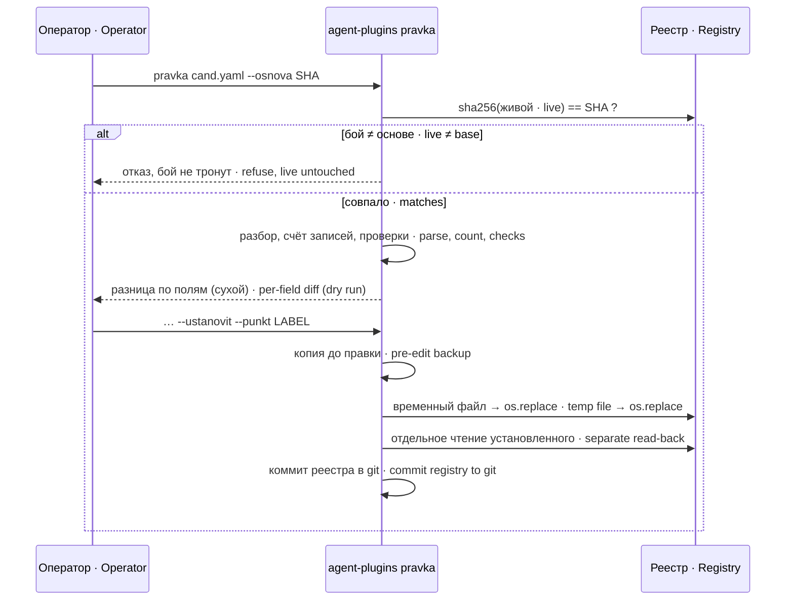
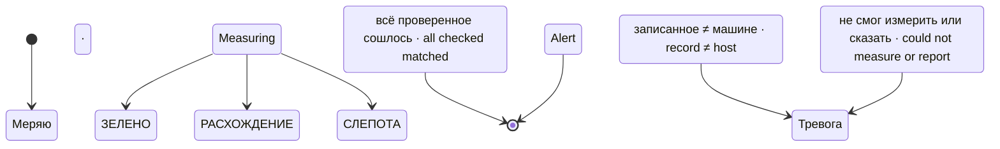

# Устройство · Architecture

## Части · Parts

Пакет состоит из одного файла данных — реестра — и десяти команд вокруг него. Реестр — YAML со списком записей `plugins:`; каждая запись описывает одно вмешательство в машину: где лежит, откуда взято, чья рука, кто им пользуется, что сломается без него и какой командой проверить версию и отпечаток.
The package is one data file — the registry — and ten commands around it. The registry is YAML with a `plugins:` list; each entry describes one intervention on the host: where it lives, where it came from, whose hand maintains it, who uses it, what breaks without it, and which command checks its version and fingerprint.

## Правка реестра · Registry edit

`--osnova` — сумма реестра, с которого собран кандидат. Если живой файл с тех пор изменился, правка поверх него затёрла бы чужое; поэтому установка без совпадения основы невозможна.
`--osnova` is the sha256 of the registry the candidate was built from. If the live file has changed since, editing over it would erase someone else's change; installation is therefore impossible without a base match.

## Исходы сторожа · Watchdog outcomes

Недоставленная тревога — тоже СЛЕПОТА (код 2): юнит обязан числиться упавшим, иначе молчание сойдёт за спокойствие.
An undelivered alert is also BLIND (exit 2): the unit must show as failed, otherwise silence passes for calm.

## Потоки данных · Data flow

Реестр пишет только `agent-plugins pravka`: новая редакция самого реестра, копия до правки, коммит в git реестра и строка в системный журнал (`logger -t agent-plugins`, sha256 легшего файла). Сторож реестров пишет своё состояние — отметки прогона и голоса в `REGWD_STATE` (по умолчанию `/var/lib/registry-watchdog`). Прочие команды только читают. Ни одна команда не ставит пакеты, не правит юниты и не перезапускает службы.
Only `agent-plugins pravka` writes the registry: the new revision itself, the pre-edit backup, a commit in the registry's git and a system journal line (`logger -t agent-plugins`, sha256 of the file that landed). The registry watchdog writes its own state — run and voice stamps in `REGWD_STATE` (default `/var/lib/registry-watchdog`). All other commands are read-only. No command installs packages, edits units or restarts services.
