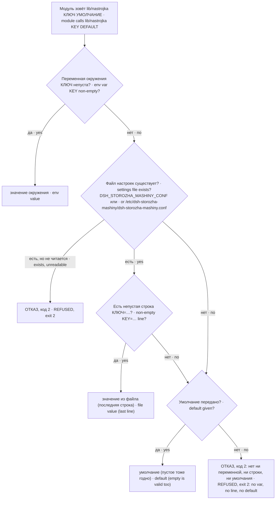

# Устройство · Architecture

Пакет — 16 независимых исполняемых файлов (12 модулей с юнитом, 2 прибора и 2 запускателя) без общего процесса и без общей библиотеки, кроме одной функции `lib/nastrojka`. Каждый модуль сам снимает замер, сам решает, беда ли это, и сам зовёт канал тревоги. Ниже — что сторожит каждый, как идёт одна тревога и откуда модули без юнита берут настройки.

The package is 16 independent executables (12 modules with a unit, 2 instruments and 2 launchers) with no shared process and no shared library except one function, `lib/nastrojka`. Each module takes its own measurement, decides on its own whether it is trouble, and calls the alert channel itself. Below: what each one watches, how one alert flows, and where modules without a unit get their settings.

## Сторожа и их предметы · Watchers and their subjects

```mermaid
flowchart TB
  subgraph TIM["По таймеру systemd · on a systemd timer"]
    AW["agent-watchdog.sh<br/>5 мин · 5 min"]
    AP["apt-updates-notify.sh<br/>сутки · daily"]
    DK["dkms-kernel-coverage-check.sh<br/>сутки + загрузка · daily + boot"]
    I6["inet6-poyavlenie-watch<br/>30 мин · 30 min"]
    HV["hvosty-vartmp-watch<br/>сутки · daily"]
    DV["dve-kopii-watch<br/>сутки · daily"]
    PV["podyom-mimo-vorot-watch<br/>15 мин · 15 min"]
    UP["dsh-upstream-watch.sh<br/>сутки · daily"]
    PD["predel-dliny-watch<br/>15/30 мин · 15/30 min"]
    ZP["zadaniya-prervany-watch<br/>час · hourly"]
    SD["storozh-dvizhkov.sh<br/>2 мин · 2 min; экземпляр · template instance"]
  end
  YP["yadro-predohranitel<br/>разово при загрузке · once at boot"]
  subgraph RUK["Без юнита · without a unit"]
    BP["bash-padenie-70"]
    PP["python-padenie-70"]
    KZ["kontekst-zamer"]
    AL["agent-limits"]
  end
  AW --> S1["службы, таймеры, свежесть разовых, сервис памяти, диски · units, timers, oneshot freshness, memory service, disks"]
  AP --> S2["списки apt: ожидающие и security · apt lists: pending and security"]
  DK --> S3["dkms status × установленные ядра · dkms status × installed kernels"]
  YP --> S4["модуль туннелей и контрольный адрес в новом ядре · tunnel module and probe address in a new kernel"]
  I6 --> S5["глобальный inet6 и маршрут v6 по умолчанию · global inet6 and default v6 route"]
  HV --> S6["верхний уровень /var/tmp старше порога · top level of /var/tmp older than threshold"]
  DV --> S7["код 9 пакетов: общее дерево против установок · code of 9 packages: shared tree vs installations"]
  PV --> S8["старты служб без квитанции ворот · service starts without a gate receipt"]
  UP --> S9["метки пакета платформы в npm · platform package tags in npm"]
  PD --> S10["журнал шлюза агента: отказ по длине · agent gateway journal: length refusal"]
  ZP --> S11["файлы прерванных заданий у агентов · interrupted task files of agents"]
  SD --> S12["процессы-ходы под шлюзом · turn processes under a gateway"]
  KZ --> S13["кэш проекций платформы и файл порогов · platform projection cache and threshold file"]
  AL --> S14["файлы пределов агентов · agents' limit files"]
```



Разовые службы с таймером запускаются, делают один прогон и выходят; повторы гасят файлы состояния в `/var/lib/<модуль>` (или путь из настройки). `yadro-predohranitel` не имеет таймера: его юнит включается только на одну загрузку, вместе с меткой взвода. `kontekst-zamer` и `agent-limits` не тревожат никого — это приборы, их вывод читает человек или другой сторож.

Timer-driven oneshot units start, do one run and exit; repeats are suppressed by state files in `/var/lib/<module>` (or a configured path). `yadro-predohranitel` has no timer: its unit is enabled for one boot only, together with the arming marker. `kontekst-zamer` and `agent-limits` alert nobody — they are instruments whose output is read by a human or another watchdog.

## Одна тревога · One alert

```mermaid
sequenceDiagram
  participant T as Таймер · Timer
  participant W as Сторож · Watchdog
  participant S as Файл состояния · State file
  participant A as agent-alert (dsh-trevogi)
  participant O as Канал владельца · Owner channel
  participant J as Журнал · Journal
  T->>W: запуск разовой службы · start oneshot unit
  W->>W: замер; слепота → код 2 · measure; blindness → exit 2
  W->>S: уже сообщено? · already reported?
  alt новая беда · new trouble
    W->>A: текст тревоги первым доводом · alert text as first argument
    A->>O: доставка · delivery
    A-->>W: код доставки · delivery exit code
    W->>S: запомнить сказанное · remember what was said
  else уже сказано или чисто · already said or clean
    W->>W: молчать · stay quiet
  end
  W->>J: итог прогона в stdout · run summary to stdout
  W-->>T: код выхода: 0 чисто · 1/3 беда · 2 слепота · exit code: 0 clean · 1/3 trouble · 2 blindness
```

Отказ доставки отражается в исходе: `agent-watchdog.sh` — код 3 без отметки окна тишины; `inet6-poyavlenie-watch` — код 1 без изменения состояния; оба повторяют попытку. `podyom-mimo-vorot-watch` — код 3 и `dostavleno: net`; `hvosty-vartmp-watch` — код 3 и перечисление хвостов на каждом прогоне. Особые случаи — в [GUARDS.md](GUARDS.md) и разделе «Границы» [README](../README.md).

Failed delivery is reflected in the outcome: `agent-watchdog.sh` exits 3 without a quiet-window stamp; `inet6-poyavlenie-watch` exits 1 without changing state; both retry. `podyom-mimo-vorot-watch` exits 3 with `dostavleno: net`; `hvosty-vartmp-watch` exits 3 and lists leftovers every run. Special cases are in [GUARDS.md](GUARDS.md) and the "Limits" section of the [README](../README.md).

## Порядок настроек модулей без юнита · Settings order for modules without a unit



Функция одна на пакет — исполняемый файл на POSIX sh. Bash-модуль зовёт её подстановкой `$("$NASTROJKA" КЛЮЧ УМОЛЧАНИЕ) || exit 2`, python-модуль — `subprocess.run([путь, КЛЮЧ, УМОЛЧАНИЕ])` списком аргументов, без оболочки. Путь к ней модуль строит от настоящего пути своего файла (`readlink -f` / `os.path.realpath`): `<каталог пакета>/bin/<модуль>` → `<каталог пакета>/lib/nastrojka`; запасной путь — `/usr/local/lib/dsh-storozha-mashiny/lib/nastrojka`; нет ни там, ни там — модуль отказывает с кодом 2.

There is one function per package — an executable in POSIX sh. A bash module calls it by substitution `$("$NASTROJKA" KEY DEFAULT) || exit 2`, a python module by `subprocess.run([path, KEY, DEFAULT])` with an argument list, no shell. The module builds the path from the real path of its own file (`readlink -f` / `os.path.realpath`): `<package dir>/bin/<module>` → `<package dir>/lib/nastrojka`; the fallback is `/usr/local/lib/dsh-storozha-mashiny/lib/nastrojka`; found in neither place — the module refuses with exit 2.

`storozh-dvizhkov.sh` читает `lib/nastrojka` и при запуске шаблонным юнитом. Остальные модули с юнитом берут настройки из окружения юнита, заданного drop-in `<юнит>.service.d/50-<host>.conf`; действующее окружение проверяется через `systemctl cat <юнит>`.

`storozh-dvizhkov.sh` reads `lib/nastrojka` even when started by its template unit. Other modules with a unit take settings from the unit environment, set through a `<unit>.service.d/50-<host>.conf` drop-in; inspect it with `systemctl cat <unit>`.
