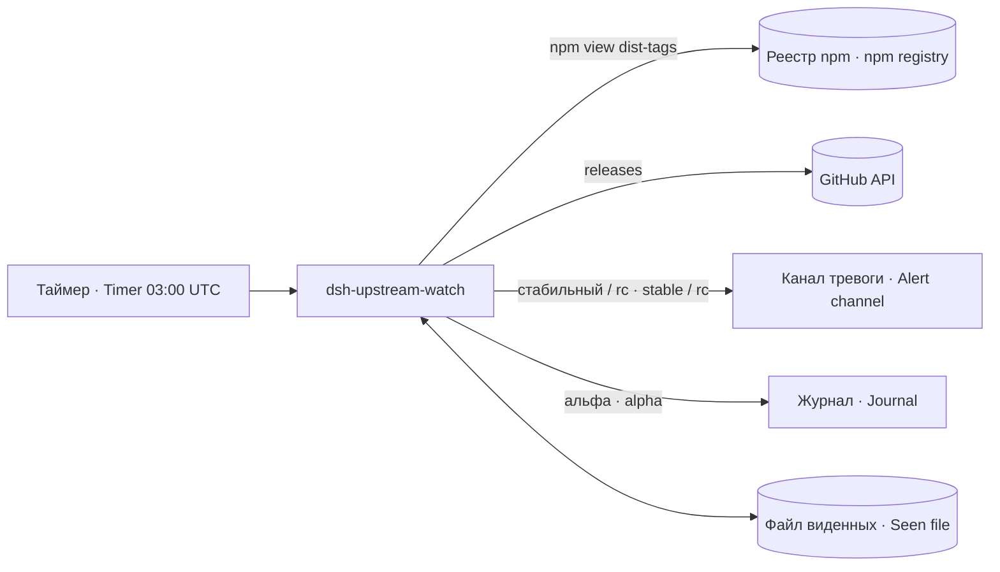

# dsh-upstream-watch · Сторож новых версий платформы DSH · DSH new-release watcher

Раз в сутки спрашивает у реестра npm все метки (dist-tags) пакета платформы и громко сообщает только о той новой версии, которую владелец готов ставить: релиз-кандидате или стабильной.

Once a day it asks the npm registry for all dist-tags of the platform package and alerts loudly only about a new version the owner is ready to install: a release candidate or a stable release.

## Зачем · Why

Новые версии платформы выходят под разными метками, и однажды новьё сидело в метке, которую никто не назвал. Сторож смотрит все метки сразу. Чтобы не превратиться в шум, он различает сорт версии: альфы пишет только в журнал, а тревожит о релиз-кандидатах и стабильных — это и есть сигнал «пора обновляться».

New platform versions appear under different tags, and once a new version sat under a tag nobody had named. The watcher looks at all tags at once. To avoid becoming noise it distinguishes version kinds: alphas go only to the journal, while release candidates and stable versions raise an alert — that is the "time to upgrade" signal.

## Как работает · How it works

1. `npm view <пакет> dist-tags --json` (60 с предел). Пустой ответ — слепота, код 2, а не «нового нет».
2. Каждая версия сверяется с файлом виденных версий; виденная — пропускается. Установленная у нас версия (из `DSH_PACKAGE_JSON`) тоже считается виденной.
3. Сорт по prerelease-части semver: нет части — стабильный; `rc*` — релиз-кандидат; прочее — альфа.
4. Описание релиза берётся с GitHub целиком (без обрезки) и проверяется на признаки безопасности (`DSH_BEZOPASNOST`).
5. Стабильный/релиз-кандидат → тревога; альфа с признаком безопасности → тревога с оговоркой «ставить не предлагаю»; прочая альфа → только `logger -t dsh-upstream-watch`. Версия дописывается в файл виденных.

1. `npm view <package> dist-tags --json` (60 s limit). An empty answer is blindness, exit 2, not "nothing new".
2. Each version is checked against the seen-versions file; seen ones are skipped. The installed version (from `DSH_PACKAGE_JSON`) also counts as seen.
3. Kind by the semver prerelease part: none — stable; `rc*` — release candidate; anything else — alpha.
4. Release notes are fetched from GitHub whole (not truncated) and searched for security markers (`DSH_BEZOPASNOST`).
5. Stable/release candidate → alert; alpha with a security marker → alert with the caveat "not suggesting to install"; other alpha → only `logger -t dsh-upstream-watch`. The version is appended to the seen file.

## Настройки · Settings

Все настройки — переменные окружения (в юните — через drop-in с `EnvironmentFile=`).

All settings are environment variables (in the unit — via a drop-in with `EnvironmentFile=`).

| Имя · Name | Тип · Type | Умолчание · Default | Смысл · Meaning | Пример · Example | Если неверно · If wrong |
|---|---|---|---|---|---|
| `DSH_PAKET` | строка · string | `@deepseek-ai/dsh` | пакет в npm · npm package | `@deepseek-ai/dsh` | реестр молчит → код 2 · registry silent → exit 2 |
| `DSH_REPO` | `владелец/репо` · `owner/repo` | `deepseek-ai/deepseek-harness` | репозиторий описаний релизов · release-notes repo | `org/repo` | точный тег `v<версия>`/`<версия>` не получен или ответ не объект релиза → для новой альфы код 2 без записи версии; полученный объект с пустым body — признака безопасности нет · exact `v<version>`/`<version>` tag missing or invalid release object → a new alpha exits 2 without recording; valid object with an empty body has no security marker |
| `DSH_SOSTOYANIE` | путь · path | `/var/lib/dsh-upstream-watch/vidennye.txt` <!-- vorota-ob:dopusk=PUT --> | файл виденных версий · seen-versions file | `/var/lib/x/seen.txt` | нет прав записи → повторные тревоги каждый день · not writable → repeated alerts daily |
| `DSH_ALERT` | команда · command | `agent-alert` (из PATH · from PATH) | канал тревоги, текст HTML первым доводом · alert channel, HTML text as 1st arg | `/usr/local/bin/agent-alert` | нет команды или доставка отказала → код 3, юнит failed; версия не записана, повтор · missing or failed delivery → exit 3, unit failed; version not recorded, retry |
| `DSH_BEZOPASNOST` | ERE | `security\|vulnerabilit\|CVE-\|безопасн\|уязвим` | признаки безопасности · security markers | `security\|CVE-` | негодный ERE → признак не найден никогда · invalid ERE → never found |
| `DSH_PACKAGE_JSON` | путь · path | пусто · empty | package.json приложения с установленной версией · app package.json with the installed version | `/opt/<agent-home>/app/package.json` | пусто → сторож говорит «НЕ НАСТРОЕНО» и один раз объявит нашу версию новой · empty → prints "НЕ НАСТРОЕНО" and announces our own version as new once |

## Что ловит и чего НЕ ловит · What it catches and does NOT catch

Ловит: в реестре появилась версия, которой мы не видели, под любой меткой.

Catches: a version we have not seen appears in the registry under any tag.

НЕ ловит: годна ли версия нам; переименование пакета или смену репозитория; бета-версии отдельно (идут как альфа). Если npm недоступен либо точный объект релиза новой альфы не получен, это слепота, код 2; альфа не записывается и повторяется. Полученный объект релиза с пустым body не содержит признака безопасности. Молчание при коде 0 значит «нового среди меток нет».

Does NOT catch: whether the version suits us; a renamed package or moved repository; betas separately (treated as alpha). An unavailable npm registry or missing exact release object for a new alpha gives blindness, exit 2; the alpha is not recorded and is retried. A valid release object with an empty body contains no security marker. Silence with exit 0 means "nothing new among the tags".

## Куда кричит · Where it alerts

В канал `DSH_ALERT` (команда пакета тревог). Версии-альфы без признака безопасности — только в журнал под тегом `dsh-upstream-watch`.

To the `DSH_ALERT` channel (the alert package command). Alphas without a security marker go only to the journal under the tag `dsh-upstream-watch`.

## Коды выхода · Exit codes

`0` — нового нет · nothing new; `1` — есть новое · something new; `2` — слепота: реестр не ответил или метки не разобраны; с 1.0.1 и объект релиза точного тега не добыт (отказ `curl` или негодный объект) при новой альфе — альфа не записана, повторится · blindness: registry silent or tags unparsable; since 1.0.1 also release notes not obtained for a new alpha — not recorded, retried; `3` (с 1.0.2) — тревога не доставлена: версия не записана, повтор; юнит failed · (since 1.0.2) alert not delivered: not recorded, retried; unit failed. Юнит считает успехом все три (`SuccessExitStatus=0 1 2`): «не смогли спросить» — не поломка службы.

The unit treats all three as success (`SuccessExitStatus=0 1 2`): "could not ask" is not a service failure.

## Стенд · Test stand

`test/stend-dsh-upstream-watch.sh` — три пробы (исправное молчит · новая rc-версия краснеет и называет версию · вход возвращён — снова тишина) и проба слепоты; с 1.0.1 ещё три: отказ `curl` → слепота и альфа не записана · источник вернулся → альфа с безопасностью повторена · негодный объект релиза при коде 0 → слепота. npm и curl подставные, сеть не трогается.

`test/stend-dsh-upstream-watch.sh` — three probes (healthy is quiet · a new rc version turns red naming it · input restored — quiet again) plus a blindness probe. npm and curl are stubs; the network is not touched.

### Точный релиз · Exact release

Описание запрашивается по `/releases/tags/v<версия>`, затем при отказе по `/releases/tags/<версия>`: не больше двух запросов по40с на новую версию. `tag_name` обязан совпасть точно; ответ — объект с body строкой либо null. Без годного ответа новая альфа не записывается, код2; rc/стабильная всё равно вызывает тревогу. Пустой body годного объекта означает отсутствие найденного признака, а не доказательство безопасности.

Notes are requested from `/releases/tags/v<version>`, then `/releases/tags/<version>` if needed: at most two requests,40s each, per new version. `tag_name` must match exactly; the response is an object with string/null body. Without a valid response a new alpha is not recorded and exits2; rc/stable still raises an alert. An empty valid body means no marker found, not proven safety.
