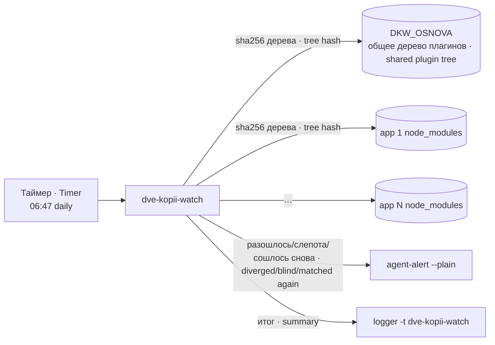

# dve-kopii-watch · Two-copies-of-platform-packages watchdog

Сторож «две копии пакетов платформы»: сверяет КОД 9 общих пакетов в общем дереве плагинов и в `node_modules` каждой установки агента; разошёлся код — тревога.

A "two copies of the platform packages" watchdog: compares the CODE of 9 shared packages in the shared plugin tree and in every agent installation's `node_modules`; code diverged — alert.

## Зачем · Why

В процессе каждого агента платформы живут две копии общих пакетов: ядро берёт их из `node_modules` своей установки, плагины памяти — из общего дерева плагинов. Пока код копий одинаков, это безопасно. Когда копии расходятся кодом, `instanceof HarnessError` (dsh-llm) и `instanceof TimeoutReason` (dsh-timeout) через границу копий дают ложь, а две версии договора молча живут в одном процессе.

Every platform agent process holds two copies of the shared packages: the core loads them from its installation's `node_modules`, the memory plugins from the shared plugin tree. While both copies have the same code this is safe. When they diverge in code, `instanceof HarnessError` (dsh-llm) and `instanceof TimeoutReason` (dsh-timeout) across the copy boundary return false, and two contract versions silently live in one process.

## Как работает · How it works

Для каждого из 9 пакетов (`@deepseek-ai/cordis`, `@deepseek-ai/cosmokit`, `@deepseek-ai/schemastery`, `@deepseek-ai/dsh-attachment`, `@deepseek-ai/dsh-brand`, `@deepseek-ai/dsh-invariants`, `@deepseek-ai/dsh-llm`, `@deepseek-ai/dsh-timeout`, `@standard-schema/spec`) считается сумма дерева БЕЗ верхнего `package.json` и без вложенных `node_modules`: строка версии и диапазоны зависимостей не в счёт (4.0.1↔4.0.2 при одинаковом коде — не повод). Сумма основы сравнивается с суммой в каждой установке из `DKW_APPS`. При расхождении печатаются пакет, оба пути, обе суммы и первые три различающихся файла (`лишний`/`нет`/`разный`).

For each of the 9 packages (`@deepseek-ai/cordis`, `@deepseek-ai/cosmokit`, `@deepseek-ai/schemastery`, `@deepseek-ai/dsh-attachment`, `@deepseek-ai/dsh-brand`, `@deepseek-ai/dsh-invariants`, `@deepseek-ai/dsh-llm`, `@deepseek-ai/dsh-timeout`, `@standard-schema/spec`) a tree hash is computed WITHOUT the top-level `package.json` and without nested `node_modules`: the version string and dependency ranges do not count (4.0.1↔4.0.2 with identical code is no reason). The base hash is compared with the hash in every installation from `DKW_APPS`. On divergence it prints the package, both paths, both hashes and the first three differing files (`лишний` extra / `нет` missing / `разный` different).

Тревога при красном или слепоте идёт на КАЖДОМ прогоне (суточный таймер = раз в сутки, пока не починят); при возврате в норму — одна строка «снова совпадают». Если канал не подтвердил доставку, состояние не пишется (повтор на следующем прогоне), исход 2.

On red or blindness the alert goes out on EVERY run (daily timer = once a day until fixed); on return to normal — one "matched again" line. If the channel did not confirm delivery, the state is not written (repeat on the next run), exit 2.

Без настроек `DKW_OSNOVA` и `DKW_APPS` сторож не сверяет ничего и прямо говорит `НЕ НАСТРОЕНО …`, исход 2 (юнит упадёт и это будет видно), тревогу не шлёт и состояние не пишет.

Without `DKW_OSNOVA` and `DKW_APPS` the watchdog compares nothing and says `НЕ НАСТРОЕНО …` (not configured), exit 2 (the unit fails visibly); it sends no alert and writes no state.

## Настройки · Settings

| Имя · Name | Тип · Type | Умолчание · Default | Смысл · Meaning | Пример · Example | Если неверно · If wrong |
|---|---|---|---|---|---|
| `DKW_OSNOVA` | путь · path | пусто = не настроено · empty = not configured | `node_modules` общего дерева плагинов · `node_modules` of the shared plugin tree | `/opt/<plugins>/node_modules` | Нет каталога пакета — СЛЕПОТА по каждому пакету, исход 2 · Missing package dir — blindness per package, exit 2 |
| `DKW_APPS` | список `имя=каталог` через пробел · space-separated `name=dir` | пусто = не настроено · empty = not configured | `node_modules` установок агентов; порядок = порядок вывода · agent installations' `node_modules`; order = output order | `a=/opt/<agent-home>/app/node_modules b=/srv/b/app/node_modules` | Элемент без `=` — ошибка разбора, код 2; нет каталога — СЛЕПОТА; установки нет в списке — она вне сторожа · Item without `=` — parse error, exit 2; missing dir — blindness; installation not listed — not watched |
| `DKW_SOSTOYANIE` | путь · path | `/var/lib/dve-kopii-watch/posledniy-ishod` | Последний исход (для строки «снова совпадают») · Last outcome (for "matched again") | — | Не пишется — «снова совпадают» не скажется · Not writable — "matched again" is never said |
| `DKW_ALERT` | путь · path | `/usr/local/bin/agent-alert` | Канал тревоги (`--plain -- текст`) · Alert channel | `/usr/local/bin/agent-alert` | Нет команды — «СЛЕПОТА канала», исход 2 · Missing — channel blindness, exit 2 |
| `DKW_MASHINA` | строка · string | имя узла · node name | Имя машины в тексте тревоги · Machine name in the alert | `node1` | Только текст · Text only |
| `DKW_PODPIS` | строка · string | `dve-kopii-watch` | Подпись «кто» в тексте тревоги · "Who" signature in the alert | `dve-kopii-watch` | Только текст · Text only |

Доводы командной строки (для стенда): `--osnova КАТАЛОГ` заменяет `DKW_OSNOVA`; `--app ИМЯ=КАТАЛОГ` (повторяемый) заменяет `DKW_APPS` целиком; `--tolko-pechat` — только печать, без тревоги и состояния. `DKW_APPS` должен содержать ФАКТИЧЕСКИЕ app служб, снятые с их `ExecStart` (`systemctl cat <служба>`), а не шаблон каталогов: каталог, который не запускает ни одна служба, даёт ложный красный.

Command-line arguments (for the test stand): `--osnova DIR` replaces `DKW_OSNOVA`; `--app NAME=DIR` (repeatable) replaces `DKW_APPS` entirely; `--tolko-pechat` — print only, no alert, no state. `DKW_APPS` must hold the ACTUAL service apps taken from their `ExecStart` (`systemctl cat <service>`), not a directory template: a directory no service runs gives a false red.

## Адресная отсрочка монтажа · Scoped installation deferral

`--avto-montazh` ничего не чинит и не монтирует: он спрашивает `montazh-okno` из пакета `dsh-montazh` (`MONTAZH_OKNO_BIN`, умолчание `/usr/local/sbin/montazh-okno`). По каждому точному отличающемуся файлу проверяются обе стороны пары, один вызов на предмет с пределом 5 с. Если все предметы подтверждены действующим окном, пара отложена (код 4), не зелёная; срок окна не больше 1800 с. Другой отличающийся файл или слепота не глушатся. Без помощника или подтверждения действует строгий результат сверки. Ответ 6 вызывает пересъём пары; перед итогом срок/поколение проверяются снова, допускается один повтор всего замера (`DKW_MO_RESCAN` — внутренний признак), повторная смена — код 2. Код 4 не переписывает прежнее состояние и не отправляет «снова совпадают». Ручной вызов без ключа строгий; пакетный юнит включает `--avto-montazh`. Его `SuccessExitStatus=1` не включает 4, поэтому отложенный исход виден как failed.

`--avto-montazh` does not repair or install: it queries `montazh-okno` from `dsh-montazh` (`MONTAZH_OKNO_BIN`, default `/usr/local/sbin/montazh-okno`). Each exact differing file is checked on both sides of the pair, one call per subject with a 5 s limit. If every subject is covered by a current window, the pair is deferred (exit 4), not green; the window lasts at most 1800 s. Other differences and blindness are not suppressed. Missing helper or confirmation leaves the strict comparison result. Reply 6 resamples the pair; expiry/generation are rechecked before the result, allowing one whole-pass retry (`DKW_MO_RESCAN` is internal); a second change exits 2. Exit 4 neither overwrites previous state nor sends "matched again". A manual call without the flag is strict; the packaged unit enables `--avto-montazh`. Its `SuccessExitStatus=1` does not include 4, so a deferred outcome is failed.

## Что ловит и чего НЕ ловит · What it catches and does NOT catch

Ловит: расхождение кода (любой файл, кроме верхнего `package.json`; символьные ссылки — по цели ссылки как строке) 9 пакетов между основой и каждой установкой из списка.

Catches: code divergence (any file except the top-level `package.json`; symlinks by their target string) of the 9 packages between the base and each listed installation.

НЕ ловит (класс «две копии» этим не закрыт): вложенные `node_modules` внутри пакета; пакеты вне списка из 9; установки вне `DKW_APPS`; плагины, загружаемые не из общего дерева; то, что РЕАЛЬНО загружено в живом процессе (сверяется диск, а не память: пакет обновили, процесс не перезапущен — сторож зелёный); расхождение, спрятанное в `package.json` (`exports`/`main` указывает на другой файл). Пакета нет в установке — это не две копии: строка «нет в app», не красное.

Does NOT catch (the "two copies" class is not closed by it): nested `node_modules` inside a package; packages outside the list of 9; installations outside `DKW_APPS`; plugins not loaded from the shared tree; what is ACTUALLY loaded in a live process (disk is compared, not memory: package updated, process not restarted — watchdog green); a divergence hidden in `package.json` (`exports`/`main` pointing to another file). A package missing from an installation is not two copies: a "нет в app" (not in app) line, not red.

## Куда кричит · Where it alerts

`DKW_ALERT --plain -- "<текст до 3500 знаков>"`. Итоговая строка каждого прогона — одной строкой `logger -t dve-kopii-watch`; stdout юнита — под тегом `dve-kopii-watch-vyvod`.

`DKW_ALERT --plain -- "<text up to 3500 chars>"`. Every run's summary — one line `logger -t dve-kopii-watch`; the unit's stdout — under tag `dve-kopii-watch-vyvod`.

## Коды выхода · Exit codes

| Код · Code | Смысл · Meaning |
|---|---|
| 0 | Код совпал везде · Code matched everywhere |
| 1 | Разошёлся код, тревога ушла (юнит: `SuccessExitStatus=1`) · Code diverged, alert delivered |
| 2 | Слепота (дерево не читается, нет основы, тревога не ушла) или не настроено · Blindness (tree unreadable, no base, alert not delivered) or not configured |
| 4 | Адресно отложено действующим окном; не зелёное, состояние не меняется и отбоя нет, юнит failed · Scoped deferral by a current window; not green, state unchanged, no recovery alert, unit failed |

## Юниты и стенд · Units and test stand

`systemd/dve-kopii-watch.service` (oneshot, `--avto-montazh`, `SuccessExitStatus=1`, код 4 не включён · exit 4 not included) и `.timer` (ежедневно 06:47, разброс 5 мин); настройки — drop-in-ом `Environment=`. Стенд — `test/stend-dve-kopii.sh`: подставные деревья, канал и `logger` — заглушки; пробы: не настроено → говорит; совпало (разный только `package.json`) → тишина; порча кода → красное с именем пакета, установки и файла; порча снята → одна строка «снова совпадают» → тишина; пакета нет в app → не красное.

`systemd/dve-kopii-watch.service` (oneshot, `--avto-montazh`, `SuccessExitStatus=1`; exit 4 is not included) and `.timer` (daily 06:47, 5 min spread); settings via a drop-in `Environment=`. Test stand — `test/stend-dve-kopii.sh`: fake trees, stub channel and `logger`; probes: not configured → says so; equal (only `package.json` differs) → silence; code fault → red naming package, installation and file; fault removed → one "matched again" line → silence; package missing from app → not red.
