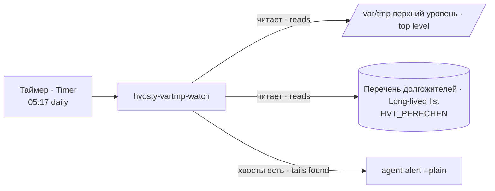

# hvosty-vartmp-watch · /var/tmp leftovers watchdog

Сторож брошенных «хвостов» верхнего уровня `/var/tmp`: раз в сутки называет записи старше 72 часов, которых нет в перечне долгожителей. Только отчёт — ничего не удаляет.

A watchdog for abandoned top-level "leftovers" in `/var/tmp`: once a day it names entries older than 72 hours that are not in the long-lived list. Report only — it deletes nothing.

## Зачем · Why

`/var/tmp` не чистит никто: у systemd-tmpfiles для него обычно нет правил. Временные каталоги проб, брошенные при повторе попытки, лежат там, пока их не найдут руками. Удалять сам сторож не должен: tmpfiles судит по файлу, а не по дереву (живой каталог потрошит частично), а в `/var/tmp` лежат карантины с возвратом и кандидаты на монтаж. Поэтому сторож только сообщает, а удаляет хозяин.

Nobody cleans `/var/tmp`: systemd-tmpfiles usually has no rules for it. Test directories abandoned on a retry stay there until someone finds them by hand. The watchdog must not delete by itself: tmpfiles judges by file, not by tree (it partially guts a live directory), and `/var/tmp` holds restorable quarantines and installation candidates. So the watchdog only reports; the owner deletes.

## Как работает · How it works

Для каждой записи верхнего уровня (кроме `systemd-private-*`) возраст считается по НОВЕЙШЕМУ mtime во всём её дереве, а не по mtime каталога: он не меняется, когда пишут глубже. Запись старше порога и не исключённая перечнем попадает в одно сообщение тревоги: имя · владелец · объём · возраст (до 30 строк, дальше «… и ещё N»).

For every top-level entry (except `systemd-private-*`) the age is the NEWEST mtime in its whole tree, not the directory's mtime: that does not change when writes happen deeper. An entry older than the threshold and not exempted by the list goes into one alert message: name · owner · size · age (up to 30 lines, then "… and N more").

Перечень долгожителей — текстовый файл, строка `<маска> <срок ГГГГ-ММ-ДД> <хозяин> | <причина>`; маска — fnmatch по имени верхнего уровня, `#` — комментарий. Пока срок не истёк, запись молчит; истёк — снова видна с пометкой «срок исключения истёк». Негодная строка не исключает ничего и делает исход «слепота» (2), остальное при этом работает.

The long-lived list is a text file, one line `<mask> <expiry YYYY-MM-DD> <owner> | <reason>`; the mask is fnmatch on the top-level name, `#` starts a comment. Until expiry the entry is silent; after expiry it is visible again, marked "exemption expired". An invalid line exempts nothing and makes the outcome "blindness" (2); everything else still works.

Состояния на диске нет намеренно: остывание — это суточный такт таймера. Ручной прогон повторит тревогу — это его смысл.

There is deliberately no on-disk state: the cool-down is the daily timer tick. A manual run repeats the alert — that is its purpose.

## Настройки · Settings

| Имя · Name | Тип · Type | Умолчание · Default | Смысл · Meaning | Пример · Example | Если неверно · If wrong |
|---|---|---|---|---|---|
| `HVT_PERECHEN` | путь · path | `/etc/hvosty-vartmp-watch/dolgozhiteli.txt` | Перечень долгожителей · Long-lived list | `/etc/hvosty-vartmp-watch/dolgozhiteli.txt` | Файла нет — перечень пуст, хвостом назовётся всё старое (громко, не вредно) · Missing file — empty list, every old entry is reported (loud, harmless) |
| `VT_KOREN` | путь · path | `/var/tmp` | Только для стенда: проверяемый корень · Test only: root to scan | `/tmp/fake-root` | Печатается строкой «ПОДМЕНА» · Printed as a "ПОДМЕНА" (override) line |
| `VT_PERECHEN` | путь · path | — | Только для стенда; главнее `HVT_PERECHEN` · Test only; wins over `HVT_PERECHEN` | `/tmp/list.txt` | То же · Same |
| `VT_ALERT` | путь · path | `/usr/local/bin/agent-alert` | Только для стенда: канал тревоги · Test only: alert channel | `/tmp/alert-stub` | То же · Same |
| `VT_POROG_CH` | число · number | `72` | Только для стенда: порог в часах · Test only: threshold, hours | `1` | Не число — падение Python · Not a number — Python crash |
| `VT_SEGODNYA` | дата · date | сегодня UTC · today UTC | Только для стенда: «сегодня» для сроков · Test only: "today" for expiries | `2030-01-01` | То же · Same |

Настройка в юнит подаётся drop-in-ом: `systemctl edit hvosty-vartmp-watch.service` → `[Service]` `Environment="HVT_PERECHEN=…"`.

The setting reaches the unit through a drop-in: `systemctl edit hvosty-vartmp-watch.service` → `[Service]` `Environment="HVT_PERECHEN=…"`.

## Что ловит и чего НЕ ловит · What it catches and does NOT catch

Ловит: записи верхнего уровня `/var/tmp`, в дереве которых ничего не менялось дольше порога; истёкшие исключения; негодные строки перечня.

Catches: top-level `/var/tmp` entries whose tree has not changed for longer than the threshold; expired exemptions; invalid list lines.

НЕ ловит: хвосты глубже верхнего уровня и вне `/var/tmp` (`/tmp`, домашние каталоги); подделанный mtime (`touch -d`) — возраст врёт в любую сторону; цели символьных ссылок (объём и возраст — самой ссылки). Живую запись, которую только читают дольше порога, назовёт хвостом: тревога ложная, но громкая, лечится строкой перечня.

Does NOT catch: leftovers below the top level and outside `/var/tmp` (`/tmp`, home directories); a forged mtime (`touch -d`) — the age lies either way; symlink targets (size and age are of the link itself). A live entry that is only read for longer than the threshold will be called a leftover: a false but loud alert, cured by a list line.

## Куда кричит · Where it alerts

Одним вызовом `agent-alert --plain -- "<текст>"`. Итоговая строка и перечень хвостов — в stdout (в журнал юнита под тегом `hvosty-vartmp-watch`).

One call `agent-alert --plain -- "<text>"`. The summary line and the list of leftovers go to stdout (the unit journal under tag `hvosty-vartmp-watch`).

## Коды выхода · Exit codes

| Код · Code | Смысл · Meaning |
|---|---|
| 0 | Хвостов нет · No leftovers |
| 1 | Хвосты есть, тревога ушла (юнит: `SuccessExitStatus=1`) · Leftovers found, alert delivered |
| 2 | Слепота: корень или перечень не читается, строка перечня негодна · Blindness: root or list unreadable, invalid list line |
| 3 | Хвосты есть, тревога НЕ ушла · Leftovers found, alert NOT delivered |

## Юниты и стенд · Units and test stand

`systemd/hvosty-vartmp-watch.service` (oneshot) и `.timer` (ежедневно 05:17, разброс 5 мин). Стенд — `test/stend-hvostov.sh`: подставной корень, канал-заглушка, 11 проб (свежее молчит, старое кричит, долгожитель молчит, истёкший кричит с пометкой, `systemd-private-*` молчит, возраст по дереву, негодная строка → 2, отказ канала → 3, хвостов нет → 0 и тишина).

`systemd/hvosty-vartmp-watch.service` (oneshot) and `.timer` (daily 05:17, 5 min spread). Test stand — `test/stend-hvostov.sh`: fake root, stub channel, 11 probes (fresh is quiet, old alerts, long-lived is quiet, expired alerts with a mark, `systemd-private-*` is quiet, age by tree, invalid line → 2, channel failure → 3, no leftovers → 0 and silence).
