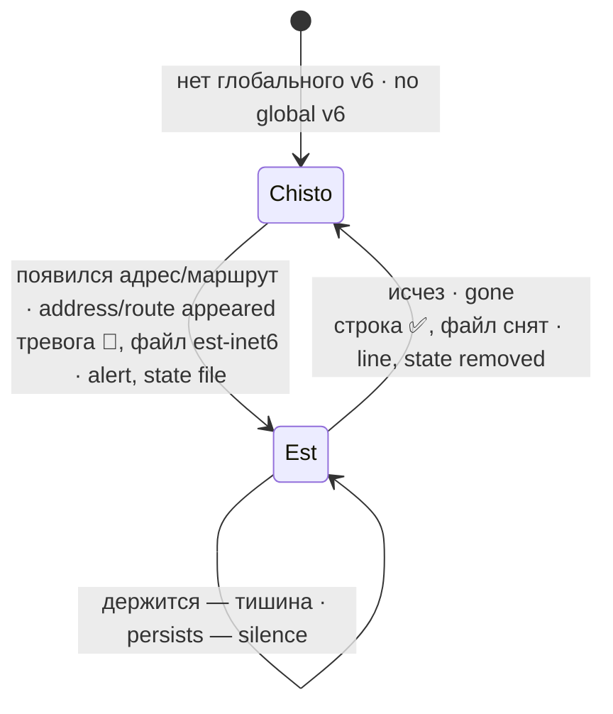

# inet6-poyavlenie-watch · Global IPv6 appearance watchdog

Сторож появления глобального IPv6: как только на машине появляется глобальный адрес inet6 или маршрут v6 по умолчанию — одна тревога; исчез — одна строка «исчез».

A watchdog for a global IPv6 address appearing: as soon as the machine gets a global inet6 address or a default v6 route — one alert; gone — one "disappeared" line.

## Зачем · Why

Node при двух семействах адресов пробует IPv6 первым и, если v6-маршрута нет, валится парой ETIMEDOUT+ENETUNREACH; в худший день таких пар было 26 в час. Лечение — «v4-first»: `net.ipv6.conf.all.disable_ipv6=1` и/или `precedence ::ffff:0:0/96 100` в `/etc/gai.conf`. Но защита держится на ADDRCONFIG и МОЛЧА исчезнет при первом же глобальном inet6: отказы вернутся и будут выглядеть как сетевые. Этот сторож — условие остановки защиты: он говорит, когда она перестала действовать.

With both address families Node tries IPv6 first and, without a v6 route, fails with an ETIMEDOUT+ENETUNREACH pair; on the worst day there were 26 such pairs per hour. The cure is "v4-first": `net.ipv6.conf.all.disable_ipv6=1` and/or `precedence ::ffff:0:0/96 100` in `/etc/gai.conf`. But the protection relies on ADDRCONFIG and will SILENTLY vanish with the first global inet6 address: the failures come back looking like network trouble. This watchdog is the protection's stop condition: it tells you when the protection no longer holds.

## Как работает · How it works

Сторож смотрит СОСТОЯНИЕ, а не событие: `ip -6 addr show scope global` и `ip -6 route show default`. Link-local (`fe80::`) и `::1` не считаются — они есть всегда и на выбор семейства не влияют. Порога нет: любой глобальный inet6 — повод. Анти-спам — файл `est-inet6` в каталоге состояния: тревога при появлении, строка при исчезновении, между ними тишина. В текст тревоги попадают оба слоя защиты: значение sysctl и есть ли строка precedence в gai.conf.

The watchdog looks at STATE, not events: `ip -6 addr show scope global` and `ip -6 route show default`. Link-local (`fe80::`) and `::1` do not count — they always exist and do not affect family selection. No threshold: any global inet6 is a reason. Anti-spam is the `est-inet6` file in the state directory: alert on appearance, a line on disappearance, silence in between. The alert text includes both protection layers: the sysctl value and whether gai.conf has the precedence line.

Отказ `ip` — это слепота, а не «адресов нет»: код 2, строка «СЛЕПОТА» в stderr и в журнал. Пустой успешный вывод `ip` законен.

An `ip` failure is blindness, not "no addresses": exit 2, a "СЛЕПОТА" (blindness) line to stderr and to the journal. An empty successful `ip` output is legitimate.

## Настройки · Settings

| Имя · Name | Тип · Type | Умолчание · Default | Смысл · Meaning | Пример · Example | Если неверно · If wrong |
|---|---|---|---|---|---|
| `INET6_STATE_DIR` | путь · path | `/var/lib/inet6-poyavlenie-watch` | Каталог файла состояния `est-inet6` · Directory of the `est-inet6` state file | `/var/lib/inet6-poyavlenie-watch` | Не создаётся — `mkdir` ругается, анти-спам не работает (тревога на каждом прогоне либо ни одной) · Cannot be created — `mkdir` complains, anti-spam breaks |

Канал тревоги не настраивается переменной: берётся первая найденная в `PATH` команда `agent-alert`, иначе `claudeclaw-alert`; нет ни одной — строка в журнал `ALERT(no sink)`.

The alert channel is not a variable: the first of `agent-alert`, then `claudeclaw-alert` found in `PATH`; neither — a journal line `ALERT(no sink)`.

## Что ловит и чего НЕ ловит · What it catches and does NOT catch

Ловит: появление любого глобального адреса inet6 и любого маршрута v6 по умолчанию; исчезновение их обоих.

Catches: the appearance of any global inet6 address and any default v6 route; the disappearance of both.

НЕ ловит: адрес, появившийся и исчезнувший между двумя прогонами (такт 30 мин); отказы самих приложений по IPv6 (смотрит источник, а не следствие); снятие sysctl/precedence без появления адреса (это видно только в тексте следующей тревоги). Если тревога не доставлена, состояние не меняется, код 1; следующий прогон повторяет доставку.

Does NOT catch: an address that appeared and vanished between two runs (30 min tick); the applications' own IPv6 failures (it watches the source, not the effect); removal of sysctl/precedence without an address appearing (only visible in the next alert's text). If an alert is not delivered, state stays unchanged and the module exits 1; the next run retries delivery.

## Куда кричит · Where it alerts

`agent-alert "<html>"` (или `claudeclaw-alert`), один вызов на смену состояния. В журнал (`logger -t inet6-poyavlenie-watch`): `ALERT: …`, `RECOVERED: …`, на каждом чистом прогоне `чисто: …`, при слепоте `СЛЕПОТА: …`.

`agent-alert "<html>"` (or `claudeclaw-alert`), one call per state change. To the journal (`logger -t inet6-poyavlenie-watch`): `ALERT: …`, `RECOVERED: …`, on every clean run `чисто: …` (clean), on blindness `СЛЕПОТА: …`.

## Коды выхода · Exit codes

| Код · Code | Смысл · Meaning |
|---|---|
| 0 | Прогон состоялся; тревога, если была, доставлена · The run happened; an alert, if any, was delivered |
| 1 | (с 1.0.1) тревога не доставлена — состояние не тронуто, следующий прогон повторит · (since 1.0.1) alert not delivered — state untouched, the next run repeats |
| 2 | Слепота: `ip` или разбор его вывода отказал · Blindness: `ip` or its parsing failed |

## Юниты и стенд · Units and test stand

`systemd/inet6-poyavlenie-watch.service` (oneshot) и `.timer` (через 10 мин после загрузки, далее каждые 30 мин). Стенд — `test/stend-inet6-poyavlenie.sh`: `ip`, `logger`, `agent-alert` — заглушки первыми в `PATH`, состояние во временном каталоге; пробы: исправное молчит → порча (2001:db8::1) кричит → держится молча → снята, одна строка → снова тишина; отказ `ip` → 2.

`systemd/inet6-poyavlenie-watch.service` (oneshot) and `.timer` (10 min after boot, then every 30 min). Test stand — `test/stend-inet6-poyavlenie.sh`: `ip`, `logger`, `agent-alert` are stubs first in `PATH`, state in a temp directory; probes: healthy is quiet → fault (2001:db8::1) alerts → persists silently → removed, one line → silence again; `ip` failure → 2.
