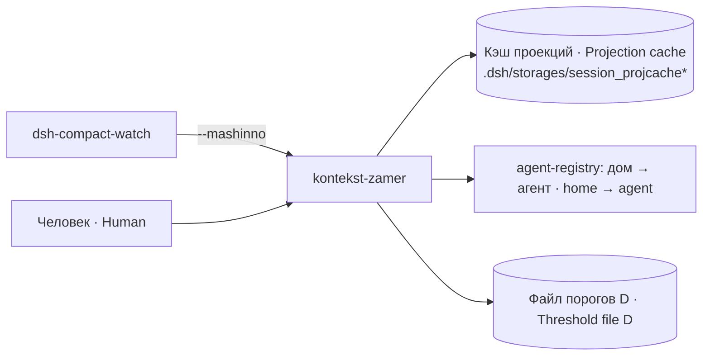

# kontekst-zamer · Прибор заполненности окна контекста · Context-window fill instrument

Печатает настоящую заполненность окна контекста каждой сессии каждого агента DSH на машине — по формуле самой платформы — и номинальный порог компакта из файла порогов агента.

Prints the real context-window fill of every session of every DSH agent on the machine — using the platform's own formula — and the nominal compaction threshold from the agent's threshold file.

## Зачем · Why

Чтобы число «сколько занято» было одним и тем же у человека (`/compact-status`), у сторожа компакта и у этого прибора. Величина — `projectedTokens = max(0, pressureTokens + surfaceTokens − sampledSurfaceTokens)` из пакета `@deepseek-ai/dsh-token-meter`. Порог и окно берутся готовыми из файла порогов D (`defaultRoute`), без пересчёта: при негодном D — «не измерено», а не подстановка старого числа.

So that "how full is it" is the same number for a human (`/compact-status`), for the compaction watcher and for this instrument. The quantity is `projectedTokens = max(0, pressureTokens + surfaceTokens − sampledSurfaceTokens)` from the `@deepseek-ai/dsh-token-meter` package. The threshold and window are taken ready-made from the threshold file D (`defaultRoute`), not recomputed: with an invalid D it reports "not measured" instead of substituting an old number.

## Где место · Where it sits

Своего юнита нет. Его вызывает сторож компакта `dsh-compact-watch` с ключом `--mashinno` и читает машинный формат; человек зовёт без ключей.

It has no unit of its own. The compaction watcher `dsh-compact-watch` calls it with `--mashinno` and reads the machine format; a human calls it without arguments.

## Как работает · How it works

1. Дома: `KONTEKST_ZAMER_DOMA` (явный список) либо поиск по шаблонам `KONTEKST_ZAMER_SHABLONY` — каталоги `.dsh`, в которых есть кэш проекций любой формы.
2. Для каждого дома реестр (`KONTEKST_REESTR_PRIBOR`, функция `zagruzit()`) даёт агента, а `chitat_porog_d()` — готовые `window`, `ratio`, `nominalThreshold` маршрута по умолчанию. Ошибка — строка «порог D НЕ ИЗМЕРЕН» / `status=ne_izmereno reason=D`.
3. Кэш проекций читается ПО ФАКТУ: есть каталог `session_projcache/sessions/` (DSH 0.2.0, документ на сессию, версия 7) — читается он, прежний файл не читается; иначе — файл `session_projcache.json` (DSH 0.1.1). Незнакомая версия документа — отказ.
4. Для каждой сессии: нет `pressureTokens`/окна — «не измерено»; нет `surfaceTokens`/`sampledSurfaceTokens` — только нижняя оценка (`tolko_pressure`); иначе — projected, доля, порог, остаток до порога. Окно кэша, отличное от окна D, помечается.

1. Homes: `KONTEKST_ZAMER_DOMA` (explicit list) or a search by `KONTEKST_ZAMER_SHABLONY` — `.dsh` directories that contain a projection cache of any form.
2. For each home the registry (`KONTEKST_REESTR_PRIBOR`, function `zagruzit()`) gives the agent, and `chitat_porog_d()` gives the ready `window`, `ratio`, `nominalThreshold` of the default route. An error yields "порог D НЕ ИЗМЕРЕН" / `status=ne_izmereno reason=D`.
3. The projection cache is read BY FACT: if the `session_projcache/sessions/` directory exists (DSH 0.2.0, one document per session, version 7) it is read and the old file is not; otherwise the `session_projcache.json` file (DSH 0.1.1). An unknown document version is a refusal.
4. Per session: no `pressureTokens`/window — "not measured"; no `surfaceTokens`/`sampledSurfaceTokens` — lower bound only (`tolko_pressure`); otherwise projected, ratio, threshold, remainder. A cache window that differs from D's window is flagged.

## Настройки · Settings

| Имя · Name | Тип · Type | Умолчание · Default | Смысл · Meaning | Пример · Example | Если неверно · If wrong |
|---|---|---|---|---|---|
| `KONTEKST_ZAMER_SHABLONY` | glob через «:» · ":"-separated globs | `/opt/*/.dsh` | где искать каталоги `.dsh` агентов · where to look for agents' `.dsh` | `/opt/*/.dsh:/srv/agents/*/.dsh` | агенты вне шаблона молча не видны; ни одного кэша → код 2 · agents outside the pattern are silently missed; no cache at all → exit 2 |
| `KONTEKST_ZAMER_DOMA` | пути через «:» · ":"-separated paths | пусто · empty | явный список домов (перекрывает шаблоны; для стендов) · explicit homes (overrides patterns; for stands) | `/tmp/fx/.dsh` | несуществующий дом → «кэш не прочитан» · missing home → "cache not read" |
| `KONTEKST_REESTR_PRIBOR` | путь · path | `/usr/local/bin/agent-registry` | Python-модуль реестра с `zagruzit()` и `chitat_porog_d()` · registry module | — | не загружается → у всех «порог D НЕ ИЗМЕРЕН» · fails to load → "D not measured" for all |
| `AGENTS_REGISTRY` | путь · path | (умолчание реестра · registry default) | файл реестра агентов (читает модуль реестра) · agent registry file | `agents.yaml` | см. выше · see above |
| `KOMPAKT_NASTROJKI_KATALOG` | путь · path | (умолчание реестра · registry default) | каталог файлов порогов D `<агент>.json` · directory of D files | `/etc/x/agents` | нет файла → «не измерено» · no file → "not measured" |

## Что ловит и чего НЕ ловит · What it catches and does NOT catch

Ловит: заполненность по формуле платформы; негодный D; незнакомую форму кэша; сессии, по которым поставщик ещё не отчитался.

Catches: fill by the platform's formula; an invalid D; an unknown cache form; sessions the provider has not reported yet.

НЕ ловит: effective-порог конкретного запроса с резервом ответа (только nominal `defaultRoute`); модель сессии из старого кэша не выводит; дома вне шаблонов (о них не знает и не говорит). Форма документа 0.2.0 снята с кода пакетов 0.2.0-rc.2, живая 0.2.0 не проверялась.

Does NOT catch: the effective per-request threshold with reply reserve (only nominal `defaultRoute`); does not infer the session model from an old cache; homes outside the patterns (it neither knows nor says). The 0.2.0 document shape was taken from 0.2.0-rc.2 package code; a live 0.2.0 was not verified.

## Вывод и коды · Output and exit codes

Без ключей — таблица для человека; `--mashinno` — строки `v=1 agent=… sessiya=… projected=… okno=… dolya=… porog=… dolya_poroga=… okno_ist=D route_source=defaultRoute threshold_kind=nominal` (или `status=ne_izmereno|tolko_pressure|fail_read`).

Without arguments — a human table; `--mashinno` — `v=1 …` lines as above (or `status=ne_izmereno|tolko_pressure|fail_read`).

`0` — хотя бы одна величина получена · at least one value; `1` — сессии есть, ни одной величины · sessions exist, no value; `2` — ни одного кэша не найдено: прибор слеп · no cache found: the instrument is blind. Логгер, канал тревоги и systemctl прибор не зовёт — только читает.

It calls no logger, alert channel or systemctl — read only.

## Стенд · Test stand

`test/stend-doli-preseta.sh` — функции и цикл вывода извлекаются из настоящего файла через AST и гоняются на подставных D/кэше: готовые числа D, смена defaultRoute, обе формы кэша, девять видов негодного D без подстановки. Нужен `agent-registry` из `a2a-bus` (`KONTEKST_REESTR_PRIBOR`, по умолчанию `/usr/local/bin/agent-registry`) и Python 3 с `yaml`; если зависимость не прочитана — слепота, код 2. С `AGENTS_REGISTRY` и `KOMPAKT_NASTROJKI_KATALOG` дополнительно сверяет прибор с живыми D (только чтение).

`test/stend-doli-preseta.sh` — functions and the output loop are extracted from the real file via AST and run on fixture D/cache: ready D numbers, defaultRoute switch, both cache forms, nine kinds of invalid D with no fallback. Requires `agent-registry` from `a2a-bus` (`KONTEKST_REESTR_PRIBOR`, default `/usr/local/bin/agent-registry`) and Python 3 with `yaml`; an unreadable dependency gives blindness, exit 2. With `AGENTS_REGISTRY` and `KOMPAKT_NASTROJKI_KATALOG` it also compares the instrument with live D files (read only).
