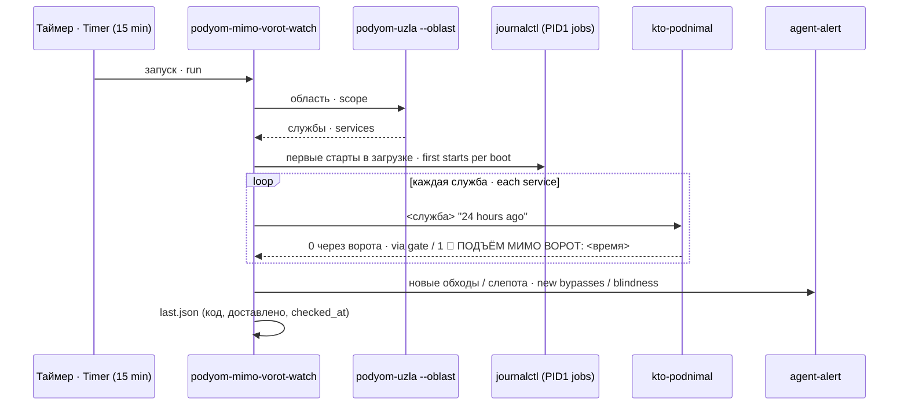

# podyom-mimo-vorot-watch · Start-bypassing-the-gate watchdog

Сторож «подъём мимо ворот»: каждые 15 минут спрашивает прибор, не была ли служба агента поднята в обход штатных ворот подъёма (`podyom-uzla`), и о каждом новом обходе говорит человеку один раз.

A "start bypassing the gate" watchdog: every 15 minutes it asks a probe whether an agent service was started bypassing the standard start gate (`podyom-uzla`), and tells a human once about every new bypass.

## Зачем · Why

Ворота подъёма снимают базу и проверяют состав перед стартом службы. Голый `systemctl restart` рукой, авторестарт по падению, подъём после загрузки проходят мимо них. Прибор `kto-podnimal` умеет отличить «через ворота» от «мимо», но пока его никто не звал, об обходах не узнавал никто. Этот сторож — назначенный зовущий прибора.

The start gate takes a base snapshot and checks composition before a service starts. A bare manual `systemctl restart`, an auto-restart after a crash, a start after boot all bypass it. The probe `kto-podnimal` can tell "via the gate" from "bypassing", but while nobody called it nobody learned about bypasses. This watchdog is the probe's designated caller.

## Как работает · How it works

Область (какие службы смотреть) берётся вызовом `podyom-uzla --oblast` — та же, что у ворот, без своей копии списка. Ворота не ответили или область пуста — это СЛЕПОТА с тревогой (код 2), а не откат на какой-то список: тихий откат — та же беда. `PMV_SLUZHBY` перекрывает вызов (для стенда).

The scope (which services to watch) comes from calling `podyom-uzla --oblast` — the same as the gate's, without a private copy. Gate silent or scope empty is BLINDNESS with an alert (code 2), not a fallback to some list: a silent fallback is the same trouble. `PMV_SLUZHBY` overrides the call (for the test stand).

Для каждой службы прибор зовётся с окном 24 часа. Каждое время подъёма «мимо» сверяется с файлом «сказанного» (`PMV_SOST`): уже сказанное не повторяется, записи старше трёх суток забываются. Отметка ставится только после подтверждённой доставки: не доставлено — скажется в следующий прогон.

For each service the probe is called with a 24-hour window. Every "bypass" start time is checked against the "already said" file (`PMV_SOST`): what was said is not repeated, entries older than three days are forgotten. The mark is set only after confirmed delivery: not delivered — it will be said on the next run.

Подъём при начальной загрузке исключается, только если журнал PID1 это подтверждает: первый успешный старт службы в данной загрузке, раньше первого `multi-user.target` и не позже 60 с monotonic от начала загрузки; при неоднозначности (два старта в одну секунду) исключения нет. Нет метаданных журнала — слепота, а не молчание.

A start during initial boot is exempted only when the PID1 journal confirms it: the service's first successful start in that boot, before the first `multi-user.target` and no later than 60 s monotonic from boot start; with ambiguity (two starts in the same second) there is no exemption. No journal metadata — blindness, not silence.

Итог каждого прогона (при ЛЮБОМ выходе) пишется в `PMV_ITOG` как JSON `{code, dostavleno: da|net|nechego, text, checked_at}` — его может читать healthcheck: чтение без записи повторять безопасно.

Every run's result (on ANY exit) is written to `PMV_ITOG` as JSON `{code, dostavleno: da|net|nechego, text, checked_at}` — a healthcheck may read it: read-only access is safe to repeat.

## Настройки · Settings

| Имя · Name | Тип · Type | Умолчание · Default | Смысл · Meaning | Пример · Example | Если неверно · If wrong |
|---|---|---|---|---|---|
| `PMV_PODYOM` | путь · path | `/usr/local/bin/podyom-uzla` | Ворота подъёма, источник области (`--oblast`) · Start gate, scope source | — | Нет/отказ — СЛЕПОТА с тревогой, код 2 · Missing/failing — blindness with alert, exit 2 |
| `PMV_PRIBOR` | путь · path | `/usr/local/bin/kto-podnimal` | Прибор «кто поднимал» · "Who started it" probe | — | Не исполняем — СЛЕПОТА, код 2 (тревоги нет — сказать не о чем) · Not executable — blindness, exit 2 |
| `PMV_ALERT` | путь · path | `/usr/local/bin/agent-alert` | Канал тревоги · Alert channel | — | Отказ — `dostavleno: net`, повтор в следующий прогон · Failure — `dostavleno: net`, repeat next run |
| `PMV_SOST` | путь · path | `/var/lib/podyom-mimo-vorot-watch/soobshcheno.txt` | Сказанное (служба\|время; slepota\|дата) · Already said | — | Не заводится — СЛЕПОТА, код 2 · Cannot create — blindness, exit 2 |
| `PMV_ITOG` | путь · path | `/var/lib/podyom-mimo-vorot-watch/last.json` | Итог для healthcheck · Result for the healthcheck | — | Не пишется — предупреждение в stdout · Not writable — warning to stdout |
| `PMV_OKNO` | строка `date -d` · string | `24 hours ago` | Окно прибора · Probe window | `6 hours ago` | Прибор откажет — СЛЕПОТА по службе · Probe fails — per-service blindness |
| `PMV_SLUZHBY` | список · list | — (вызов ворот · gate call) | Список служб без `.service` (стенд) · Service list (test stand) | `a b` | Перекрывает область ворот · Overrides the gate's scope |
| `PMV_MASHINA` | строка · string | `hostname -s` | Имя машины в тексте тревоги · Machine name in the alert | `node1` | Только текст · Text only |

## Что ловит и чего НЕ ловит · What it catches and does NOT catch

Ловит: старт службы из области ворот без квитанции ворот за последние сутки (рука, авторестарт, root напрямую, неподтверждённая загрузка); слепоту ворот, прибора, журнала и файла состояния.

Catches: a start of an in-scope service without a gate receipt within the last day (a manual hand, auto-restart, direct root, unconfirmed boot); blindness of the gate, the probe, the journal and the state file.

НЕ ловит: службы вне области ворот (правило ворот само отсекает агентов-исполнителей, которых поднимают рукой по своему порядку); первый ручной запуск ДО `multi-user.target` в первые 60 с загрузки (неотличим от загрузочного); обходы старше окна прибора (24 ч) — если сторож молчал дольше суток. Метаданные PID1 читаются по всем сохранённым загрузкам одним вызовом (15 с); пустой ответ либо больше 8×1024×1024 символов декодированного JSON — слепота, код 2: исключение загрузочного старта не проверено. Чья рука — не определяет: это делает `kto-podnimal <служба> '<день>'`.

Does NOT catch: services outside the gate's scope (the gate rule itself excludes worker agents restarted by hand under their own procedure); a first manual start BEFORE `multi-user.target` within the first 60 s of boot (indistinguishable from boot); bypasses older than the probe window (24 h) — if the watchdog was silent longer than a day. PID1 metadata is fetched from all stored boots in one call (15 s); an empty response or over 8×1024×1024 characters of decoded JSON gives blindness, exit 2: the boot-start exemption was not checked. It does not determine whose hand it was: `kto-podnimal <service> '<day>'` does.

## Куда кричит · Where it alerts

`PMV_ALERT "<текст>"` (HTML-символы экранированы). Одна тревога на набор новых обходов; слепота — не чаще раза в сутки. Вывод прогона — stdout юнита.

`PMV_ALERT "<text>"` (HTML characters escaped). One alert per batch of new bypasses; blindness — at most once a day. Run output — the unit's stdout.

## Коды выхода · Exit codes

| Код · Code | Смысл · Meaning |
|---|---|
| 0 | Чисто: новых обходов нет · Clean: no new bypasses |
| 2 | Слепота (ворота, прибор, журнал, состояние) · Blindness (gate, probe, journal, state) |
| 3 | НОВЫЙ обход: сказано человеку либо сказать не удалось — см. вывод и `dostavleno` · NEW bypass: told a human, or failed to — see output and `dostavleno` |

Юнит считает 2 и 3 успехом (`SuccessExitStatus=2 3`): находка и слепота живут в `last.json`, иначе юнит «падал» бы на каждой находке.

The unit treats 2 and 3 as success (`SuccessExitStatus=2 3`): findings and blindness live in `last.json`, otherwise the unit would "fail" on every finding.

## Юниты и стенд · Units and test stand

`systemd/podyom-mimo-vorot-watch.service` (oneshot) и `.timer` (каждые 15 мин). Стенд — `test/stend-podyom-mimo-vorot.sh`: ворота, прибор и канал — заглушки через `PMV_*`, `journalctl` и `logger` — заглушки первыми в `PATH`; пробы: исправное → 0 и тишина; обход при отказе канала → 3, `net`, не запомнено; обход → 3, тревога со службой и временем, запомнено; тот же обход → тишина; обходов нет → 0; ворота молчат → 2 с тревогой; та же слепота в тот же день → без тревоги.

`systemd/podyom-mimo-vorot-watch.service` (oneshot) and `.timer` (every 15 min). Test stand — `test/stend-podyom-mimo-vorot.sh`: gate, probe and channel are stubs via `PMV_*`, `journalctl` and `logger` are stubs first in `PATH`; probes: healthy → 0 and silence; bypass with channel failure → 3, `net`, not remembered; bypass → 3, alert with service and time, remembered; the same bypass → silence; no bypasses → 0; gate silent → 2 with alert; same blindness the same day → no alert.
