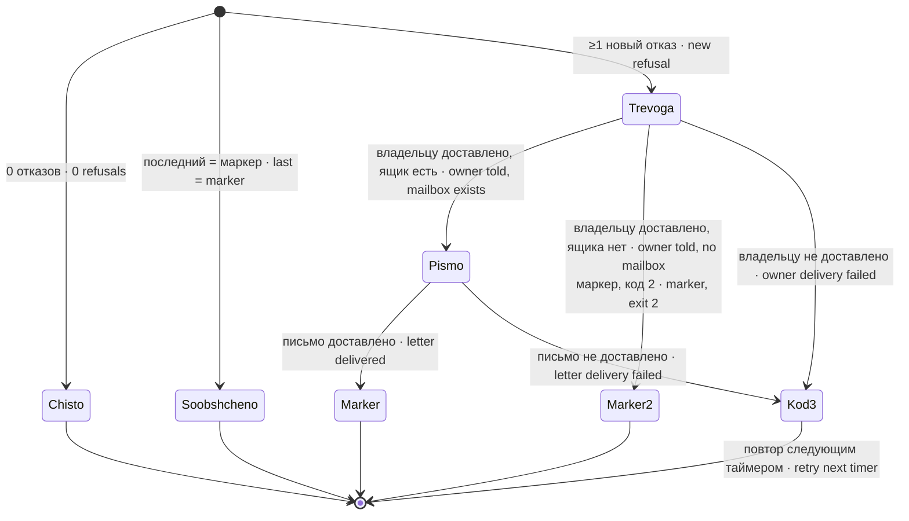

# predel-dliny-watch · Сторож отказа по длине промпта · Prompt-too-long refusal watcher

Читает журнал шлюза агента за последние `OKNO_MIN` минут и, увидев отказ поставщика по длине промпта, шлёт тревогу владельцу и письмо самому агенту.

Reads the agent gateway journal for the last `OKNO_MIN` minutes and, on seeing a provider refusal due to prompt length, alerts the owner and drops a letter to the agent itself.

## Зачем · Why

Однажды ход агента упал с «Prompt is too long», а служба осталась живой с `Result=success` — сторожей на это не было, беду искали вручную больше часа. Сторож смотрит само СОБЫТИЕ отказа, а не близость к пределу: по замеру длина очереди сообщений предиктором не является, а порог по ней дал бы 12–25 ложных криков в сутки на один настоящий отказ.

Once an agent turn failed with "Prompt is too long" while the service stayed alive with `Result=success` — no watcher existed and the trouble was hunted by hand for over an hour. The watcher looks at the refusal EVENT itself, not at the proximity to the limit: by measurement, queue length is not a predictor, and a threshold on it would give 12–25 false alarms a day per real refusal.

## Как работает · How it works

1. `journalctl -q -u $UNIT -t node --since -${OKNO_MIN}min` — только строки самого шлюза (`-t node`): команды агента пишутся в тот же юнит и давали ложные тревоги. Отказ journalctl — слепота, код 2.
2. Совпадения с `PATTERN` (ERE) считаются как СОБЫТИЯ по ключу «месяц день время» (несколько строк одной секунды — один отказ). Оценка снизу: два отказа в одну секунду сольются.
3. 0 отказов → `logger` «чисто» со знаменателем «просмотрено строк шлюза N». Последний отказ равен маркеру → «уже сообщено», молчит.
4. 1 отказ → тревога «⚠️ отказ по длине промпта»; 2 и более → «🚨 ДВА И БОЛЕЕ» (агент, вероятно, не может завершить ход).
5. Письмо агенту — во входящий каталог из `PREDEL_YASHCHIKI` через скрытый временный файл и `mv -n` (владелец/группа — как у каталога). Маркер `last-seen-$KOMU` пишется после доставки владельцу и письма агенту; отказ любого канала — код 3 без маркера и повтор. Если ящика нет в `PREDEL_YASHCHIKI`, после доставки владельцу маркер записывается, код 2, повторов нет.

1. `journalctl -q -u $UNIT -t node --since -${OKNO_MIN}min` — only the gateway's own lines (`-t node`): agent commands land in the same unit and caused false alerts. journalctl failure is blindness, exit 2.
2. Matches of `PATTERN` (ERE) are counted as EVENTS keyed by "month day time" (several lines in one second — one refusal). Lower bound: two refusals in the same second merge.
3. 0 refusals → `logger` "clean" with the denominator "gateway lines scanned N". Last refusal equals the marker → "already reported", silent.
4. 1 refusal → alert "⚠️ refusal by prompt length"; 2 or more → "🚨 TWO OR MORE" (the agent probably cannot finish its turn).
5. The letter to the agent goes into the inbox directory from `PREDEL_YASHCHIKI` via a hidden temp file and `mv -n` (owner/group as of the directory). The `last-seen-$KOMU` marker is written after owner and agent-letter delivery; either channel failing gives exit 3 without a marker and retry. If the mailbox is absent from `PREDEL_YASHCHIKI`, successful owner delivery writes the marker and exits 2, without repeats.

## Настройки · Settings

| Имя · Name | Тип · Type | Умолчание · Default | Смысл · Meaning | Пример · Example | Если неверно · If wrong |
|---|---|---|---|---|---|
| `UNIT` | имя юнита · unit name | пусто · empty (обязательна · required) | юнит шлюза агента, чей журнал читается · agent gateway unit | `<gateway>@<agent>.service` | пусто → код 2; чужой юнит → «чисто» при 0 строк (знаменатель это покажет) · empty → exit 2; wrong unit → "clean" with 0 lines (the denominator shows it) |
| `KOMU` | имя агента · agent name | пусто · empty (обязательна · required); в шаблоне `%i` | ключ маркера и адресат письма · marker key and letter recipient | `<agent>` | пусто → код 2; нет в `PREDEL_YASHCHIKI` → после доставки владельцу код 2 и маркер, повтора нет · empty → exit 2; not in `PREDEL_YASHCHIKI` → owner told, exit 2 and marker, no repeat |
| `PREDEL_YASHCHIKI` | пары `имя=каталог` через пробел · space-separated `name=dir` | пусто · empty | входящие каталоги агентов · agents' inbox dirs | `a=/opt/<agent-home>/a2a/in b=/srv/b/in` | адресата нет → после доставки владельцу код 2, маркер записан, повтора нет; доставка владельцу отказала → код 3 без маркера · recipient missing → owner told, exit 2, marker written, no repeat; owner delivery failed → exit 3, no marker |
| `PATTERN` | ERE | `Prompt is too long\|input_too_large\|Input exceeds the maximum length\|[(]perepolnenie:` | формулировки отказа · refusal wording | — | негодный ERE → код 2 · invalid ERE → exit 2; новая формулировка → пропуск · new wording → missed |
| `OKNO_MIN` | минуты · minutes | `35` | окно чтения журнала (таймер 15/30 мин — с перекрытием) · journal window (timer 15/30 min — overlapping) | `35` | меньше периода таймера → отказы между запусками теряются · below the timer period → refusals between runs are lost |
| `ALERT` | путь · path | `agent-alert` из PATH, иначе `/nonexistent` · from PATH, else `/nonexistent` | канал тревоги · alert channel | `/usr/local/bin/agent-alert` | не исполняем → тревога уходит в `logger` как «ALERT(no sink)» · not executable → alert goes to `logger` as "ALERT(no sink)" |
| `PREDEL_STATE_DIR` | путь · path | `/var/lib/predel-dliny-watch` | каталог маркеров · marker directory | `/var/lib/x` | нет записи → маркер не пишется, тревога повторяется · not writable → marker not written, alert repeats |

## Что ловит и чего НЕ ловит · What it catches and does NOT catch

Ловит: отказ по длине промпта у поставщиков с перечисленными формулировками и собственную строку переполнения шлюза; два и более отказа в окне — громче.

Catches: prompt-length refusals of providers with the listed wording and the gateway's own overflow line; two or more refusals in the window — louder.

НЕ ловит: переполнение с формулировкой, которой нет в `PATTERN` (новый поставщик, смена текста), на свежем запросе; «два отказа подряд без успешного хода между ними» буквально (журнал шлюза не пишет завершение хода — поэтому «два и более в окне»); два отказа в одну секунду (сольются); шлюз, запущенный не бинарём `node` (0 строк — знаменатель покажет); близость к пределу до отказа. Доставка владельцу проверяется; при её отказе или отказе письма агенту — код 3 без маркера, следующий прогон повторит попытку.

Does NOT catch: an overflow worded in a way not in `PATTERN` (new provider, changed text) on a fresh request; literally "two refusals in a row with no successful turn between" (the gateway does not log turn completion — hence "two or more in the window"); two refusals in the same second (they merge); a gateway not started by a `node` binary (0 lines — the denominator shows it); proximity to the limit before a refusal. Owner delivery is checked; failed owner delivery or a failed agent letter gives exit 3 without a marker, so the next run retries.

## Куда кричит · Where it alerts

Тревога — в `ALERT` (HTML, имя машины и юнит в тексте); письмо — агенту во входящий каталог; ход — в журнал под тегом `predel-dliny-watch`.

Alert — to `ALERT` (HTML, host name and unit in the text); letter — to the agent's inbox; progress — to the journal under the tag `predel-dliny-watch`.

## Юниты · Units

`predel-dliny-watch.service/.timer` — одиночный экземпляр (каждые 30 мин), `UNIT`/`KOMU` задаются drop-in'ом. `predel-dliny-watch@.service/.timer` — экземпляр на агента (каждые 15 мин, `KOMU=%i`, `LC_ALL=C.UTF-8`); `UNIT` — общим drop-in шаблона и/или экземплярным. Новый агент — `systemctl enable --now predel-dliny-watch@<имя>.timer` и строка в `PREDEL_YASHCHIKI`.

`predel-dliny-watch.service/.timer` — single instance (every 30 min), `UNIT`/`KOMU` via a drop-in. `predel-dliny-watch@.service/.timer` — one instance per agent (every 15 min, `KOMU=%i`, `LC_ALL=C.UTF-8`); `UNIT` via a common template drop-in and/or a per-instance one. A new agent — `systemctl enable --now predel-dliny-watch@<name>.timer` plus an entry in `PREDEL_YASHCHIKI`.

## Коды выхода · Exit codes

`0` — чисто / уже сообщено / сообщено и доставлено · clean / already reported / reported and delivered; `2` — слепота (journalctl или grep отказали) или не настроено; с 1.0.1 и ящика агента нет в `PREDEL_YASHCHIKI` — владельцу сказано, маркер записан, повтора нет · blindness or not configured; since 1.0.1 also no agent mailbox — owner told, marker written, no repeat; `3` — отказ доставки письма агенту или (с 1.0.2) тревоги владельцу — маркер не записан, повтор · agent letter or (since 1.0.2) owner alert not delivered — marker not written, retry.

## Стенд · Test stand

`test/stend-predel-dliny-watch.sh` — три пробы (чистый журнал молчит · отказ краснеет, тревога и письмо называют юнит · журнал снова чист — «чисто») и проба «не настроено»; с 1.0.1 ещё две: агент без ящика → одна тревога, «НЕ НАСТРОЕНО», код 2 · тот же отказ снова → повтора нет. journalctl, logger и канал тревоги подставные; состояние и ящик — во временном каталоге.

`test/stend-predel-dliny-watch.sh` — three probes (clean journal is quiet · a refusal turns red, alert and letter name the unit · clean again — "clean") plus a "not configured" probe. journalctl, logger and the alert channel are stubs; state and inbox are in a temporary directory.
