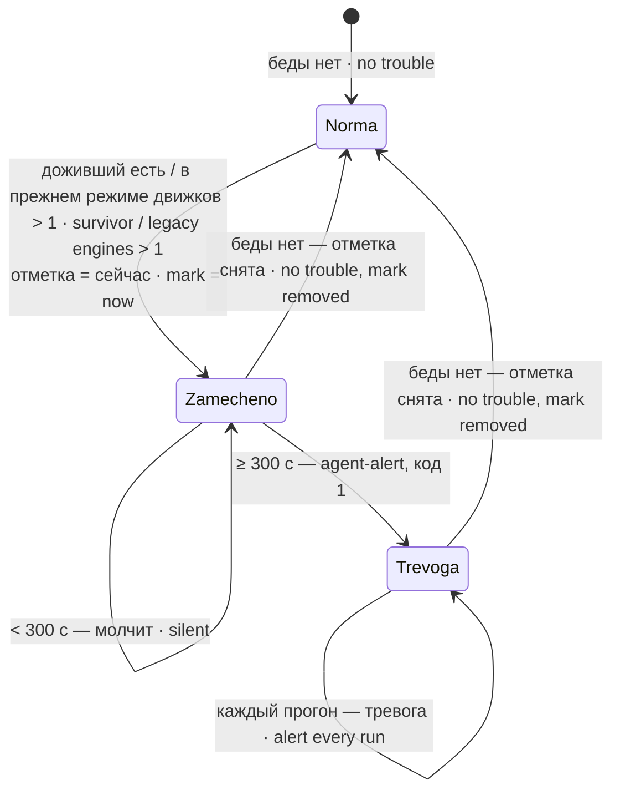

# storozh-dvizhkov.sh · Engine watchdog (a turn that outlived its platform)

Сторож движков: ход агента (процесс `claude` под шлюзом) не должен пережить свою платформу. С 2.0.9, когда `SD_SLUZHBA_PLATFORMY` — загруженный юнит systemd, тревога — **доживший** ход дольше пяти минут (рождён до старта платформы, при неработающей платформе или вне цепочки родителей шлюза; подробно — ниже). Если юнит платформы не загружен — прежнее правило: больше одного хода дольше пяти минут.

Engine watchdog: an agent turn (a `claude` process under the gateway) must not outlive its platform. Since 2.0.9, when `SD_SLUZHBA_PLATFORMY` is a loaded systemd unit, the alert is a **surviving** turn for longer than five minutes (started before the platform, while the platform is down, or outside the gateway's parent chain; details below). If the platform unit is not loaded — the old rule: more than one turn for longer than five minutes.

## Зачем · Why

Однажды прошлый ход агента пережил смерть своей платформы не меньше чем на пятнадцать минут и за это время опубликовал пакет в npm — необратимо. Причина: движки живут в cgroup ШЛЮЗА, а не платформы, поэтому перезапуск службы платформы их не трогает по построению — они доживают свой ход сами. Сторож замечает такой лишний ход.

Once a previous agent turn outlived its platform by at least fifteen minutes and in that time published a package to npm — irreversibly. Cause: engines live in the GATEWAY's cgroup, not the platform's, so restarting the platform service does not touch them by design — they finish their turn on their own. The watchdog notices such an extra turn.

## Как работает · How it works

Шлюз ищется ТОЧНО: только процессы с исполняемым `node` (`comm` = `node` или `MainThread`), у которых аргумент заканчивается строкой `SD_SHLYUZ` (сравнение окончания строки, не регулярное выражение). Так сторож не находит сам себя: первая редакция искала `pgrep -f '<строка>'`, первым в выдаче шёл её же bash, «движков» выходило 0 при живом ходе — ложное зелёное. С 1.0.1: задан `SD_SHLYUZ_SLUZHBA` — берётся `MainPID` этой службы (и обязан быть среди найденных); не задан и шлюзов больше одного — СЛЕПОТА, код 2 (прежде брался ПЕРВЫЙ). Движки — процессы `claude` из cgroup шлюза и его прямые дети; в cgroup проверяются также вложенные движки.

The gateway is found EXACTLY: only processes whose executable is `node` (`comm` = `node` or `MainThread`) with an argument ending with the string `SD_SHLYUZ` (string-ending comparison, not a regular expression). This way the watchdog does not find itself: the first version used `pgrep -f '<string>'`, its own bash came first, "engines" came out 0 with a live turn — a false green. Since 1.0.1: with `SD_SHLYUZ_SLUZHBA` set, that service's `MainPID` is used (and must be among those found); unset with more than one gateway — BLINDNESS, exit 2 (before, the FIRST was taken). Engines are `claude` processes from the gateway cgroup and its direct children; nested engines in that cgroup are checked too.

Порог — 300 с после первого прогона с бедой: в режиме юнита беда — хотя бы один доживший движок; в прежнем режиме — больше одного движка. Начало хранится в отметке; прогон без беды удаляет её. При недоставке тревоги отметка сохраняется, попытка повторяется на каждом прогоне.

The threshold is 300 s after the first run with trouble: at least one survivor in unit mode, or more than one engine in legacy mode. Its start is kept in a mark; a run without trouble removes it. Failed alert delivery keeps the mark and is retried on every run.

### Доживший ход (2.0.9–2.0.10) · Surviving turn

Если `SD_SLUZHBA_PLATFORMY` — юнит systemd, сторож судит не число движков, а каждый движок `claude` в cgroup шлюза и среди его детей. **Доживший** = рождён раньше старта текущей платформы (starttime из `/proc/<pid>/stat` против `ExecMainStartTimestampMonotonic`) ИЛИ платформа не работает ИЛИ **цепочка родителей не доходит до текущего шлюза** (подъём по `ppid`, не больше 32 шагов; сирота с родителем 1 — доживший). Вложенный движок (шлюз → движок → оболочка инструмента → `claude`) законен, если цепочка доходит до шлюза и он рождён после старта платформы (2.0.10; прежде «родитель не шлюз» давал ложное «ДОЖИЛ» на длинных вложенных ходах). Тревога — доживший держится дольше 300 с; число законных не ограничено. Если юнит платформы не загружен — прежнее правило «движков больше одного».

Шум гонки: звено цепочки может уйти посреди подъёма (оболочка инструмента закончилась) — тогда разовое «ДОЖИЛ» в списке, но отметка только заводится и тревоги нет: она — лишь если доживший держится дольше 300 с.

If `SD_SLUZHBA_PLATFORMY` is a systemd unit, the watchdog judges every `claude` engine in the gateway cgroup and among its children. **Surviving** = started before the current platform start OR the platform is not running OR **the parent chain does not reach the current gateway** (walk up `ppid`, at most 32 steps; an orphan with parent 1 survives). A nested engine (gateway → engine → tool shell → `claude`) is legitimate if the chain reaches the gateway and it started after the platform (2.0.10). Alert — a survivor lasting over 300 s. A link leaving mid-walk gives a one-off "ДОЖИЛ" line but only sets the mark; no alert before 300 s.

## Настройки · Settings

| Имя · Name | Тип · Type | Умолчание · Default | Смысл · Meaning | Пример · Example | Если неверно · If wrong |
|---|---|---|---|---|---|
| `SD_SHLYUZ` | путь · path | пусто = не настроено · empty = not configured | Путь скрипта шлюза в командной строке node · Gateway script path in the node command line | `/srv/gateway/gateway.mjs` | Пусто — `НЕ НАСТРОЕНО`, код 2; не тот путь — `СЛЕПОТА: шлюз не найден`, код 2 · Empty — not configured, exit 2; wrong — gateway not found, exit 2 |
| `SD_SHLYUZ_SLUZHBA` | юнит · unit | пусто · empty | (1.0.1) юнит конкретного шлюза; обязателен при нескольких шлюзах с одним скриптом · the specific gateway unit; required with several gateways sharing a script | `<gateway>@<агент>.service` | нет MainPID или он не среди найденных шлюзов → слепота, код 2 · no MainPID or not among the matched gateways → blindness, exit 2 |
| `SD_SOSTOYANIE` | путь · path | `/var/lib/storozh-dvizhkov/sostoyanie` | отметка начала беды; каталог и файл принадлежат вызывающему, без чужой записи и без ссылок · trouble-start mark; caller-owned directory and file, no other write permissions or symlinks | `/var/lib/storozh-dvizhkov/mark` | не создать/записать или негодные владелец/тип/права → слепота, код 2; нечисловая/будущая дата сбрасывается на «сейчас» · create/write failure or invalid owner/type/permissions → blindness, exit 2; a nonnumeric/future date resets to now |
| `SD_MASHINA` | строка · string | `hostname -s` | Имя машины в тексте тревоги · Machine name in the alert | `node1` | Только текст · Text only |
| `SD_SLUZHBA_PLATFORMY` | имя юнита · unit name | `службы платформы` | имя юнита платформы: `LoadState=loaded` включает проверку доживших по MainPID и времени старта · platform unit: `LoadState=loaded` enables survivor checks using MainPID and start time | `<agent>.service` | не загружен (включая умолчание) → прежнее правило «движков больше одного»; загружен без MainPID → все движки дожившие · not loaded (including default) → legacy more-than-one rule; loaded without MainPID → all engines survive |
| `SD_PRIPISKA` | строка · string | пусто · empty | Приписка к тревоге (последствия на этой машине); `\n` — перевод строки · Alert appendix; `\n` = newline | `Публикация сейчас закрыта обёрткой.` | Только текст · Text only |

Порог 300 с; норма — 0 доживших при загруженном юните платформы, иначе не больше 1 движка. Это числа в коде, не настройки.

Threshold 300 s; normal means 0 survivors with a loaded platform unit, otherwise at most 1 engine. These are code constants, not settings.

## Что ловит и чего НЕ ловит · What it catches and does NOT catch

Ловит: с юнитом платформы — доживший ход `claude` дольше пяти минут подряд (по прогонам); без юнита — больше одного движка `claude` из cgroup и прямых детей ОДНОГО выбранного шлюза дольше пяти минут; в обоих режимах — пропажу шлюза (слепота).

Catches: with a platform unit — a surviving `claude` turn for longer than five minutes in a row (across runs); without it — more than one `claude` engine from the cgroup and direct children of ONE selected gateway for longer than five minutes; in both modes — a missing gateway (blindness).

НЕ ловит (2.0.9–2.0.10): два главных хода внутри ОДНОЙ живой платформы (оба рождены после её старта; прежнее правило «движков больше одного» их ловило); помощников, рождённых ДОЖИВШИМ ходом уже после перезапуска; граница часов — starttime по BOOTTIME против Monotonic systemd: при засыпании или миграции ВМ законный может выглядеть «рождённым раньше».

НЕ ловит: другие шлюзы, машины и публикацию как действие; вложенную cgroup, если движок не прямой ребёнок шлюза. Несколько шлюзов с одним путём без `SD_SHLYUZ_SLUZHBA` дают слепоту, код 2. По расписанию нужен свой экземпляр `storozh-dvizhkov@<агент>.timer` (2 мин); сам скрипт расписание не заводит.

Does NOT catch: other gateways, machines, or publishing as an action; a nested cgroup unless its engine is a direct gateway child. Several gateways on one path without `SD_SHLYUZ_SLUZHBA` give blindness, exit 2. Scheduling requires its own `storozh-dvizhkov@<agent>.timer` instance (2 min); the script does not create a schedule.

## Куда кричит · Where it alerts

`agent-alert "<html>"` из `PATH`, на каждом прогоне, пока перекрытие длится дольше порога. Ход прогона — в stdout.

`agent-alert "<html>"` from `PATH`, on every run while the overlap lasts longer than the threshold. Run progress — to stdout.

## Коды выхода · Exit codes

| Код · Code | Смысл · Meaning |
|---|---|
| 0 | Беды нет либо с первого её обнаружения прошло меньше 300 с · No trouble, or less than 300 s since its first detection |
| 1 | Беда держится не меньше 300 с; доставка отражена в выводе · Trouble lasts at least 300 s; see output for delivery |
| 2 | Слепота источника или состояния, не настроено, настройки не прочитаны · Source/state blindness, not configured, or settings unreadable |

## Юниты и стенд · Units and test stand

С 1.0.1 в пакете шаблон `storozh-dvizhkov@.service` + `storozh-dvizhkov@.timer` (раз в 2 мин; экземпляр на агента, своя отметка `/var/lib/storozh-dvizhkov-%i/sostoyanie`, `StateDirectory=storozh-dvizhkov-%i`, режим `0700` и `UMask=0077`; `SD_SHLYUZ_SLUZHBA` — drop-in'ом); до 1.0.1 зовущего не было. Стенд — `test/stend-storozh-dvizhkov.sh`: `ps`, `pgrep`, `agent-alert` — заглушки первыми в `PATH`, отметка во временном каталоге; пробы: не настроено → говорит; один движок → 0 (свой bash и чужой путь не в счёт); два впервые → отметка, тишина; два короче порога → тишина; два дольше порога → 1, тревога с числом и PID; снова один → отметка снята; шлюза нет → 2; (1.0.1) два шлюза без юнита → 2; юнит задан → считает под его MainPID; у юнита нет процесса → 2.

Since 1.0.1 the package has a `storozh-dvizhkov@.service` + `.timer` template (every 2 min; one instance per agent; mark `/var/lib/storozh-dvizhkov-%i/sostoyanie`, `StateDirectory=storozh-dvizhkov-%i`, mode `0700`, `UMask=0077`; `SD_SHLYUZ_SLUZHBA` via a drop-in); before 1.0.1 nothing called it. Test stand — `test/stend-storozh-dvizhkov.sh`: `ps`, `pgrep`, `agent-alert` are stubs first in `PATH`, mark in a temp directory; probes: not configured → says so; one engine → 0 (own bash and a foreign path do not count); two for the first time → mark, silence; two shorter than threshold → silence; two beyond threshold → 1, alert with count and PIDs; back to one → mark removed; no gateway → 2; (1.0.1) two gateways without a unit → 2; unit set → counts under its MainPID; unit without a process → 2.
