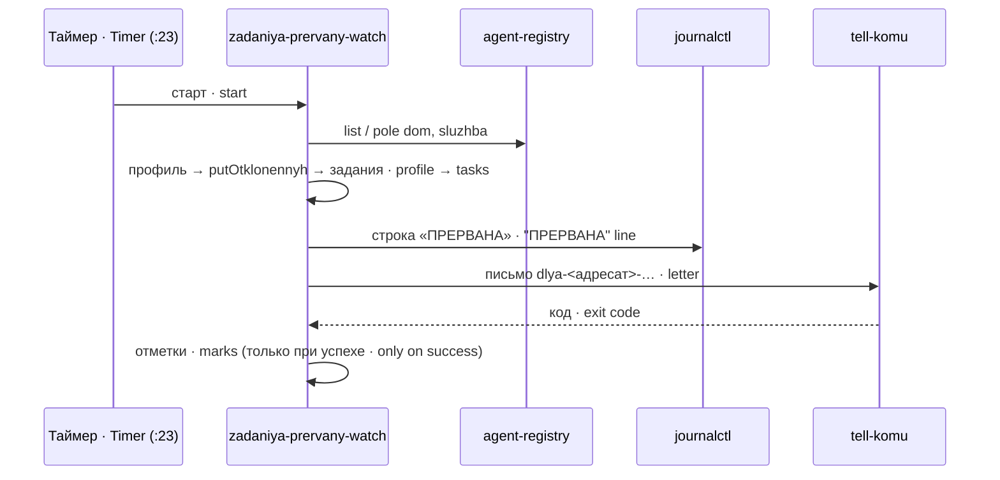

# zadaniya-prervany-watch · Читатель прерванных дистилляций · Interrupted-distillation reader

Раз в час обходит агентов из реестра, находит файлы заданий `zadanie-prervan-*`, пролежавшие больше часа, и одним письмом даёт координатору наряд на повтор рукой.

Once an hour it walks the agents of the registry, finds `zadanie-prervan-*` task files older than an hour, and sends the coordinator one letter with a work order for a manual retry.

## Зачем · Why

Секретарь памяти агента, найдя при старте брошенный разбор (метку `razbor-idet-*`), превращает её в задание `zadanie-prervan-*`, пишет строку «ПРЕРВАНА» в журнал и шлёт тревогу. Повтор — только рукой. Тревога — событие: её можно не прочесть, и однажды задание пролежало непрочитанным 16 часов. Задание — состояние: пока файл лежит, этот сторож раз в сутки напоминает о нём координатору.

When the agent's memory secretary finds an abandoned run (a `razbor-idet-*` marker) on start, it turns it into a `zadanie-prervan-*` task, writes an "ПРЕРВАНА" line into the journal and raises an alert. Retry is manual only. An alert is an event and can go unread — once a task stayed unread for 16 hours. A task file is a state: while it exists, this watcher reminds the coordinator about it once a day.

## Как работает · How it works

1. `agent-registry list` → имена агентов; `agent-registry pole <агент> dom|sluzhba --json` → дом и служба.
2. Из живого профиля `<dom>/.dsh/profiles/web/cordis.patch.yml` берётся `putOtklonennyh` — каталог(и) заданий.
3. В каждом каталоге: `zadanie-prervan-<мс>-<pid>.txt` старше часа (по ctime) — кандидат в наряд; моложе — пропуск; негодное имя — называется в выводе, наряда нет; срез с живой меткой `razbor-idet-*` (pid жив и метка моложе 3 ч) — уже разбирается, наряда нет.
4. Повтор на одно задание — не чаще раза в сутки (отметки в `<ZPW_SOST>/otmetki/`).
5. Число записанных статей — из строки «ПРЕРВАНА … задание на повтор рукой: <путь>» журнала службы агента (`journalctl -u <служба>`).
6. Письмо `<ZPW_SOST>/dlya-<ZPW_ADRESAT>-zadaniya-prervany.md` уходит через `tell-komu` из щели агента `ZPW_KOREN`. Задания больше нет, а отметка есть — строка «снято», отметка удаляется после доставки.

1. `agent-registry list` → agent names; `agent-registry pole <agent> dom|sluzhba --json` → home and service.
2. From the live profile `<dom>/.dsh/profiles/web/cordis.patch.yml` it reads `putOtklonennyh` — the task directory(ies).
3. In each directory: `zadanie-prervan-<ms>-<pid>.txt` older than an hour (by ctime) is an order candidate; younger — skipped; an invalid name is reported, no order; a slice with a live `razbor-idet-*` marker (pid alive and marker younger than 3 h) is being processed, no order.
4. Repeat for one task — at most once a day (marks in `<ZPW_SOST>/otmetki/`).
5. Articles written — from the "ПРЕРВАНА … задание на повтор рукой: <path>" line in the agent's service journal (`journalctl -u <service>`).
6. The letter `<ZPW_SOST>/dlya-<ZPW_ADRESAT>-zadaniya-prervany.md` goes through `tell-komu` from the outbox of the agent at `ZPW_KOREN`. Task gone but a mark exists — a "снято" (removed) line; the mark is deleted after delivery.

## Настройки · Settings

| Имя · Name | Тип · Type | Умолчание · Default | Смысл · Meaning | Пример · Example | Если неверно · If wrong |
|---|---|---|---|---|---|
| `ZPW_KOREN` | путь · path | пусто · empty (обязательна · required) | дом агента, через щель которого уходит письмо · home of the agent whose outbox carries the letter | `/opt/<agent-home>` | пусто → код 2 «не настроено», обхода нет · empty → exit 2 "not configured", no pass; неверный → канал откажет, код 1 · wrong → channel fails, exit 1 |
| `ZPW_ADRESAT` | слово · word | пусто · empty (обязательна · required) | адресат в имени письма `dlya-<адресат>-…` (по нему маршрутизирует tell-komu) · recipient in the letter name (tell-komu routes by it) | `koordinatora` | пусто → код 2; неизвестный tell-komu → отказ канала, код 1 · empty → exit 2; unknown to tell-komu → channel refusal, exit 1 |
| `ZPW_SHAPKA` | строка · string | `<host> · zadaniya-prervany-watch (root, щель <ZPW_KOREN>) → координатору · …` | первая строка письма · first line of the letter | любая · any | только текст · text only |
| `ZPW_PRAVKA_SCHYOTA` | строка · string | `правки счёта статей` | как назвать правку секретаря, после которой он пишет счёт статей · name of the secretary change that added the article count | `v0.3.0` | только текст · text only |
| `ZPW_SOST` | путь · path | `/var/lib/zadaniya-prervany-watch` | состояние: отметки, письмо, зеркало, вывод канала · state: marks, letter, mirror, channel output | `/var/lib/x` | не создаётся → код 2 · cannot create → exit 2 |
| `ZPW_REESTR_BIN` | путь · path | `/usr/local/bin/agent-registry` | реестр агентов · agent registry | — | не читается → код 2 · unreadable → exit 2 |
| `ZPW_TELL_BIN` | путь · path | `/usr/local/bin/tell-komu` | канал писем · letter channel | — | отказ → код 1, отметки не обновлены · failure → exit 1, marks not updated |
| `ZPW_JOURNALCTL` | команда · command | `journalctl` | чтение журнала службы агента · agent service journal reader | — | молчит → «записано: НЕ установлено» · silent → "written: not established" |
| `ZPW_SEYCHAS` | эпоха, с · epoch s | `date +%s` | «сейчас» — только для стендов · "now" — test stands only | `1700000000` | — |

Пороги зашиты в коде: возраст задания для наряда — 3600 с, повтор — 86400 с, «живая» метка — моложе 10800 с.

Thresholds are fixed in code: task age for an order — 3600 s, repeat — 86400 s, a "live" marker — younger than 10800 s.

## Что ловит и чего НЕ ловит · What it catches and does NOT catch

Ловит: задание секретаря, пролежавшее дольше часа, — раз в сутки, пока файл лежит; исчезновение задания — строкой «снято».

Catches: a secretary task older than an hour — once a day while the file exists; the disappearance of a task — as a "снято" line.

НЕ ловит: «повтор сделан рукой, файл забыли удалить» (наряд будет идти); «снято» значит «файла нет», а не «срез разобран»; задания вне `profiles/web`; метку `razbor-idet-*`, не превращённую в задание (агент не поднимался); задание с негодным именем (только строка в выводе). Счёт статей «НЕ установлено», если строки «ПРЕРВАНА» в журнале уже нет (ротация).

Does NOT catch: "retry done by hand, file forgotten" (orders keep coming); "снято" means "the file is gone", not "the slice was processed"; tasks outside `profiles/web`; a `razbor-idet-*` marker never turned into a task (agent did not start); a task with an invalid name (only an output line). The article count is "not established" if the "ПРЕРВАНА" line has left the journal (rotation).

## Куда кричит · Where it alerts

Письмом координатору (не владельцу: это работа, не авария). Слепота и отказ канала — ненулевой код ⇒ юнит `failed` ⇒ его видит «сторож над сторожами» машины, если он заведён.

By a letter to the coordinator (not the owner: this is work, not an outage). Blindness and channel failure — non-zero exit ⇒ unit `failed` ⇒ seen by the machine's "watcher of watchers", if one exists.

## Коды выхода · Exit codes

`0` — обход состоялся (наряд ушёл или слать нечего) · pass completed; `1` — канал отказал, отметки не обновлены, повтор через час · channel failed, marks kept, retry next hour; `2` — слепота или не настроено (реестр не прочитан, профиль не читается, ни у одного агента нет пути, не заданы `ZPW_KOREN`/`ZPW_ADRESAT`), а также любой довод командной строки · blindness or not configured, and any command-line argument.

## Безопасность состояния · State safety

В каталоге состояния лежат письма с путями заданий. Юнит пакета ставит `StateDirectoryMode=0750` (drop-in `50-rezhim-sostoyaniya.conf`): без него systemd открывал каталог до 0755 на каждом старте. Проверка — `test/proba-prav-sostoyaniya-zadaniya-prervany.sh --boj | --koren DIR`.

The state directory holds letters with task paths. The package unit sets `StateDirectoryMode=0750` (drop-in `50-rezhim-sostoyaniya.conf`): without it systemd reopened the directory to 0755 on every start. Check — `test/proba-prav-sostoyaniya-zadaniya-prervany.sh --boj | --koren DIR`.

### Границы разбора профиля и полей · Profile and field limits

`putOtklonennyh` принимается как абсолютная строка либо YAML-список абсолютных строк. Разбор дерева YAML без конструирования объектов ограничен 1 МиБ, 10000 посещённых узлов и 10 с; ошибка разбора/типов/чтения — слепота по агенту, итог 2. Поля задания `srez`, `pozvana`, `avtopovtor` — данные: переносы CR/LF/NEL/LS/PS и маркер «•» заменяются пробелом, предел 160 кодовых точек (длинное значение усечено с меткой). Это не проверка достоверности или смысла текста: указание в одной строке не распознаётся.

`putOtklonennyh` accepts an absolute scalar path or a YAML list of absolute paths. YAML nodes are read without constructing objects, bounded by 1 MiB, 10000 visited nodes and 10 s; read/parse/type errors produce per-agent blindness and exit 2. Task fields `srez`, `pozvana`, `avtopovtor` are data: CR/LF/NEL/LS/PS and “•” become spaces; at most 160 code points, with a truncation mark. This does not validate truth or meaning, and does not recognise an instruction within one line.
