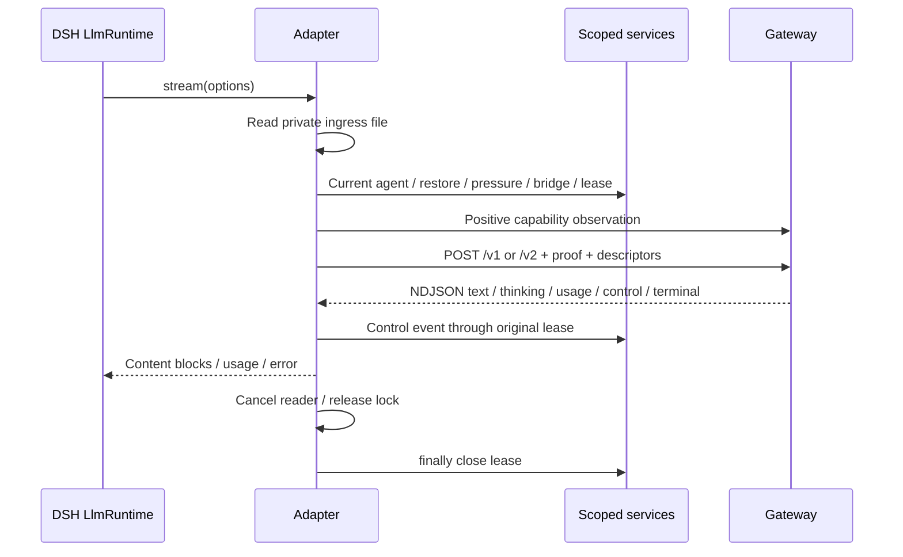

# Архитектура · Architecture

apply регистрирует один handle LlmRuntime для claude-oauth и conversationIdentity.version=2. Provide failure сразу снимает handle. Dispose использует lifecycle Cordis/LlmRuntime, отменяет pending health и не оставляет зарегистрированный provider. Сам адаптер не владеет history/mapping DB/control ledger.
apply registers one LlmRuntime handle plus identity2 service. A failed provide cleans up immediately. Cordis/LlmRuntime disposal cancels health and detaches the route. History, mapping and control ledgers belong to platform/gateway/receiver.

В новой telegram-v2 сессии lexical id/createdAt/absolute cwd проверяются до запроса; неизвестный caller — stateless. Gateway проверяет более строгую UUID/generation форму. Legacy остаётся v1 и не получает live inputDelivery этой веткой; spool address не заменяет native identity.
New telegram-v2 identities are checked lexically before requests; unknown callers are stateless. The gateway validates stricter UUID/generation shape. Legacy remains v1 without live inputDelivery; a spool address does not replace native identity.

Lease берётся у taskControlCodex для текущего owner/turn, descriptor находится вне prompt. telegramStopVersion1 отдельно допускает stop даже при taskControlCodex=false; false не выключает всё управление. Неподтверждённый контрольный event даёт отдельный CONTROL_EVENT_REJECTED с cause, останавливает поток и закрывает lease; SDK-эффекты этим не откатываются.
The lease is for the current owner/turn and stays outside the prompt. Explicit stop capability is independent of cancel opt-in. A rejected control event has its own cause/code, ends the stream and closes the lease without undoing SDK side effects.

Парсер один для newline и EOF remainder, fatal UTF-8. После плохой строки предыдущий текст/done не превращает исход в успех. Блоки переключаются reasoning/text, block-end содержит полный накопленный текст; usage не закрывает блок. Unknown/tool types не генерируют native tool calls. Input-status/task-status известны и проверяются отдельно.
One parser handles newline/EOF with fatal UTF-8. Earlier text/done cannot hide a malformed later record. Complete block-end text is retained; usage does not end a block. Unknown/tool types do not create native tool calls; control types are explicitly scoped.

Live pressure — [SETTINGS](SETTINGS.md): loaded process/code identity, current session/policy и успешная пара compaction. Missing proof классифицируется отдельно, журналируется один раз; решение fallback/стопа принадлежит шлюзу. Services-поставщики — [SERVICES](SERVICES.md).
The proof binds loaded process/code, current session/policy and a successful compaction pair. Missing proof has a classified one-time log; the gateway owns fallback/stop decisions. See the named service providers.

Overflow/429/refused connection имеют доверенные LlmError категории. Другие HTTP/NDJSON/контрольные ошибки — обычный Error с preserved cause/code: платформа не получает разрешение на скрытый SDK replay. Собственного retry-loop нет; пределы задаёт platform retry policy.
Only justified overflow/rate-limit/refused-connection paths use trusted LlmError categories. Other errors preserve diagnostics as ordinary Error without granting hidden SDK replay. Platform policy owns retry counts.
