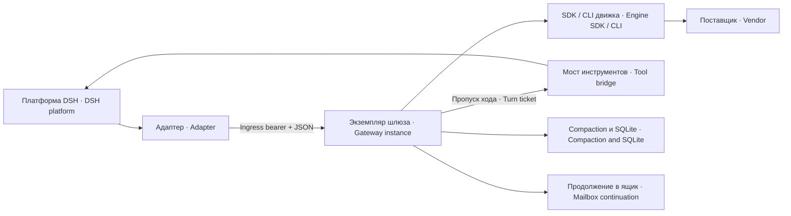

# dsh-subscription-gateway — подписочный шлюз агентного движка · Subscription gateway for an agent engine

## Codex engine account proof — AP 0.1.10, private candidate

RU: В app-server режиме G дважды вызывает `account/read` у ТОГО ЖЕ дочернего
процесса: после `initialize`/`initialized`, до `turn/start`, и перед записью
`engine_terminal`. `refreshToken=false`, `initialize.capabilities.experimentalApi=true`.
При равных accountRef пишет auth с proof `engine-account-read`. AccountRef — полный
SHA256 exact `workspaceRouting.chatgptAccountId` (64 lowercase hex). В auth входят
только accountRef, производный authEpoch, authMode из `account.type` и planType плюс proof/общий raw-v1
контекст. `account.email`, его SHA, исходный ID, токены и весь RPC reply не пишутся.
Разрешён mode chatgpt, PlanType — strict enum из binary schema0.162.1; неизвестное
значение/неверная форма дают именованный SUBSCRIPTION_UNBOUND, не догадку.

Имена wire: positive `{kind:"auth",accountRef:"<sha256>",authEpoch:"<sha256>",authMode:"chatgpt",
planType:"<PlanType>",proof:"engine-account-read"}`; negative `{kind:"auth",
accountRef:null,authEpoch:null,authMode:null,planType:null,reason:"SUBSCRIPTION_UNBOUND",
detail:"<named reason>"}`. Полей codex-N/subscription в новом proof нет:
сопоставление accountRef→codex-N и AP validator — отдельная рука Беты. Старый
SDK exec без app-server account API сохраняет прежний route-only отказ.

RU: authEpoch выдаётся при первом успешном account/read: `authEpoch = sha256("engine-account-read" ‖ processEpoch ‖ accountRef)` (UTF-8, конкатенация без разделителей); стабилен при той же учётке внутри процесса, меняется с процессом/учёткой; при отказе — null.
Склейка однозначна, пока processEpoch — UUID (36 знаков) и accountRef — sha256 hex (64); меняешь источник — добавь разделитель или длину.

Наблюдённый иной ID, включая A→B→A, фиксирует
`ACCOUNT_CHANGED_DURING_TURN` до конца observer; более ранний именованный отказ,
если он уже был, сохраняет приоритет. Ни один последующий ответ не снимает отказ. `account/updated` сам по себе
не означает смену: только запускает account/read. В один момент один RPC и один
coalesced hint; hint во время initial не теряется, его чтение завершается до
turn/start. Новые hints во время hint-read объединяются с ним, не порождают
цикл перечитываний из собственного уведомления. Перед terminal приём новых hints
закрывается; уже ожидавший hint завершается перед обязательным final read.

Каждый read ограничен2000мс; initial/final могут дополнительно дождаться одного
уже занятого hint. Нет retries/login/logout/config/read. RPC ошибка —
ACCOUNT_READ_ERROR, deadline — ACCOUNT_READ_TIMEOUT; неверный ответ —
ACCOUNT_READ_SCHEMA_INVALID/ACCOUNT_ID_UNAVAILABLE/ACCOUNT_AUTH_MODE_UNSUPPORTED.
Незавершённый ход без точного terminal — ACCOUNT_TERMINAL_UNPROVEN; потерянный
обязательный final read — ACCOUNT_READ_FINAL_MISSING. Поздние ответы не дописывают
auth после закрытия. Ошибка учёта не отменяет модельный ход; его запуск может
дождаться bounded initial proof, terminal G — bounded final proof.

Любой непустой accountRoutingOverride кроме NO_CONSTRAINT отказывает
ACCOUNT_ROUTING_OVERRIDE. Основание исключения: точный upstream rust-v0.162.1,
[`model-provider/src/workspace_routing.rs:60`](https://github.com/openai/codex/blob/rust-v0.162.1/codex-rs/model-provider/src/workspace_routing.rs#L60):
`"NO_CONSTRAINT" => None` при выборе x-openai-account-routing-override header.
Это отсутствие override HEADER, не обещание отсутствия региональной маршрутизации:
backendOrigin всё ещё применяется, но в G не копируется. Остальные непустые значения
(us/us_cr/неизвестные) остаются UNBOUND; исходный override в G не записывается.
Пустая строка/null допускаются как пустое значение по наряду; отсутствующее поле
или неверный тип — ACCOUNT_READ_SCHEMA_INVALID.

EN: The same spawned Codex app-server is queried after initialization, before
turn/start, and again before the G terminal record. Equal SHA256 account IDs produce
engine-account-read proof containing only accountRef, derived authEpoch, account.type as authMode,
and the strict PlanType enum. No email, email hash, raw ID, token, backend origin
or full reply is retained. Observed ID changes are sticky through the turn; an earlier named failure keeps priority.
account/updated only requests a fresh read; it is not identity evidence. Reads
are coalesced and bounded at2000ms each. Errors/timeouts produce named unbound
records; late replies cannot upgrade a closed observer. NO_CONSTRAINT alone is
accepted as the documented absence of a routing-override header; other nonempty
overrides refuse. This attests engine-reported account state at the observed read
points, not billing or identity of an unobserved model request. Beta separately
maps accountRef to a subscription slot and updates the AP consumer.

EN: On the first successful account/read, `authEpoch = sha256("engine-account-read" ‖ processEpoch ‖ accountRef)` (UTF-8 concatenation, no separators); it stays stable for the same account in one process, changes with the process/account, and is null on refusal.
Concatenation is unambiguous while processEpoch is a UUID (36 characters) and accountRef is SHA256 hex (64); if you change either source, add a separator or a length.

## G 3.1.8 — writer ротации, только кандидат AP 0.1.10

RU: Старый одиночный `gateway-v1.jsonl` принимается как active S0, закрывается при append > 8 МиБ или через час от старта; дальше GC через 7 суток от closedAt; `.usage-meter` из копий не восстанавливать.
EN: A legacy single `gateway-v1.jsonl` becomes active S0, seals when an append would exceed 8 MiB or one hour after startup, then GC removes it seven days after closedAt; never restore `.usage-meter` from backups.

**G не защищён от намеренной переписи учёткой агента.** Печати предназначены
для обнаружения случайной порчи. Root-import и parsed/disk cache отсутствуют.
Намеренная согласованная перепись bytes/manifest/SHA вне модели угроз.

**G is not protected against intentional rewriting by the agent account.** Seals
address accidental corruption. There is no root import or parsed/disk cache;
coordinated rewriting of data and its hashes is outside this threat model.

### Потеря G и подмена active · Loss of G and active replacement

**Каталог G (.usage-meter) НЕ восстанавливается из копий никогда. Потеря G —
потеря учёта за период, а не повод вернуть старое.** Восстановление каталога G
при ОСТАНОВЛЕННОМ шлюзе, с подменой истории ровно в окне регистрации, не
различается; это действие запрещено правилом выше. sourceCreatedAt не является
доказательством отсутствия такого восстановления.

Работающий writer сохраняет dev/inode/size и времена своего active. Перед
дописыванием смена inode или размера (включая копию с теми же байтами) означает
G_ACTIVE_REPLACED. Suspect bytes уходят в segments/<sourceEpoch>-<segmentNo>.replaced
0400; это карантин, не canonical raw и не источник для AP. Writer долговечно
пишет вместо утраченного active canonical source_gap с scope=process,
reason=G_ACTIVE_REPLACED и replacedFile, закрывает этот gap-сегмент с обычной
печатью и открывает следующий пустой active. sourceId/epoch/sourceCreatedAt
не меняются. Незавершённый active_gap intent доводится при restart; незавершённый
обычный seal не перетирается. При ошибке FS marker может не записаться —
отказ остаётся в журнале, полнота не обещается.

Существующий process-scope latch останавливает G всего процесса до restart,
модельный HTTP-запрос продолжает выполняться. Restart не лечит старые окна:
source_gap/seqhole выбранного полного поколения по-прежнему даёт SOURCE_GAP
в groups(); свежий доказанный период проверяется отдельно политикой P1.
.replaced удаляется writer вместе со связанным gap-сегментом по его closedAt
через 7 суток, не читается как история и учитывается ночным обходом Альфы
как дополнительные байты/файл сверх здоровой часовой формулы. На restart
заранее восстановленную согласованную историю этот механизм не различает.

**The G directory (.usage-meter) must never be restored from backups. Losing G
means losing accounting coverage for that period, not permission to restore old
history.** Restoring G while the gateway is STOPPED, replacing history exactly
inside the registration window, cannot be distinguished. That action is
prohibited by this rule; sourceCreatedAt does not prove it did not happen.

A running writer remembers active dev/inode/size and timestamps. Before append,
changed inode or size, including a byte-identical copied replacement, triggers
G_ACTIVE_REPLACED. Suspect bytes move to the0400 .replaced quarantine beside
closed segments; readers must never treat it as canonical history. The writer
persists a canonical source_gap (scope=process, reason=G_ACTIVE_REPLACED,
replacedFile), seals that gap segment and opens the next empty active segment.
Source identity and birth are preserved. An active_gap intent supports restart
recovery and never replaces a pending ordinary seal. Filesystem failure may
prevent the marker itself; a journal message cannot prove complete raw history.
The existing process-wide latch disables G until process restart, while model
HTTP handling continues. Restart does not repair historical coverage. The AP
reader still obtains SOURCE_GAP from groups() for any selected generation with
a gap or sequence hole. The writer removes quarantine with its linked gap
segment after seven days by closedAt. Alpha's nightly size/count audit includes
these extra files beyond the healthy hourly baseline. Restoring consistent
history before startup remains outside the live identity check.

Формат для читателя (код AP меняет Бета отдельной дельтой):

- `<engineHOME>/.usage-meter/gateway-v1.jsonl`: active regular0600, родитель0700.
- `.usage-meter/segments/manifest.json`: regular0600, schemaVersion1; sourceId,
  sourceEpoch, active:{segmentNo,openedAt,origins}, segments:[seal...],
  deletedMaxObservedAt:null|epoch-ms, retainedFrom. origins: generation→firstSegmentNo.
- `.usage-meter/segments/<sourceEpoch>-<segmentNo>.jsonl` и `.seal.json`: regular0400,
  свой UID/nlink1, каталог0700, no symlink. Номер сегмента монотонен с0 и не seq.
- Seal: schemaVersion1, sourceId/sourceEpoch, segmentNo, file, closedAt(epoch-ms),
  byteLength, sha256(точные bytes сLF), generations:[{generation,firstSeq,finalSeq,
  finalObservedAt,maxObservedAt,firstSegmentNo}]. Final относится к сегменту,
  не означает конец поколения; max отдельно нужен для P1 до проверки rewind.
- gateway-v1.jsonl.source.json0400 рядом с active: sourceId/sourceEpoch и
  sourceCreatedAt (UTC epoch-ms), записанный при первой инициализации. Обычный
  restart/rotation/GC дату не меняют. UUID служит журналу и согласованию файлов,
  ручной UUID в профиле AP не требуется.
  writer.lock0600: постоянный flock FD. Его
  удалять/подменять при живом writer нельзя. Потерянный manifest при этих метаданных
  отказывает; это не новый чистый source. intent.json0600 — только незавершённый
  seal/GC/active_gap; .new временные файлы не являются историей. Два источника в одном
  нестандартном каталоге API получают отдельные manifest/intent/lock prefixes.

Reader contract (the AP integration is Beta's separate change): active is a
0600 regular file; its parent and segments directory are0700. The0600 manifest
carries source identity, active segment number/open time/generation origins,
ordered seals, retainedFrom and deletedMaxObservedAt. Each0400 closed JSONL has
an identical0400 seal mirrored in the manifest. Per-generation finalSeq and
finalObservedAt describe this segment, not end-of-turn; maxObservedAt supports
whole-generation P1. All objects must have the gateway UID, one hard link and
no symlinks. The0400 source metadata beside active contains sourceCreatedAt
(UTC epoch milliseconds), sourceId and sourceEpoch. UUIDs correlate files/logs;
there is no manual AP UUID enrollment. Ordinary restart/rotation/GC preserve the
birth time. The0600 writer.lock retains flock. Partial loss of segments or
manifest refuses instead of silently restarting history. intent.json (seal/GC/active_gap) is recovery state,
not an additional raw kind. Temporary .new files are not source records.

Один writer сериализует append/seal/GC. Нужен Linux `/usr/bin/flock` (util-linux),
он получает inheritedFD3; родитель удерживает тот же open-file-description после
выхода helper. Нет пакетов/демона для этого кода. Второй writer — G_WRITER_BUSY.
Сегмент закрывается перед превышением8МиБ или через1час непустой жизни; idle
таймер тоже зовёт seal. Пустые часы не плодят закрытые файлы. Событие<=65536Б
не режется. Generation/seq продолжаются через сегмент; restart не переписывает
старые строки и восстанавливает origin. Рестарт процесса не возобновляет старый
HTTP-ход/движок: следующий GatewayUsage получает собственную generation/seq1.

One serialized writer owns append, seal and GC. Linux /usr/bin/flock locks an
inherited FD; the parent retains the lock. A second writer fails G_WRITER_BUSY.
Close before exceeding8MiB or after one hour of a nonempty segment, including
idle timer invocation. Empty hours produce no closed segments. Records up to
65536bytes remain whole. Rotation preserves observer generation and sequence;
process restart preserves previous bytes but does not resume an engine/HTTP turn.
The next observer starts a distinct generation at seq1.

GC делает writer при startup, seal и часовом обслуживании: eligible closedAt
<=now−604800000мс; до/на/после границы различаются. Один pass<=32сегмента,
без повтора до успеха; следующий вызов продолжит backlog. Если время закрытия
нарушает порядок, удаление не перескакивает через более молодой сегмент.
Manifest/scalar публикуется до unlink; crash может оставить лишние файлы,
но не забывает покрытие. deletedMaxObservedAt=max observedAt удалённых строк
(монотонен, null только доGC). Rawход>7суток может утратить начало. Нет pins,
вечного conflict-index, quota/PRESSURE. Пороги наблюдения — в настройке стенда
обхода, не здесь. Writer не удаляет сырьё раньше срока ради размера каталога.
Синхронный fsync может зависеть от ФС;32 — предел числа объектов, не обещание
абсолютного5с deadline для системных вызовов.

The writer reclaims segments with closedAt<=now−7days, at startup/seal/hourly
maintenance, at most32per pass. It never skips a younger prefix segment. The
manifest and conservative deletedMaxObservedAt commit before unlink. A crash
may leave extra bytes but cannot grant false historical coverage. There are no
pins, permanent conflict index or pressure/quota controller. Filesystem fsync
latency is not bounded by the32-object work limit. Nightly size/count warnings
are monitoring inputs, not grounds for early deletion.

Читатель сначала получает полный active и descriptors, выбирает целые поколения
P1 (любая строка>=accept−600с), читает ВСЕ их сегменты отseq1, проверяет SHA/печати
и заново разбирает JSON. Кэша нет. cutoff<=deletedMaxObservedAt → RETENTION_GAP.
Missing required raw/seal/firstSegmentNo → writer validator G_SEGMENT_MISSING
с segmentNo: это вход reader для RETENTION_GAP ДО groups(), не новый raw kind.
Порча byte/SHA → G_SEGMENT_CORRUPT; неправильная печать/manifest → G_SEGMENT_INVALID;
unsafe mode/link/owner → G_SOURCE_UNSAFE. Raw source_gap/seq-дыра выбранной gen
по-прежнему SOURCE_GAP в groups, недоступна вся проекция. ENOSPC может не оставить
marker: journal не raw-input; writer-ротация не добавляет health-transport.

The AP reader obtains full active bytes and generation descriptors, applies P1,
and reads every segment of each selected generation from seq1. It verifies seals
and parses JSON every time. cutoff<=deletedMaxObservedAt is RETENTION_GAP.
G_SEGMENT_MISSING with segmentNo identifies missing raw/seal/origin data for
reader-side RETENTION_GAP before groups(). G_SEGMENT_CORRUPT identifies byte/hash
damage; G_SEGMENT_INVALID identifies bad metadata; G_SOURCE_UNSAFE identifies
unsafe ownership/type/mode/link. Raw source_gap or a sequence hole remains
SOURCE_GAP in groups(), refusing the whole projection. ENOSPC may prevent a raw
gap marker; journald is not a raw event stream or a new health transport.

usage-limits.json schemaVersion3 — единственный источник размеров/сроков:
legacyFileMaxBytes134217728 (только для первого legacyS0), segmentMaxBytes8388608,
segmentMaxAgeSeconds3600, rawRetentionSeconds604800, maxRecordBytes65536.
Пороги наблюдения — в настройке стенда обхода, не здесь. Python читает strict JSON,
не JS. Ошибка static import policy по-прежнему роняет весь gateway. Startup gate
prepareGatewayUsage решает G есть/нет один раз; после отказа нужен restart.
Новая пустая история не расходует seq. Existing established active/manifest loss
не чинится O_CREAT. Legacy S0 допускает старый предел+maxRecordBytes; остальные
sealed<=8МиБ. При полной потере .usage-meter новая инициализация автоматически
пишет новый sourceCreatedAt=Date.now(), не дату из старых файлов/mtime. Для AP
windowStart=max(0,acceptedAt−600000мс); windowStart<sourceCreatedAt означает
RETENTION_GAP до P1: история до рождения неизвестна. Равенство допускается.
Ручного expectedSourceId нет. Первые10минут новые заявки отказываются, затем
новые заявки работают по обычным доказательствам. У ранней заявки acceptedAt
не меняется от ожидания; её cutoff и предел180с не продлеваются. Старые source
metadata без даты рождения не получают выдуманную дату: G_SEGMENT_INVALID.


Policy schemaVersion3 is the single packaged source for writer sizes/retention.
Observation thresholds belong to the nightly scan configuration, not this package.
Python reads strict JSON. Invalid static policy
import still prevents gateway startup. prepareGatewayUsage decides G availability
once per process; a failed startup needs restart. An established missing active
or manifest refuses instead of silently recreating history. The first legacy S0
allows legacyFileMaxBytes+maxRecordBytes; subsequent segments are bounded8MiB.
If the entire .usage-meter directory is lost, new initialization records a new
sourceCreatedAt=Date.now(). It never inherits the old birth time or substitutes
mtime. Before P1, the AP reader rejects windowStart<sourceCreatedAt as RETENTION_GAP,
where windowStart=max(0,acceptedAt−600000ms); equality is allowed. There is no
expectedSourceId/manual UUID profile step. New intents can pass after ten minutes;
an old intent keeps its original acceptedAt/cutoff and180-second retry deadline.
Metadata without a proven birth field refuses G_SEGMENT_INVALID rather than
receiving an invented historical date. The reader implementation is a separate change.


При heartbeat Беты332Б/15с:5760строк/сутки,1 912 320Б/сутки; при ровной работе
24закрытия/сутки по часу плюс один active. Число metadata-файлов: на24закрытых
48raw+seal плюс manifest/lock/active/source-metadata, transientintent отдельно. Другие события,
размерная ротация и частые restart меняют число. Это расчёт от замера Беты,
не замер суточной нагрузки этой версии.

Beta's332-byte heartbeat every15seconds gives5760records /1,912,320bytes per day.
Continuous operation yields24hourly closed segments (48raw+seal files) plus
active/manifest/lock/source-metadata and transient intent files. Other events and size rotation
change this estimate; it is arithmetic from Beta's measurement, not a daily
load measurement of3.1.8.


Расчёт числа файлов для Альфы (здоровый часовой сценарий):
Nclosed=ceil(rawRetentionSeconds/segmentMaxAgeSeconds)=168;
Fstable=2*Nclosed+4=340 (active,manifest,lock,source). Burst/size rotation,
quarantine и transient-файлы увеличивают число. Это справочный baseline, не
порог WARN и не quota. Пороги наблюдения — в настройке стенда обхода, не здесь.

Alpha's healthy hourly baseline is Nclosed=ceil(retentionSeconds/segmentAge)=168
and Fstable=2*Nclosed+4=340. Bursts, size rotation, quarantine and transient files
can increase this count. This is a reference baseline, not a WARN threshold or
quota. Observation thresholds belong to the nightly scan configuration, not here.

Удаление обязательных полей несовместимо с прежней strict-схемой2: её точный
список требовал оба порога. Поэтому policy schemaVersion=3; потребители JSON
должны принимать эту версию и ровно пять исполняемых writer-величин выше.
Схемы source/manifest/seal/raw-v1 при этом не изменены.

Removing required fields is incompatible with the former strict schema2, which
required both warning fields. The writer policy therefore uses schemaVersion3.
JSON consumers must accept version3 and the five writer-enforced quantities above.
Source, manifest, seal and raw-v1 schemas are unchanged.


---

### Историческая основа3.1.7 · Historical3.1.7 baseline

Кандидат 3.1.7 — только для Автопилота 0.1.10; не для принятого окна 0.1.9.

Границы отказа G 3.1.7: стартовая проверка `prepareGatewayUsage` принимает решение
«создавать G-observer или нет» один раз до HTTP-listen. В 3.1.6 попытка включить
G выполнялась на каждом ходе. Если при старте каталог не 0700, UID чужой, файл
имеет жёсткую ссылку или иной отказ проверки, G выключен до рестарта шлюза;
исправление пути во время работы само его не включает. Проверки append остаются
при каждой записи, но не повторяют неудавшуюся стартовую инициализацию.

Отдельная граница: статический импорт `usage-limits.json` предшествует запуску.
Битый JSON, отсутствие файла или негодная схема/тип останавливают **весь шлюз**,
а не только G; HTTP-listen не начинается. Это граница отказа 3.1.7, здесь она не
исправлена. Имя фактического safety-gate — `prepareGatewayUsage`; отдельного
чистого экспортированного предиката нет. Точный read-only эквивалент для стенда
и область сравнения UID приведены в [USAGE-PRODUCER.md](USAGE-PRODUCER.md#проверка-безопасности-для-стенда).

G 3.1.7 decides at startup whether to create usage observers. A failed
`prepareGatewayUsage` check disables G until gateway restart; fixing the path
while running does not retry initialization. Invalid or missing
`usage-limits.json` stops the whole gateway during static import, before HTTP
listen. These failure boundaries are documented here without changing code.

Сервис на экземпляр агента ведёт модельный ход через официальный Claude Agent SDK или Codex SDK/app-server и отдаёт платформе поток NDJSON.
A per-agent service runs model turns through the official Claude Agent SDK or Codex SDK/app-server and streams NDJSON back to the platform.

## Зачем нужен · Why it exists

Подписочная авторизация и агентный движок отличаются от обычного API-ключа. Шлюз держит интеграцию SDK, resume, MCP и управление ходом в одном процессе, а платформа сохраняет свою историю и реестр инструментов. Если ваш provider уже поддерживается напрямую в DSH с API-ключом, дополнительный шлюз может не понадобиться.
Subscription authentication and an agent engine differ from a regular API key. The gateway keeps SDK integration, resume, MCP and turn control in one process while the platform keeps its history and tool registry. If DSH already supports your provider directly through an API key, an additional gateway may be unnecessary.



Полный путь включает `dsh-subscription-adapter` и при необходимости `dsh-tool-bridge`. Gateway — процесс, исполняющий движковые shell/file tools: его UID, группы и sandbox определяют права. Права платформенного юнита не доказывают права SDK-процесса. Инстансы должны иметь отдельные cwd, порты, mapping DB и scope авторизации.
The full path includes `dsh-subscription-adapter` and optionally `dsh-tool-bridge`. The gateway process executes engine shell/file tools: its UID, groups and sandbox determine permissions. Platform-unit permissions do not prove SDK-process permissions. Instances need separate working directories, ports, mapping databases and authorization scopes.

## Требования и установка · Requirements and installation

Пакет ESM; engines.node требует Node ≥ 22.22.0: нужен `node:sqlite` (DatabaseSync, без флага с 22.13). На 22.22.0 импорт пакета, установка по этому README и поставляемые стенды проверены облачным аудитом; работа проверена и на 24.19.0. systemd-шаблоны требуют Linux/systemd; не переносите их на другую ОС без собственной интеграции.
The package is ESM; engines.node requires Node ≥ 22.22.0: it needs `node:sqlite` (DatabaseSync, unflagged since 22.13). On 22.22.0 the package import, installation per this README and the supplied tests were checked by the cloud audit; operation is also checked on 24.19.0. systemd templates require Linux/systemd; other operating systems need their own integration.

Backend compaction задаётся файлом GATEWAY_COMPACTION_MODULE; это внешний модуль, не npm-зависимость. Без настройки, при ошибке import или недопустимом контракте шлюз продолжает SDK транспорт, а /health и журнал называют функцию недоступной. Сжатие отказывает; измерения этого backend возвращают null, не выдуманный ноль. Для восстановления нужен restart.
Configure the external compaction backend with GATEWAY_COMPACTION_MODULE; it is not an npm dependency. Without configuration, on import failure or invalid contract, SDK transport continues while /health and logs identify the unavailable feature. Compaction refuses; backend measurements return null rather than invented zero. Recovery requires restart.

Разложите пакет с `gateway.mjs` в корне выбранного runtime, затем установите его собственные зависимости. Здесь описан выпуск 3.1.8 (`version` в `package.json`); имя в npm — `dsh-subscription-gateway`. Архив пакета даёт `npm pack`: из реестра — `npm pack dsh-subscription-gateway@3.1.8` (после публикации; до неё имени в реестре нет), из исходников — `npm pack <каталог пакета>`; распаковка — `tar -xzf dsh-subscription-gateway-<версия>.tgz --strip-components=1 -C <gateway-runtime>` (в архиве всё лежит в `package/`). Vendor SDKs находятся отдельно в `sdk-runtime` рядом с модулем; helper проверяет диапазоны `sdkCompat`. `update` выполняет npm-установку и требует сеть/права записи; его нельзя применять к живому слою без вашего окна/страховки.
Lay out the package with `gateway.mjs` at the selected runtime root, then install its own dependencies. This describes release 3.1.8 (`version` in `package.json`); the npm name is `dsh-subscription-gateway`. `npm pack` produces the package archive: from the registry `npm pack dsh-subscription-gateway@3.1.8` (after publication; until then the name is absent from the registry), from sources `npm pack <package directory>`; unpack with `tar -xzf dsh-subscription-gateway-<version>.tgz --strip-components=1 -C <gateway-runtime>` (the archive keeps everything under `package/`). Vendor SDKs live separately in adjacent `sdk-runtime`; the helper checks `sdkCompat` ranges. `update` performs npm installation and needs network/write access; do not mutate a live layer outside your change window/backup policy.

```bash
cd <gateway-runtime>
npm pack dsh-subscription-gateway@3.1.8   # или · or: npm pack <каталог пакета · package directory>
tar -xzf dsh-subscription-gateway-3.1.8.tgz --strip-components=1 && rm dsh-subscription-gateway-3.1.8.tgz
npm install --omit=dev --no-audit --no-fund
node gateway-sdk.mjs update anthropic
# RU: Для Codex вместо anthropic выбрать codex; для обеих веток all.
# EN: Use codex instead of anthropic for Codex, or all for both branches.
node gateway-sdk.mjs status
```

`status` проверяет обе ветки SDK независимо от `GATEWAY_POSTAVSHIK`. Если поставлена одна ветка, для второй он печатает «🔴 НЕ УСТАНОВЛЕН в слое» и выходит кодом 1 — для экземпляра одной ветки это ожидаемый исход: смотрите строку своей ветки (диск, граница `sdkCompat`, «в границе»). Код 0 бывает только при обеих ветках в границе.
`status` checks both SDK branches regardless of `GATEWAY_POSTAVSHIK`. With one branch installed it prints «🔴 НЕ УСТАНОВЛЕН в слое» (not installed in the layer) for the other and exits 1 — expected for a single-branch instance: read the line of your branch (disk version, `sdkCompat` range, «в границе» = within range). Exit 0 requires both branches within range.

Шаблон systemd/gateway@.service — пример deployment. Проверьте ExecStart/EnvironmentFile/token paths, User/Group и права runtime. status обнаруживает публичные gateway@*.service и прежние семьи служб; сверяет только свой каталог. Версия на диске и загруженная SDK-версия измеряются отдельно.
systemd/gateway@.service is a deployment example. Verify ExecStart/EnvironmentFile/token paths, User/Group and runtime permissions. status discovers public gateway@*.service and legacy service families and compares its own runtime directory only. Disk and loaded SDK versions are measured separately.

Гостевой drop-in `systemd/95-gost.conf` сбрасывает `LoadCredential=` и отдаёт гостю ровно одну подписку (B-N-1621): `ExecStartPre=+/usr/local/libexec/gost-podpiska-vybor %i` (файл пакета `systemd/gost-podpiska-vybor`, ставится root 0755) копирует токен из строки `GATEWAY_TOKEN_FILE` файла `instance-<гость>.env` в `RuntimeDirectory=claude-oauth-gost-%i` (0500, systemd удаляет его при остановке), а `CREDENTIALS_DIRECTORY` указывает на этот каталог. Подробнее — [systemd/GUEST.md](systemd/GUEST.md) и [SETTINGS](docs/SETTINGS.md).
The guest drop-in `systemd/95-gost.conf` resets `LoadCredential=` and gives the guest exactly one subscription (B-N-1621): `ExecStartPre=+/usr/local/libexec/gost-podpiska-vybor %i` (package file `systemd/gost-podpiska-vybor`, installed root 0755) copies the token named by the `GATEWAY_TOKEN_FILE` line of `instance-<guest>.env` into `RuntimeDirectory=claude-oauth-gost-%i` (0500, removed by systemd on stop), and `CREDENTIALS_DIRECTORY` points to that directory. See [systemd/GUEST.md](systemd/GUEST.md) and [SETTINGS](docs/SETTINGS.md).

## Быстрый старт · Quick start

Выберите provider явно; задайте индивидуальные ingress key, рабочий каталог и mapping DB. Ниже нейтральный пример EnvironmentFile для Claude. `<...>` — места, которые оператор заменяет своими путями/именами; секретное значение в файл примера не вставляется.
Choose the provider explicitly and set individual ingress key, working directory and mapping DB. Below is a neutral Claude EnvironmentFile example. `<...>` placeholders must be replaced by the operator; no secret value belongs in this example.

```dotenv
GATEWAY_POSTAVSHIK=anthropic
GATEWAY_PORT=<local-port>
GATEWAY_MCP_PORT=<separate-local-port>
GATEWAY_WORK_DIR=<absolute-agent-home>
GATEWAY_BAZA_SESSIJ=<absolute-private-state>/sessions.db
GATEWAY_TOKEN_FILE=<absolute-private-credential-file>
GATEWAY_INGRESS_KEY_FILE=<absolute-ingress-key-file>
GATEWAY_EFFORT=high
GATEWAY_MAX_TURNS=60
GATEWAY_RESUME=1
GATEWAY_COMPACTION_MODULE=<absolute-backend-module.mjs>
GATEWAY_CONTINUATION_MODE_FILE=<absolute-continuation-mode.json>
GATEWAY_CONTINUATION_ALLOWLIST=["example-coder"]
```

Ingress-файл должен быть regular, абсолютным, root-owned или owned UID процесса, без group/other permissions, и содержать 64 lowercase hex. Это пропуск клиента, не токен подписки. Для Codex выберите `GATEWAY_POSTAVSHIK=openai`, явный `CODEX_HOME`, при необходимости sandbox и путь `exec`/`app-server`; подписочный файл Claude ему не нужен.
The ingress file must be a regular absolute-path file, owned by root or the process UID, with no group/other permissions, containing 64 lowercase hex characters. It is a client access key, not a subscription token. For Codex choose `GATEWAY_POSTAVSHIK=openai`, set `CODEX_HOME`, and optionally sandbox and `exec`/`app-server`; it does not need the Claude token file.

После штатного запуска проверьте `/health`, version/source fingerprint в журнале, provider и реальные группы `/proc/<PID>/status`. Health проверяет читаемость credential/ingress, но не исполняет модельный ход и не доказывает здоровье vendor API. Для настоящей приёмки через адаптер выполните короткий ход и один разрешённый platform tool, проверив оба конца трассы.
After normal startup, check `/health`, version/source fingerprint logs, provider and actual groups in `/proc/<PID>/status`. Health checks credential/ingress readability, not a model turn or vendor API health. For actual acceptance, run a short turn and an allowed platform tool through the adapter and check both ends of the trace.

## Основные настройки · Primary settings

| Имя · Name | Назначение · Purpose |
|---|---|
| `GATEWAY_POSTAVSHIK` | Обязательная ветка anthropic/openai · Required anthropic/openai branch |
| `GATEWAY_INGRESS_KEY_FILE` | Входной bearer, до JSON/SDK · Ingress bearer before JSON/SDK |
| `GATEWAY_TOKEN_FILE`, `CODEX_HOME` | Авторизация выбранного поставщика · Provider-specific credentials |
| `GATEWAY_COMPACTION_MODULE` | Optional backend file; empty means feature unavailable · Необязательный backend, пусто — функция недоступна |
| `GATEWAY_CONTINUATION_ALLOWLIST`, `GATEWAY_CONTINUATION_MODE_FILE` | Явный allowlist и mode-файл · Explicit allowlist and mode file |
| `GATEWAY_BAZA_SESSIJ`, `GATEWAY_RESUME` | Mapping и resume истории · History mapping and resume |
| `GATEWAY_MCP`, `GATEWAY_MCP_PORT` | Внешние MCP и локальный прокси · External MCP and local proxy |
| `GATEWAY_DAVLENIE*`, `GATEWAY_CODEX_PUT` | Наблюдение и управление давлением · Pressure observation/control |
| `GATEWAY_MASKA_PDN`, `GATEWAY_GOST_*` | Маска персональных данных гостя (только anthropic) · Guest personal-data mask (anthropic only) |

Каждый runtime env key, параметр тела, fixed bound и helper setting описан в [SETTINGS](docs/SETTINGS.md). Там различаются значения по умолчанию и обязательные deployment-поля, которые переносимой установке нужно закрепить явно.
[SETTINGS](docs/SETTINGS.md) describes every runtime environment key, request field, fixed bound and helper setting. It distinguishes defaults from deployment fields that a portable installation must pin explicitly.

## Работа шлюза · Gateway behavior

Входной bearer проверяется до токена, JSON и SDK. `/v2/agent-stream` требует conversation identity v2 либо явный stateless envelope. Ключ включает provider/canonical cwd/session ID/createdAt, поэтому одинаковый текст не объединяет разные беседы. `/v1` оставлен для legacy-клиентов и не даёт ту же гарантию идентичности.
Ingress bearer validation precedes credentials, JSON and SDK. `/v2/agent-stream` requires conversation identity v2 or an explicit stateless envelope. Its key includes provider/canonical cwd/session ID/createdAt, so identical text cannot merge separate conversations. `/v1` remains for legacy clients and lacks the same identity guarantee.

Resume использует SDK session mapping и hash уже переданного префикса. Изменённая история требует полного входа; слишком длинный вход получает аварийный хвост. Повтор допустим только на ограниченных ветках восстановления и до выдачи событий клиенту; после частичного ответа нельзя молча исполнять ход заново.
Resume uses SDK-session mapping and the hash of the already-transferred prefix. Changed history requires full input; oversized input receives an emergency tail. Retries are limited to recovery branches before emitting events to the client; after partial output a turn cannot silently be executed again.

Платформа передаёт bridge descriptor на каждый ход. Локальный MCP proxy доставляет схемы без zod; при отказе proxy Claude может использовать legacy конвертер, Codex остаётся без платформенных инструментов. Коллизия MCP имени оставляет внешний сервер и явно отключает bridge. Пропуски идут через имена env-переменных, а не секретные значения в argv.
The platform sends a bridge descriptor for each turn. A local MCP proxy forwards schemas without zod; on proxy failure Claude can use the legacy converter, while Codex loses platform tools. MCP name collisions preserve the external server and explicitly omit the bridge. Tickets travel through environment-variable names, not secret values in argv.

`task-control` связывает команду с живым request и точным binding. Повторы одного control ID дедуплицируются по содержимому. `accepted:true` подтверждает принятие управления SDK, но не исполнение модели; `model_response:unknown` сохраняет эту границу. Закрытие request удаляет route, новый ход не становится запасным адресатом.
`task-control` binds each command to a live request and exact binding. Replays of one control ID are deduplicated by content. `accepted:true` proves SDK control admission, not model execution; `model_response:unknown` preserves that boundary. Closing a request removes its route; a new turn never becomes a fallback target.

Давление отдельно наблюдает заполненность и при включённом signal просит модель довести шаг до безопасной точки. Codex app-server использует steer и сроки наблюдения, истечение которых не прерывает ход; явный stop — interrupt. Continuation-письмо имеет ограничение 2 последовательных продолжений. Compaction summaries, SDK context metrics и platform physical compact — разные признаки и читатели.
Pressure separately observes occupancy and, when signal is enabled, asks the model to reach a safe point. Codex app-server uses steering and observation deadlines whose expiry does not interrupt the turn; explicit stop uses interrupt. Continuation messages are bounded to 2 consecutive continuations. Compaction summaries, SDK context metrics and physical platform compaction are distinct signals and consumers.

Маска персональных данных гостя (`GATEWAY_MASKA_PDN=1`, файл `pdn-maska.mjs`) ставит между SDK и поставщиком локального посредника на 127.0.0.1: значения из реестра гостей (`GATEWAY_GOST_REESTR`) и образцы телефона и почты заменяются в теле запроса заглушками `⟦вид:id⟧`, обратная подстановка идёт только в ответе клиенту и только по карте этого хода. Значения из белого списка (`GATEWAY_GOST_BELYJ_SPISOK`) уходят модели как есть. Модель берётся только из `GATEWAY_GOST_MODELI`, рабочий каталог — только `GATEWAY_WORK_DIR` (`cwd` тела отбрасывается). Отказ при старте, код 2: поставщик не anthropic; шлюзовой компакт включён или не объявлен (модуль сжатия шлёт стенограмму мимо посредника); нет реестра или моделей. `/health` показывает `pdnMaska`. Не ловит: имя, которого нет в реестре, склонённые формы имени, контакт словами, по буквам или на картинке. Ключи — [SETTINGS](docs/SETTINGS.md).
The guest personal-data mask (`GATEWAY_MASKA_PDN=1`, file `pdn-maska.mjs`) puts a local intermediary on 127.0.0.1 between the SDK and the provider: values from the guest registry (`GATEWAY_GOST_REESTR`) and phone/email patterns are replaced in the request body with `⟦kind:id⟧` placeholders; reverse substitution happens only in the reply to the client and only from this turn's map. Whitelisted values (`GATEWAY_GOST_BELYJ_SPISOK`) reach the model as is. The model comes only from `GATEWAY_GOST_MODELI`, the working directory only from `GATEWAY_WORK_DIR` (body `cwd` is dropped). Startup refusal, exit 2: provider is not anthropic; gateway compaction enabled or undeclared (the compaction module sends the transcript around the intermediary); registry or models missing. `/health` reports `pdnMaska`. Not caught: a name absent from the registry, inflected name forms, contacts written in words, spelled out or inside an image. Keys: [SETTINGS](docs/SETTINGS.md).

## Документы · Documents

| Файл · File | О чём · Contents |
|---|---|
| [docs/SETTINGS.md](docs/SETTINGS.md) | Ключи окружения, поля запроса, постоянные пределы, systemd · Environment keys, request fields, fixed bounds, systemd |
| [docs/ARCHITECTURE.md](docs/ARCHITECTURE.md) | Потоки, компоненты, протокол ответа · Flows, components, response protocol |
| [docs/GUARDS.md](docs/GUARDS.md) | Сторожа, читатели тревог, стенды · Guards, alert consumers, tests |
| [docs/TROUBLESHOOTING.md](docs/TROUBLESHOOTING.md) | Диагностика по признакам · Diagnosis by symptom |
| [docs/STOP-WATCH.md](docs/STOP-WATCH.md) | Наблюдение после мягкого стопа Codex app-server · Watch after a Codex app-server soft stop |
| [CONVERSATIONS.md](CONVERSATIONS.md) | Беседа v2: идентичность, ключ, откат · Conversation v2: identity, key, rollback |
| [LIVE-INPUT.md](LIVE-INPUT.md) | Обычные письма внутри хода: состояния и сроки · Ordinary mail inside a turn: states and deadlines |
| [systemd/GUEST.md](systemd/GUEST.md) | Гостевой экземпляр · Guest instance |

## Проверки, ограничения, лицензия · Checks, limits and license

[ARCHITECTURE](docs/ARCHITECTURE.md) содержит схемы потоков/состояний; [GUARDS](docs/GUARDS.md) — поимённые проверки и читателей тревог; [TROUBLESHOOTING](docs/TROUBLESHOOTING.md) — диагностику. Гостевое отключение встроенных tools действует только для Claude SDK при `GATEWAY_INSTRUMENTY_DVIZHKA=net`; MCP-инструменты и их регистрация требуют собственной приёмки.
[ARCHITECTURE](docs/ARCHITECTURE.md) contains flow/state diagrams; [GUARDS](docs/GUARDS.md) names checks and alert consumers; [TROUBLESHOOTING](docs/TROUBLESHOOTING.md) covers diagnosis. Guest built-in tool disabling applies only to Claude SDK under `GATEWAY_INSTRUMENTY_DVIZHKA=net`; MCP tools and their registrations require separate acceptance.

Шлюз не является OS sandbox, billing proxy, открытым API-сервером или гарантией завершения любой команды управления. Секрет в env остаётся доступен тому, кто может читать память/окружение процесса. Memory-export и compaction backends задаются настройками. Нейтральные адреса — только в `systemd/gateway@.service`; гостевой `systemd/95-gost.conf` несёт пути развёртки (`/etc/claude-oauth/instance-%i.env`, `/opt/subscription-gateway-guest/…`, `/usr/local/libexec/gost-podpiska-vybor`), на другой машине его переписывают. Существующая машина сохраняет свои expanded settings.
The gateway is not an OS sandbox, billing proxy, public API server or guarantee that every control command completes. An environment secret remains accessible to anyone able to read process memory/environment. Memory export and compaction backends are explicitly configured. Only `systemd/gateway@.service` uses neutral example locations; the guest `systemd/95-gost.conf` carries deployment paths (`/etc/claude-oauth/instance-%i.env`, `/opt/subscription-gateway-guest/…`, `/usr/local/libexec/gost-podpiska-vybor`) and must be rewritten for another host. Existing hosts preserve their own expanded settings.

Окружение движка Claude (B-N-1899) — гигиена, не защита. Движку не передаются служебные `GATEWAY_*`, кроме `GATEWAY_MOST_PROPUSK` (пропуск моста), и не передаётся `CLAUDE_CODE_OAUTH_TOKEN`: токен подписки идёт трубой на дескриптор 3 (`CLAUDE_CODE_OAUTH_TOKEN_FILE_DESCRIPTOR=3`), её отказ пишется в журнал строкой «труба токена (fd 3) отказала». При ненулевом коде выхода движка в журнал пишется хвост его stderr («🔴 движок вышел с кодом N…»). Не закрывает: учётка движка — учётка шлюза, она читает файл `GATEWAY_TOKEN_FILE` и `/proc/<шлюз>/environ`; `OMEGA_MCP_API_KEY` и пропуск хода остаются в env движка. Ветку Codex правка не меняет.
Claude engine environment (B-N-1899) is hygiene, not protection. The engine receives no gateway-only `GATEWAY_*` variables except `GATEWAY_MOST_PROPUSK` (bridge ticket) and no `CLAUDE_CODE_OAUTH_TOKEN`: the subscription token is written to a pipe on descriptor 3 (`CLAUDE_CODE_OAUTH_TOKEN_FILE_DESCRIPTOR=3`), and a pipe failure is logged as «труба токена (fd 3) отказала». When the engine exits with a non-zero code, the tail of its stderr is logged («🔴 движок вышел с кодом N…»). Not covered: the engine runs under the gateway account, which can read the `GATEWAY_TOKEN_FILE` file and `/proc/<gateway>/environ`; `OMEGA_MCP_API_KEY` and the turn ticket stay in the engine environment. The Codex branch is unchanged.

MIT, Iia-arg team. Общая документация: [dsh-plugins](https://github.com/iia-arg/dsh-plugins). Новая нумерация, публикация и rollout выполняются отдельно; наличие README не подтверждает SDK/credential/live-tools приёмку.
MIT, Iia-arg team. System documentation: [dsh-plugins](https://github.com/iia-arg/dsh-plugins). Versioning, publishing and rollout are separate steps; a README does not certify SDK/credential/live-tools acceptance.

GATEWAY_MCP и merge/name-collision относятся к Claude ветке. Codex собирает собственный единственный proxy server под именем dsh, не использует mcpAll/body.bridge.name для SDK config и не подключает внешние servers через GATEWAY_MCP. Проверяйте фактическую MCP-приставку по provider.
GATEWAY_MCP and merge/name-collision apply to Claude. Codex builds its own single proxy server named dsh, does not use mcpAll/body.bridge.name in SDK config and does not attach external servers through GATEWAY_MCP. Verify the actual MCP prefix per provider.

Кандидат rawG/ограничения: [USAGE-PRODUCER.md](USAGE-PRODUCER.md), [граница Codex slot](OPEN-CODEX-AUTH.md). Окно только будущим отдельным листом, сейчас не выполнять.


## Child capture · кандидат 3.1.9

субагенты глубже первого уровня и завершившиеся после закрытия наблюдения — не считаются: строка участника помечается неполной

Loaded version witness: Codex — initialize.userAgent запущенного app-server; Claude — system/init CLI и кэш первой загрузки SDK. Общий source_version/sv1; ID-only lifecycle, без текстов/paths/SDK total_tokens. Поддержанные пары закреплены child-source-versions.json; неизвестные дают CHILD_INCOMPLETE.

Свидетель SDK фиксирует версию из package.json при первой загрузке и SHA256 входного файла SDK, сверенный до и после import. Он не аттестует всё дерево модулей и транзитивных зависимостей.

Кандидат вводит новые G kinds. Порядок окна: сначала AP-читатель с поддержкой общего wire ab58161a и manifest, затем этот шлюз. Выпуск шлюза не раньше AP. Живые подписочные канарейки остаются условием окна выпуска; здесь только копийные пробы.
