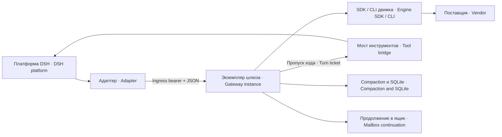

# dsh-subscription-gateway — подписочный шлюз агентного движка · Subscription gateway for an agent engine

Сервис на экземпляр агента ведёт модельный ход через официальный Claude Agent SDK или Codex SDK/app-server и отдаёт платформе поток NDJSON.
A per-agent service runs model turns through the official Claude Agent SDK or Codex SDK/app-server and streams NDJSON back to the platform.

## Зачем нужен · Why it exists

Подписочная авторизация и агентный движок отличаются от обычного API-ключа. Шлюз держит интеграцию SDK, resume, MCP и управление ходом в одном процессе, а платформа сохраняет свою историю и реестр инструментов. Если ваш provider уже поддерживается напрямую в DSH с API-ключом, дополнительный шлюз может не понадобиться.
Subscription authentication and an agent engine differ from a regular API key. The gateway keeps SDK integration, resume, MCP and turn control in one process while the platform keeps its history and tool registry. If DSH already supports your provider directly through an API key, an additional gateway may be unnecessary.



Полный путь включает `dsh-subscription-adapter` и при необходимости `dsh-tool-bridge`. Gateway — процесс, исполняющий движковые shell/file tools: его UID, группы и sandbox определяют права. Права платформенного юнита не доказывают права SDK-процесса. Инстансы должны иметь отдельные cwd, порты, mapping DB и scope авторизации.
The full path includes `dsh-subscription-adapter` and optionally `dsh-tool-bridge`. The gateway process executes engine shell/file tools: its UID, groups and sandbox determine permissions. Platform-unit permissions do not prove SDK-process permissions. Instances need separate working directories, ports, mapping databases and authorization scopes.

## Требования и установка · Requirements and installation

Пакет ESM; engines.node требует Node ≥ 22.22.0: нужен `node:sqlite` (DatabaseSync, без флага с 22.13). На 22.22.0 импорт пакета, установка по этому README и поставляемые стенды проверены облачным аудитом; работа проверена и на 24.19.0. systemd-шаблоны требуют Linux/systemd; не переносите их на другую ОС без собственной интеграции.
The package is ESM; engines.node requires Node ≥ 22.22.0: it needs `node:sqlite` (DatabaseSync, unflagged since 22.13). On 22.22.0 the package import, installation per this README and the supplied tests were checked by the cloud audit; operation is also checked on 24.19.0. systemd templates require Linux/systemd; other operating systems need their own integration.

Backend compaction задаётся файлом GATEWAY_COMPACTION_MODULE; это внешний модуль, не npm-зависимость. Без настройки, при ошибке import или недопустимом контракте шлюз продолжает SDK транспорт, а /health и журнал называют функцию недоступной. Сжатие отказывает; измерения этого backend возвращают null, не выдуманный ноль. Для восстановления нужен restart.
Configure the external compaction backend with GATEWAY_COMPACTION_MODULE; it is not an npm dependency. Without configuration, on import failure or invalid contract, SDK transport continues while /health and logs identify the unavailable feature. Compaction refuses; backend measurements return null rather than invented zero. Recovery requires restart.

Разложите пакет с `gateway.mjs` в корне выбранного runtime, затем установите его собственные зависимости. Здесь описан выпуск 3.1.4 (`version` в `package.json`); имя в npm — `dsh-subscription-gateway`. Архив пакета даёт `npm pack`: из реестра — `npm pack dsh-subscription-gateway@3.1.4` (после публикации; до неё имени в реестре нет), из исходников — `npm pack <каталог пакета>`; распаковка — `tar -xzf dsh-subscription-gateway-<версия>.tgz --strip-components=1 -C <gateway-runtime>` (в архиве всё лежит в `package/`). Vendor SDKs находятся отдельно в `sdk-runtime` рядом с модулем; helper проверяет диапазоны `sdkCompat`. `update` выполняет npm-установку и требует сеть/права записи; его нельзя применять к живому слою без вашего окна/страховки.
Lay out the package with `gateway.mjs` at the selected runtime root, then install its own dependencies. This describes release 3.1.4 (`version` in `package.json`); the npm name is `dsh-subscription-gateway`. `npm pack` produces the package archive: from the registry `npm pack dsh-subscription-gateway@3.1.4` (after publication; until then the name is absent from the registry), from sources `npm pack <package directory>`; unpack with `tar -xzf dsh-subscription-gateway-<version>.tgz --strip-components=1 -C <gateway-runtime>` (the archive keeps everything under `package/`). Vendor SDKs live separately in adjacent `sdk-runtime`; the helper checks `sdkCompat` ranges. `update` performs npm installation and needs network/write access; do not mutate a live layer outside your change window/backup policy.

```bash
cd <gateway-runtime>
npm pack dsh-subscription-gateway@3.1.4   # или · or: npm pack <каталог пакета · package directory>
tar -xzf dsh-subscription-gateway-3.1.4.tgz --strip-components=1 && rm dsh-subscription-gateway-3.1.4.tgz
npm install --omit=dev --no-audit --no-fund
node gateway-sdk.mjs update anthropic
# RU: Для Codex вместо anthropic выбрать codex; для обеих веток all.
# EN: Use codex instead of anthropic for Codex, or all for both branches.
node gateway-sdk.mjs status
```

`status` проверяет обе ветки SDK независимо от `GATEWAY_POSTAVSHIK`. Если поставлена одна ветка, для второй он печатает «🔴 НЕ УСТАНОВЛЕН в слое» и выходит кодом 1 — для экземпляра одной ветки это ожидаемый исход: смотрите строку своей ветки (диск, граница `sdkCompat`, «в границе»). Код 0 бывает только при обеих ветках в границе.
`status` checks both SDK branches regardless of `GATEWAY_POSTAVSHIK`. With one branch installed it prints «🔴 НЕ УСТАНОВЛЕН в слое» (not installed in the layer) for the other and exits 1 — expected for a single-branch instance: read the line of your branch (disk version, `sdkCompat` range, «в границе» = within range). Exit 0 requires both branches within range.

Шаблон systemd/gateway@.service — пример deployment. Проверьте ExecStart/EnvironmentFile/token paths, User/Group и права runtime. status обнаруживает публичные gateway@*.service и прежние семьи служб; сверяет только свой каталог. Версия на диске и загруженная SDK-версия измеряются отдельно.
systemd/gateway@.service is a deployment example. Verify ExecStart/EnvironmentFile/token paths, User/Group and runtime permissions. status discovers public gateway@*.service and legacy service families and compares its own runtime directory only. Disk and loaded SDK versions are measured separately.

Гостевой drop-in `systemd/95-gost.conf` сбрасывает `LoadCredential=` и отдаёт гостю ровно одну подписку (B-N-1621): `ExecStartPre=+/usr/local/libexec/gost-podpiska-vybor %i` (файл пакета `systemd/gost-podpiska-vybor`, ставится root 0755) копирует токен из строки `GATEWAY_TOKEN_FILE` файла `instance-<гость>.env` в `RuntimeDirectory=claude-oauth-gost-%i` (0500, systemd удаляет его при остановке), а `CREDENTIALS_DIRECTORY` указывает на этот каталог. Подробнее — [systemd/GUEST.md](systemd/GUEST.md) и [SETTINGS](docs/SETTINGS.md).
The guest drop-in `systemd/95-gost.conf` resets `LoadCredential=` and gives the guest exactly one subscription (B-N-1621): `ExecStartPre=+/usr/local/libexec/gost-podpiska-vybor %i` (package file `systemd/gost-podpiska-vybor`, installed root 0755) copies the token named by the `GATEWAY_TOKEN_FILE` line of `instance-<guest>.env` into `RuntimeDirectory=claude-oauth-gost-%i` (0500, removed by systemd on stop), and `CREDENTIALS_DIRECTORY` points to that directory. See [systemd/GUEST.md](systemd/GUEST.md) and [SETTINGS](docs/SETTINGS.md).

## Быстрый старт · Quick start

Выберите provider явно; задайте индивидуальные ingress key, рабочий каталог и mapping DB. Ниже нейтральный пример EnvironmentFile для Claude. `<...>` — места, которые оператор заменяет своими путями/именами; секретное значение в файл примера не вставляется.
Choose the provider explicitly and set individual ingress key, working directory and mapping DB. Below is a neutral Claude EnvironmentFile example. `<...>` placeholders must be replaced by the operator; no secret value belongs in this example.

```dotenv
GATEWAY_POSTAVSHIK=anthropic
GATEWAY_PORT=<local-port>
GATEWAY_MCP_PORT=<separate-local-port>
GATEWAY_WORK_DIR=<absolute-agent-home>
GATEWAY_BAZA_SESSIJ=<absolute-private-state>/sessions.db
GATEWAY_TOKEN_FILE=<absolute-private-credential-file>
GATEWAY_INGRESS_KEY_FILE=<absolute-ingress-key-file>
GATEWAY_EFFORT=high
GATEWAY_MAX_TURNS=60
GATEWAY_RESUME=1
GATEWAY_COMPACTION_MODULE=<absolute-backend-module.mjs>
GATEWAY_CONTINUATION_MODE_FILE=<absolute-continuation-mode.json>
GATEWAY_CONTINUATION_ALLOWLIST=["example-coder"]
```

Ingress-файл должен быть regular, абсолютным, root-owned или owned UID процесса, без group/other permissions, и содержать 64 lowercase hex. Это пропуск клиента, не токен подписки. Для Codex выберите `GATEWAY_POSTAVSHIK=openai`, явный `CODEX_HOME`, при необходимости sandbox и путь `exec`/`app-server`; подписочный файл Claude ему не нужен.
The ingress file must be a regular absolute-path file, owned by root or the process UID, with no group/other permissions, containing 64 lowercase hex characters. It is a client access key, not a subscription token. For Codex choose `GATEWAY_POSTAVSHIK=openai`, set `CODEX_HOME`, and optionally sandbox and `exec`/`app-server`; it does not need the Claude token file.

После штатного запуска проверьте `/health`, version/source fingerprint в журнале, provider и реальные группы `/proc/<PID>/status`. Health проверяет читаемость credential/ingress, но не исполняет модельный ход и не доказывает здоровье vendor API. Для настоящей приёмки через адаптер выполните короткий ход и один разрешённый platform tool, проверив оба конца трассы.
After normal startup, check `/health`, version/source fingerprint logs, provider and actual groups in `/proc/<PID>/status`. Health checks credential/ingress readability, not a model turn or vendor API health. For actual acceptance, run a short turn and an allowed platform tool through the adapter and check both ends of the trace.

## Основные настройки · Primary settings

| Имя · Name | Назначение · Purpose |
|---|---|
| `GATEWAY_POSTAVSHIK` | Обязательная ветка anthropic/openai · Required anthropic/openai branch |
| `GATEWAY_INGRESS_KEY_FILE` | Входной bearer, до JSON/SDK · Ingress bearer before JSON/SDK |
| `GATEWAY_TOKEN_FILE`, `CODEX_HOME` | Авторизация выбранного поставщика · Provider-specific credentials |
| `GATEWAY_COMPACTION_MODULE` | Optional backend file; empty means feature unavailable · Необязательный backend, пусто — функция недоступна |
| `GATEWAY_CONTINUATION_ALLOWLIST`, `GATEWAY_CONTINUATION_MODE_FILE` | Явный allowlist и mode-файл · Explicit allowlist and mode file |
| `GATEWAY_BAZA_SESSIJ`, `GATEWAY_RESUME` | Mapping и resume истории · History mapping and resume |
| `GATEWAY_MCP`, `GATEWAY_MCP_PORT` | Внешние MCP и локальный прокси · External MCP and local proxy |
| `GATEWAY_DAVLENIE*`, `GATEWAY_CODEX_PUT` | Наблюдение и управление давлением · Pressure observation/control |
| `GATEWAY_MASKA_PDN`, `GATEWAY_GOST_*` | Маска персональных данных гостя (только anthropic) · Guest personal-data mask (anthropic only) |

Каждый runtime env key, параметр тела, fixed bound и helper setting описан в [SETTINGS](docs/SETTINGS.md). Там различаются значения по умолчанию и обязательные deployment-поля, которые переносимой установке нужно закрепить явно.
[SETTINGS](docs/SETTINGS.md) describes every runtime environment key, request field, fixed bound and helper setting. It distinguishes defaults from deployment fields that a portable installation must pin explicitly.

## Работа шлюза · Gateway behavior

Входной bearer проверяется до токена, JSON и SDK. `/v2/agent-stream` требует conversation identity v2 либо явный stateless envelope. Ключ включает provider/canonical cwd/session ID/createdAt, поэтому одинаковый текст не объединяет разные беседы. `/v1` оставлен для legacy-клиентов и не даёт ту же гарантию идентичности.
Ingress bearer validation precedes credentials, JSON and SDK. `/v2/agent-stream` requires conversation identity v2 or an explicit stateless envelope. Its key includes provider/canonical cwd/session ID/createdAt, so identical text cannot merge separate conversations. `/v1` remains for legacy clients and lacks the same identity guarantee.

Resume использует SDK session mapping и hash уже переданного префикса. Изменённая история требует полного входа; слишком длинный вход получает аварийный хвост. Повтор допустим только на ограниченных ветках восстановления и до выдачи событий клиенту; после частичного ответа нельзя молча исполнять ход заново.
Resume uses SDK-session mapping and the hash of the already-transferred prefix. Changed history requires full input; oversized input receives an emergency tail. Retries are limited to recovery branches before emitting events to the client; after partial output a turn cannot silently be executed again.

Платформа передаёт bridge descriptor на каждый ход. Локальный MCP proxy доставляет схемы без zod; при отказе proxy Claude может использовать legacy конвертер, Codex остаётся без платформенных инструментов. Коллизия MCP имени оставляет внешний сервер и явно отключает bridge. Пропуски идут через имена env-переменных, а не секретные значения в argv.
The platform sends a bridge descriptor for each turn. A local MCP proxy forwards schemas without zod; on proxy failure Claude can use the legacy converter, while Codex loses platform tools. MCP name collisions preserve the external server and explicitly omit the bridge. Tickets travel through environment-variable names, not secret values in argv.

`task-control` связывает команду с живым request и точным binding. Повторы одного control ID дедуплицируются по содержимому. `accepted:true` подтверждает принятие управления SDK, но не исполнение модели; `model_response:unknown` сохраняет эту границу. Закрытие request удаляет route, новый ход не становится запасным адресатом.
`task-control` binds each command to a live request and exact binding. Replays of one control ID are deduplicated by content. `accepted:true` proves SDK control admission, not model execution; `model_response:unknown` preserves that boundary. Closing a request removes its route; a new turn never becomes a fallback target.

Давление отдельно наблюдает заполненность и при включённом signal просит модель довести шаг до безопасной точки. Codex app-server использует steer и сроки наблюдения, истечение которых не прерывает ход; явный stop — interrupt. Continuation-письмо имеет ограничение 2 последовательных продолжений. Compaction summaries, SDK context metrics и platform physical compact — разные признаки и читатели.
Pressure separately observes occupancy and, when signal is enabled, asks the model to reach a safe point. Codex app-server uses steering and observation deadlines whose expiry does not interrupt the turn; explicit stop uses interrupt. Continuation messages are bounded to 2 consecutive continuations. Compaction summaries, SDK context metrics and physical platform compaction are distinct signals and consumers.

Маска персональных данных гостя (`GATEWAY_MASKA_PDN=1`, файл `pdn-maska.mjs`) ставит между SDK и поставщиком локального посредника на 127.0.0.1: значения из реестра гостей (`GATEWAY_GOST_REESTR`) и образцы телефона и почты заменяются в теле запроса заглушками `⟦вид:id⟧`, обратная подстановка идёт только в ответе клиенту и только по карте этого хода. Значения из белого списка (`GATEWAY_GOST_BELYJ_SPISOK`) уходят модели как есть. Модель берётся только из `GATEWAY_GOST_MODELI`, рабочий каталог — только `GATEWAY_WORK_DIR` (`cwd` тела отбрасывается). Отказ при старте, код 2: поставщик не anthropic; шлюзовой компакт включён или не объявлен (модуль сжатия шлёт стенограмму мимо посредника); нет реестра или моделей. `/health` показывает `pdnMaska`. Не ловит: имя, которого нет в реестре, склонённые формы имени, контакт словами, по буквам или на картинке. Ключи — [SETTINGS](docs/SETTINGS.md).
The guest personal-data mask (`GATEWAY_MASKA_PDN=1`, file `pdn-maska.mjs`) puts a local intermediary on 127.0.0.1 between the SDK and the provider: values from the guest registry (`GATEWAY_GOST_REESTR`) and phone/email patterns are replaced in the request body with `⟦kind:id⟧` placeholders; reverse substitution happens only in the reply to the client and only from this turn's map. Whitelisted values (`GATEWAY_GOST_BELYJ_SPISOK`) reach the model as is. The model comes only from `GATEWAY_GOST_MODELI`, the working directory only from `GATEWAY_WORK_DIR` (body `cwd` is dropped). Startup refusal, exit 2: provider is not anthropic; gateway compaction enabled or undeclared (the compaction module sends the transcript around the intermediary); registry or models missing. `/health` reports `pdnMaska`. Not caught: a name absent from the registry, inflected name forms, contacts written in words, spelled out or inside an image. Keys: [SETTINGS](docs/SETTINGS.md).

## Документы · Documents

| Файл · File | О чём · Contents |
|---|---|
| [docs/SETTINGS.md](docs/SETTINGS.md) | Ключи окружения, поля запроса, постоянные пределы, systemd · Environment keys, request fields, fixed bounds, systemd |
| [docs/ARCHITECTURE.md](docs/ARCHITECTURE.md) | Потоки, компоненты, протокол ответа · Flows, components, response protocol |
| [docs/GUARDS.md](docs/GUARDS.md) | Сторожа, читатели тревог, стенды · Guards, alert consumers, tests |
| [docs/TROUBLESHOOTING.md](docs/TROUBLESHOOTING.md) | Диагностика по признакам · Diagnosis by symptom |
| [docs/STOP-WATCH.md](docs/STOP-WATCH.md) | Наблюдение после мягкого стопа Codex app-server · Watch after a Codex app-server soft stop |
| [CONVERSATIONS.md](CONVERSATIONS.md) | Беседа v2: идентичность, ключ, откат · Conversation v2: identity, key, rollback |
| [LIVE-INPUT.md](LIVE-INPUT.md) | Обычные письма внутри хода: состояния и сроки · Ordinary mail inside a turn: states and deadlines |
| [systemd/GUEST.md](systemd/GUEST.md) | Гостевой экземпляр · Guest instance |

## Проверки, ограничения, лицензия · Checks, limits and license

[ARCHITECTURE](docs/ARCHITECTURE.md) содержит схемы потоков/состояний; [GUARDS](docs/GUARDS.md) — поимённые проверки и читателей тревог; [TROUBLESHOOTING](docs/TROUBLESHOOTING.md) — диагностику. Гостевое отключение встроенных tools действует только для Claude SDK при `GATEWAY_INSTRUMENTY_DVIZHKA=net`; MCP-инструменты и их регистрация требуют собственной приёмки.
[ARCHITECTURE](docs/ARCHITECTURE.md) contains flow/state diagrams; [GUARDS](docs/GUARDS.md) names checks and alert consumers; [TROUBLESHOOTING](docs/TROUBLESHOOTING.md) covers diagnosis. Guest built-in tool disabling applies only to Claude SDK under `GATEWAY_INSTRUMENTY_DVIZHKA=net`; MCP tools and their registrations require separate acceptance.

Шлюз не является OS sandbox, billing proxy, открытым API-сервером или гарантией завершения любой команды управления. Секрет в env остаётся доступен тому, кто может читать память/окружение процесса. Memory-export и compaction backends задаются настройками. Нейтральные адреса — только в `systemd/gateway@.service`; гостевой `systemd/95-gost.conf` несёт пути развёртки (`/etc/claude-oauth/instance-%i.env`, `/opt/subscription-gateway-guest/…`, `/usr/local/libexec/gost-podpiska-vybor`), на другой машине его переписывают. Существующая машина сохраняет свои expanded settings.
The gateway is not an OS sandbox, billing proxy, public API server or guarantee that every control command completes. An environment secret remains accessible to anyone able to read process memory/environment. Memory export and compaction backends are explicitly configured. Only `systemd/gateway@.service` uses neutral example locations; the guest `systemd/95-gost.conf` carries deployment paths (`/etc/claude-oauth/instance-%i.env`, `/opt/subscription-gateway-guest/…`, `/usr/local/libexec/gost-podpiska-vybor`) and must be rewritten for another host. Existing hosts preserve their own expanded settings.

Окружение движка Claude (B-N-1899) — гигиена, не защита. Движку не передаются служебные `GATEWAY_*`, кроме `GATEWAY_MOST_PROPUSK` (пропуск моста), и не передаётся `CLAUDE_CODE_OAUTH_TOKEN`: токен подписки идёт трубой на дескриптор 3 (`CLAUDE_CODE_OAUTH_TOKEN_FILE_DESCRIPTOR=3`), её отказ пишется в журнал строкой «труба токена (fd 3) отказала». При ненулевом коде выхода движка в журнал пишется хвост его stderr («🔴 движок вышел с кодом N…»). Не закрывает: учётка движка — учётка шлюза, она читает файл `GATEWAY_TOKEN_FILE` и `/proc/<шлюз>/environ`; `OMEGA_MCP_API_KEY` и пропуск хода остаются в env движка. Ветку Codex правка не меняет.
Claude engine environment (B-N-1899) is hygiene, not protection. The engine receives no gateway-only `GATEWAY_*` variables except `GATEWAY_MOST_PROPUSK` (bridge ticket) and no `CLAUDE_CODE_OAUTH_TOKEN`: the subscription token is written to a pipe on descriptor 3 (`CLAUDE_CODE_OAUTH_TOKEN_FILE_DESCRIPTOR=3`), and a pipe failure is logged as «труба токена (fd 3) отказала». When the engine exits with a non-zero code, the tail of its stderr is logged («🔴 движок вышел с кодом N…»). Not covered: the engine runs under the gateway account, which can read the `GATEWAY_TOKEN_FILE` file and `/proc/<gateway>/environ`; `OMEGA_MCP_API_KEY` and the turn ticket stay in the engine environment. The Codex branch is unchanged.

MIT, Iia-arg team. Общая документация: [dsh-plugins](https://github.com/iia-arg/dsh-plugins). Новая нумерация, публикация и rollout выполняются отдельно; наличие README не подтверждает SDK/credential/live-tools приёмку.
MIT, Iia-arg team. System documentation: [dsh-plugins](https://github.com/iia-arg/dsh-plugins). Versioning, publishing and rollout are separate steps; a README does not certify SDK/credential/live-tools acceptance.

GATEWAY_MCP и merge/name-collision относятся к Claude ветке. Codex собирает собственный единственный proxy server под именем dsh, не использует mcpAll/body.bridge.name для SDK config и не подключает внешние servers через GATEWAY_MCP. Проверяйте фактическую MCP-приставку по provider.
GATEWAY_MCP and merge/name-collision apply to Claude. Codex builds its own single proxy server named dsh, does not use mcpAll/body.bridge.name in SDK config and does not attach external servers through GATEWAY_MCP. Verify the actual MCP prefix per provider.
