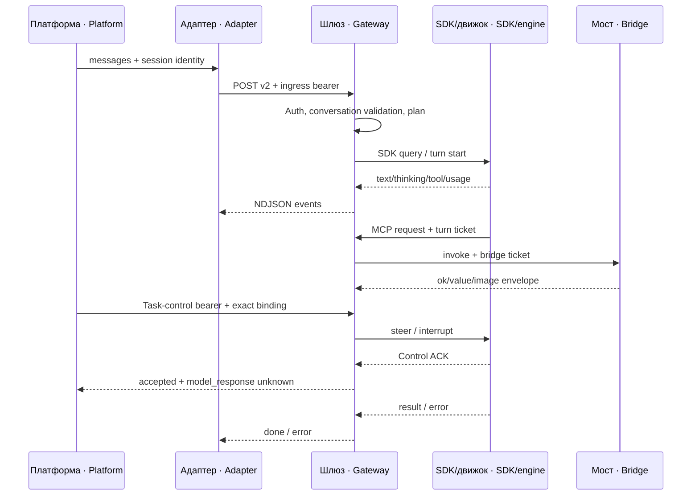
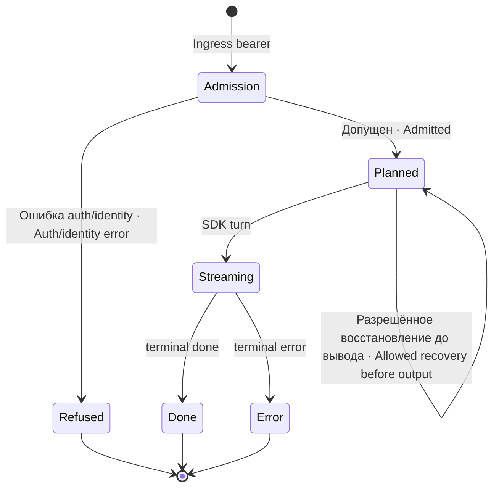
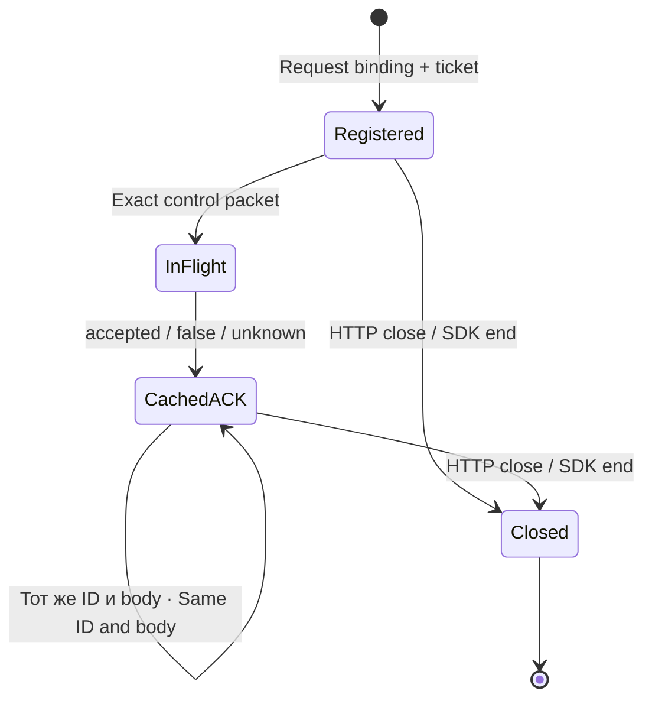

# Устройство и протоколы · Architecture and protocols

## Процессы · Processes

Один instance запускает один provider. Claude Agent SDK порождает CLI и выполняет tools под UID шлюза; Codex exec использует SDK, app-server использует отдельный JSON-RPC child. Граница платформа→шлюз защищена ingress key; proxy→bridge защищён пропуском хода. Task-control имеет третий, request-specific bearer и не использует «последнюю активную беседу».
One instance runs one provider. Claude Agent SDK starts a CLI and executes tools under the gateway UID; Codex exec uses its SDK, while app-server uses a separate JSON-RPC child. Ingress keys protect platform→gateway; turn tickets protect proxy→bridge. Task-control has a third request-specific bearer and never targets the latest active conversation.

## Слои данных · Data layers

| Компонент · Component | Владелец и persistence · Ownership and persistence |
|---|---|
| `gateway.mjs` | HTTP/admission, SDK routing, mapping, pressure hooks · HTTP/admission, SDK routing, mapping, pressure hooks |
| `ingress-auth.mjs` | Проверка credential-файла до тела · Read-only credential file checking before request body |
| `conversation-identity.mjs` | SQLite identity columns/index и ключ v2 · SQLite identity columns/index + v2 key |
| `task-control.mjs` | Память generation/tickets/dedup команд · In-memory route generation/tickets/control dedup |
| `codex-app-server.mjs` | Дочерний JSON-RPC, управление точным ходом · Child JSON-RPC, turn-bound steer/interrupt |
| `codex-compaction-watch.mjs` | Чтение rollout telemetry и disk context · Read-only rollout telemetry, disk context |
| `mcp-image.mjs` | Ограниченная проверка protocol 1 reply · Bounded protocol 1 bridge reply validation |
| `image-history.mjs` | Узкая очистка image history при compaction · Narrow history image cleanup around compaction |
| `jsonschema-to-zod.mjs` | Legacy fallback конвертер · Legacy fallback converter |
| `gateway-sdk.mjs` | CLI оператора для sdk-runtime · Operator CLI for sdk-runtime metadata/update |
| `pdn-maska.mjs` | Маска ПДн гостя: посредник SDK → поставщик, карта заглушек на ход (в памяти) · Guest PII mask: SDK → provider intermediary, per-turn placeholder map (in memory) |
| `inbox-input.mjs` | Обычные письма внутри хода: очередь и состояния доставки (в памяти) · Ordinary mail inside a turn: queue and delivery states (in memory) |
| `live-pressure.mjs` | Сверка proof живого порога давления и счёт писем продолжения · Live pressure-threshold proof check and continuation-letter counter |
| `secret-redact.mjs` | Вычистка секретов процесса на выходе (NDJSON, журнал, тревоги) · Egress redaction of process secrets (NDJSON, logs, alerts) |
| `compaction-runtime.mjs` | Загрузка и проверка контракта внешнего backend сжатия · Loading and contract check of the external compaction backend |

База `sessions` хранит SDK sessionId, otdano, hashPref и v2 identity: dshId/dshCreated/dshCwd/provider/routingVersion. Кэш в памяти — не больше 8 бесед; база по числу бесед не ограничена и с кэшем не связана, но на старте чистится по сроку `GATEWAY_SESSII_SROK_DNEJ` (умолчание 30 суток без обновления): вытеснение убирает беседу только из памяти, при старте в память поднимаются последние 8 строк базы (по `rowid`), а промах кэша читает строку из базы. Кроме срока, строка удаляется только когда SDK признал сессию мёртвой (`sessiya-mertva`); в обоих случаях следующий ход идёт новой сессией с полной историей. Потеря SDK rollout не равна потере mapping; оба слоя нужно различать в диагностике.
The `sessions` database stores SDK sessionId, otdano, hashPref and v2 identity: dshId/dshCreated/dshCwd/provider/routingVersion. The in-memory cache holds at most 8 conversations; the database is not bounded by conversation count and is independent of the cache, but is cleaned on startup by the `GATEWAY_SESSII_SROK_DNEJ` retention (default 30 days without update): eviction removes a conversation from memory only, start-up loads the latest 8 database rows (by `rowid`) into memory, and a cache miss reads the row from the database. Apart from retention, a row is deleted only when the SDK reports the session dead (`sessiya-mertva`); in both cases the next turn goes to a new session with the full history. Losing an SDK rollout is not the same as losing mapping; diagnosis must distinguish both layers.

## Протокол ответа · Response protocol

До начала stream ошибки приходят статусами 400/401/500/503 и JSON error. После начала stream HTTP 200 сохраняется, а исход передаётся событиями по одной JSON-строке: `text`, `thinking`, `tool`, `usage`, `done` или `error`. При `taskControl` приходят ещё `task-status` (`ready`, `terminal` — при `taskControl.terminal=1`) и `input-status` (`ready`, `offered`, `not-offered` — при операции `message`), см. [LIVE-INPUT](../LIVE-INPUT.md). Читатель обязан закончить незавершённый буфер только по полной строке; transport close без terminal event — неизвестный/оборванный исход, а не успешный ответ.
Before streaming begins, errors use 400/401/500/503 and JSON error objects. Once streaming starts, HTTP 200 remains and the result is carried as one JSON object per line: `text`, `thinking`, `tool`, `usage`, `done` or `error`. With `taskControl` there are also `task-status` (`ready`, `terminal` — with `taskControl.terminal=1`) and `input-status` (`ready`, `offered`, `not-offered` — with the `message` operation), see [LIVE-INPUT](../LIVE-INPUT.md). Consumers must only parse complete lines; transport closure without a terminal event is an unknown/interrupted outcome, not success.

Клиентское body.cwd перекрывает GATEWAY_WORK_DIR; это доверенное полномочие входного клиента, не sandbox-проверка. Body.model и maxTurns могут перекрывать defaults. Credential не даёт право произвольному пользователю обращаться к порту; оператор отвечает за хранение ingress key и локальное сетевое разграничение.
Client body.cwd overrides GATEWAY_WORK_DIR; this is trusted ingress-client authority, not a sandbox check. Body.model and maxTurns can override defaults. Credentials do not permit arbitrary users to access the port; operators own ingress-key storage and local network isolation.

## Identity и управление · Identity and control

Точный binding содержит generation, recipient, ledger_uuid, session_id, session_created и turn. Control добавляет control_id, а cancel ещё target_receipt. Маршрут имеет лимит 64 регистраций, запись 256 control IDs. HTTP body ≤ 131072 bytes, text ≤ 65536 bytes, чтение 4 seconds, dispatch 3.5 seconds. Слишком поздний ACK может оставить unknown; timeout ответа не является доказанной отменой SDK-действия.
Exact binding contains generation, recipient, ledger_uuid, session_id, session_created and turn. A control adds control_id, while cancel also adds target_receipt. Routes are capped at 64 registrations and records at 256 control IDs. HTTP body ≤ 131072 bytes, text ≤ 65536 bytes, reading 4 seconds, dispatch 3.5 seconds. A late ACK can leave unknown; response timeout does not prove SDK-operation cancellation.

## MCP и изображения · MCP and images

HTTP MCP listener расположен на отдельном loopback порту. Claude допускает только пропуск живого хода в таблице; удаление происходит на response close. Codex path хранит текущий/предыдущий descriptor процесса. Этот gateway instance не является мультипользовательским брокером параллельных произвольных агентов: выдачу/текущий descriptor нужно согласовать с caller serialization.
The HTTP MCP listener uses a separate loopback port. Claude accepts only live-turn tickets in its table and removes them on response close. The Codex path retains the current/previous process descriptor. This gateway instance is not a multiuser broker for arbitrary parallel agents: callers must coordinate issuance/current descriptor with serialization.

Image protocol 1 разрешён только для read_image на Claude. Ответ ограничивается 10065536 (10000000 + 65536) bytes и проверяет MIME/base64/блоки. Cleanup истории при compaction распознаёт только bridge-owned tool results; пользовательские картинки и другие tool results не являются его предметом. Замена metadata без очистки физического SDK transcript не доказывает уменьшение контекста.
Image protocol 1 is permitted only for read_image on Claude. Replies are bounded to 10065536 (10000000 + 65536) bytes and validate MIME/base64/blocks. Compaction history cleanup identifies only bridge-owned tool results; user images and other tool results are outside its scope. Replacing metadata without cleaning the physical SDK transcript does not prove reduced context.

## Давление и завершение · Pressure and completion

Claude signal добавляется через PostToolBatch и не является server-confirmed чтением моделью. App-server steer тоже подтверждает доставку управления SDK, а не понимание сигнала. Только Codex app-server имеет сроки наблюдения safe-boundary/completion: при истечении он снимает взведение или отмечает timeout и оставляет ход работать, не выполняет interrupt. У Claude PostToolBatch нет отдельного такого deadline; continuation ограничено 2 последовательными письмами. Runtime pressure state сбрасывается на restart.
Claude signals are added through PostToolBatch and are not server-confirmed model consumption. App-server steering likewise confirms SDK control delivery, not understanding. Only Codex app-server has safe-boundary/completion observation deadlines: expiry disarms or records timeout while allowing the turn to continue, without interrupting. Claude PostToolBatch has no equivalent separate deadline; continuation is capped at 2 consecutive messages. Runtime pressure state resets on restart.

Ветка внешних MCP различается: Claude использует merged mcpAll и name-collision решение; Codex использует фиксированное config.mcp_servers.dsh. Поэтому разрешённый внешний MCP в Claude config не означает его наличие у Codex.
External MCP routing differs: Claude uses merged mcpAll and its name-collision decision; Codex uses fixed config.mcp_servers.dsh. An external MCP allowed in Claude config therefore does not imply its presence in Codex.

Canonical cwd здесь означает lexical path.resolve: без fs.realpath и проверки существования каталога. Разные alias/symlink пути могут получать разные identity keys; не приписывайте этому host filesystem isolation.
Canonical cwd here means lexical path.resolve, without fs.realpath or directory-existence checks. Different alias/symlink paths can produce different identity keys; this is not host filesystem isolation.

Legacy jsonschema-to-zod — не полноценный JSON Schema validator: неподдерживаемые type/ветви отказывают, но часть keywords (например pattern/additionalProperties) не переносится. После fallback сверять реальный tools/list и платформенную проверку аргументов; HTTP путь не делает эту конверсию.
Legacy jsonschema-to-zod is not a complete JSON Schema validator: unsupported types/branches fail, but some keywords such as pattern/additionalProperties are not transferred. After fallback inspect actual tools/list and platform argument validation; the HTTP route does not perform this conversion.

Optional compaction-runtime загружает настроенный файл один раз. У backend свой признак available и причина; отсутствие сохраняет SDK транспорт и явные unknown-измерения. Pressure/rollout reader и physical-compaction caller используют этот API; operator читает status в /health и журнал, а изменения настройки требуют restart.
Optional compaction-runtime loads its configured file once. The backend has a separate available state/reason; absence preserves SDK transport and explicit unknown measurements. Pressure/rollout readers and the physical-compaction caller consume its API; operators inspect /health status/logs and configuration changes require restart.

Экспорт SDK summary проверяет GATEWAY_PAMYAT_BAZA/KOMPAKT_AGENT и выбирает GATEWAY_MEMORY_MODULE; лениво импортирует apply и называет отказ отсутствующего/несовместимого модуля без удаления transcript. Эта функция отделена от optional compaction-runtime.
SDK summary export resolves the configured GATEWAY_MEMORY_MODULE after checking GATEWAY_PAMYAT_BAZA/KOMPAKT_AGENT; it imports apply lazily and reports a missing/incompatible module without deleting the source transcript. This feature is separate from optional compaction-runtime.
