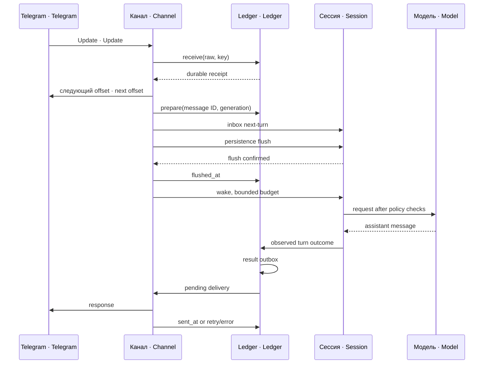
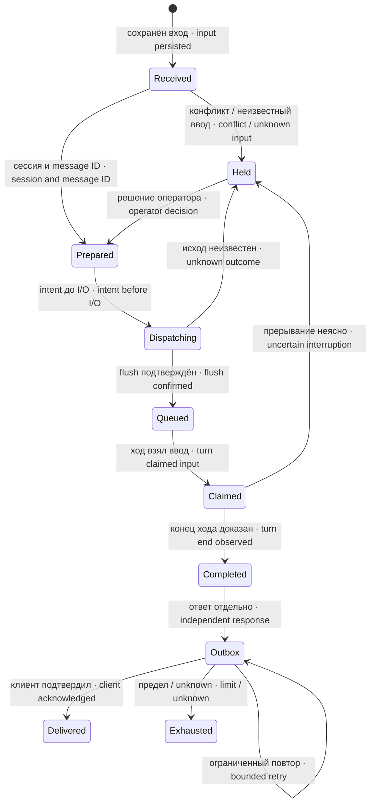
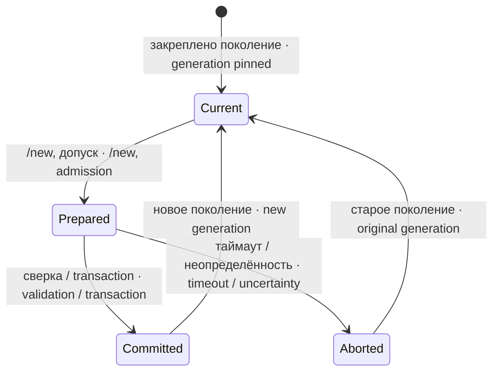

# Устройство и состояния · Architecture and states

## Границы компонентов · Component boundaries

`src/index.js` владеет композицией канала: Telegram client, ledger, отображение маршрутов на сессии, вызовы сервисов DSH и циклы опроса. Дополнительные модули изолируют протоколы и состояния. Они не подменяют ОС-права и не назначают конфигурацию внешнего поставщика модели.

`src/index.js` owns channel composition: the Telegram client, ledger, route-to-session bindings, DSH service calls, and polling loops. Companion modules isolate protocols and state machines. They do not replace OS permissions or configure an external model provider.

Метка `dispatch_started` пишется перед постановкой. Если процесс погиб после неё, проверка ищет конкретный DSH message ID в истории/очереди; отсутствие доказательства не разрешает повторно выполнить работу. `flushed_at` подтверждает участие persistence, `claimed_turn` — подхват сообщения ходом, `finished_at` — установленный исход. Транзакция ledger не является транзакцией Telegram или модели.

`dispatch_started` is written before inbox dispatch. If the process dies afterward, recovery looks for the exact DSH message ID in session history/inbox state; missing evidence does not authorize replaying the work. `flushed_at` confirms persistence participation, `claimed_turn` associates the message with a turn, and `finished_at` records an established outcome. A ledger transaction is not a Telegram or model transaction.

## Сессии и поколения · Sessions and generations

По умолчанию маршрут Telegram получает `telegram-<route>`. `mergeChatIntoA2A` соединяет выбранный личный чат с `a2aSession`; остальные чаты независимы. `ConversationSessions` хранит `route_key`, `session_id`, время создания и revision в SQLite. Поколение сравнивается по ID и времени: совпадения одного имени недостаточно.

A Telegram route normally receives `telegram-<route>`. `mergeChatIntoA2A` combines a selected private chat with `a2aSession`; other chats remain independent. `ConversationSessions` stores route key, session ID, creation time, and revision in SQLite. A generation is matched by both ID and creation time: matching only the name is insufficient.

`/new` имеет фазы prepared/committed/aborted и срок одной попытки 60 секунд. План отмены отдельно учитывает задания расписания, inbox, квитанции и вложения. Commit выполняется только при неизменном старом поколении и подтверждённом новом; после перезапуска prepared-попытки прекращаются, а не повторяют внешние действия автоматически.

`/new` has prepared/committed/aborted phases and a 60-second attempt deadline. Its cancellation plan separately tracks schedules, inbox items, receipts, and attachments. Commit requires the original generation to remain unchanged and the replacement to be verified; after restart, prepared attempts are aborted rather than automatically replaying external actions.

Durable-пауза закреплена за поколением, а не последним текстом чата. Восстановление paused inbox не будит агента до разрешённого ввода человека из allowedUsers. Удалённое задание расписателя не отзывает уже доставленный inbox автоматически; поэтому план отмены и обратные квитанции проверяются отдельно.

A durable pause belongs to a generation, not to the chat's latest text. Restoring a paused inbox does not wake the agent before authorized privileged human input. Deleting a scheduler record does not automatically recall an already delivered inbox item; cancellation plans and return receipts therefore require separate verification.

## Файловая почта и доверие · File mail and trust

Идентичность обычной почты строится из источника, устойчивого delivery ID и байтов. `From:` и имя файла помогают подписать ответ, но сами по себе не удостоверяют отправителя. Подписанные конверты проверяют key ID, получателя, ledger identity, срок, SHA и защиту от повторного использования. Неизвестные формы протокола удерживаются, а не исполняются как распоряжение.

Ordinary mail identity uses its source, durable delivery ID, and bytes. `From:` and filenames help attribute a response but do not authenticate the sender. Signed envelopes validate key ID, recipient, ledger identity, expiry, hashes, and replay protection. Unknown protocol forms are held instead of being executed as directives.

## Гости и сайт · Guests and website traffic

`GuestCopies` фиксирует адресатов при admission и делает устойчивые question/answer outbox IDs. `telegram_send_file` выводит чат из квитанций открытого хода, требует один непротиворечивый маршрут и ограничивает гостя его каталогом. Назвать чужой чат параметром инструмента невозможно; смешанный ход с гостевым сообщением остаётся гостевым.

`GuestCopies` snapshots targets at admission and creates durable question/answer outbox IDs. `telegram_send_file` derives the chat from receipts claimed by the open turn, requires one consistent route, and confines guests to their own directory. A caller cannot select another chat through tool arguments; a mixed turn containing guest input remains guest-scoped.

Сайт использует `site-<N>` и поколения `telegram-site-...`; копии не вызывают модель. Читатель атомарно переименовывает вход в `.claimed-*`, принимает его в ledger и затем удаляет. После перезапуска захваченные файлы дочитываются. Повтор `id` с изменённым `at` или причиной — конфликт, а не новая копия; адаптер должен воспроизводить исходные байты или согласовать другую политику отдельно.

Website traffic uses `site-<N>` routes and `telegram-site-...` generations; copy-only envelopes do not wake the model. The reader atomically renames input to `.claimed-*`, admits it to the ledger, then removes the file. Claimed files are recovered after restart. Reusing an ID with a changed timestamp or reason is a conflict rather than a new copy; the adapter must reproduce the original bytes or separately agree on a different policy.

Результат сайта выводится из закреплённого маршрута, receipt и исходного конверта. Если несколько вопросов принадлежат одному модельному ходу, ответ и его копия имеют одного первичного владельца. Имя выходного файла — SHA outbox ID, ключ дедупликации адаптера. Общий выключатель запрещает новые ходы и ответы, но не сбор копий. Native-фильтр инструментов и внешний MCP descriptor проверяются независимо.

A website result derives its destination from the pinned route, receipt, and original envelope. If several questions belong to one model turn, one primary receipt owns its response and response copy. The output filename is a hash of the outbox ID and serves as the adapter's deduplication key. The shared closure switch blocks new turns and responses while copy collection continues. Native tool filtering and the external MCP descriptor are checked independently.

Незавершённое письмо без claim, удержанное backlog завершённого replace-STOP того же поколения, получает `blocked=held_by_replace` при сверке квитанций. `status` показывает control-id и время из audit; WakeGate и проверка занятости профиля учитывают удержание. При первой классификации в одной транзакции сохраняются маркер, audit и одно уведомление отправителю через существующий outbox. Audit исключает повтор уведомления; неизвестный обратный адрес виден как `HOLD` в outbox. Общие персональные тревоги о просрочке к этому состоянию не применяются; удержания с неизвестным обратным адресом остаются в суточной сводке для reviewer. Квитанция остаётся незавершённой; очередь и backlog сохраняются. Повторная подача требует отдельного решения отправителя.

An unfinished, unclaimed letter held in the backlog of a completed replace-STOP for the same session generation receives `blocked=held_by_replace` during receipt reconciliation. `status` shows the control ID and time from audit; WakeGate and the profile busy check respect the hold. The first classification atomically stores the marker, audit record and one sender notice in the existing outbox. Audit prevents another notice; an unknown return address appears as `HOLD` in the outbox. Generic individual overdue alerts exclude this state; holds with an unknown return address remain in the daily reviewer summary. The receipt remains unfinished and its queue entry and backlog are preserved. Resubmission requires a separate sender decision.

## Срок и хранение · Retention and storage

Квитанции, audit и outbox находятся в `.message-receipts/receipts.sqlite`; вложения — в `attachments/telegram/`, их manifest — `attachments/telegram/index.json`; публикация паузы — отдельный атомарный файл. Срок очистки тела обычной квитанции — 30 суток после результата и доставки; недоставленные и неопределённые данные сохраняются. Затирание касается дубликатов текста, а не только `raw`.

Receipts, audit records, and outbox entries reside in `.message-receipts/receipts.sqlite`; attachments and their manifest reside under `attachments/telegram/` with `index.json`; pause visibility uses a separate atomic file. Ordinary receipt bodies expire 30 days after completion and delivery; undelivered and uncertain records are preserved. Erasure covers duplicate text fields rather than only `raw`.

Сайт имеет отдельную 30-суточную очистку завершённых записей с доставленными исходящими. Она удаляет связанные тексты/ссылки и использует secure_delete, VACUUM, а при WAL — checkpoint. Живые ходы и недоставленные ответы не удаляются. Сессии DSH на диске, резервные копии и уже отправленные Telegram сообщения этим механизмом не очищаются; им нужны отдельные владельцы и сроки.

Website traffic has a separate 30-day purge for finished records whose outgoing messages have been sent. It removes related text and references, using secure deletion, VACUUM, and a WAL checkpoint where necessary. Active turns and undelivered responses are retained. Persisted DSH session files, backups, and previously sent Telegram messages are outside this purge and need independent retention owners.

## Копии исходящих писем агента · Owner copies of the agent's outgoing letters

В `owner-all` модуль раз в такт читает зеркало исходящих `<a2aDir>/polnye`: прежние `dlya-<адресат>-…-<UTC>Z-<pid>.txt|md` со штампом укладки и новые `agent-outgoing-<delivery-id>.json` от a2a-send. Новая запись содержит полное тело/адресата/время/операцию; reader проверяет hash тела и ключ операции, regular файл собственного uid, no symlink и предел 8 388 608 байт. Ключ `sent-copy:<имя файла>` исключает дубли; `sent_copy_since` заводится первым проходом и сдвигается вперёд вне owner-all. Старые письма до отметки не рассылаются автоматически; поимённое восстановление пропусков — отдельная операторская работа. Новый sender writer должен быть установлен вместе с helper, иначе полного source record нет. Произвольные скрипты, не использующие эти writers, всё ещё вне этого покрытия.

Исходящие не-final статусы outbox (a2a/new-return/mail-stop-status), включая HOLD и прерывание, также получают owner-all копию до первичной доставки; обычный result использует уже существующий `:copy:answer`, без второго дубля. Goal/legacy-error и legacy ответы используют durable copy outbox. Personal не создаёт эти копии и не переносит их в owner-all задним числом. Копии не копируют сами себя. Успех журнала теперь содержит `outbox=<точный ID>`; `sent_at` означает завершённый вызов Telegram API для всех частей, не чтение человеком.

In `owner-all` the module reads the outgoing mirror `<a2aDir>/polnye` each cycle: the older `dlya-<recipient>-…-<UTC>Z-<pid>.txt|md` files with the placement stamp and the newer `agent-outgoing-<delivery-id>.json` records from a2a-send. A new record holds the full body, recipient, time and operation; the reader checks the body hash and the operation key, a regular file of its own uid, no symlink and a limit of 8 388 608 bytes. The `sent-copy:<file name>` key prevents duplicates; the `sent_copy_since` baseline is set on the first pass and moves forward outside `owner-all`. Older letters before the baseline are not sent automatically; recovering gaps by name is separate operator work. The new sender writer must be installed together with its helper, otherwise there is no full source record. Arbitrary scripts that do not use these writers are still outside this coverage.

Outgoing non-final outbox statuses (a2a/new-return/mail-stop-status), including HOLD and interruption, also get an owner-all copy before the primary delivery; an ordinary result uses the existing `:copy:answer`, without a second duplicate. Goal/legacy-error and legacy answers use a durable copy outbox. Personal mode creates none of these copies and does not move them into owner-all retroactively. Copies do not copy themselves. A successful log line now contains `outbox=<exact ID>`; `sent_at` means a completed Telegram API call for all parts, not reading by a person.

## Текстовый delivery-v1 и публикация паузы · Text delivery-v1 and pause visibility

Заголовок `[delivery-v1 id=<64hex> reply=no]` запрещает служебный ответ, а не исполнение текста. Копия владельцу может сохраняться независимо от reply. Тело такого письма не становится доверенным распоряжением только из-за заголовка или `From:`; доверие координатора устанавливается подписью.

The header `[delivery-v1 id=<64hex> reply=no]` disables the service response, not execution of the text. Owner visibility may remain independent of reply. Neither the header nor `From:` authenticates a directive; coordinator trust is established by a signature.

Публикация паузы вызывается каждые60секунд и при изменении событий. Для измерения нужны сервисы sessions, sessionProjections и schedule.catalog; snapshot ограничен ожиданием20секунд, catalog —5секунд. Без этих сервисов очередь считается «не измерено», а не0. Атомарная публикация записывается с режимом0644; внешний читатель должен использовать обязательные поля JSON и проверять свежесть. Это наблюдение очереди, не разрешение возобновления.

Pause visibility is refreshed every60seconds and on event changes. Measurement requires sessions, sessionProjections, and schedule.catalog; snapshots have a20-second wait bound and catalog queries a5-second bound. Missing services mean unmeasured rather than zero queued items. Atomic publication writes mode0644; external readers must validate required JSON fields and freshness. This observes the queue rather than authorizing resume.

Внешний pause file определяется из абсолютного spoolDir: basename становится ключом агента (`[a-z][a-z0-9_-]*`, иначе отказ публикации), путь — `<pauseStateRoot>/<agent>/pauza.json`. Каталог `<pauseStateRoot>/<agent>` создаёт монтажник, не канал: каталог учётки агента, не ссылка, без записи для группы и прочих, иначе в журнале «[pause] ОТКАЗ публикации»; без spoolDir минимальный Telegram пример работает с журналом явного отказа публикации. JSON содержит agent, paused, since, by, command_id, queue:{letters,tasks}, updated. Letters — число ожидающих несcheduled сообщений; tasks — множество ID@scheduledAt, без двойного счёта уже доставленных расписаний. При снятии паузы файл удаляется, freshness проверяет внешний читатель.

The external pause file derives its agent key from an absolute spoolDir basename (`[a-z][a-z0-9_-]*`, otherwise publication is refused) and resides at `<pauseStateRoot>/<agent>/pauza.json`. An installer, not the channel, creates the `<pauseStateRoot>/<agent>` directory: owned by the agent's account, not a link, with no write for group and others, otherwise the log shows «[pause] ОТКАЗ публикации» (publication refused); without spoolDir, the minimal Telegram example emits an explicit visibility-publication refusal but still works. JSON fields are agent, paused, since, by, command_id, queue:{letters,tasks}, and updated. Letters counts pending nonscheduled messages; tasks deduplicates ID@scheduledAt, including delivered schedules. Resume removes the file, and external readers validate freshness.

Путь публикации: `<pauseStateRoot>/<agent>/pauza.json`, где `pauseStateRoot` — настройка (умолчание `<workspace>/.pause-state`, на sadik `/var/lib/dsh-pauza`; см. README «Настройка» и [SETTINGS.md](SETTINGS.md)), `<agent>` — basename абсолютного spoolDir. Отдельного version в JSON нет; валидируй типы полей и updated.

The publication path is `<pauseStateRoot>/<agent>/pauza.json`, where `pauseStateRoot` is a setting (default `<workspace>/.pause-state`, on sadik `/var/lib/dsh-pauza`; see README "Configuration" and [SETTINGS.md](SETTINGS.md)) and the agent key is an absolute spoolDir basename. The JSON has no version field; validate field types and updated freshness.
