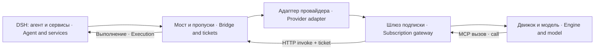

# dsh-tool-bridge — инструменты DSH для внешнего движка · DSH tools for an external engine

Версия · Version: 3.1.4

Мост переносит инструменты живой платформы DeepSeek Harness в цикл внешнего движка, сохраняя владельца вызова и ограничивая автономные напоминания.
The bridge carries live DeepSeek Harness tools into an external engine loop, preserving the call owner and limiting autonomous reminders.

## Зачем нужен · Why it exists

Внешний движок строит собственный каталог инструментов: регистрация плагина в DSH сама по себе не делает его доступным модели. Мост возвращает платформенные цели, задания, расписание, память и зарегистрированные инструменты на этот маршрут. Состояние остаётся в DSH; шлюз только передаёт вызов.
An external engine builds its own tool catalog: registering a DSH plugin does not by itself expose it to the model. The bridge returns platform goals, jobs, scheduling, memory and registered tools to this route. State remains in DSH; the gateway only forwards the call.

## Место в системе · System position



Это три совместимых компонента: `dsh-tool-bridge`, `dsh-subscription-adapter` и `dsh-subscription-gateway`. Запуск только моста не подключает MCP к внешнему движку. Его `POST /invoke` — внутренний протокол, а не универсальный MCP endpoint.
This requires three compatible components: `dsh-tool-bridge`, `dsh-subscription-adapter` and `dsh-subscription-gateway`. Starting the bridge alone does not connect MCP to the external engine. Its `POST /invoke` is an internal protocol, not a general MCP endpoint.

## Установка · Installation

Пакет — ESM; манифест требует Node.js ≥ 20. Используйте поддерживаемую вашим DSH версию Node; интеграция и актуальные схемы ориентированы на DSH 0.2.0-rc.2. ОС должна поддерживать localhost TCP и Node API. Установите плагин в профиль и его peer dependencies: `@deepseek-ai/schemastery`, `yaml` и `@deepseek-ai/dsh-tools` (`^0.2.0-rc.2`, тот же, что у платформы). Последний загружается всегда, даже при выключенном `ostrovApi`: без него импорт пакета падает. Команды выполняются в каталоге установки DSH.
The package is ESM and declares Node.js ≥ 20. Use the Node version supported by your DSH installation; integration and current schemas target DSH 0.2.0-rc.2. The OS must support localhost TCP and Node APIs. Install the plugin into the profile together with its peer dependencies: `@deepseek-ai/schemastery`, `yaml` and `@deepseek-ai/dsh-tools` (`^0.2.0-rc.2`, the platform's own). The last one is always loaded, even with `ostrovApi` disabled: without it the package import fails. Run commands from the DSH installation directory.

```bash
npm pack <каталог пакета · package directory>          # → dsh-tool-bridge-<версия · version>.tgz
dsh plugin add /<абсолютный путь · absolute path>/dsh-tool-bridge-<версия · version>.tgz
# из реестра — только после публикации · from the registry only after publication:
# dsh plugin add dsh-tool-bridge
```

Этот README описывает версию из `package.json` пакета. В реестре npm под этим именем сейчас лежит старое поколение 0.3.5 — без scoped-сессий, `ostrovApi`, image protocol и часового потолка, поэтому до публикации ставьте архив `npm pack`. Путь к архиву — абсолютный: относительный путь `dsh plugin add` отвергает.
This README describes the version in the package's `package.json`. The npm registry currently holds the old 0.3.5 generation under this name — without scoped sessions, `ostrovApi`, image protocol or the hourly ceiling — so until publication install the `npm pack` archive. The archive path must be absolute: `dsh plugin add` refuses a relative path.

Для проверки исходников на выделенной копии установите зависимости с учётом политики своей организации. `@deepseek-ai/cordis` нужен части стендов; установка production-only может оставить эти стенды с кодом 2. Обновление DSH требует сверки сгенерированных схем, а не только обновления номера пакета.
For source verification in an isolated checkout, install dependencies under your organization's policy. Some tests need `@deepseek-ai/cordis`; a production-only install can leave those tests at exit 2. Updating DSH requires comparing generated schemas, not just changing a package version.

## Быстрый старт · Quick start

Включите запись профиля из `cordis.patch.yml`, закрепите имя сервера и явно укажите агенту каталог политики. Ключи профиля `limitsDir`/`alertCommand` выше окружения: `AGENT_LIMITS_DIR`/`DSH_ALERT_CMD` действуют, только если ключа в профиле нет, а пустая строка — тоже ключ. Поставляемый `cordis.patch.yml` задаёт оба (`limitsDir: ./limits`, `alertCommand: ''`), поэтому с ним окружение не действует: задайте пути в записи профиля (как в примере YAML ниже) или уберите эти два ключа из своей записи. Имя `example` в YAML — машинный ключ, не отображаемое имя модели. Каталог примера создаёт оператор; его запись должна быть недоступна агенту.
Enable the profile entry from `cordis.patch.yml`, pin the server name, and explicitly set the policy directory. The profile keys `limitsDir`/`alertCommand` take precedence over the environment: `AGENT_LIMITS_DIR`/`DSH_ALERT_CMD` apply only when the profile has no such key, and an empty string is a key too. The supplied `cordis.patch.yml` sets both (`limitsDir: ./limits`, `alertCommand: ''`), so with it the environment has no effect: set the paths in the profile entry (as in the YAML example below) or remove these two keys from your entry. `example` in YAML is a machine key, not the model's display name. The operator creates the example directory and prevents the agent from writing to it.

```bash
# действуют, только если в записи профиля нет limitsDir/alertCommand · apply only without limitsDir/alertCommand in the profile entry
export AGENT_LIMITS_DIR="/srv/<instance>/policies"
export DSH_ALERT_CMD="/srv/<instance>/notify-operator"
```

```yaml
- insert:
    - name: dsh-tool-bridge
      id: dsh-tool-bridge
      config:
        limitsAgent: example
        limitsDir: /srv/<instance>/policies
        alertCommand: /srv/<instance>/notify-operator
        port: 0
        domains: [goals]
        ticketTtlMinutes: 360
        serverName: bridge
        heartbeatNoticeDir: ''
```

Поместите следующий файл в `<AGENT_LIMITS_DIR>/example.yml`. Общая политика, если нужна, называется `obshchee.yml`. При отсутствии обоих файлов применяется строгий отказной профиль; подробности и все настройки — в [SETTINGS](docs/SETTINGS.md).
Place the following file at `<AGENT_LIMITS_DIR>/example.yml`. A shared policy, when needed, is named `obshchee.yml`. If both files are absent, strict failure policy applies; see [SETTINGS](docs/SETTINGS.md) for details and every setting.

```yaml
predely:
  createLimitCount: 3
  createWindowMinutes: 60
  blockAfterRoundsCount: 3
  minIntervalSeconds: 1800
  maxConsecutiveCount: 6
  maxPerDayCount: 48
  maxVChasCount: 0
politiki:
  dayZone: UTC
  humanKinds: [user, a2a, agent-message]
  rezhimIntervala: lesenka
  ravnomernoIntervalSeconds: 1800
  szhimatIstoriyuPeredUdarom: false
  rezyumirovatPolosu: true
```

После штатного запуска проверьте строку подъёма с именем/версией, выбранный порт и источники значений. В интеграционном ходе проверьте каталог модели и реальный вызов `mcp__bridge__get_goal`. Строка регистрации плагина не доказывает доставку инструмента до модели; вызов должен дойти до журнала моста и платформенного результата.
After normal startup, check the package name/version line, selected port and each value source. In an integration turn, inspect the model catalog and call `mcp__bridge__get_goal`. Plugin registration does not prove delivery to the model; the call must reach the bridge log and a platform result.

## Переход с частной сборки · Migration from a custom build

Закрепите `serverName` до замены пакета: приставка `mcp__<serverName>__` входит в имена инструментов и инструкции движка. Умолчание — `bridge`; смена имени без обновления потребителя оставляет инструменты под другими именами. Приставку проверяют отдельно от числа инструментов.
Pin `serverName` before replacing a custom build: the `mcp__<serverName>__` prefix is part of tool names and engine instructions. The default is `bridge`; changing it without updating consumers leaves tools under different names. Check the prefix separately from the tool count.

## Краткие настройки · Settings at a glance

| Ключ · Key | Назначение · Purpose |
|---|---|
| `limitsAgent` | Файл политики агента · Agent policy filename |
| `serverName`, `port` | Имя MCP и localhost listener · MCP name and localhost listener |
| `ticketTtlMinutes` | Верхний срок пропуска · Ticket lifetime ceiling |
| `heartbeatNoticeDir` | Файловые уведомления или только журнал · File notices or logging only |
| `limitsDir`, `alertCommand` | Каталог YAML и отправщик; config выше env · YAML directory and sender; config overrides env |
| `AGENT_LIMITS_DIR`, `DSH_ALERT_CMD` | Каталог политики и команда уведомления · Policy directory and alert command |
| `ostrovApi.enabled` | `true` регистрирует инструмент `ostrov_api`; умолчание `false` · `true` registers the `ostrov_api` tool; default `false` |
| `ostrovApi.baseUrl` | Адрес API Острова; обязателен при `enabled: true`, умолчания нет · Ostrov API address; required with `enabled: true`, no default |
| `ostrovApi.keyFile` | Ключ подписи запросов; обязателен при `enabled: true`, умолчания нет · Request signing key; required with `enabled: true`, no default |
| `ostrovApi.botId` | Бот, от имени которого идут запросы; обязателен при `enabled: true`, умолчания нет · Bot on whose behalf requests are sent; required with `enabled: true`, no default |
| `ostrovApi.requestKeyDir` | При `enabled: true` обязателен: абсолютный путь вне рабочего каталога агента · Required with `enabled: true`: an absolute path outside the agent working directory |

Полная типизация, умолчания, единицы, ошибки и источник каждого значения описаны в [SETTINGS](docs/SETTINGS.md). Сервис не делает полноценную валидацию YAML политики: корректный YAML ещё не означает безопасные значения.
Full types, defaults, units, failure effects and value sources are documented in [SETTINGS](docs/SETTINGS.md). The service does not fully validate policy YAML: valid YAML syntax does not imply safe values.

`ostrovApi.baseUrl` принимается только в виде `http://<узел>[:<порт>][/]`: знаки узла `A-Za-z0-9.[]:-`, без пути, запроса и учётных данных; порт, если указан, — 1..65535, пустой порт (`host:`) — отказ. `ostrovApi.botId` — 1..16 цифр без ведущего нуля. Иначе вызов `ostrov_api` отказывает с текстом раннера: «Адрес API должен иметь вид http://host:port», «Неверный порт API» или «Неверный ID бота» (A-N-1880, `src/ostrov_api.py`).
`ostrovApi.baseUrl` is accepted only as `http://<host>[:<port>][/]`: host characters `A-Za-z0-9.[]:-`, no path, query or credentials; the port, if given, is 1..65535, and an empty port (`host:`) is refused. `ostrovApi.botId` is 1..16 digits without a leading zero. Otherwise an `ostrov_api` call is refused with the runner text «Адрес API должен иметь вид http://host:port», «Неверный порт API» or «Неверный ID бота» (A-N-1880, `src/ostrov_api.py`).

## Как работает · How it works

Доверенный адаптер запрашивает `mcpBridge.descriptor(agentId)` для корневого живого агента. Описание содержит URL, набор схем и случайный bearer-пропуск на текущий ход. Поля `agentId` в HTTP-теле нет: владелец определяется по таблице пропусков. Повторное описание выдаёт новый пропуск в том же наборе, не отзывая предыдущие.
The trusted adapter requests `mcpBridge.descriptor(agentId)` for a live root agent. The descriptor contains a URL, schemas and a random bearer ticket for the current turn. No HTTP body field supplies `agentId`: ownership comes from the ticket table. A repeated descriptor issues another ticket in the same set without revoking earlier tickets.

Каждый вызов заново сверяется с каталогом владельца пропуска. Закреплённые инструменты используют правила целей, native тела расписания/памяти или прямые чтения сервисов. Остальные зарегистрированные инструменты проходят полный `tools.execute`, включая платформенные проверки разрешений и события результатов. Эти два пути имеют разные границы отмены и таймаутов.
Each call is checked again against the ticket owner's catalog. Fixed tools use goal policies, native scheduling/memory bodies or direct service reads. Other registered tools use full `tools.execute`, including platform permission checks and result events. These paths have different cancellation and timeout boundaries.

Событие `turn/end` отзывает весь набор пропусков своего хода. Пропуск, выданный вне открытого хода, живёт до TTL; значения не сохраняются на диске. Корневые агенты получают отдельные полномочия, а помощники движка внутри хода используют полномочие корня. Права root и чтение памяти процесса находятся вне этой защиты.
`turn/end` revokes the complete ticket set for its matching turn. A ticket issued outside an open turn lasts until TTL; values are not stored on disk. Root agents receive separate authority, while engine helpers within a turn use root authority. Root privileges and process-memory access are outside this protection.

Автономные напоминания ограничиваются минимальным интервалом, полосой, сутками и необязательным скользящим часом. При полном часовом окне одноразовые after_seconds и `at` отодвигаются (`at` проходит ту же лесенку и потолок: срок пересчитывается в задержку от «сейчас»), создание/изменение времени every_seconds, daily и weekly отклоняется. После конца хода снимаются действующие напоминания любого вида. Уже выполняющийся ход и одновременные доставки до его конца не прерываются. Неизвестная история не считается нулём.
Autonomous reminders are constrained by a minimum interval, streak, day and optional rolling hour. At a full hourly window, one-shot after_seconds and `at` are deferred (`at` goes through the same ladder and ceiling: the deadline becomes a delay from now), and every_seconds, daily and weekly creation/timing updates are refused. Turn end removes existing reminders of every kind. It does not interrupt a running turn or simultaneous deliveries before turn end. Unknown history is not counted as zero.

Для гостевых сессий с приставками `telegram-site-` и `telegram-gost-` (`src/scoped-sessions.json`) набор — пересечение живой области и разрешённого перечня, а не добавление привилегий. Перечень `allowedToolNames`: `pismo_rukovoditelyu`, `pamyat_dlya_gostej`, `zapomnit_dannye_gostya`, `ostrov_api`; для `telegram-gost-` к нему добавляется `telegramGuestToolNames`: `telegram_send_file`, `telegram_make_pdf`, `ostrov_api`. Незарегистрированное имя из перечня в набор не попадает. Такие сессии исключены из heartbeat; существующие напоминания и внешние движковые инструменты этим не удаляются.
For guest sessions with the `telegram-site-` and `telegram-gost-` prefixes (`src/scoped-sessions.json`) the catalog is the intersection of the live scope and the allowed list, not a privilege grant. `allowedToolNames`: `pismo_rukovoditelyu`, `pamyat_dlya_gostej`, `zapomnit_dannye_gostya`, `ostrov_api`; for `telegram-gost-` it is extended by `telegramGuestToolNames`: `telegram_send_file`, `telegram_make_pdf`, `ostrov_api`. A listed name that is not registered does not enter the catalog. These sessions skip heartbeat; this does not delete existing reminders or external engine-native tools.

Результат `read_image` экспортируется только по разрешённому Claude-маршруту с image protocol 1. Мост читает сохранённое вложение и проверяет его размер и идентичность; он не скачивает произвольный URL из ответа модели. Изображение и транспорт требуют совместимого шлюза.
A `read_image` result is exported only on the authorized Claude route with image protocol 1. The bridge reads a stored attachment and checks size and identity; it does not download arbitrary model-result URLs. Images require a compatible gateway and transport.

При `ostrovApi.enabled: true` мост регистрирует инструмент `ostrov_api` (каталог, расчёт, CRM API Острова) и на каждый вызов запускает `python3 -B src/ostrov-api-runner.py` (`python3` берётся из `PATH` процесса DSH; не запустился — известный отказ «Python 3 не запущен (…); запрос не отправлен»). Без `baseUrl`, `keyFile` или `botId` при `enabled: true` инструмент `ostrov_api` не ставится, а в журнал идёт строка «[dsh-tool-bridge] ostrovApi НЕ установлен: <поле> обязателен при enabled — умолчаний нет»; остальные инструменты моста работают. После неизвестного исхода повторов нет; `requestKeyDir` не заводится сам — до первого запуска его готовит оператор по [OSTROV-REQUEST-RECOVERY](docs/OSTROV-REQUEST-RECOVERY.md). Ключи, потерянные до подготовки, мост не восстановит. Операции, роли и границы — [OSTROV-API](docs/OSTROV-API.md).
With `ostrovApi.enabled: true` the bridge registers the `ostrov_api` tool (catalog, quotes, CRM of the Ostrov API) and starts `python3 -B src/ostrov-api-runner.py` on every call (`python3` is taken from the `PATH` of the DSH process; if it does not start — a known refusal «Python 3 не запущен (…); запрос не отправлен» (Python 3 not started; the request was not sent)). Without `baseUrl`, `keyFile` or `botId` with `enabled: true` the `ostrov_api` tool is not installed and the journal gets the line «[dsh-tool-bridge] ostrovApi НЕ установлен: <поле> обязателен при enabled — умолчаний нет» (ostrovApi NOT installed: <field> is required with enabled — no defaults); the other bridge tools keep working. There are no retries after an unknown outcome; `requestKeyDir` is not created automatically — before the first start the operator prepares it following [OSTROV-REQUEST-RECOVERY](docs/OSTROV-REQUEST-RECOVERY.md). Keys lost before preparation will not be recovered by the bridge. Operations, roles and limits: [OSTROV-API](docs/OSTROV-API.md).

## Проверки и границы · Checks and limits

[GUARDS](docs/GUARDS.md) перечисляет каждый поставляемый стенд, условия запуска и границы его вывода. [ARCHITECTURE](docs/ARCHITECTURE.md) описывает процесс, данные и состояния; [TROUBLESHOOTING](docs/TROUBLESHOOTING.md) связывает симптомы с проверкой и восстановлением.
[GUARDS](docs/GUARDS.md) lists every shipped test, its prerequisites and result boundaries. [ARCHITECTURE](docs/ARCHITECTURE.md) describes processes, data and states; [TROUBLESHOOTING](docs/TROUBLESHOOTING.md) maps symptoms to verification and recovery.

Мост не является самостоятельным агентом, не содержит полный MCP HTTP-сервер, не отменяет native вызов при закрытии HTTP и не ограничивает общий расход всех сессий одним бюджетом. Политика scoped-сессий не фильтрует глобальную память или движковые инструменты. [SAMOPROBUZHDENIE](SAMOPROBUZHDENIE.md) — навигация по полной политике напоминаний.
The bridge is not a standalone agent, does not implement a complete MCP HTTP server, does not cancel native calls when HTTP closes, and does not share one budget across all sessions. Scoped session policy does not filter global memory or engine-native tools. [SAMOPROBUZHDENIE](SAMOPROBUZHDENIE.md) links to the full reminder policy.

## Лицензия и авторы · License and authors

MIT, Iia-arg team. Общая документация проекта: [dsh-plugins](https://github.com/iia-arg/dsh-plugins). Публикация и нумерация версии выполняются отдельным выпуском; эта документация не подтверждает завершённый монтаж.
MIT, Iia-arg team. System documentation: [dsh-plugins](https://github.com/iia-arg/dsh-plugins). Publication and version assignment are separate release steps; this documentation does not certify deployment.
