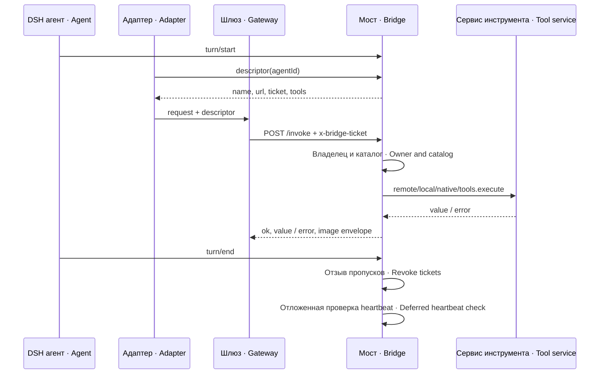
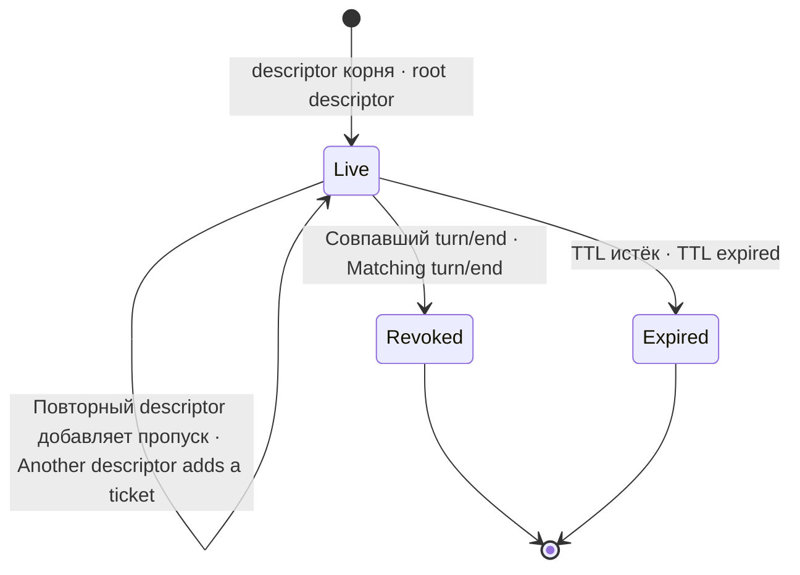
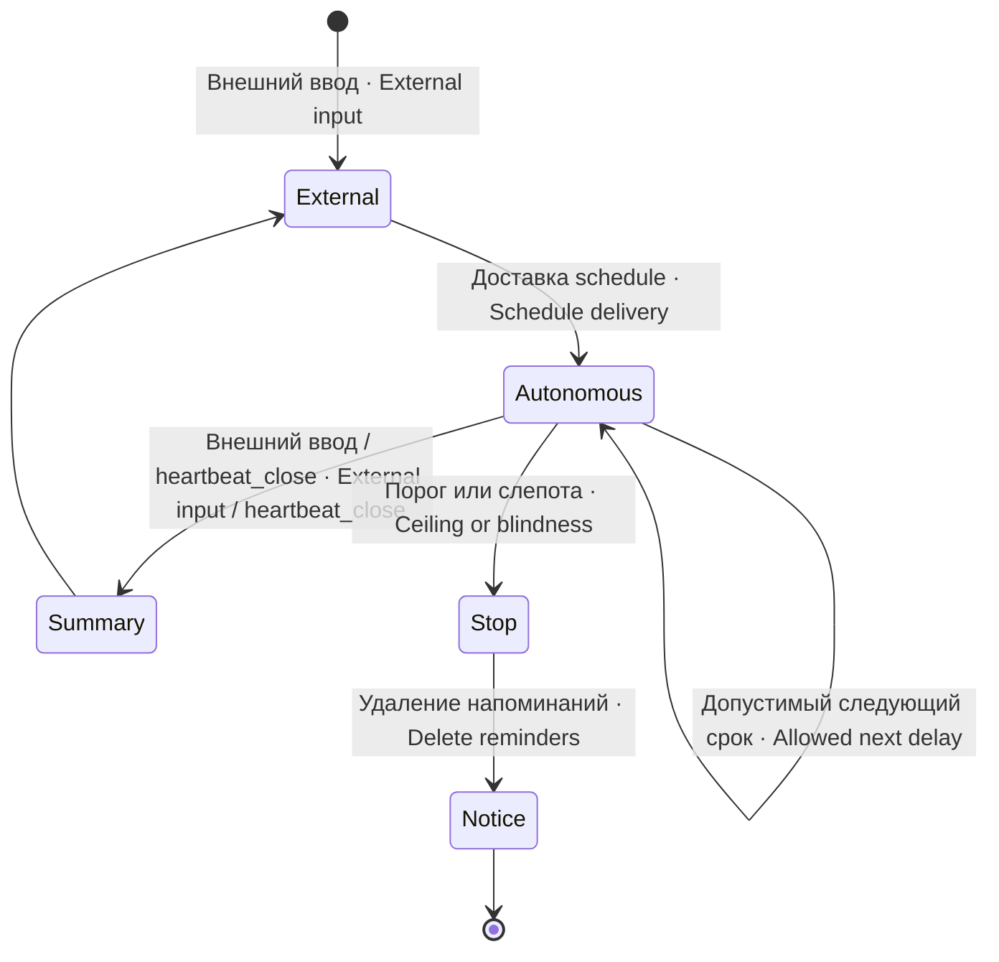

# Устройство · Architecture

## Владельцы состояния · State ownership

Плагин монтируется Cordis в процесс DSH и требует `agents`, `goals`, `jobs`, `typertGateway` и `tools` (`inject`, `src/index.js`): без любого из них Cordis молча не вызывает `apply`, и мост не поднимается. Сервис `schedule` и `attachments` используются по нужному пути. Обработчик HTTP исполняется в том же процессе, но вне AsyncLocalStorage хода: личность передаёт таблица пропусков, а видимый инициатор дополнительно проверяется.
Cordis mounts the plugin in the DSH process, requiring `agents`, `goals`, `jobs`, `typertGateway` and `tools` (`inject`, `src/index.js`): without any of them Cordis silently skips `apply` and the bridge does not start. The `schedule` service and `attachments` are used on their relevant paths. HTTP runs in the same process but outside the turn AsyncLocalStorage: ticket state supplies identity and any visible initiator is checked additionally.

Служба `mcpBridge` предоставляется до готовности listener. Раннее `descriptor()` возвращает `undefined`; потребитель должен различать этот исход и отсутствие плагина. Один process-level `mounted` предотвращает повторный listener; `ctx.effect` очищает флаг и сокет при выгрузке волокна.
The `mcpBridge` service is provided before the listener is ready. An early `descriptor()` returns `undefined`; consumers must distinguish this from an absent plugin. A process-level `mounted` flag prevents duplicate listeners; `ctx.effect` clears the flag and socket on fiber disposal.

## Данные и выполнение · Data and dispatch

| Файл или объект · File or object | Владелец и смысл · Owner and meaning |
|---|---|
| `paritet.json` | Снимок целей/jobs из регистрации платформы · Goal/job registration snapshot |
| `raspisanie.json` | Схемы schedule; выдаваемые create/update лишены cron · Schedule schemas; emitted create/update omit cron |
| `pamyat.json`, `vydacha.json` | Контракты памяти/выдачи, body остаётся у native плагина · Memory/retrieval contracts; bodies remain native |
| `scoped-sessions.json` | Обязательная package policy ID-префиксов и allowlist · Required package policy for ID prefixes and allowlist |
| `tickets`, `ticketOf`, `openTurnOf` | Память процесса, пропуски и открытые ходы · In-memory tickets and open turns |
| `createStamps` | Память процесса, rolling creation reservations · In-memory rolling creation reservations |
| события сессии · session events | Постоянный источник heartbeat, принадлежит DSH · Durable heartbeat source owned by DSH |
| каталог notice · notice directory | Уведомления и отметки объявленного резюме · Notices and announced-summary markers |

`TOOLS` содержит закреплённые схемы; reserved names не заменяются схемой другого плагина. `wireSchemas(owner)` добавляет живые незарезервированные инструменты и ограничивает optional retrieval. Пустой scoped wire view даёт пустой список для restricted session. На HTTP вызове пересечение вычисляется снова.
`TOOLS` contains fixed schemas; reserved names cannot be replaced by another plugin's schema. `wireSchemas(owner)` adds live nonreserved tools and restricts optional retrieval. An empty scoped wire view grants no tools to a restricted session. The intersection is recomputed on HTTP invocation.

Цели используют текущие `goal_id`/`revision` и платформенную удалённую границу. `get_goal`, jobs и `blocked` имеют локальные сервисные пути. Изменяющее `blocked` проверяет authority и порог явно. `nativeCall` расписания/памяти вызывает scoped definition напрямую, обходя registry approval waterfall, concurrency и отмену; динамический `tools.execute` эти этапы сохраняет.
Goals use current `goal_id`/`revision` and the platform remote boundary. `get_goal`, jobs and `blocked` use local service paths. Mutating `blocked` explicitly checks authority and its threshold. Scheduling/memory `nativeCall` invokes the scoped definition directly, bypassing registry approval waterfall, concurrency and cancellation; dynamic `tools.execute` preserves those stages.

## Жизнь пропуска · Ticket lifecycle

Пропуск содержит 24 криптографически случайных байта, кодированных hex, и хранит связь с агентом и номером хода. Это многоразовое полномочие до отзыва. TTL по умолчанию 360 минут; истёкшие записи очищаются при выдаче/разрешении. Рестарт теряет все пропуски, поэтому адаптер должен запросить свежий descriptor.
A ticket contains 24 cryptographically random bytes encoded as hex and binds to an agent and turn number. It is reusable authority until revocation. The default TTL is 360 minutes; expired records are cleaned during issuance/resolution. Restart loses all tickets, so the adapter must request a fresh descriptor.

## Автономные напоминания · Autonomous reminders

Учитываются old `schedule/change dispatch` и new `user/message source.kind=schedule`, а не совпадение текста сообщения. Счёт ведётся на сессию: streak, календарные сутки и rolling hour. История schedule — дополнительный свидетель до 100 записей на задачу, поэтому это нижняя оценка, а не полный независимый журнал.
Counting recognizes old `schedule/change dispatch` and new `user/message source.kind=schedule`, not message text. Counters are per session: streak, calendar day and rolling hour. Scheduler history is an extra witness of up to 100 records per task, so it is a lower bound rather than a complete independent ledger.

Проверка вызывается после `turn/end` через `setTimeout(0)`, чтобы удаления не делали recursive append при публикации события. Stopped marker ставится до await и снимается при неудаче. Неизвестный счёт запрещает дальнейшее автономное угадывание, но не блокирует обычный человеческий ход.
The check runs after `turn/end` through `setTimeout(0)` so deletion cannot recursively append during event publication. The stopped marker is set before awaiting and cleared on failure. Unknown counts prohibit autonomous guessing but do not block normal human input.

## HTTP и изображения · HTTP and images

Разрешён только `POST /invoke`. `x-bridge-ticket` проверяется до чтения JSON: неизвестный/истёкший пропуск →403, неверное тело→400, неверный маршрут→404. Ошибка инструмента возвращается HTTP 200 с `{ok:false,error}`; успех — `{ok:true,value}`. Это прикладной исход, статус 200 сам по себе не означает исполнение.
Only `POST /invoke` is accepted. `x-bridge-ticket` is checked before JSON reading: unknown/expired ticket→403, malformed body→400, wrong route→404. Tool errors return HTTP 200 with `{ok:false,error}`; success returns `{ok:true,value}`. This is an application result; status 200 alone does not prove execution.

У внутреннего HTTP reader нет самостоятельного лимита тела или timeout. Loopback не заменяет разграничение по UID, а bearer не защищает память процесса. Динамическое исполнение получает новый незавершённый AbortSignal, не связанный с закрытием HTTP/концом хода. Эти ограничения сохранены, не исправлены документацией.
The internal HTTP reader has no independent body limit or timeout. Loopback does not replace UID isolation, and a bearer does not protect process memory. Dynamic execution receives a fresh noncancelled AbortSignal unbound to HTTP closure/turn end. Documentation records these limitations without changing them.

Image protocol v1 возвращает `mcpImageVersion:1` и `mcpContent` после повторного чтения attachment reference. Для Claude принимается одна png/jpeg/webp/gif картинка; пределы и источник ограничений перечислены в SETTINGS. Согласованная установка bridge/gateway обязательна.
Image protocol v1 returns `mcpImageVersion:1` and `mcpContent` after rereading the attachment reference. Claude accepts one png/jpeg/webp/gif image; SETTINGS lists limits and their sources. A coordinated bridge/gateway deployment is required.
