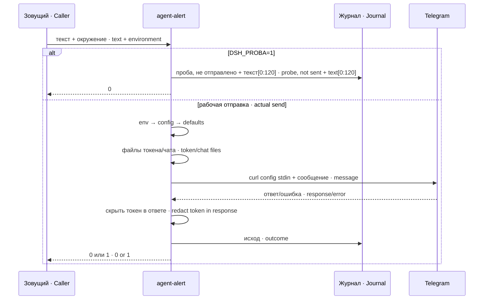

# Устройство · Architecture

Три исполняемых файла используют один читатель настроек. Bash получает пары `KEY=value` от Python без `eval` или `source`; Python-сторож импортирует ту же библиотеку. Библиотека ищется относительно физического файла скрипта в соседнем `../lib/dsh-trevogi/`; это работает для копии пакета и размещения bin/sbin под одним префиксом.

Three executables share one configuration reader. Bash receives Python-produced `KEY=value` pairs without `eval` or `source`; the Python watcher imports the same library. The library is resolved relative to the script's physical path under the neighboring `../lib/dsh-trevogi/`; this works for the package copy and bin/sbin under a shared prefix.

Токен читается внутри процесса отправщика. URL передаётся встроенным `printf` в stdin `curl --config -`, не отдельным аргументом. Ответ curl очищается от точного прочитанного токена перед любым выводом. Это не универсальный фильтр секретов: иные секреты в тексте вызывающего, кодированные формы и произвольные приватные данные он не обнаруживает.

The token is read inside the sender process. A shell builtin `printf` feeds the URL into `curl --config -` stdin, never a separate argument. The exact loaded token is removed from curl responses before output. This is not a general secret filter: it does not detect other secrets supplied in caller text, encoded forms or arbitrary private data.

HTML и plain ограничивают общий видимый текст 4096 единицами UTF-16, включая имя хоста и подпись обрезки. Хвост хранит исходный полный текст, журнал ограничивается 120 знаками. Под flock отправщик только дописывает; обрезка под тем же замком переписывает существующий файл.

HTML and plain bound total visible text to 4096 UTF-16 units, including host prefix and truncation footer. The tail keeps the original full text; journal excerpts are limited to 120 characters. Under flock the sender only appends; the trimmer rewrites the existing file under the same lock.

Сторож читает журнал после курсора и отбирает только `исход=отказ-ключ`. При пустом первом журнале хранит момент начала, иначе текущий курсор. При непроверенном исходе канала сохраняет прежний курсор и durable pending; автоматического повторного вызова этого окна нет. Между отдельными вызовами нет общего бюджета повторов: жизнь суточного таймера должен контролировать сторож системы.

The watcher reads after its cursor and selects only `исход=отказ-ключ`. On an empty initial journal it stores a start time, otherwise the current cursor. Unconfirmed channel delivery keeps the previous cursor and durable pending; this window is never automatically replayed. There is no shared retry budget across invocations: a system watcher must monitor daily timer liveness.

Метка источника собирается из MONITOR_UNIT или положительных cgroup/TriggeredBy признаков; systemctl читается для timer evidence. HTML-обрезка разбирает открытые теги стеком и закрывает в обратном порядке, включая blockquote/spoiler/emoji. Не исправляет произвольный неверный HTML; fallback plain остаётся. Полный префикс/подпись входят в лимит.

Source labels come from MONITOR_UNIT or positive cgroup/TriggeredBy evidence; systemctl provides timer evidence. HTML truncation parses open tags as a stack and closes in reverse order, including blockquote/spoiler/emoji. It does not repair arbitrary invalid HTML; plain fallback remains. Prefix and footer count toward the limit.

Курсор и pending пишутся tempfile+fsync+replace; первая запись также атомарна. Intent до внешнего эффекта, sent:true до commit. Повтор после cursor failure — commit-only; sent:false — ручное reconciliation, не обещание гарантированной доставки. Обрезка имеет временный буфер: отказ чтения до усечения не теряет хвост, ошибка записи во время переписывания может оставить частичный файл и даёт2.

Cursor and pending use tempfile+fsync+replace, including the initial write. Intent precedes external effects, sent:true precedes commit. Cursor-failure recovery is commit-only; sent:false requires manual reconciliation, not guaranteed delivery. Trimming reads into a temporary buffer first; read failures do not truncate the tail, but an IO error during in-place rewriting can leave partial data and exits2.
