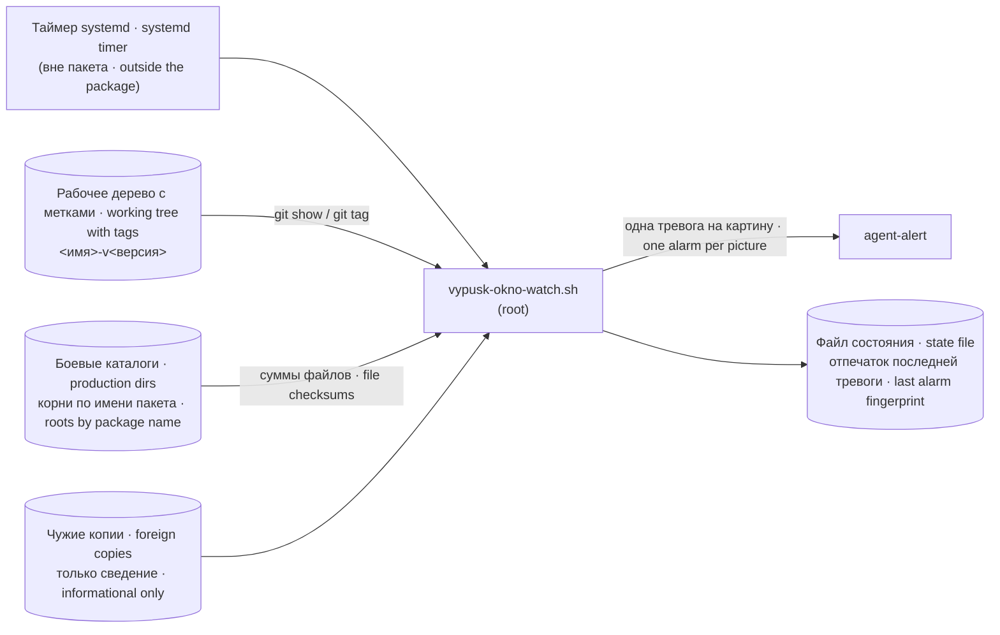

# dsh-vypusk-watch · сторож окна выпуска · release window watchdog

Версия · Version: 3.1.6

**Сторож, который сверяет каждый установленный пакет с git-меткой его версии и громко говорит, если в бой попало не то, что выпускали.**

**A watchdog that compares every installed package with the git tag of its version and speaks up loudly if what reached production is not what was released.**

## Зачем нужно · Why it exists

Пакет ставят в рабочий каталог («бой») из рабочего дерева. Если поставить его без метки выпуска или поправить файлы на месте, номер версии остаётся прежним — и ничто этого не покажет: номер не различает две разные редакции. Однажды так дважды за три часа пакет ушёл в бой без метки, и оба раза находку принёс человек, а не прибор.

A package is installed into the production directory from the working tree. If it is installed without a release tag, or files are edited in place, the version number stays the same — and nothing shows it: the number does not distinguish two different builds. Once a package reached production without a tag twice within three hours, and both times a human, not a tool, caught it.

Сторож закрывает этот класс: для каждого пакета дерева он находит установленные копии, читает их версию, находит метку **своей** версии и сверяет суммы файлов. Совпало — молчит. Разошлось — одна тревога, без повторов, пока картина не изменится.

The watchdog closes this class: for every package in the tree it finds the installed copies, reads their version, finds the tag of **their own** version and compares file checksums. Match — silence. Divergence — one alarm, with no repeats until the picture changes.

## Место в системе · Place in the system



Пакет содержит исходник, пустой список исключений, документацию, стенды и образец `systemd/vypusk-okno-watch.service`: автоматически не устанавливает исполняемый файл, юнит или таймер. На машине авторов служба живёт по пути `/usr/local/sbin/vypusk-okno-watch.sh`, а `src/vypusk-okno-watch.sh` — её побайтный снимок.

The package contains source, an empty exception list, documentation, stands and a sample `systemd/vypusk-okno-watch.service`: it automatically installs no executable, unit or timer. On the authors' machine the service lives at `/usr/local/sbin/vypusk-okno-watch.sh`, and `src/vypusk-okno-watch.sh` is its byte-for-byte snapshot.

## Установка · Installation

Требования: Linux, `bash`, `python3 ≥ 3.9`, PyYAML (`python3-yaml`), `git`, `jq`, штатные coreutils; `npm` — только как оболочка для `npm test`. Права чтения ко всем боевым каталогам (на машине авторов сторож работает от root).

Requirements: Linux, `bash`, `python3 ≥ 3.9`, PyYAML (`python3-yaml`), `git`, `jq`, standard coreutils; `npm` only as the `npm test` wrapper. Read access to all production directories (on the authors' machine the watchdog runs as root).

Установка — вручную: скопировать `src/vypusk-okno-watch.sh` в системный путь и пустой `src/vypusk-okno-watch.exceptions.list` рядом с ним (либо явно задать путь `VYPUSK_ISKLYUCHENIYA`), задать окружение (см. [docs/SETTINGS.md](docs/SETTINGS.md)) и завести свой таймер. Пример юнита и таймера — в [docs/ARCHITECTURE.md](docs/ARCHITECTURE.md#install).

Installation is manual: copy `src/vypusk-okno-watch.sh` to a system path and the empty `src/vypusk-okno-watch.exceptions.list` next to it (or set its path through `VYPUSK_ISKLYUCHENIYA`), set the environment (see [docs/SETTINGS.md](docs/SETTINGS.md)) and create your own timer. A sample unit and timer are in [docs/ARCHITECTURE.md](docs/ARCHITECTURE.md#install).

Для git ≥ 2.35.2 владелец дерева должен совпадать с пользователем юнита. Иначе администратор доверяет именно этому дереву: `git config --system --add safe.directory /path/to/tree` (не `*`). Ошибка `dubious ownership` ведёт в слепоту; первая строка stderr git печатается рядом с причиной.

For git ≥ 2.35.2 the tree owner must match the unit user. Otherwise an administrator trusts that specific tree with `git config --system --add safe.directory /path/to/tree` (never `*`). `dubious ownership` is blindness; its first stderr line is retained.

## Зависимости от соседей · Neighbor dependencies

`agent-alert` поставляется пакетом `dsh-trevogi`: `$1` — один довод с текстом тревоги, HTML-экранированным сторожем (`&`, `<`, `>`). Код 0 — канал подтвердил доставку; прочтение человеком не проверено. Один вызов за прогон, предел 90 с + 5 с до SIGKILL; внутренние повторы — договор отправителя. `plugins.yaml` и поля `derevo` описаны в README пакета `dsh-montazh`; читаются только разделы `plugins` и `services`.

`dsh-trevogi` supplies `agent-alert`: `$1` is one argument containing the alarm text, HTML-escaped by the watchdog (`&`, `<`, `>`). Exit 0 confirms delivery at the channel, not human reading. One call per run, 90 seconds plus 5 seconds before SIGKILL; internal retries belong to the sender. The `dsh-montazh` README defines `plugins.yaml` and `derevo`; only the `plugins` and `services` sections are read.

## Быстрый старт · Quick start

```bash
VYPUSK_TIHO=1 VYPUSK_REPO=/path/to/tree VYPUSK_KORNI=/path/to/plugins/node_modules \
  VYPUSK_AGENT_KORNI= VYPUSK_INFO_KORNI= VYPUSK_SOOTVETSTVIYA= VYPUSK_SSYLKI= VYPUSK_RASKLADKA= VYPUSK_REESTR= \
  VYPUSK_ISKLYUCHENIYA=src/vypusk-okno-watch.exceptions.list bash src/vypusk-okno-watch.sh; echo "код · exit $?"
```

`VYPUSK_TIHO=1` — без канала тревог: прогон только печатает. Пустые значения выключают необязательные проверки; не задать их вовсе нельзя — это слепота. Работает — значит, код 0 и строки `сошлось: <пакет> … N из N файлов, метка …`. Код 1 — расхождение (тревога), 2 — слепота (сверять нечем), 3 — ошибка вызова: единственный разрешённый довод — `--avto-montazh`, любой иной довод (`--dry-run` тоже) даёт отказ с кодом 3 до чтения дерева — ничего не сверено, тревог нет, состояние не тронуто; всё задаётся окружением.

`VYPUSK_TIHO=1` means no alarm channel: the run only prints. Empty values disable the optional checks; leaving them unset is not allowed — that is blindness. It works when the exit code is 0 and lines read `сошлось: <package> … N из N файлов, метка …` (matched: N of N files, tag …). Exit 1 is divergence (alarm), 2 is blindness (nothing to compare against), 3 is a call error: the watchdog accepts only `--avto-montazh`; any other argument (`--dry-run` included) is refused with exit 3 before the tree is read — nothing compared, no alarm, state untouched; everything is set through the environment.

## Настройки · Settings

| Переменная · Variable | Значит · Meaning |
|---|---|
| `VYPUSK_REPO` | рабочее дерево с метками · working tree with tags |
| `VYPUSK_KORNI` | корни боевых каталогов через `:` · production roots, `:`-separated |
| `VYPUSK_AGENT_KORNI`, `VYPUSK_AGENT_POISK` | корни копий агентов: явный перечень или родители для поиска `<родитель>/*/plugins` · agent copy roots: an explicit list or parents to search `<parent>/*/plugins` |
| `VYPUSK_INFO_KORNI` | политика чужих копий: только сведение; корни также должны входить в поиск (`VYPUSK_KORNI`/`VYPUSK_AGENT_*`) · foreign-copy policy only; these roots must also be included in the search (`VYPUSK_KORNI`/`VYPUSK_AGENT_*`) |
| `VYPUSK_SOOTVETSTVIYA` | пары `ключ=путь1:путь2`, по строке; ключ — каталог, имя или прежнее имя; повтор ключа — слепота · one `key=path1:path2` pair per line; key is directory, package name or former name; duplicate keys are blindness |
| `VYPUSK_SSYLKI` | символические ссылки монтажа, которые обязаны существовать · install symlinks that must exist |
| `VYPUSK_RASKLADKA` | пакеты без `package.json`, сверяемые по раскладке `bin`, `sbin`, `libexec`, `lib` → `/usr/local`, `systemd` → `/etc/systemd/system` · manifest-less packages compared by the fixed install layout |
| `VYPUSK_REESTR` | реестр (`plugins.yaml`) с записями `derevo`: пакет сверяется с меткой `ref` по парам `local` ↔ `remote`, с режимом и владельцем · registry with `derevo` entries: the package is compared with its `ref` tag by `local` ↔ `remote` pairs, mode and owner |
| `VYPUSK_ISKLYUCHENIYA` | прощённые пропуски записи CHANGELOG · forgiven missing CHANGELOG entries |
| `VYPUSK_SOSTOYANIE`, `VYPUSK_NAPOMINAT` | файл состояния и интервал повтора тревоги (86400 с) · state file and alarm repeat interval (86400 s) |
| `VYPUSK_ALERT`, `VYPUSK_TIHO` | отправитель тревог; `1` — не звать его · alarm sender; `1` — do not call it |

Подробно, с умолчаниями и тем, что сломается при неверном значении, — [docs/SETTINGS.md](docs/SETTINGS.md).

Details, with defaults and what breaks with a wrong value: [docs/SETTINGS.md](docs/SETTINGS.md).

## Как работает · How it works

**Правило тревоги — «бой разошёлся с меткой своей версии».** Версия совпадает, а суммы файлов разные — тревога: это главный класс, номер не различает редакции. Своей метки нет, хотя выпуски этого пакета известны, — тоже расхождение: смонтировано невыпущенное. Совсем нет меток или две «своих» — слепота. Есть более новый выпуск, а своя метка на месте, — только сведение (INFO). Всё совпало — молчание: сторож, который говорит всегда, перестают читать.

**The alarm rule is "production diverged from the tag of its own version".** Same version but different file checksums — alarm: this is the main class, the number does not distinguish builds. No own tag while releases of this package are known — also divergence: something unreleased was installed. No tags at all, or two "own" tags — blindness. A newer release exists while the own tag is in place — information only (INFO). Everything matches — silence: a watchdog that always talks stops being read.

**Режим счёта.** Суммы считаются по всем файлам вне `node_modules`, без `*.bak*`, `*.tar`, `*.tgz`; режим печатается в выводе, чтобы числа не расходились. Файл, который есть в метке, но не входит в состав публикации (`files` манифеста) и отсутствует в бою, расхождением не считается: установка его не кладёт. Обратная сторона — файл есть в бою, а в метке нет — расхождение всегда: его положили руками.

**Counting mode.** Checksums cover every file outside `node_modules`, excluding `*.bak*`, `*.tar`, `*.tgz`; the mode is printed in the output so numbers stay comparable. A file present in the tag but not in the published file list (`files` in the manifest) and absent from production is not a divergence: installation does not place it. The other side — a file present in production but not in the tag — is always a divergence: it was put there by hand.

**Дополнительные проверки.** У версии в бою должна быть непустая запись в CHANGELOG — и в бою, и в метке (прощения — списком исключений с причиной, кем и когда). Пакеты, чей бой живёт не в корнях по имени, сверяются по составу публикации через пары соответствий. Названные символические ссылки монтажа проверяются отдельно: пропавшая ссылка не видна сверке файлов.

**Extra checks.** The version in production must have a non-empty CHANGELOG entry — both in production and in the tag (forgiveness via an exception list with reason, who and when). Packages whose production copy lives outside the name-based roots are checked by their published file list via correspondence pairs. Named install symlinks are checked separately: a missing link is invisible to file comparison.

**Когда замолкает.** Одну и ту же картину расхождения сторож отправляет один раз; дальше пишет только в журнал, пока картина не изменится или не пройдёт `VYPUSK_NAPOMINAT` секунд (по умолчанию сутки). Отпечаток картины считается по суммам, а не по тексту тревоги: вторая правка того же файла меняет картину. Отметка ставится только после подтверждённой доставки — отказ канала не глушится как «уже отправлено».

**When it goes quiet.** The watchdog sends the same divergence picture once; after that it only writes to the journal until the picture changes or `VYPUSK_NAPOMINAT` seconds pass (one day by default). The picture fingerprint is computed from checksums, not from the alarm text: a second edit of the same file changes the picture. The mark is set only after confirmed delivery — a channel failure is not silenced as "already sent".

## Сторожа и проверки · Guards and checks

Перечень из 15 входов (12 shell-обёрток и три прямых Python-стенда) приведён по именам в [docs/GUARDS.md](docs/GUARDS.md). `npm test` запускает только копии выпуска и договор своей метки; остальные запускаются отдельно. Проверка исходников без установленного сторожа:

The 15 entry points (12 shell wrappers and three direct Python stands) are listed by name in [docs/GUARDS.md](docs/GUARDS.md). `npm test` runs only release copies and the own-tag contract; run the others separately. To check source without an installed watchdog:

```bash
VYPUSK_TEST_WATCH=src/vypusk-okno-watch.sh VYPUSK_TEST_REFERENCE=src/vypusk-okno-watch.sh npm test
```

Подмена эталона проверяет кандидат, а не тождество боевому файлу. Настройки — 7 проб: отсутствие REPO, KORNI, SSYLKI, AGENT-корней, RASKLADKA, REESTR и явно пустые необязательные значения.

An overridden reference checks the candidate, not equality with production. Settings have 7 probes: missing REPO, KORNI, SSYLKI, AGENT roots, RASKLADKA, REESTR and explicit empty optional values.

## Границы · Limits

- Не отличает «смонтировали и пометили» от «не монтировали вовсе»: оба дают «метка = бой», то есть зелёное. Он ловит несоответствие боя выпуску, а не отсутствие работы.
- Не ловит правку в памяти процесса: сверяет диск с диском. Живую версию показывает только журнал работающего процесса.
- Не ловит пакеты вне дерева, подмену самой метки, верность кода (одинаково плохой код в обоих местах — зелёный), содержимое `node_modules` и файлы, исключённые режимом счёта.
- Не ловит неверное значение переменной окружения (`VYPUSK_TIHO=да` — не «1», режим боевой) и опечатку в имени необязательной (`VYPUSK_TIH0=1` — ноль вместо «O», переменная не прочитана вовсе; так же с `VYPUSK_NAPOMINAT` и др.). Опечатка в имени обязательной настройки ловится: это слепота «не задана».
- `src/vypusk-okno-watch.sh` — снимок установленного файла, и стенд сверяет их суммы: правка снимка без выпуска нового боевого файла даёт красный стенд.
- Сверка по раскладке (`VYPUSK_RASKLADKA`) пропускает в метке только верхние имена `README.md`, `CHANGELOG.md`, `LICENSE`, `docs`, `test`; остальное ставится по `bin`, `sbin`, `libexec`, `lib`, `systemd`. Любой другой верхний файл метки — слепота «куда ставится, не знаю (верх «…»)». `README.en.md` в перечне нет: пакет из `VYPUSK_RASKLADKA`, получивший `README.en.md`, ослепит сверку своей раскладки на первой же новой метке.

- Does not distinguish "installed and tagged" from "not installed at all": both give "tag = production", i.e. green. It catches production diverging from a release, not the absence of work.
- Does not catch an in-memory change in a process: it compares disk with disk. Only the running process's journal shows the live version.
- Misses packages outside the tree, a moved tag itself, code correctness (equally bad code in both places is green), `node_modules` contents and files excluded by the counting mode.
- Misses a wrong environment value (`VYPUSK_TIHO=yes` is not "1", the mode stays live) and a typo in the name of an optional one (`VYPUSK_TIH0=1` — zero instead of "O", the variable is not read at all; likewise `VYPUSK_NAPOMINAT` etc.). A typo in a required setting's name is caught: it is blindness "not set".
- `src/vypusk-okno-watch.sh` is a snapshot of the installed file, and the stand compares their checksums: editing the snapshot without releasing a new production file turns the stand red.
- The layout check (`VYPUSK_RASKLADKA`) skips only the top-level names `README.md`, `CHANGELOG.md`, `LICENSE`, `docs`, `test` in a tag; everything else is placed by `bin`, `sbin`, `libexec`, `lib`, `systemd`. Any other top-level file in the tag is blindness «куда ставится, не знаю (верх «…»)» (don't know where it goes). `README.en.md` is not in the list: a `VYPUSK_RASKLADKA` package that gains `README.en.md` blinds its layout check on the very next new tag.

## Документация · Documentation

[Архитектура · Architecture](docs/ARCHITECTURE.md) · [Настройки · Settings](docs/SETTINGS.md) · [Сторожа · Guards](docs/GUARDS.md) · [Неполадки · Troubleshooting](docs/TROUBLESHOOTING.md) · [Изменения · Changelog](CHANGELOG.md)

## Лицензия и авторы · License and authors

Авторы — команда Iia-arg. Исходники семейства: <https://github.com/iia-arg/dsh-plugins> (каталог `packages/dsh-vypusk-watch`). Лицензия MIT объявлена в манифесте; полный текст — в корневом LICENSE семейства.

Authors: the Iia-arg team. Family sources: <https://github.com/iia-arg/dsh-plugins> (directory `packages/dsh-vypusk-watch`). The manifest declares MIT; the full license text is in the family root LICENSE.

`--avto-montazh` включает адресную отсрочку: код 4 — «отложено», не «сошлось». Без ключа — строгий ручной прогон. Нужен `montazh-okno` из `dsh-montazh`; предел пересъёма — один. Подробные границы — в ARCHITECTURE.md, «Автоматическая отсрочка».

`--avto-montazh` enables addressed deferral: exit 4 means deferred, not matched. Without the flag the manual run stays strict. Requires `montazh-okno` from `dsh-montazh`; at most one resample. See ARCHITECTURE.md, “Automatic deferral”, for its boundaries.

B-N-2032: systemd/vypusk-okno-watch.service.d/60-bash-padenie-70.conf учтена в пакете; сохраняет --avto-montazh при сбросе ExecStart. Боевая правильная вставка не изменялась. Corrected crash-wrapper drop-in is tracked and preserves the automatic deployment flag.

### B-N-2043 Ш2 — общий прибор копии / shared copy consumer

При ручной установке добавь `src/copy-compare.sh` → `/usr/local/libexec/dsh-vypusk-watch/copy-compare.sh`, root:root 0755, в проверяемый runtime-состав реестра. Новый VOW и helper montazh-okno используют один consumer; источник рядом применяется в standalone source-copy, боевой reader использует libexec. Без consumer VOW даёт слепоту2, SMV отказывает до замены. Consumer выводит только JSON и возвращает0/1/2, без канала, ledger и отсрочки. Согласованный монтаж назначенной рукой: consumer → helper/SMV → reader, затем проверка живого состава. Старый загруженный reader normal-copy отсрочки не умеет.

For manual installation include `src/copy-compare.sh` → `/usr/local/libexec/dsh-vypusk-watch/copy-compare.sh`, root:root 0755, in the verified runtime registry inventory. New VOW and helper share this consumer. A source copy uses its adjacent file; the production reader uses libexec. Missing consumer means blindness2 for VOW and refusal before SMV replacement. The consumer outputs JSON, exits0/1/2, and writes no channel or ledger. Deploy consumer, helper/SMV, reader as a compatible composition; old loaded readers retain their old normal-copy behavior.

Normal-copy `--avto-montazh` требует одну полную copy/files/entry/tag запись, точный repo/subdir/root, ту же policy/registry/mapping/exceptions и поколение. Strict diff откладывается максимум1800с от открытия; manual strict, safety/слепота/неоднозначность/другие roots/ошибки вне плана не глушатся. После закрытия требуется максимум один пересъём; повторная смена — слепота2. Стенд consumer/wiring: `bash test/stend-copy-compare.sh`; полный producer/common-plan/rollback: companion `dsh-montazh/test/stend-copy-window.sh` на private roots под root. Это не доказательство исполненного обновления живого процесса.

Automatic normal-copy deferral requires one complete copy/files/entry/tag record with the exact repo/subdir/root, matching policy/registry/mapping/exceptions and generation. At most1800s from opening; manual runs, safety/blindness/ambiguity/other roots and out-of-plan errors stay strict. At most one resample; another change is blindness2. Run `bash test/stend-copy-compare.sh`; the companion montazh window stand covers private producer/common-plan/rollback under root. These tests do not establish a live process upgrade.
