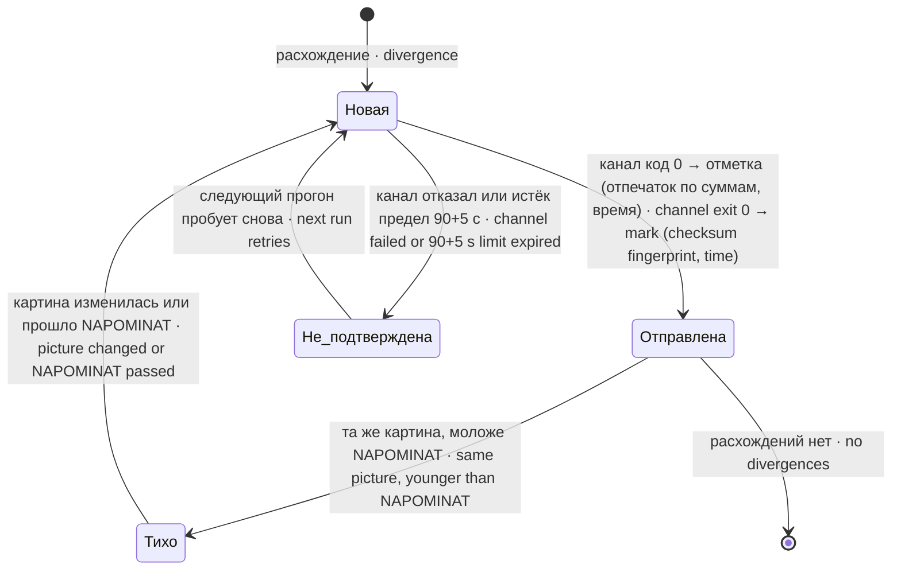

# Архитектура · Architecture — dsh-vypusk-watch

## Состав · Components

| Файл · File | Что · What |
|---|---|
| `src/vypusk-okno-watch.sh` | сторож: bash с встроенными программами на Python (heredoc) и вызовом общего consumer · bash with embedded Python programs and the shared consumer call |
| `src/copy-compare.sh` | общий прибор копии VOW/montazh-okno, JSON 0/1/2; сюда перенесён `PY_CHANGELOG` · shared VOW/montazh copy checker, JSON exits 0/1/2; now owns `PY_CHANGELOG` |
| `test/stend-copy-compare.sh` | declared runner для следующих двух Python suites · declared runner for the next two Python suites |
| `test/test_copy_compare.py` | 7 private-проб consumer (байты, состав, policy, исключения, CHANGELOG, протокол) · 7 private consumer checks |
| `test/test_copy_wiring.py` | 1 проба фактического VOW: missing/restore consumer и порча JSON-протокола · 1 actual VOW wiring check |
| `test/probe.py` + `stend-kopij-vypuska.sh` | стенд копий выпуска и сверка снимка с установленным файлом · release-copy stand and snapshot-vs-installed check |
| `test/stend-sootvetstviya.py` + `.sh` | стенд пар соответствия · correspondence-pair stand |
| `test/stend-svoej-metki.py` + `.sh` | договор «бой = своему выпуску» · "production = own release" contract |
| `test/stend-prezhnih-imen.py` + `.sh` | прежние имена пакета (`dsh.prezhnie_imena`) · former package names |
| `test/stend-dovodov.sh` | отказ на неподдерживаемый довод · refusal on an unsupported argument |

Поимённый перечень 15 входов; Python-тело shell-обёртки отдельно не считается.

Named inventory of 15 entry points; a shell wrapper and its Python body count once.

| Вход · Entry |
|---|
| `test/stend-audit-docs.py` |
| `test/stend-audit-runtime.py` |
| `test/stend-copy-compare.sh` |
| `test/stend-derevo.sh` |
| `test/stend-dovodov.sh` |
| `test/stend-kopij-vypuska.sh` |
| `test/stend-montazh-okno.py` |
| `test/stend-nastroek.sh` |
| `test/stend-neskolko-kopij.sh` |
| `test/stend-pochinki.sh` |
| `test/stend-prezhnih-imen.sh` |
| `test/stend-pustoj-zapisi.sh` |
| `test/stend-raskladki.sh` |
| `test/stend-sootvetstviya.sh` |
| `test/stend-svoej-metki.sh` |

## Один прогон · One run

```mermaid
flowchart TB
    A["старт · start"] --> B{"есть доводы? · arguments?"}
    B -- иной · unsupported --> X3["ОТКАЗ, код 3 · REFUSAL, exit 3"]
    B -- нет/--avto-montazh · none/--avto-montazh --> R0{"VYPUSK_REPO непуст? · nonempty?"}
    R0 -- нет · no --> X3
    R0 -- да · yes --> C{"дерево с .git есть? · tree with .git?"}
    C -- нет · no --> S2["слепота → тревога, код 2 · blindness → alarm, exit 2"]
    C -- да · yes --> D["корни: основные, добавочные, чужие; исключения CHANGELOG · roots: main, extra, foreign; CHANGELOG exceptions"]
    D --> E["для каждого пакета дерева · for each tree package"]
    E --> F{"боевая копия найдена? · production copy found?"}
    F -- нет · no --> VNE["вне области — перечислить · out of scope — list"]
    F -- да · yes --> G["версия боя → своя метка &lt;имя&gt;-v&lt;версия&gt; · production version → own tag"]
    G --> H{"метка одна? · exactly one tag?"}
    H -- "нет, выпуски известны · none, releases known" --> R["расхождение · divergence"]
    H -- "нет меток / две · no tags / two" --> SL["слепота пакета · package blindness"]
    H -- да · yes --> I["суммы метки и боя по режиму счёта; CHANGELOG; состав · tag and production checksums by counting mode; CHANGELOG; file list"]
    I --> J{"всё совпало? · all match?"}
    J -- да · yes --> OK["сошлось · matched"]
    J -- нет · no --> R
    OK & R & SL & VNE --> K["ссылки монтажа · install symlinks"]
    K --> L{"итог · result"}
    L -- "расхождения есть · divergences" --> M["тревога, если картина новая или прошло NAPOMINAT; код 1 · alarm if picture is new or NAPOMINAT passed; exit 1"]
    L -- "только слепота · only blindness" --> S2
    L -- "чисто · clean" --> Z["молча, код 0 · silent, exit 0"]
```

Слепота — отдельный предмет: «сверять нечем» не смешивается с «разошлось». Ранняя слепота (нет дерева, исключения не прочитаны, корень нечитаем) обрывает прогон сразу; поздняя (у отдельных пакетов) собирается в итог.

Blindness is a separate subject: "nothing to compare against" is never mixed with "diverged". Early blindness (no tree, exceptions unreadable, an unreadable root) aborts the run at once; late blindness (for individual packages) is collected into the result.

## Сверка одного пакета · Checking one package

```mermaid
sequenceDiagram
    participant W as Сторож · Watchdog
    participant G as git (дерево · tree)
    participant L as Боевой каталог · Production dir
    W->>L: package.json → версия · version
    W->>G: git tag --list → свои метки и все выпуски · own tags and all releases
    W->>G: git archive &lt;метка&gt; packages/&lt;каталог&gt; → временный каталог · tag files → temp dir
    W->>W: суммы метки по режиму счёта · tag checksums by counting mode
    W->>L: суммы боя по тому же режиму · production checksums, same mode
    W->>W: сравнить множества; состав из manifest files · compare sets; file list from manifest
    W->>W: CHANGELOG: запись версии в бою и в метке · CHANGELOG: version entry in production and tag
    W-->>W: сошлось / разошлось (до 6 имён файлов с каждой стороны) · matched / diverged (up to 6 file names per side)
```

Дерево обязано иметь раскладку `packages/<каталог>`: файлы метки берутся `git archive` именно оттуда. Идентичность пакета — имя каталога в дереве, а не `package.name` и не текст диагностики. Метка своей версии — `<каталог>-v<версия>` или `<имя пакета>-v<версия>`, также по `dsh.prezhnie_imena`; если таких несколько — слепота.

The tree must use the `packages/<directory>` layout: tag files are taken from there with `git archive`. Package identity is the directory name in the tree, not `package.name` and not the diagnostic text. The own-version tag is `<directory>-v<version>` or `<package name>-v<version>`, also by `dsh.prezhnie_imena`; more than one such tag is blindness.

## Подавление повторов · Repeat suppression



Отметка доставки пишется только после кода 0 канала, атомарно (временный файл → `mv`). Не сохранилась — следующий прогон может повторить тревогу, и это сказано в выводе.

The delivery mark is written only after channel exit 0, atomically (temp file → `mv`). If it could not be saved, the next run may repeat the alarm, and the output says so.

<a id="install"></a>
## Пример установки · Sample installation

```ini
# /etc/systemd/system/vypusk-okno-watch.service
[Service]
Type=oneshot
User=root
ExecStart=/usr/local/sbin/vypusk-okno-watch.sh
# 1 — расхождение, 2 — слепота: это находки, а не сбой службы · 1 is divergence, 2 is blindness: findings, not a service failure
SuccessExitStatus=0 1 2
# «-»: нет файла/REPO — сторож откажет3 без канала; oneshot неуспешен · "-": missing file/REPO — refusal3 without alerts; oneshot fails
EnvironmentFile=-/etc/vypusk-okno-watch.env

# /etc/vypusk-okno-watch.env — восемь обязательных настроек и явный путь исключений; пусто выключает необязательную проверку · eight required settings and an explicit exception path; empty disables optional checks
VYPUSK_REPO=<рабочее-дерево · working-tree>
VYPUSK_KORNI=<каталог-плагинов · plugins-dir>/node_modules:<каталог-плагинов · plugins-dir>
VYPUSK_AGENT_POISK=<родитель-домов-агентов · agent-homes-parent>
VYPUSK_INFO_KORNI=
VYPUSK_SOOTVETSTVIYA=
VYPUSK_SSYLKI=
VYPUSK_RASKLADKA=
VYPUSK_REESTR=
VYPUSK_ISKLYUCHENIYA=/usr/local/sbin/vypusk-okno-watch.exceptions.list

# /etc/systemd/system/vypusk-okno-watch.timer
[Timer]
OnBootSec=10min
OnUnitActiveSec=15min
Persistent=true
[Install]
WantedBy=timers.target
```

Расписание выше — то, что стоит у авторов (через 10 минут после загрузки, затем каждые 15 минут). Таймер в пакет не входит; `systemd/vypusk-okno-watch.service` — другой образец, с `--avto-montazh`, требует настройки окружения через drop-in.

The schedule above is the authors' one (10 minutes after boot, then every 15 minutes). The timer is not part of the package; `systemd/vypusk-okno-watch.service` is another sample using `--avto-montazh`, and needs an environment drop-in.

Раскладка не устанавливает `README.md`, `CHANGELOG.md`, `LICENSE`, `docs/`, `test/`; реестр сверяется только по разделам `plugins` и `services`. Описание `derevo` — в `dsh-montazh`.

The layout excludes `README.md`, `CHANGELOG.md`, `LICENSE`, `docs/`, `test/`; registry comparison reads only `plugins` and `services`. See `dsh-montazh` for `derevo`.

Несколько пар в systemd `EnvironmentFile` — значение в двойных кавычках с переводами строк, не пары через пробел. Пример формы (замени все пути на свои):

Multiple pairs in a systemd `EnvironmentFile` use a double-quoted multiline value, not space-separated pairs. Example shape (replace every path):

```ini
VYPUSK_SOOTVETSTVIYA="demo=/srv/copyA:/srv/copyB
other=/srv/other"
VYPUSK_SSYLKI="/srv/plugins/linkA=../demo
/srv/plugins/linkB=../other"
```

## Автоматическая отсрочка · Automatic deferral

`--avto-montazh` — единственный разрешённый ключ, включает адресную отсрочку через `MONTAZH_OKNO_BIN` (умолчание `/usr/local/sbin/montazh-okno`, пакет `dsh-montazh`). Ручной вызов без ключа остаётся строгим. В Ш2 отсрочка применяется к обычному расхождению полной copy-записи, невыпущенной версии копии и разрешённым расхождениям сумм `derevo`, когда каждый предмет покрыт действующим окном; права, владельцы и другие строгие дефекты не откладываются. Код 4 — «отложено», не «сошлось»; код 1/2 имеет приоритет. При смене срока/поколения — максимум один пересъём, повторная смена даёт слепоту 2. `SuccessExitStatus=4` не добавляется: адресную отсрочку читает helper по текущей invocation и сроку.

`--avto-montazh` is the only accepted flag; it enables addressed deferral through `MONTAZH_OKNO_BIN` (default `/usr/local/sbin/montazh-okno`, supplied by `dsh-montazh`). Manual invocation stays strict. In Step 2, ordinary differences with a complete copy record, an unreleased copy version and eligible `derevo` checksum differences may be deferred when every subject has an active window; permissions, ownership and other strict defects remain strict. Exit 4 means deferred, not matched; exit 1/2 takes precedence. Expiry/generation changes permit at most one resample; another change is blindness 2. Do not add `SuccessExitStatus=4`: the helper reads addressed deferral using the current invocation and deadline.

Слепота записи `derevo` (3.1.8, B-N-1978) откладывается иначе и уже, чем расхождение: расхождение — только целиком из DIFF consistency и с `--require file:<путь>` на каждый файл; слепота — одним `entry:<id>`, но лишь если ВСЕ её строки — причины разрыва «файлы → метка → запись» (поле `razryv` строки SLEP: метки нет · subdir нет в метке · файл метки не в files · files.remote / not_installed нет в метке). Структурная слепота (две записи на каталог, package.json не прочитан, prezhnie_imena, строка files без полей, дубль remote, expected_diff_files нет в files, local не читается, отказ git) и строка без пометки — красные сразу. До 3.1.8 эта ветка окно не спрашивала (14.10: 5 ложных «поздняя слепота» за сутки в окнах, назвавших запись; все пять — разрывные). Окно с другой записью или истёкшее — прежняя слепота, код 2. · Registry-entry blindness (3.1.8) is deferred by a single `entry:<id>` only when every blindness line is a files → tag → record gap cause (`razryv`); structural blindness stays red at once.

## Shared strict consumer — B-N-2043 Ш2

`src/copy-compare.sh` supplies data to VOW and montazh-okno. Runtime install: `/usr/local/libexec/dsh-vypusk-watch/copy-compare.sh`, root:root0755; track the source/destination pair in the verified runtime registry inventory. It returns JSON and exit0(match)/1(diff)/2(blind), never4, and calls neither channels nor ledger/whole-watch. VOW retains tag discovery and reporting; helper archives pinned C and adds full publication/mode/owner/registry/tag checks. Preparation alone runs npm, with scripts disabled. Unknown arguments/schema and missing checker refuse; no embedded-comparator fallback exists.

Consumer preserves literal/asymmetric VOW scope and CHANGELOG exceptions. VOW validates counts, positive copy area, status/rc, index SHA256 and full response fields. A strict ordinary difference may get4 only through an exact linked copy record under --avto-montazh. The reader's actual policy, registry path and configuration signature are queried; before reporting it repeats the same required subjects and record-generation SHA256. Mixed uncovered errors stay strict. Closed-after-start yields one addressed resample; another change is2.

The helper records the trusted old copy state for every selected root before mkdir/.new and rejects a caller-substituted or truncated copy rollback plan. Its last barrier repeats scoped file/directory names and generations after external tag/config calls. Old readers or currently running old code do not gain the new behavior from a file replacement. Full deployment of consumer/helper/producer/new reader and the registry inventory is the coordinator's responsibility; these source tests cover no live restart.
