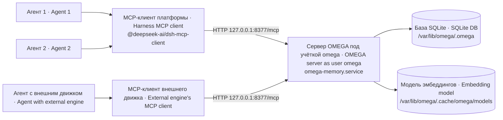

# omega-memory — долговременная память для агентов · long-term memory for harness agents

Служба машины, которая даёт агентам платформы DSH общую долговременную память: решения, уроки и договорённости переживают сессию и ищутся по смыслу, а не по точным словам. Хранение локальное; поставляемые offline/telemetry drop-in ограничивают известные сетевые выходы движка.

A machine service that gives DSH platform agents shared long-term memory: decisions, lessons and agreements survive the session and are found by meaning rather than by exact words. Storage is local; the shipped offline/telemetry drop-ins restrict known engine network traffic.

## 1. Что это · What it is

Как и [`voice-stack`](../voice-stack), это **не плагин платформы**, а служба машины. Платформа достаёт до неё по MCP через петлевой интерфейс, используя MCP-клиент, который идёт в составе продукта (`@deepseek-ai/dsh-mcp-client`).

Like [`voice-stack`](../voice-stack), this is **not a harness plugin** — it is a machine service. The harness reaches it over MCP on the loopback, using the MCP client that ships with the product (`@deepseek-ai/dsh-mcp-client`).

Мы публикуем только свою часть: модель служебной учётки, юнит systemd, подключение, которое действительно доходит до агента, и ловушки. Сам движок памяти ([OMEGA](https://omegamax.co), ядро открыто, пакет `omega-memory` в PyPI) ставится из своего первоисточника. Своего в пакете немного: юнит `systemd/omega-memory.service` с четырьмя drop-in'ами в `systemd/omega-memory.service.d/`, проверка установки `bin/proverit-ustanovku.sh` (коды 0/1/2) и её стенд `test/stend-gruppy.sh` (раздел 8).

We publish our part only: the service account model, the systemd unit, the wiring that actually reaches the agent, and the traps. The memory engine itself ([OMEGA](https://omegamax.co), core is open source, package `omega-memory` on PyPI) is installed from its own upstream. Our own part of the package is small: the unit `systemd/omega-memory.service` with four drop-ins in `systemd/omega-memory.service.d/`, the install check `bin/proverit-ustanovku.sh` (exit codes 0/1/2) and its stand `test/stend-gruppy.sh` (section 8).

## 2. Зачем · Why

Без памяти каждая сессия агента начинается с нуля: прошлые решения, причины и ошибки теряются, и их приходится пересказывать. Общая служба памяти даёт всем агентам машины одно хранилище, в котором поиск идёт по смыслу (эмбеддинги), а у каждого агента свой корень (`entity_id`).

Without memory every agent session starts from zero: past decisions, their reasons and mistakes are lost and have to be retold. A shared memory service gives every agent on the machine one store, searched by meaning (embeddings), with a root of its own (`entity_id`) for each agent.

## 3. Место в системе · Place in the system



Подробно — [docs/ARCHITECTURE.md](docs/ARCHITECTURE.md).

Details — [docs/ARCHITECTURE.md](docs/ARCHITECTURE.md).

## 4. Установка · Install

Требования: Linux с systemd, Python 3.11+ с модулем `venv`, доступ к PyPI и к хранилищу модели на время установки, платформа DSH с плагином `@deepseek-ai/dsh-mcp-client`. Минимальные версии мы не фиксируем: пакет проверялся на Ubuntu с Python 3.12; версии движка и платформы, с которыми он заведомо работает, не сведены в таблицу.

Requirements: Linux with systemd, Python 3.11+ with the `venv` module, access to PyPI and to the model host during install, the DSH platform with the `@deepseek-ai/dsh-mcp-client` plugin. We do not fix minimum versions: the package was used on Ubuntu with Python 3.12; a table of engine and platform versions known to work has not been compiled.

**1. Отдельная служебная учётка — раньше всего остального.**

**1. A dedicated service account, before anything else.**

```bash
sudo useradd --system --home-dir /var/lib/omega --create-home --shell /usr/sbin/nologin omega
```

Память общая для всех агентов машины. Запустите службу под учёткой одного агента — и база окажется в его домашнем каталоге с правами `700`: формально системная служба, на деле личная собственность того, кто ей владеет. Мы сделали ровно эту ошибку на первом заходе: служба работала, `/health` отвечал, а второй агент до памяти не доставал вовсе.

Memory is shared by every agent on the machine. Start the service under one agent's account and the database ends up in that agent's home directory with `700` — formally a system service, in practice the private property of whoever happens to own it. We made exactly this mistake on the first pass: the service ran, `/health` answered, and the second agent could not reach memory at all.

**1а. Дополнительная группа службы.** omega-users должна существовать до запуска, иначе216/GROUP. Она сохранена для совместимости, но UMask0077 не даёт агентам доступа к приватным файлам. HOME —2750 omega:omega-users, без записи группе; .omega —700 omega:omega.

**1a. Supplementary service group.** Create omega-users before startup or systemd fails216/GROUP. It remains for compatibility, while UMask0077 grants agents no private-file access. HOME is2750 omega:omega-users without group write; .omega is700 omega:omega.

```bash
sudo groupadd --system omega-users

sudo chgrp omega-users /var/lib/omega && sudo chmod 2750 /var/lib/omega
```

**2. Движок — в собственном виртуальном окружении.**

**2. The engine, in its own virtual environment.**

```bash
python3 -m venv /opt/omega/venv
/opt/omega/venv/bin/pip install "omega-memory[server]==1.5.20"
```

Команды — для новой отдельной установки, с правами записи /opt/omega. Проверяемая версия движка здесь1.5.20 (PyPI требует Python3.11+), номер обвязки3.1.1 — другой. Новую версию движка принимайте отдельно; существующую общую venv не обновляйте этой инструкцией: это может снять локальные патчи и потребовать отдельного согласованного окна.

These commands are for a new isolated installation with write access to /opt/omega. The audited engine version is1.5.20 (PyPI requires Python3.11+); wrapper3.1.1 is a different number. Accept a new engine version separately. Do not upgrade an existing shared venv using this installation example: local patches may be overwritten and require a separately agreed window.

**3. Модель эмбеддингов — и шаг, который не опционален.**

**3. The embedding model — and the step that is not optional.**

Штатный omega setup --download-model скачивает bge-small (384), а наш обязательный embedding.conf использует bge-m3 (1024). setup также регистрирует MCP, ставит хуки и меняет настройки обнаруженного клиента: для серверной учётки не используйте его как загрузчик bge-m3. Получите все файлы официального ONNX-каталога [BAAI/bge-m3](https://huggingface.co/BAAI/bge-m3/tree/main/onnx) по закреплённой ревизии. model.onnx этого экспорта использует model.onnx_data и Constant_7_attr__value; два файла без остальных не образуют рабочую модель.

The standard omega setup --download-model fetches bge-small (384), while the mandatory embedding.conf uses bge-m3 (1024). setup also registers MCP, installs hooks and changes detected client settings: do not use it as the server's bge-m3 downloader. Fetch every file in the official [BAAI/bge-m3 ONNX directory](https://huggingface.co/BAAI/bge-m3/tree/main/onnx) at the pinned revision. This export's model.onnx uses model.onnx_data and Constant_7_attr__value; two files alone are not a working model.

```bash
sudo -u omega bash -eu <<'MODEL'
umask 077
omega_model_dir=/var/lib/omega/.cache/omega/models/bge-m3-onnx
omega_model_revision=5617a9f61b028005a4858fdac845db406aefb181
mkdir -p "$omega_model_dir"
for omega_model_file in model.onnx model.onnx_data Constant_7_attr__value tokenizer.json config.json tokenizer_config.json special_tokens_map.json sentencepiece.bpe.model; do
  curl --fail --location --max-time 1800 "https://huggingface.co/BAAI/bge-m3/resolve/$omega_model_revision/onnx/$omega_model_file" -o "$omega_model_dir/$omega_model_file.part"
  test -s "$omega_model_dir/$omega_model_file.part"
  mv "$omega_model_dir/$omega_model_file.part" "$omega_model_dir/$omega_model_file"
done
MODEL
```

Это загрузка примерно 2.3 ГБ, без setup и клиентских хуков. Состав и revision проверены по первоисточнику, сами веса этой правкой не скачивались. Перед запуском обязательны установочная проверка и приёмка поиска. Наличие файлов не доказывает исправность ONNX, нормальную память/RAM или качество векторов; doctor1.5.20 ищет штатную bge-small и не является пробником нашей bge-m3 даже с её окружением. Не принимайте 384 как результат этой конфигурации: ожидается 1024, без hash fallback.

This downloads about2.3GB without setup/client hooks. The file list and revision were verified upstream; weights were not downloaded for this change. Run the install check and search acceptance before relying on the service. Files alone do not prove ONNX validity, sufficient RAM or vector quality; doctor1.5.20 checks default bge-small and cannot validate this bge-m3 even with its environment. The configured dimension is1024, without hash fallback.

**4. Юнит** из `systemd/`, затем:

**4. The unit** from `systemd/`, then:

```bash
sudo cp systemd/omega-memory.service /etc/systemd/system/
sudo install -d -m 0755 /etc/systemd/system/omega-memory.service.d
sudo cp systemd/omega-memory.service.d/*.conf /etc/systemd/system/omega-memory.service.d/

sudo systemctl daemon-reload
# enable --now только после следующего блока ключа/модели/checker · after the key/model/checker block below
```

Файл ключа пакет не содержит. До включения службы root создаёт /etc/omega/mcp-klyuch.env с 0600; генерация пишет напрямую в файл и не раскрывает значение в аргументах, выводе или журнале. Для существующего ключа сначала проверьте метаданные и согласуйте повторное использование; этот пример не перезаписывает файл.

The package ships no key. Before enabling the service, root creates /etc/omega/mcp-klyuch.env with0600. Generation writes directly to the file, keeping its value out of argv/output/logs. Check metadata and agree on reuse of existing keys; this example never overwrites a file.

```bash
sudo install -d -m 0755 /etc/omega
sudo python3 - <<'KEY'
import os,secrets
path='/etc/omega/mcp-klyuch.env'
fd=os.open(path,os.O_WRONLY|os.O_CREAT|os.O_EXCL,0o600)
try:
    os.write(fd,('OMEGA_MCP_API_KEY='+secrets.token_urlsafe(32)+'\n').encode())
    os.fsync(fd)
finally:
    os.close(fd)
KEY
sudo install -d -m 0700 -o omega -g omega /var/lib/omega/.omega
sudo install -m 0755 bin/proverit-ustanovku.sh /usr/local/bin/omega-proverit-ustanovku
```

После блоков выше выполните `sudo sh bin/proverit-ustanovku.sh /etc/systemd/system/omega-memory.service`, затем `sudo systemctl enable --now omega-memory`. Включение делается ТОЛЬКО после подготовки ключа/модели и проверки. Установочный checker (Python 3) по пути читает файл юнита и соседние .d/*.conf: Group/SupplementaryGroups, обязательные EnvironmentFile, WorkingDirectory, приватность HOME/.omega, непустые читаемые model.onnx/tokenizer.json явно заданной модели. Режим имени через systemctl проверяет только эффективные группы. Коды0/1/2: проверенные предпосылки есть / отказ / слепота. Вставки из иных каталогов, значение ключа, валидность ONNX/внешних весов, схема БД, доступ учётки и качество поиска не доказаны этим checker. Он не меняет файлы, не повторяет проверки; команды getent/systemctl ограничены5с.

After the blocks above, run `sudo sh bin/proverit-ustanovku.sh /etc/systemd/system/omega-memory.service`, then `sudo systemctl enable --now omega-memory`. Enable ONLY after preparing the key/model and passing the check. File mode reads the unit and adjacent .d/*.conf: groups, mandatory EnvironmentFile, WorkingDirectory, private HOME/.omega and non-empty readable model.onnx/tokenizer.json for the explicitly configured model. Unit-name mode checks effective groups only. Exit0/1/2: checked prerequisites present / refusal / blindness. Other drop-in locations, key contents, ONNX/external weights validity, DB schema, account access and search quality are outside its proof. It is read-only, runs once and bounds getent/systemctl calls to5s.

## 5. Быстрый старт: подключение к агенту · Quick start: wiring it into an agent

Это та часть, что стоит часа. Строку MCP-клиента добавляйте в **набор агента** (`agent.cordis.yml`), а не в слой профиля:

This is the part that costs an hour. Add the MCP client row to the **agent preset** (`agent.cordis.yml`), not to the profile patch layer:

```yaml
- id: mcp-omega
  name: '@deepseek-ai/dsh-mcp-client'
  config:
    serverName: omega
    transport: streamable-http
    url: http://127.0.0.1:8377/mcp
    headers:
      Authorization: !!js "'Bearer ' + process.env.OMEGA_MCP_API_KEY"
    failOnStartupError: false
```

В профиле `web` инструменты общего плана выключены намеренно, и набор инструментов приходит из набора агента. Строка в слое профиля собирается без единой ошибки, числится подключённой — и до агента не доходит. И ещё: набор читается при **создании сессии** — правка файла ничего не меняет в уже идущей сессии.

In the `web` profile, common-plane tools are disabled on purpose and the toolset comes from the preset. A row in the profile layer composes without a single error, is listed as mounted, and never reaches the agent. Also: the preset is read when a **session is created** — editing the file changes nothing in a running session.

⚠️ **Ключ доступа обязателен.** С 2.0.0 пакет ставит drop-in `15-omega-mcp-klyuch.conf`: он подключает `/etc/omega/mcp-klyuch.env` (переменная движка `OMEGA_MCP_API_KEY`) без «-», так что служба без файла ключа не поднимется, а `/mcp` без заголовка `Authorization: Bearer <ключ>` отвечает 401 (`/health` — по-прежнему 200). Поэтому строка выше несёт поле `headers`. Значение ключа в набор не пишется: выражение `!!js` берёт его из переменной `OMEGA_MCP_API_KEY` в окружении процесса агента, и её туда надо подать (у нас — файлом окружения службы агента). Нет переменной — заголовок уйдёт без ключа, и MCP omega у агента не поднимется. См. [docs/SETTINGS.md](docs/SETTINGS.md).

⚠️ **The access key is mandatory.** Since 2.0.0 the package installs the `15-omega-mcp-klyuch.conf` drop-in: it includes `/etc/omega/mcp-klyuch.env` (engine variable `OMEGA_MCP_API_KEY`) without «-», so the service does not start without the key file, and `/mcp` without an `Authorization: Bearer <key>` header returns 401 (`/health` still returns 200). That is why the row above carries a `headers` field. The key value is not written into the preset: the `!!js` expression takes it from the `OMEGA_MCP_API_KEY` variable in the agent process environment, and you have to supply it there (we do it with an environment file of the agent's service). No variable — the header goes out without the key, and the omega MCP does not come up for the agent. See [docs/SETTINGS.md](docs/SETTINGS.md).

🔴 **Если мышление вашего агента выполняет внешний движок** (платформа служит шасси, а рассуждает и вызывает инструменты другая среда исполнения агента), MCP-клиент на стороне платформы бесполезен: агент видит только набор инструментов своего движка. Подключайте сервер памяти **к этому движку**. Прежде чем что-то подключать, установите, кто на самом деле исполняет инструменты в вашей сборке.

🔴 **If your agent's thinking is done by an external engine** (the harness acting as a chassis while some other agent runtime does the reasoning and runs the tools), then the harness-side MCP client is useless: the agent only ever sees its own engine's toolset. Attach the memory server to **that engine** instead. Before wiring anything, establish who actually executes the tools in your setup.

**Корни агентов.** Дайте каждому агенту свой корень (`entity_id`) и впишите его в описание личности агента: «твой корень — X, передавай его при каждой записи и каждом поиске». Без этого всё ляжет в одну несортированную кучу. Корни — это система раскладки, а не граница безопасности (см. «Границы»).

**Per-agent roots.** Give every agent its own root (`entity_id`) and write it into the agent's persona: "your root is X, pass it on every store and every search". Without it everything lands in one unsorted pile. Roots are a filing system, not a security boundary (see "Boundaries").

**Проверка «работает»:** новая сессия агента → omega_store (с entity_id) → omega_query другими словами с тем же entity_id. Если omega_query скрыт компактным tools/list, используйте omega_call с tool="omega_query" и arguments поиска. Принимающий проверяет найденный ID/содержимое, а не лишь ответ Stored. Нашлась — работает.

**"It works" check:** new agent session → omega_store (with entity_id) → omega_query using different words and the same entity_id. If compact tools/list hides omega_query, use omega_call with tool="omega_query" and search arguments. Check the found ID/content rather than the Stored reply alone. Found — it works.

## 6. Настройки · Settings

| Настройка · Setting | Где · Where | Значение · Value |
|---|---|---|
| `User` / `Group` | юнит · unit | `omega` |
| `WorkingDirectory`, `HOME` | юнит · unit | `/var/lib/omega` |
| `OMEGA_TRANSPORT` | юнит · unit | `http` |
| `OMEGA_IDLE_TIMEOUT` | юнит · unit | `0` |
| `SupplementaryGroups` | юнит · unit | `omega-users` |
| `UMask` | юнит · unit | `0077` |
| `OMEGA_DEDUP_THRESHOLDS` | юнит · unit | `{"lesson_learned":0.93,"decision":0.93,"memory":0.92}` |
| `ExecStart` | юнит · unit | `/opt/omega/venv/bin/python3 -m omega.server.mcp_server` |
| `serverName` / `transport` / `url` | набор агента · agent preset | `omega` / `streamable-http` / `http://127.0.0.1:8377/mcp` |
| `failOnStartupError` | набор агента · agent preset | `false` |
| `entity_id` | личность агента · agent persona | свой у каждого · one per agent |

Полный перечень с типами, умолчаниями и последствиями ошибки — [docs/SETTINGS.md](docs/SETTINGS.md).

Full list with types, defaults and what breaks when wrong — [docs/SETTINGS.md](docs/SETTINGS.md).

⚠️ **Drop-in'ы и ключ.** С 2.0.0 пакет ставит вместе с юнитом четыре drop-in'а из `systemd/omega-memory.service.d/` — из пакета: файл окружения с ключом доступа к `/mcp` (`15-omega-mcp-klyuch.conf` → `/etc/omega/mcp-klyuch.env`, права `600`, владелец root), многоязычная модель эмбеддингов (`OMEGA_EMBEDDING_*`, размерность 1024 вместо 384), запрет движку ходить в сеть за моделями (`HF_HUB_OFFLINE=1`, `OMEGA_RERANKER_AUTODOWNLOAD=0`) и выключенная телеметрия onnxruntime (`ORT_DISABLE_TELEMETRY=1`). Сам файл ключа пакет НЕ поставляет — без него служба не поднимется. Без каталога `.d` вы получите штатную модель (384) и движок без ключа из файла окружения.

⚠️ **Drop-ins and the key.** Since 2.0.0 the package installs, together with the unit, four drop-ins from `systemd/omega-memory.service.d/`, from the package: an environment file with the `/mcp` access key (`15-omega-mcp-klyuch.conf` → `/etc/omega/mcp-klyuch.env`, mode `600`, owned by root), a multilingual embedding model (`OMEGA_EMBEDDING_*`, 1024 dimensions instead of 384), a ban on the engine fetching models from the network (`HF_HUB_OFFLINE=1`, `OMEGA_RERANKER_AUTODOWNLOAD=0`) and onnxruntime telemetry turned off (`ORT_DISABLE_TELEMETRY=1`). The key file itself is NOT shipped — without it the service will not start. Without the `.d` directory you get the default model (384) and an engine without a key from an environment file.

## 7. Как работает · How it works

Служба `omega-memory` запускает MCP-сервер движка OMEGA в режиме HTTP под учёткой `omega`. Адрес и порт юнит не задаёт: по умолчанию движка сервер слушает `127.0.0.1:8377`, MCP — на пути `/mcp`, проверка жизни — `/health`.

The `omega-memory` service runs the OMEGA engine's MCP server in HTTP mode as user `omega`. The unit sets neither address nor port: by engine default the server listens on `127.0.0.1:8377`, MCP on path `/mcp`, liveness on `/health`.

Данные движок держит от домашнего каталога учётки: база SQLite и служебные файлы — в `/var/lib/omega/.omega`, модель эмбеддингов — в `/var/lib/omega/.cache/omega/models`. Поэтому юнит явно задаёт `HOME`.

The engine keeps its data relative to the account's home: the SQLite database and service files in `/var/lib/omega/.omega`, the embedding model in `/var/lib/omega/.cache/omega/models`. That is why the unit sets `HOME` explicitly.

На стороне платформы MCP-клиент из строки набора агента при создании сессии подключается к `url`, забирает список инструментов сервера и выдаёт их агенту. Дальше агент вызывает инструменты памяти как свои; каждый вызов — HTTP-запрос к службе.

On the harness side, the MCP client from the preset row connects to `url` when a session is created, fetches the server's tool list and hands it to the agent. From then on the agent calls memory tools as its own; every call is an HTTP request to the service.

При записи движок считает эмбеддинг текста моделью и кладёт запись с вектором в базу; при поиске считает эмбеддинг запроса и ищет ближайшие записи. Если модель не загрузилась, движок подставляет псевдо-эмбеддинги: всё отвечает, но поиск по смыслу пропадает.

On store the engine computes the text's embedding with the model and saves the record with its vector to the database; on search it embeds the query and looks for the nearest records. If the model failed to load, the engine substitutes pseudo-embeddings: everything answers, but search by meaning is gone.

Служба использует группу omega-users для совместимости учёток, но UMask=0077 оставляет новые служебные файлы приватными; группе не даётся запись в HOME или .omega. Агенты читают память через MCP.

The service retains omega-users for account compatibility, but UMask=0077 keeps newly created auxiliary files private; neither HOME nor .omega is group-writable. Agents use MCP for memory.

Сам файл базы группе не доступен, и это не нужно. Движок создаёт базу, ключ и журналы с явными правами `600`/`700` (маска биты только убирает) и возвращает базе `600` при каждом новом соединении, так что любой `chmod` в юните живёт до первого запроса. Не боритесь с этим: агенты говорят с памятью по сети, файл читает служба. Мы убрали свою заплатку с `chmod` ровно по этой причине — механизм, работающий «обычно», хуже никакого, потому что на него начинают опираться. Ожидания готовности после старта в юните тоже нет.

The database file itself is not group-readable, and does not need to be. The engine creates the database, the key and the logs with explicit modes `600`/`700` (a mask only removes bits) and resets the database to `600` on every new connection, so any `chmod` you add in the unit survives until the first request. Do not fight it: agents talk to memory over the network, the service reads the file. We removed our own `chmod` patch for exactly this reason — a mechanism that works "usually" is worse than none, because people build on it. The unit has no post-start readiness wait either.

Повторы при записи движок склеивает: если новая запись того же типа и той же области почти дословно повторяет прежнюю (сходство по Жаккару на словах выше порога), он возвращает id прежней вместо новой. Юнит поднимает пороги для уроков, решений и простых записей (`OMEGA_DEDUP_THRESHOLDS`), чтобы склеивались только почти дословные повторы.

The engine collapses repeats on store: if a new record of the same type and scope nearly repeats an earlier one (Jaccard similarity over words above the threshold), it returns the earlier id instead of saving a new one. The unit raises the thresholds for lessons, decisions and plain records (`OMEGA_DEDUP_THRESHOLDS`) so that only near-verbatim repeats collapse.

## 8. Сторожа и проверки · Guards and checks

Своего сторожа у пакета нет. Сторожами служат проверки приёмки:

The package has no watchdog of its own. The acceptance checks act as its guards:

1. `systemctl is-active` и `is-enabled` — второе и переживает перезагрузку · `systemctl is-active` and `is-enabled` — the second is what survives a reboot;
2. `/health` отвечает · `/health` answers;
3. запись → поиск находит её, из инструментов самого агента, а не обходом через оболочку · store → search finds it, from the agent's own tools, not from a shell workaround;
4. служба работает под служебной учёткой, а не под агентом (`systemctl show omega-memory -p User`) · the service runs under the service account, not an agent (`systemctl show omega-memory -p User`);
5. модель настоящая: bge-m3/1024, без hash fallback; поиск другими словами возвращает пробную запись. doctor штатной модели не доказывает это · real bge-m3/1024, no hash fallback; other-words search retrieves the probe record. Default-model doctor does not prove this.

Что каждая проверка ловит и чего не ловит — [docs/GUARDS.md](docs/GUARDS.md). Частые поломки — [docs/TROUBLESHOOTING.md](docs/TROUBLESHOOTING.md).

What each check catches and misses — [docs/GUARDS.md](docs/GUARDS.md). Common failures — [docs/TROUBLESHOOTING.md](docs/TROUBLESHOOTING.md).

**Стенд `test/stend-gruppy.sh`** (`bash test/stend-gruppy.sh`) проверяет `bin/proverit-ustanovku.sh` на подставных юнитах во временном каталоге; root не нужен, systemd и боевой юнит он не трогает. Проверяемый скрипт можно подменить переменной `STEND_PROVERKA` (по умолчанию — `bin/proverit-ustanovku.sh` этого пакета). Проб 9, под root 8 (проба «нечитаемая вставка» пропускается: root читает всё): юнит пакета разобран и названы `omega` и `omega-users`; группы есть → 0; нет группы → 1, отказ называет группу и `216/GROUP`; юнит не прочитан → 2; в юните нет групп → 2; группа только во вставке и её нет → 1; пустое `SupplementaryGroups=` во вставке сбрасывает список → 0; нечитаемая вставка → 2; имя незагруженного юнита → 2. В конце — строка «итог: N из M». Коды стенда: 0 — все пробы прошли, 1 — хоть одна не прошла, 2 — мерить нечем (нет временного каталога или пробная группа неожиданно существует). Сам systemd стенд не проверяет. Коды `bin/proverit-ustanovku.sh`: 0 — группы есть, 1 — нет группы (отказ называет её), 2 — проверять нечем (файл или вставка не прочитаны, юнит не загружен, групп в юните нет).

**Stand `test/stend-gruppy.sh`** (`bash test/stend-gruppy.sh`) checks `bin/proverit-ustanovku.sh` against fake units in a temporary directory; it needs no root and does not touch systemd or the live unit. The script under test can be replaced with the `STEND_PROVERKA` variable (default — this package's `bin/proverit-ustanovku.sh`). 9 probes, 8 as root (the "unreadable drop-in" probe is skipped: root reads everything): the package unit is parsed and `omega` and `omega-users` are named; groups exist → 0; a missing group → 1, the refusal names the group and `216/GROUP`; unreadable unit → 2; no groups in the unit → 2; a group only in a drop-in and missing → 1; an empty `SupplementaryGroups=` in a drop-in resets the list → 0; unreadable drop-in → 2; the name of an unloaded unit → 2. At the end — the line «итог: N из M» (total: N of M). Stand exit codes: 0 — all probes passed, 1 — at least one failed, 2 — nothing to measure with (no temporary directory, or the probe group unexpectedly exists). The stand does not check systemd itself. Exit codes of `bin/proverit-ustanovku.sh`: 0 — the groups exist, 1 — a group is missing (the refusal names it), 2 — nothing to check (file or drop-in unreadable, unit not loaded, no groups in the unit).

## 9. Границы · Boundaries

**Настоящая граница — порт, а не права файлов.** Любой на машине, кто достаёт до петлевого порта (и знает обязательный ключ), получает те же данные, что отдаёт служба. Планируйте доступ с этим в уме: недоверенный агент с оболочкой на той же машине находится внутри границы, какими бы ни были права файлов.

**The real boundary is the port, not file permissions.** Whoever on the machine can reach the loopback port (and knows the mandatory key) gets the same data the service serves. Plan access with that in mind: an untrusted agent with a shell on the same machine is inside the boundary regardless of file modes.

**Группа `omega-users` — не доступ к памяти.** Она не открывает приватные служебные файлы, базу или ключ; и наоборот, отказ в группе не закрывает порт.

**The `omega-users` group is not access to memory.** It does not open private auxiliary files, the database or the key; conversely, leaving someone out of the group does not close the port.

**Корни (`entity_id`) — не граница безопасности.** Они раскладывают записи, но не запрещают агенту читать чужой корень.

**Roots (`entity_id`) are not a security boundary.** They sort records but do not stop an agent from reading another root.

**`--dry-run` у setup был не сухим** в той версии движка, на которой мы попались: он скачивал модель, создавал каталоги и ставил хуки. В новых версиях в коде есть ветки для dry-run; проверяйте на своей версии, прежде чем полагаться.

**`--dry-run` on setup was not dry** in the engine version that bit us: it downloaded the model, created directories and installed hooks. Newer versions have dry-run branches in the code; check on your version before relying on it.

**Служба, отвечающая на `/health`, доказала только, что процесс жив**, и больше ничего. Приёмка — живой круг: записать и найти поиском.

**A service that answers `/health` has proved that a process is alive**, nothing more. Acceptance is a live round trip: store a record, then find it by search.

**Пакет не делает:** резервных копий базы, обновления движка, перевыпуска ключа доступа, сторожа с тревогой, перезапуска после чистого выхода процесса (код 0) — `Restart=on-failure` его не ловит.

**The package does not do:** database backups, engine upgrades, access key rotation, an alerting watchdog, restart after a clean process exit (code 0) — `Restart=on-failure` does not catch it.

## 10. Лицензия и автор · License and author

MIT — для нашей части (юнит и документация). У движка памяти своя лицензия — смотрите у первоисточника.

MIT for our part (the unit and the documentation). The memory engine has its own license — check it upstream.

Автор: Iia-arg team. Общая документация системы — в корне набора пакетов; история изменений — [CHANGELOG.md](CHANGELOG.md).

Author: Iia-arg team. System-wide documentation lives at the root of the package set; change history — [CHANGELOG.md](CHANGELOG.md).

Сетевые границы: при подготовке модели/PyPI нужен выход в сеть. В службе offline.conf запрещает автоматические HF/реранкер-загрузки, 40-ort-telemetriya-vykl.conf отключает onnxruntime telemetry; они не блокируют произвольные HTTP-вызовы и облачные функции Pro. Файловый доступ к .omega не даётся группе даже при её наличии; режим0077 не исправляет прежние каталоги775 — нужна отдельная согласованная правка владельца/режима.

Network boundaries: installing the engine/model needs network access. offline.conf disables automatic HF/reranker downloads and40-ort-telemetriya-vykl.conf disables onnxruntime telemetry; they do not block arbitrary HTTP or Pro cloud features. Group membership does not grant .omega access. Mode0077 does not repair old775 directories: agree on ownership/mode repairs separately.

Поддержан пакетный профиль, не произвольный systemd renderer: path-переопределения из EnvironmentFile учитываются после Environment; многострочные/continued EnvFile, systemd specifier и отдельные преобразования окружения/namespace дают слепоту2, не зелёное. Ключ читается внутри проверки только как строка файла, никогда не печатается.

The checker supports this package profile, not arbitrary systemd rendering: EnvironmentFile path overrides follow Environment; multiline/continued EnvFile, specifiers and separate environment/namespace transformations return blindness2. Key values are never printed.

Новый стенд: `python3 -B test/stend-audit.py` — файловые предпосылки, права/umask, допустимый разбор и отказ на неизвестный ввод. Он не запускает OMEGA, использует временные файлы; код0/1 по unittest.

New stand: `python3 -B test/stend-audit.py` checks file prerequisites, modes/umask, supported parsing and unknown-input refusal. It never starts OMEGA and uses temporary files; unittest returns0/1.
