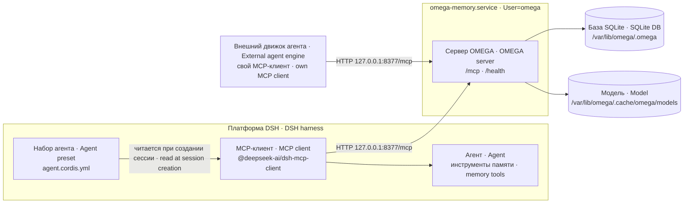
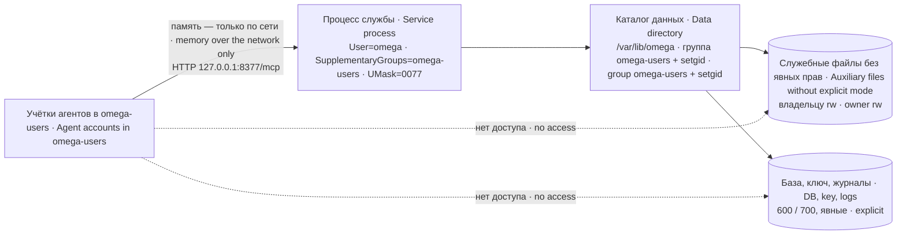
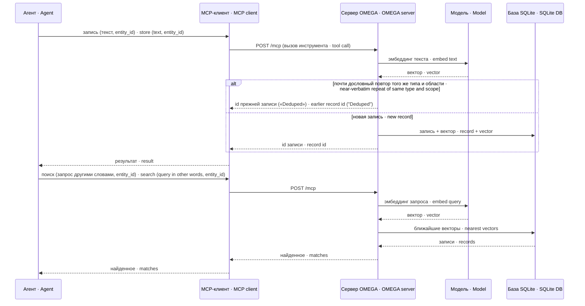

# Устройство omega-memory · omega-memory architecture

Документ описывает, из чего состоит служба памяти, как по ней идёт один запрос и в каких состояниях бывает модель эмбеддингов. Свой код: юнит/drop-in, установочный checker и два стенда; всё, что сказано о движке, относится к движку OMEGA и может меняться от версии к версии.

This document describes what the memory service consists of, how one request flows through it and which states the embedding model can be in. Own code consists of the unit/drop-ins, install checker and two stands; everything said about the engine refers to the OMEGA engine and may change between versions.

## Составные части · Components

| Часть · Part | Чьё · Owner | Где · Where | Роль · Role |
|---|---|---|---|
| Служебная учётка `omega` · Service account `omega` | пакет · package | `/var/lib/omega` | владелец процесса и данных · owns the process and the data |
| Юнит `omega-memory.service` · Unit | пакет · package | `/etc/systemd/system/` | запуск, перезапуск при отказе, автозапуск · start, restart on failure, autostart |
| Движок OMEGA · OMEGA engine | первоисточник · upstream | `/opt/omega/venv` | MCP-сервер, эмбеддинги, поиск · MCP server, embeddings, search |
| База SQLite · SQLite DB | движок · engine | `/var/lib/omega/.omega` | записи и векторы · records and vectors |
| Группа `omega-users` · Group `omega-users` | пакет (юнит ссылается, создаёт администратор) · package (unit refers to it, admin creates it) | `/etc/group`, каталог данных · data directory | группа совместимости; не открывает приватные файлы · compatibility group; no access to private files |
| Модель эмбеддингов · Embedding model | движок · engine | `/var/lib/omega/.cache/omega/models` | текст → вектор · text → vector |
| Строка MCP-клиента · MCP client row | пакет (образец) · package (sample) | `agent.cordis.yml` | выдаёт инструменты памяти агенту · gives memory tools to the agent |
| Корень `entity_id` · Root `entity_id` | пакет (соглашение) · package (convention) | личность агента · agent persona | раскладка записей по агентам · files records per agent |

Пути внутри `/var/lib/omega` — умолчания движка от `HOME` (проверено по исходнику одной версии движка), а не настройки пакета.

Paths inside `/var/lib/omega` are engine defaults derived from `HOME` (checked in the source of one engine version), not package settings.

## Взаимодействие · Interaction



Два пути к серверу взаимоисключающие для одного агента: если инструменты исполняет внешний движок, агент видит только его набор, и строка MCP-клиента платформы ему ничего не даёт.

The two paths to the server are mutually exclusive for one agent: if an external engine executes the tools, the agent sees only that engine's toolset, and the harness MCP client row gives it nothing.

## Доступ к файлам · File access



Setgid сохраняет группу файла, но0077 закрывает его для группы. Данные и служебные файлы читает владелец omega; доступ агента по MCP проверяется отдельно.

Setgid retains the file group while0077 denies that group access. The omega owner reads data/auxiliary files; agent MCP access is checked separately.


## Один круг «запись → поиск» · One store → search round trip



Склейка повторов идёт по порогам `OMEGA_DEDUP_THRESHOLDS` (сходство по Жаккару на словах); поэтому пробная запись в приёмке должна быть новым текстом, а не повтором прежней пробы — иначе вернётся id старой записи.

Repeat collapsing follows the `OMEGA_DEDUP_THRESHOLDS` thresholds (Jaccard similarity over words); so the acceptance test record must be new text, not a repeat of an earlier test — otherwise the old record's id comes back.

Этот круг и есть приёмка: `/health` в нём не участвует. Если модель подменена псевдо-эмбеддингами, круг формально проходит, но поиск другими словами находит хуже или не находит — поэтому проверять надо именно другими словами.

This round trip is the acceptance test: `/health` takes no part in it. If the model was replaced by pseudo-embeddings the round trip formally completes, but a search in other words finds worse or nothing — so test with different words.

Если движок требует ключ доступа, каждый `POST /mcp` несёт заголовок `Authorization: Bearer <ключ>`; без него сервер отвечает 401, и до модели и базы запрос не доходит.

If the engine requires an access key, every `POST /mcp` carries an `Authorization: Bearer <key>` header; without it the server answers 401, and the request never reaches the model or the database.

## Состояния модели · Model states

```mermaid
stateDiagram-v2
    [*] --> NoModel
    NoModel: Нет модели · No model
    Partial: Частичная загрузка (веса есть, токенизатор 404) · Partial download (weights, tokenizer 404)
    Real: Настоящая модель (1024 у bge-m3; 384 у штатной) · Real model (1024 for bge-m3;384 for default)
    Pseudo: Псевдо-эмбеддинги · Pseudo-embeddings
    NoModel --> Partial: штатный setup · default setup
    NoModel --> Real: полный ONNX-bge-m3 bundle, README3 · full ONNX-bge-m3 bundle, README3
    Partial --> Pseudo: служба стартует · service starts
    NoModel --> Pseudo: служба стартует · service starts
    Partial --> Real: полный ONNX bundle · full ONNX bundle
    Pseudo --> Real: загрузить модель и перезапустить · fetch model and restart
    Real --> Pseudo: модель потеряна или не в том HOME · model lost or in wrong HOME
```

Псевдо-эмбеддинги — состояние, при котором служба отвечает на всё и не сообщает об этом агенту явным отказом. Различить два состояния может поиск другими словами и отсутствие degraded; doctor штатной bge-small не проверяет bge-m3.

Pseudo-embeddings is a state in which the service answers everything and does not report it to the agent as an explicit failure. Other-words search and no degraded warning distinguish them; default bge-small doctor cannot validate bge-m3.

## Жизненный цикл службы · Service lifecycle

Юнит поднимает службу при загрузке (`WantedBy=multi-user.target`) и перезапускает её через 5 секунд только при отказе (`Restart=on-failure`). Чистый выход процесса с кодом 0 отказом не считается: служба остаётся остановленной. В проверенной версии движка так завершается его собственный сторож памяти (превышение лимита RSS); сторож простоя в режиме http выключен юнитом (`OMEGA_IDLE_TIMEOUT=0`).

The unit starts the service at boot (`WantedBy=multi-user.target`) and restarts it after 5 seconds only on failure (`Restart=on-failure`). A clean process exit with code 0 is not a failure: the service stays stopped. In the engine version we checked, its own memory watchdog (RSS limit exceeded) exits exactly that way; the idle watchdog is disabled by the unit (`OMEGA_IDLE_TIMEOUT=0`).

Шагов после старта (`ExecStartPost=`) в юните нет: ни ожидания готовности, ни правки прав. Для systemd служба `active`, как только запущен процесс (`Type=simple`), ещё до того, как сервер начал слушать порт.

The unit has no post-start steps (`ExecStartPost=`): no readiness wait and no permission fix. For systemd the service is `active` as soon as the process is started (`Type=simple`), before the server has begun listening on the port.
