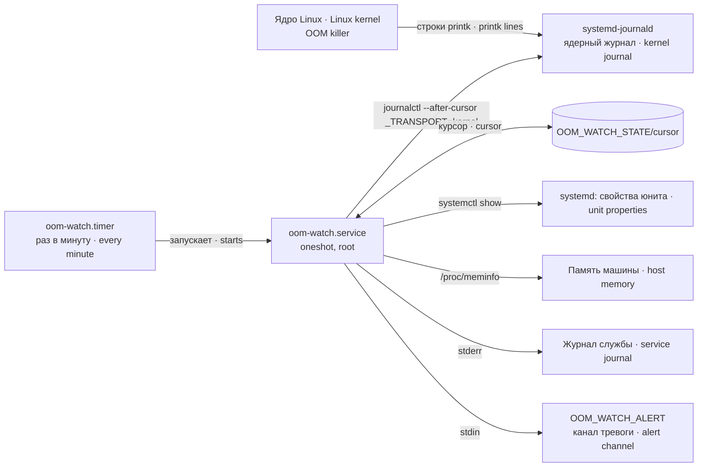

# oom-watch — сторож убийств по памяти · a watchdog for out-of-memory kills

Версия · Version: 3.1.4

**Сторож, который замечает, что ядро убило процесс по памяти, и говорит об этом вслух — в журнал всегда, во внешний канал тревоги, если он задан.**

**A watchdog that notices when the kernel killed a process for lack of memory and says so out loud — into the journal always, and into an external alert channel if you set one.**

Автор · Author: Aleksandr Argelander · Лицензия · License: MIT

---

## 1. Что это · What it is

`oom-watch` — это таймер systemd, который раз в минуту читает ядерный журнал, находит в нём убийства по памяти (OOM kill) и превращает их в понятную человеку тревогу: какая служба, сколько занимала, какой у неё предел, поднимется ли она сама.

`oom-watch` is a systemd timer that reads the kernel journal once a minute, finds out-of-memory (OOM) kills in it and turns them into an alert a human can act on: which service, how much it held, what its limit is, whether it comes back by itself.

**Это не плагин агентной платформы**, а служба машины: полезна всему, что работает под systemd.

**Not an agent-platform plugin.** A machine service, useful to anything running under systemd.

## 2. Зачем нужно · Why it exists

Ваш агент умирает. `systemctl status` говорит `failed`. Журнал самого агента обрывается на полуслове. Нигде не написано «его убил предел памяти», и вы идёте искать ошибку в своём коде.

Your agent dies. `systemctl status` says `failed`. The logs of the agent itself end mid-sentence. Nothing anywhere says "the memory limit killed it", so you go looking for a bug in your code.

Так снаружи выглядит убийство по пределу памяти cgroup, и любой парк агентов под systemd рано или поздно с ним встречается: обновили модель, удлинился контекст, добавилась ещё одна одновременная сессия — и юнит, который вчера помещался в `MemoryMax`, сегодня не помещается.

That is what a cgroup OOM kill looks like from the outside, and every fleet running agents under systemd meets it eventually — a model update, a longer context, one more concurrent session, and the unit that fit inside `MemoryMax` yesterday does not fit today.

### Ловушка, ради которой пакет существует · The trap this package exists for

Очевидный способ написать такой сторож — читать `memory.events`:

The obvious way to write this watchdog is to read `memory.events`:

```
$ cat /sys/fs/cgroup/system.slice/my-agent.service/memory.events
oom_kill 1
```

**Этот счётчик обнуляется при перезапуске юнита**, а юнит, который только что убили по памяти, — это ровно тот юнит, который сейчас перезапустится. Замер на нашей машине, тот же юнит, тот же предел:

**That counter is reset when the unit restarts**, and a unit that just got OOM-killed is exactly a unit that is about to restart. Measured on our machine, same unit, same limit:

| Момент · Moment | inode cgroup · cgroup inode | `oom_kill` |
|---|---|---|
| после убийства · after the kill | 888101 | 1 |
| после `systemctl restart` · after `systemctl restart` | 888318 | **0** |

При перезапуске cgroup уничтожается и создаётся заново, и счётчики ядра этой cgroup уходят вместе с ней. Сторож, опрашивающий счётчик раз в минуту, пропускает любое убийство, за которым в пределах того же интервала последовал перезапуск, — то есть обычный случай. Он докладывает «всё чисто» и ошибается.

The cgroup is destroyed and recreated on restart, and the kernel's per-cgroup counters go with it. A watchdog polling that counter every minute misses any kill followed by a restart inside its own polling interval — that is, the normal case. It reports "all clear" and it is wrong.

У ядерного журнала этой беды нет: строки переживают cgroup, которая их породила. Поэтому `oom-watch` читает сохранённые kernel-записи всех загрузок через `journalctl _TRANSPORT=kernel` от сохранённого курсора и связывает две строки, которые печатает ядро:

The kernel journal does not have this problem: the lines survive the cgroup that produced them. So `oom-watch` reads retained kernel entries across boots using `journalctl _TRANSPORT=kernel` from a saved cursor and pairs the two lines the kernel emits:

```
oom-kill:constraint=CONSTRAINT_MEMCG,...,oom_memcg=/system.slice/my-agent.service,task=python3,...
Memory cgroup out of memory: Killed process 1357889 (python3) total-vm:84592kB, anon-rss:65280kB
```

## 3. Место в системе · Where it sits



Соседи: ядро пишет строки убийства, journald их хранит, таймер будит сторож, сторож читает журнал от курсора, уточняет свойства юнита у systemd и отдаёт тревогу в свой журнал и, если задан, во внешний канал. Подробное устройство — [docs/ARCHITECTURE.md](docs/ARCHITECTURE.md).

Neighbours: the kernel writes the kill lines, journald keeps them, the timer wakes the watchdog, the watchdog reads the journal from its cursor, asks systemd for unit properties and hands the alert to its own journal and, if set, to an external channel. Full design — [docs/ARCHITECTURE.md](docs/ARCHITECTURE.md).

## 4. Установка · Install

```bash
sudo install -m 755 bin/oom-watch /usr/local/bin/oom-watch
sudo cp systemd/oom-watch.{service,timer} /etc/systemd/system/
sudo systemctl daemon-reload && sudo systemctl enable --now oom-watch.timer
```

Требования: `python3` (только стандартная библиотека) и systemd с journald. Юнит пакета работает от root. Для запуска от другого пользователя нужны права чтения ядерного журнала (обычно группа `systemd-journal` или `adm`), запись в каталог состояния и доступ к выбранному каналу; вариант drop-in — в SETTINGS. Если доступа к журналу нет, сторож не молчит: он объявляет себя слепым (тревога «СЛЕПОТА: …» при каждом запуске, код выхода 2, юнит в состоянии `failed`), но убийств не видит. Зависимостей от агентной платформы нет. Разбор строк ядра проверялся по образу ядра 6.8.

Requires `python3` (standard library only) and systemd with journald. The packaged unit runs as root. Another account needs permission to read the kernel journal (usually membership in `systemd-journal` or `adm`), write access to the state directory and access to the selected alert channel; see SETTINGS for a drop-in example. Without journal access, the watchdog is not silent: it declares itself blind (a «СЛЕПОТА: …» (BLINDNESS) alert on every run, exit code 2, the unit in the `failed` state), but it sees no kills. No dependency on any agent platform. Kernel-line parsing was checked against a 6.8 kernel image.

Включается таймер, а не служба: у `oom-watch.service` нет секции `[Install]` намеренно — это `oneshot`, который зовёт таймер.

You enable the timer, not the service: `oom-watch.service` has no `[Install]` section on purpose — it is a `oneshot` called by the timer.

⚠️ **Юнит пакета сам включает внешний канал тревоги.** С 2.2.2 (B-N-1901) в `systemd/oom-watch.service` стоит строка `Environment=OOM_WATCH_ALERT=/usr/local/bin/agent-alert` — канал нашей фермы из пакета `dsh-trevogi`, который устанавливается и настраивается отдельно; прежде она была закомментированным образцом, и юнит из пакета молча выключал тревоги наружу. Скопировав юнит как есть на машину, где `/usr/local/bin/agent-alert` нет, вы получите на каждую тревогу строку «🔴 OOM-KILL: тревога НЕ доставлена (канал /usr/local/bin/agent-alert недоступен) — остаётся только журнал»: сама тревога останется только в журнале службы. На такой машине задайте свой канал drop-in'ом (`Environment=OOM_WATCH_ALERT=<ваш путь>` в `/etc/systemd/system/oom-watch.service.d/*.conf`) или пустое значение (`Environment=OOM_WATCH_ALERT=`) — тогда только журнал. Что тревога из юнита пакета доходит до канала, проверяет стенд `test/stend-yunit-trevoga.py` (раздел 8).

⚠️ **The packaged unit switches the external alert channel on by itself.** Since 2.2.2 (B-N-1901) `systemd/oom-watch.service` carries the line `Environment=OOM_WATCH_ALERT=/usr/local/bin/agent-alert` — our farm's channel from the separately installed and configured `dsh-trevogi` package; before, it was a commented-out sample, and the packaged unit silently switched outward alerts off. Copy the unit as is onto a machine without `/usr/local/bin/agent-alert`, and every alert gives the line «🔴 OOM-KILL: тревога НЕ доставлена (канал /usr/local/bin/agent-alert недоступен) — остаётся только журнал» (alert NOT delivered, channel unavailable, journal only): the alert itself stays only in the service journal. On such a machine set your own channel in a drop-in (`Environment=OOM_WATCH_ALERT=<your path>` in `/etc/systemd/system/oom-watch.service.d/*.conf`) or an empty value (`Environment=OOM_WATCH_ALERT=`) — journal only then. The stand `test/stend-yunit-trevoga.py` checks that an alert from the packaged unit reaches the channel (section 8).

## 5. Быстрый старт · Quick start

Первый запуск не кричит о прошлом: он запоминает текущую позицию журнала и выходит, написав в журнал службы строку «сторож поднят». После установки подождите минуту и проверьте:

The first run does not shout about the past: it records the current journal position and exits, writing a "watchdog is up" line («сторож поднят») to the service journal. After installing, wait a minute and check:

```bash
oom-watch --version                       # номер из __version__ · version from __version__
systemctl list-timers oom-watch.timer     # таймер есть и тикает · the timer exists and ticks
sudo ls -l /var/lib/oom-watch/cursor      # курсор записан · the cursor was written
journalctl -u oom-watch.service -n 5      # «🔴 OOM-KILL: сторож поднят, слежу за ядерным логом…»
```

🔴 Если через минуту файла `cursor` нет, служба в состоянии `failed` (видно в `systemctl status oom-watch.service` и `systemctl --failed`), а в её журнале строка «СЛЕПОТА: не добыт курсор ядерного журнала: …» — сторож не может получить позицию в ядерном журнале (обычно: нет прав чтения журнала; так же выглядит и совсем пустой ядерный журнал); код выхода 2, и строка повторяется при каждом запуске таймера. Если нет ни файла, ни строки «сторож поднят», ни строки «СЛЕПОТА» — таймер не запущен. См. [docs/TROUBLESHOOTING.md](docs/TROUBLESHOOTING.md).

🔴 If after a minute there is no `cursor` file, the service is `failed` (shown by `systemctl status oom-watch.service` and `systemctl --failed`), and its journal has a line "СЛЕПОТА: не добыт курсор ядерного журнала: …" (BLINDNESS: no kernel-journal cursor obtained), the watchdog cannot get a position in the kernel journal (usually: no journal read permission; a completely empty kernel journal looks the same); exit code 2, and the line repeats on every timer run. If there is no file, no "watchdog is up" line and no "СЛЕПОТА" line — the timer is not running. See [docs/TROUBLESHOOTING.md](docs/TROUBLESHOOTING.md).

Минимальная настройка — никакой: без переменных сторож тревожит на любое убийство и пишет только в свой журнал. Но юнит пакета переменную уже задаёт: `OOM_WATCH_ALERT=/usr/local/bin/agent-alert` (раздел 4) — на машине без этого файла задайте свой канал или пустое значение drop-in'ом. Подробно об `OOM_WATCH_ALERT` — раздел 6.

Minimal configuration is none: with no variables the watchdog alerts on any kill and writes only to its own journal. But the packaged unit already sets the variable: `OOM_WATCH_ALERT=/usr/local/bin/agent-alert` (section 4) — on a machine without that file, set your own channel or an empty value in a drop-in. More on `OOM_WATCH_ALERT` — section 6.

## 6. Настройки · Settings

Переменные окружения, задаются в юните (`Environment=` или drop-in). Полное описание каждой — тип, умолчание, пример, что сломается при неверном значении — в [docs/SETTINGS.md](docs/SETTINGS.md).

Environment variables, set in the unit (`Environment=` or a drop-in). The full description of each — type, default, example, what breaks when it is wrong — is in [docs/SETTINGS.md](docs/SETTINGS.md).

| Имя · Name | Умолчание · Default | Что значит · Meaning |
|---|---|---|
| `OOM_WATCH_UNITS` | пусто · empty | Юниты для тревоги, через пробел. **Пусто = тревожить на любой.** · Units to alert on, space separated. **Empty = alert on any.** |
| `OOM_WATCH_ALERT` | пусто · empty | Полный путь к исполняемому файлу, получает текст **на stdin** (он многострочный). Пусто = только журнал. Ждём не дольше 20 с на тревогу (константа в коде). · Full path to an executable that receives the message **on stdin** (multi-line). Empty = journal only. Waited for at most 20 s per alert (a code constant). |
| `OOM_WATCH_STATE` | `/var/lib/oom-watch` | Каталог состояния; в нём один файл — `cursor`. · State directory; it holds one file — `cursor`. |
| частота таймера · timer cadence | раз в минуту · every minute | `OnCalendar=*-*-* *:*:00` в `oom-watch.timer`. |
| запуск от root · run as root | да · yes | Умолчание профиля; другой пользователь возможен с правами на journal/state/channel (SETTINGS). · Profile default; another account can run it with journal/state/channel access (SETTINGS). |

⚠️ Подумайте дважды, прежде чем заполнять `OOM_WATCH_UNITS`. Забытый в списке юнит — это молчание ровно там, где вы хотели тревогу, и ничто вам об этом не напомнит. Пустое умолчание громче и безопаснее.

⚠️ Think twice before filling `OOM_WATCH_UNITS`. A unit forgotten in that list is silence exactly where you wanted an alarm, and nothing will remind you. The empty default is louder and safer.

## 7. Как работает · How it works

### Два вида убийства, и опаснее второй · Two kinds of kill, and the dangerous one is the second

**Групповое** убийство (по пределу cgroup) значит, что один юнит вышел за *свой* предел. Локально, переживаемо, виновник очевиден — это юнит, названный в тревоге.

A **cgroup** kill means one unit went over *its own* limit. Local, survivable, and the culprit is obvious — it is the unit named in the alert.

**Глобальное** убийство значит, что память кончилась на всей машине, и ядро выбрало жертву по размеру. Жертвой может стать что угодно, включая то, у чего пределов нет вовсе: ваша база данных, ваш шлюз, сама платформа. Юнит, названный в тревоге, — **не** причина, а пострадавший.

A **global** kill means the machine ran out of memory and the kernel picked a victim by size. The victim can be anything, including something with no limit configured at all: your database, your gateway, the platform itself. The unit named in the alert is **not** the cause; it is the casualty.

В ядерном журнале это разные строки:

They are different lines in the kernel journal:

```
oom-kill:constraint=CONSTRAINT_MEMCG,...,oom_memcg=/system.slice/svc-a.service,...,pid=1001
Memory cgroup out of memory: Killed process 1001 (python3) ... anon-rss:16128kB ...

oom-kill:constraint=CONSTRAINT_NONE,...,global_oom,task_memcg=/system.slice/svc-b.service,...,pid=2002
Out of memory: Killed process 2002 (python3) ... anon-rss:310912kB ...
```

Обратите внимание, чего у глобального убийства *нет*: `oom_memcg`. Нет «предела, который превышен», поэтому `oom-watch` не печатает для него ни предела, ни процента. Подставить туда `MemoryMax` юнита значило бы выдумать число, указывающее на невиновный юнит, — и читатель, поверивший ему, потратит аварию на настройку жертвы вместо поиска того, кто съел машину.

Note what a global kill does *not* have: `oom_memcg`. There is no "limit that was exceeded", so `oom-watch` prints no limit and no percentage for it. Filling that field with the unit's `MemoryMax` would be a fabricated number pointing at an innocent unit — and a reader who trusts it spends the outage tuning the victim instead of finding what ate the machine.

Три подробности, которые стоили нам переписывания, все сверены с образом ядра (6.8), а не по памяти:

Three details that cost us a rewrite, all verified against the kernel image (6.8), not from memory:

- строка убийства — это `%s: Killed process`, и ядро подставляет **три** разных текста: `Memory cgroup out of memory`, `Out of memory` и `Out of memory (oom_kill_allocating_task)`. Сравнение с фиксированным префиксом теряет третий;
- у `constraint` **четыре** значения: `CONSTRAINT_MEMCG` — групповой случай, а `CONSTRAINT_NONE`, `CONSTRAINT_CPUSET` и `CONSTRAINT_MEMORY_POLICY` — все глобальные;
- у глобального убийства юнит жертвы берётся из `task_memcg` (в чьей cgroup она жила), у группового — из `oom_memcg` (чей предел пробит). Одно поле на оба случая неверно называет один из них.

- the kill line is `%s: Killed process`, and the kernel substitutes **three** different texts: `Memory cgroup out of memory`, `Out of memory`, and `Out of memory (oom_kill_allocating_task)`. Matching a fixed prefix drops the third one;
- `constraint` has **four** values: `CONSTRAINT_MEMCG` is the cgroup case, while `CONSTRAINT_NONE`, `CONSTRAINT_CPUSET` and `CONSTRAINT_MEMORY_POLICY` are all global;
- for a global kill the victim's unit comes from `task_memcg` (whose cgroup it lived in), for a cgroup kill from `oom_memcg` (whose limit was blown). Using one field for both misnames one case.

Глобальное убийство тревожит **всегда**, даже если задан `OOM_WATCH_UNITS`. Этот список отвечает на вопрос «чьи пределы мы стережём», а общая нехватка памяти не про чей-то предел.

A global kill **always** alerts, even when `OOM_WATCH_UNITS` is set. That list answers "whose limits do we watch"; a machine-wide shortage is not about anyone's limits.

### Вторая ловушка: одно убийство — несколько строк ядра · The second trap: one kill, several kernel lines

Ядро печатает убийство не одной строкой. Юнит — в одной, числа — в другой:

The kernel does not print a kill as one line. The unit is in one line, the numbers are in another:

```
oom-kill:constraint=CONSTRAINT_MEMCG,...,oom_memcg=/system.slice/svc-a.service,task=python3,pid=1001
Memory cgroup out of memory: Killed process 1001 (python3) total-vm:99999kB, anon-rss:16128kB
```

Очевидный способ их связать — «запомнить последнюю строку `oom-kill:` и приклеить к следующей `Killed process`». Это работает, пока два убийства не случатся рядом или журнал не потеряет строку, — а после убийства ядро вываливает таблицу процессов, так что `printk: N messages suppressed` — обычное дело, а не экзотика. Тогда склейка съезжает на одну позицию, и сторож сообщает **настоящий юнит с числами другого юнита**. Замер, один и тот же вход, одна строка `oom-kill:` пропущена:

The obvious way to pair them is "remember the last `oom-kill:` line, attach it to the next `Killed process` line". That works until two kills land close together, or until the journal drops a line — and after a kill the kernel dumps a process table, so `printk: N messages suppressed` is the normal case, not an exotic one. Then the pairing slides by one and the watchdog reports **a real unit with another unit's numbers**. Measured, same input, one `oom-kill:` line missing:

| Способ · Method | Названный юнит · Reported unit | Названный anon-rss · Reported anon-rss | Правда · Truth |
|---|---|---|---|
| склейка по порядку · pairing by order | `svc-b.service` | 16128 kB | 16128 kB принадлежат pid 1001, а это **не** svc-b · 16128 kB belongs to pid 1001, which is **not** svc-b |
| связь по pid · pairing by pid | *не определён · not identified* | 16128 kB | верно: строка с именем юнита потеряна · correct: the line that named the unit is gone |

Мы выпустили версию со склейкой по порядку и были вынуждены её отозвать: она объявила убийство в шлюзе, который не перезапускался с полудня, с 100 kB RSS рядом с настоящими убийствами по 64 MB.

We shipped the by-order version and had to withdraw it: it announced a kill in a gateway that had not restarted since noon, with 100 kB of RSS next to real kills of 64 MB.

Номер процесса есть в обеих строках, поэтому `oom-watch` связывает их по **`(_BOOT_ID, pid)`** одним хронологическим проходом, потребляя завершённую пару один раз. Если пара не нашлась, тревога говорит *«не определена»*, и ближайший юнит никогда не подставляется: тревога, называющая не ту службу, отправит вас отлаживать процесс, который жив и здоров.

Both lines carry the pid, so `oom-watch` pairs them by **`(_BOOT_ID, pid)`** in one chronological pass, consuming each completed pair once. When they do not pair, the alert says *unidentified*, and the nearest unit is never substituted — an alert that names the wrong service sends you debugging a process that is alive and well.

Два следствия, которые стоит знать:

Two consequences worth knowing:

- неопознанное убийство тревожит **всегда**, даже если задан `OOM_WATCH_UNITS`: дефект разбора не должен превращаться в молчание;
- системный юнит узнаётся по последнему `.service` сегменту cgroup, включая вложенные slice и шаблонные юниты (`/system.slice/system-foo.slice/foo@bar.service`). Для user-manager (`user@N.service` в пути) identity — весь cgroup-путь; его MemoryMax и Restart не проверяются системным manager.

- an unidentified kill **always** alerts, even when `OOM_WATCH_UNITS` is set. A parser defect must not turn into silence;
- a system unit is identified by its final `.service` cgroup segment, including nested slices and template units (`/system.slice/system-foo.slice/foo@bar.service`). For a user manager (path containing `user@N.service`), identity is the entire cgroup path; the system manager is not queried for its MemoryMax or Restart.

### Третья ловушка: сторож слепнет и говорит об этом только себе · The third trap: a watchdog that goes blind and only tells itself

`oom-watch` помнит, где остановил чтение, — курсор журнала в своём каталоге состояния. Если курсор стал нечитаемым — файл состояния обрезан или испорчен, — `journalctl --after-cursor` падает, и очевидная реакция — пожаловаться и выйти.

`oom-watch` remembers where it stopped reading, as a journal cursor in its state directory. If that cursor becomes unreadable — the state file was truncated or corrupted — `journalctl --after-cursor` fails, and the obvious handler is to complain and exit.

Такая реакция — вечная слепота. Курсор не сдвигается, каждый следующий запуск падает на том же месте, и сторож больше не видит ни одного убийства. Хуже того, жалоба уходила только в `stderr`, то есть в журнал самого `oom-watch` — единственное место, которое никто не читает, ведь весь смысл инструмента в том, чтобы не читать журналы ради новости об убийстве. Замер: три запуска подряд, три одинаковые жалобы, курсор не изменился, убийства в промежутке не замечены.

That handler is a permanent blackout. The cursor never moves, so every run afterwards fails at the same place, forever, and the watchdog never sees another kill. Worse, the complaint went to `stderr` only, which is the journal of `oom-watch` itself — the one place nobody reads, because the whole point of this tool is that you should not have to read journals to learn about a kill. Measured: three runs in a row, three identical complaints, the cursor unchanged, kills in the meantime unnoticed.

Поэтому ошибка чтения теперь **тревожит наружу** («🔴 OOM-KILL: не удалось прочитать ядерный лог (rc=…)») и сдвигает курсор на текущую позицию, после чего проход завершается кодом 2: окно не проверено, и такой проход не считается успешным. Следующий запуск читает уже от новой позиции, а тревога прямо называет цену: окно до этого момента не проверено. Граница важна — курсор сбрасывается **только** при ошибке чтения. Пустой ответ журнала значит «убийств не было», это не сбой, и курсор он не трогает.

So a failed read now **alerts outward** ("🔴 OOM-KILL: не удалось прочитать ядерный лог (rc=…)", could not read the kernel log) and moves the cursor to the current position, after which the pass exits with code 2: the window was not checked, and such a pass does not count as a success. The next run reads from the new position, and the alert states the price plainly: the window before this moment was never checked. The boundary matters — the cursor is reset **only** on a read error. An empty answer from the journal means "no kills", not a fault, and never touches the cursor.

Уточнение по пробе на systemd 255: ошибку чтения даёт синтаксически испорченный или пустой курсор. Курсор правильного вида, но от вычищенного или чужого журнала, `journalctl` принимает без ошибки и читает с ближайшего места — тогда этот сторож не срабатывает, а убийства из вычищенной части журнала теряются без тревоги. Подробно — [docs/GUARDS.md](docs/GUARDS.md).

Refinement from a probe on systemd 255: a read error comes from a syntactically broken or empty cursor. A well-formed cursor from a vacuumed or foreign journal is accepted by `journalctl` without error and read from the nearest place — then this guard does not fire, and kills from the vacuumed part of the journal are lost without an alert. Details — [docs/GUARDS.md](docs/GUARDS.md).

Вторая форма той же ловушки — сторож вообще не может получить позицию в ядерном журнале. `current_cursor()` спрашивает у `journalctl` курсор последней записи и считает **слепотой** три исхода: `journalctl` не запустился (`OSError`), ответил ненулевым кодом (нет прав: проверено, от учётки без прав код 1 и ни строки курсора) или ответил кодом 0 без строки курсора (так выглядит и совсем пустой ядерный журнал). Во всех трёх случаях сторож отдаёт через `notify` тревогу «СЛЕПОТА: не добыт курсор ядерного журнала: …» и выходит с кодом 2, поэтому юнит становится `failed` и виден в `systemctl --failed`. Так же ведёт себя основное чтение: если `journalctl --after-cursor` не запустился — «СЛЕПОТА: не добыт ядерный журнал: journalctl не запущен» и код 2.

The second form of the same trap is a watchdog that cannot get a position in the kernel journal at all. `current_cursor()` asks `journalctl` for the cursor of the last entry and treats three outcomes as **blindness**: `journalctl` failed to start (`OSError`), exited non-zero (no permission: verified, an unprivileged account gets exit 1 and no cursor line), or exited 0 without a cursor line (a completely empty kernel journal looks like this too). In all three cases the watchdog sends the alert "СЛЕПОТА: не добыт курсор ядерного журнала: …" (BLINDNESS: no kernel-journal cursor obtained) through `notify` and exits with code 2, so the unit becomes `failed` and shows up in `systemctl --failed`. The main read behaves the same way: if `journalctl --after-cursor` fails to start — "СЛЕПОТА: не добыт ядерный журнал: journalctl не запущен" (BLINDNESS: kernel journal not obtained, journalctl not started) and code 2.

У сторожа нет памяти о том, что о слепоте уже сказано: тревога «СЛЕПОТА» уходит **при каждом запуске**, то есть раз в минуту по таймеру, пока слепота не кончится. Это известное ограничение — канал тревоги заваливается одинаковыми сообщениями. Тревога о слепоте идёт тем же `notify`, что и остальные, поэтому сломанный канал тревоги этот путь не роняет: недоставка даёт строку «тревога НЕ доставлена» в журнале службы, а код выхода остаётся 2.

The watchdog keeps no memory that the blindness was already reported: the "СЛЕПОТА" alert goes out **on every run**, i.e. once a minute by the timer, for as long as the blindness lasts. This is a known limitation — the alert channel gets flooded with identical messages. The blindness alert goes through the same `notify` as every other alert, so a broken alert channel does not crash this path: a non-delivery produces the "тревога НЕ доставлена" (alert NOT delivered) line in the service journal, and the exit code stays 2.

### Что говорит тревога · What the alert says

```
🔴 Убийство по памяти на host01: служба вышла за свой предел
Служба: my-agent.service — «Agent runtime» (от имени agent)
Убит процесс: python3 (номер 1460083), занимал 23.6 МБ
Предел службы: 24.0 МБ — выбран на 98%
Дальше: перезапустится сама (Restart=always)
Время: 21.08.2026 07:16:16
```

```
🔴 ПАМЯТЬ КОНЧИЛАСЬ НА ВСЕЙ МАШИНЕ host01 — ядро выбрало жертву само
Служба жертвы: my-agent.service — «Agent runtime» (от имени agent)
Убит процесс: python3 (номер 1605006), занимал 303.6 МБ
Предела нет — убито при общей нехватке памяти (CONSTRAINT_NONE)
Память машины: свободно 22.6 ГБ из 29.2 ГБ (сейчас, не на момент убийства)
Причина НЕ в этой службе: ищите, кто съел память машины
Дальше: не перезапустится сама (Restart=no)
Время: 21.08.2026 07:17:01
```

*(Настоящий вывод приёмочных прогонов, имена машины и юнита заменены.)*

*(Real output from the acceptance runs, with the host and unit names replaced.)*

Тексты тревог — по-русски намеренно: это интерфейс, его читают наши операторы. Перевод строк для читателя:

Alert texts are in Russian on purpose: they are the interface our operators read. Line-by-line translation for the reader:

| Строка тревоги · Alert line | Значение · Meaning |
|---|---|
| `Убийство по памяти на <host>: служба вышла за свой предел` | OOM kill on `<host>`: a unit exceeded its own limit |
| `ПАМЯТЬ КОНЧИЛАСЬ НА ВСЕЙ МАШИНЕ <host> — ядро выбрало жертву само` | MEMORY RAN OUT ON THE WHOLE MACHINE — the kernel picked the victim itself |
| `Служба` / `Служба жертвы: <unit> — «<Description>» (от имени <User>)` | Unit / Victim's unit, its description, the user it ran as |
| `Служба: не определена (строки ядра не сошлись по номеру процесса)` | Unit: not identified (kernel lines did not pair by pid) |
| `Убит процесс: <name> (номер <pid>), занимал <anon-rss>` | Killed process, its pid and anonymous RSS |
| `Предел службы: <MemoryMax> — выбран на N%` | Unit limit, and how much of it the killed process held |
| `Предела нет — убито при общей нехватке памяти (<constraint>)` | No limit — killed in a machine-wide shortage |
| `Память машины: свободно X из Y (сейчас, не на момент убийства)` | Host memory: X available of Y (now, not at kill time) |
| `Причина НЕ в этой службе: ищите, кто съел память машины` | The cause is NOT this unit: find what ate the machine's memory |
| `Дальше: перезапустится сама / не перезапустится сама (Restart=…)` | Next: it will / will not restart by itself |
| `Время: ДД.ММ.ГГГГ чч:мм:сс` | Time of the kill, machine local time, no zone label |

Тревога отвечает на вопрос «ну и что?», а не только «кого убили»: что это за служба по-человечески, от чьего имени работала, **насколько близко к потолку** была и вернётся ли сама. «Killed process python3» сам по себе ничего не даёт для действия. Все тексты тревоги об убийстве собраны в одной функции, `build_alert` (единицы и слова вроде «не задан» — в соседних `fmt_*`); переводить — там. Служебные строки с префиксом `🔴 OOM-KILL:` (сторож поднят, ошибка чтения, сбой канала) и тревоги слепоты «СЛЕПОТА: …» (без этого префикса) — вне `build_alert`.

The alert answers "so what?", not just "who died": which service that unit is in human terms, who it ran as, **how close to the ceiling** it was, and whether it comes back by itself. "Killed process python3" alone tells the reader nothing they can act on. Every kill-alert text is assembled in one function, `build_alert` (units and words like «не задан» live in the neighbouring `fmt_*`); translate there. The service lines prefixed `🔴 OOM-KILL:` (watchdog up, read error, channel failure) and the blindness alerts «СЛЕПОТА: …» (without that prefix) are outside `build_alert`.

Цифра свободной памяти помечена «сейчас, не на момент убийства» намеренно. В строках убийства такого числа нет, а дамп ядра `Mem-Info:` рядом нельзя привязать к конкретному убийству, не вернув ошибку склейки по порядку, описанную выше. Процент «выбран на N%» — это anon-rss убитого процесса к **текущему** `MemoryMax` юнита; файловый кэш и память ядра в него не входят, поэтому он бывает меньше 100%.

The free-memory figure is labelled "now, not at the time of the kill" on purpose. The kill lines carry no such number, and the kernel's `Mem-Info:` dump nearby cannot be attached to a specific kill without reintroducing the by-order pairing bug described above. The "used N%" percentage is the killed process's anon-rss against the unit's **current** `MemoryMax`; page cache and kernel memory are not in it, so it can be below 100%.

## 8. Сторожа и проверки · Guards and checks

Внутри сторожа проверки: связь строк по boot + pid, «неопознанное тревожит всегда», «глобальное тревожит всегда», сброс курсора при ошибке чтения (с кодом выхода 2), молчание первого запуска, запасной путь при отказе канала тревоги, перехват сбоя доставки (таймаут 20 с и исключения при запуске канала), слепота с тревогой «СЛЕПОТА» и кодом выхода 2 (тревога повторяется при каждом запуске), курсор на последней прочитанной записи. Что каждая ловит, чего **не** ловит и куда кричит — [docs/GUARDS.md](docs/GUARDS.md).

The watchdog has checks: boot + pid pairing, "unidentified always alerts", "global always alerts", cursor reset on read error (with exit code 2), first-run silence, fallback when the alert channel fails, catching delivery failures (a 20 s timeout and exceptions when launching the channel), blindness with a «СЛЕПОТА» alert and exit code 2 (the alert repeats on every run), the cursor at the last read entry. What each catches, what it does **not** catch and where it reports — [docs/GUARDS.md](docs/GUARDS.md).

### Проверьте сами, не верьте на слово · Verify it, do not trust it

Для проверки разбора и канала используйте подставной журнал и записывающую заглушку: python3 test/stend-audit.py. Следующий пример с настоящим OOM относится только к отдельной одноразовой VM, не к общей машине.

For parsing/channel checks use the fixture journal and recording sink: python3 test/stend-audit.py. The real OOM example below is for an isolated disposable VM, not a shared host.

```bash
# одноразовый юнит с пределом, в который он не влезет · a disposable unit with a limit it cannot fit into
sudo tee /etc/systemd/system/oom-probe.service >/dev/null <<'UNIT'
[Unit]
Description=TEMP OOM probe
[Service]
Type=simple
ExecStart=/usr/bin/python3 -c "x=[bytearray(4*1024*1024) for _ in iter(int,1)]"
MemoryMax=64M
MemorySwapMax=0
Restart=no
UNIT
sudo systemctl daemon-reload && sudo systemctl start oom-probe.service
sleep 15
sudo /usr/local/bin/oom-watch            # ждём «🔴 Убийство по памяти … oom-probe.service» · expect this alert
journalctl -u oom-watch.service -n 20    # если таймер успел первым — тревога здесь · if the timer got there first, it is here
sudo systemctl stop oom-probe.service
sudo rm /etc/systemd/system/oom-probe.service && sudo systemctl daemon-reload
```

Ручной запуск и таймер делят один курсор: если таймер прошёл между убийством и вашим запуском, ручной запуск ничего не напечатает, а тревога окажется в журнале службы. Это не отказ — смотрите оба места.

The manual run and the timer share one cursor: if the timer ran between the kill and your manual run, the manual run prints nothing and the alert is in the service journal. That is not a failure — look in both places.

Связь двух убийств и глобальный вариант проверяйте на подставном журнале: две пары с разными pid, юнитами и числами; потерянная строка constraint; глобальный `CONSTRAINT_NONE` и префикс `Out of memory (oom_kill_allocating_task)`. Канал должен писать след в частный файл, состояние — лежать в отдельном временном каталоге. Сверяйте каждую тревогу со своим юнитом, процессом и anon-rss. Это проверка разбора и маршрута до заглушки, а не живого OOM killer или доставки оператору.

Check two-kill pairing and the global case with a fixture journal: two pairs with different pids, units and numbers; a missing constraint line; global `CONSTRAINT_NONE` and the `Out of memory (oom_kill_allocating_task)` prefix. Use a recording alert stub and a separate temporary state directory. Compare each alert with its own unit, task and anon-rss. This checks parsing and the route to the stub, not the live OOM killer or delivery to an operator.

Настоящие пробы с нехваткой памяти или sysrq допустимы только в отдельной одноразовой виртуальной машине; `OOMScoreAdjust=1000` не гарантирует, что будет убит только выбранный процесс. Рецептов с отсутствующими юнитами `oom-probe-a/b` и `oom-glob` здесь нет.

Real memory-pressure or sysrq experiments belong only in an isolated disposable VM; `OOMScoreAdjust=1000` does not guarantee that only the selected process will be killed. There are no recipes using absent `oom-probe-a/b` or `oom-glob` units here.

### Стенды пакета · Package stands

`python3 -B test/stend-audit.py` — девять именованных fixture-проб: процессы с пробелами/скобками, две загрузки/reused pid, user-manager identity/filter, unsupported MESSAGE/BOOT, literal channel и безопасный вывод. Все каналы/источники/состояние частные. · Nine named private fixture cases; every journal/property/channel/state source is isolated.


Оба стенда не трогают живой ядерный журнал и боевой канал тревоги: подставляют поддельный `journalctl` первым в `PATH`, заглушку канала и временный каталог состояния. В бой они не ставятся.

Neither stand touches the live kernel journal or the production alert channel: they put a fake `journalctl` first in `PATH`, a stub channel and a temporary state directory. They are not installed on the machine.

- `test/stend-cli.py` — разбор доводов на настоящем `bin/oom-watch`: `python3 -B test/stend-cli.py <корень пакета> [--baseline] [--cursor-copy <файл>] [--report <файл.json>]`. 19 случаев (проход без доводов, первый запуск, неизвестные доводы, `--version`, `--help` и их сочетания); в каждом сверяются код выхода, курсор до и после, вызов журнала, создание каталога состояния и то, что канал тревоги не звали. Последняя строка — `PASS <прошло>/19`; код 0 — все прошли, 1 — хоть один `FAIL`, 2 — ошибка доводов самого стенда. Ожидаемый вывод `--version` вписан в стенд числом, поэтому при смене `__version__` стенд краснеет, пока его не поправят.
- `test/stend-yunit-trevoga.py` — юнит → записывающая заглушка: `python3 test/stend-yunit-trevoga.py [unit] [--kanal /expected/absolute/path]`. Умолчание канала — /usr/local/bin/agent-alert, зависимость поставляемого профиля dsh-trevogi. Проверяет literal single-line Environment и ExecStart, затем запускает только bin/oom-watch пакета с частными state/PATH/journal/systemctl/channel; внешний путь никогда не исполняется. 0 — дошло в заглушку,1 — неверный договор/не дошло,2 — неподдержанный ввод. Не принимает полный синтаксис systemd или реальную доставку.

- `test/stend-cli.py` — argument parsing on the real `bin/oom-watch`: `python3 -B test/stend-cli.py <package root> [--baseline] [--cursor-copy <file>] [--report <file.json>]`. 19 cases (a pass with no arguments, first run, unknown arguments, `--version`, `--help` and their combinations); each checks the exit code, the cursor before and after, the journal call, creation of the state directory, and that the alert channel was not called. The last line is `PASS <passed>/19`; exit 0 — all passed, 1 — at least one `FAIL`, 2 — an error in the stand's own arguments. The expected `--version` output is written into the stand as a number, so when `__version__` changes the stand goes red until it is updated.
- `test/stend-yunit-trevoga.py` — unit → recording stub: `python3 test/stend-yunit-trevoga.py [unit] [--kanal /expected/absolute/path]`. The supplied profile expects /usr/local/bin/agent-alert from dsh-trevogi. Checks literal single-line Environment and ExecStart, then executes only package bin/oom-watch with private state/PATH/journal/systemctl/channel. Never invokes the external configured path. 0 reached stub;1 wrong contract/not reached;2 unsupported input. Does not accept all systemd syntax or actual delivery.

## 9. Границы · Where this stops

- **Сообщает об убийствах, а не об удушье.** Случай выше — юнит постоянно у потолка, вытесняет и тормозит, но не убит — не даёт строки ядра и тревоги здесь. Для этого смотрите счётчик `max` в `memory.events`: это другая беда с другим сигналом.
- **Только убийства ядра.** Пользовательский `systemd-oomd` убивает по давлению *раньше* ядра и пишет свои строки журнала; здесь они не распознаются.
- **Глобальное убийство называет жертву, а не причину.** Найти, кто исчерпал машину, — отдельная работа; сторож гарантирует лишь, что вы вообще узнаете о случившемся.
- **До минуты слепоты — по устройству.** Таймер — не надзиратель. Нужно, чтобы юнит поднимался, — это `Restart=` в самом юните; сторож лишь гарантирует, что вы узнаете, почему он упал.
- **Ничего не перезапускает, не ограничивает и не чинит.** Сторож, который тихо чинит, превращает видимый отказ в невидимый, — ровно тот отказ, против которого пакет существует.
- **Недоставленная тревога не повторяется.** Канал ждём не дольше 20 с на одну тревогу (константа `ALERT_TIMEOUT` в коде, не настройка); таймаут, исключение при запуске, ненулевой код или неисполнимый путь дают строку «🔴 OOM-KILL: тревога НЕ доставлена (<причина>) — остаётся только журнал», а проход идёт до конца и сдвигает курсор — тревога остаётся только в журнале службы. Канал, ответивший кодом 0, но не доставивший сообщение дальше, не распознаётся. Подробно — [docs/GUARDS.md](docs/GUARDS.md).
- **Убийство в cgroup, которая не `.service`** (сессия `*.scope`, корень, вложенная под-cgroup службы), придёт как «служба не определена», хотя строки сошлись.
- **Тревога о слепоте не помнит, что уже сказана.** Пока сторож слеп, «СЛЕПОТА: …» уходит при каждом запуске — раз в минуту — и заваливает канал тревоги одинаковыми сообщениями.
- **Доводы: только `--version` и `--help`.** Без доводов — один проход со сдвигом курсора. `--version` печатает номер, `--help` — справку; оба выходят кодом 0 без прохода (если заданы оба, побеждает `--version`). Любой другой довод (`--dry-run`, `--`, `--version=2`, пустая строка) — с 2.2.1 отказ «неизвестный довод …; допустимые: …» в stderr и код 2; доводы проверяются до прохода и до создания каталога состояния, так что журнал не читается и курсор не двигается, даже если рядом стоит допустимый ключ.
- **Код выхода: 0, 2 или 1.** 0 — проход отработал (в том числе с недоставленными тревогами), а также `--version` и `--help`; 2 — слепота, ядерный журнал не добыт или ошибка его чтения (курсор при этом сброшен на текущую позицию), юнит становится `failed`; сюда входят неподдержанные MESSAGE/_BOOT_ID, неизвестный довод и относительный канал (последние два — отказ до прохода); 1 — только неперехваченная ошибка Python (не ожидается; например, каталог состояния недоступен на запись).

- **It reports kills, not suffocation.** The case above — a unit permanently at its ceiling, reclaiming and stalling but never killed — produces no kernel line and no alert here. Watch the `max` counter in `memory.events` for that; it is a different problem with a different signal.
- **Kernel kills only.** The userspace `systemd-oomd` kills on pressure *before* the kernel does and writes its own journal lines; it is not matched here.
- **A global kill names the victim, not the cause.** Finding who exhausted the machine is a different job — this only guarantees you learn that it happened at all.
- **Up to one minute of blindness by design.** The timer is not a supervisor. If you need the unit back up, that is `Restart=` in the unit — this only makes sure you learn why it went down.
- **It never restarts, throttles or repairs anything.** A watchdog that fixes things quietly turns a visible failure into an invisible one, which is the failure this package exists to prevent.
- **An undelivered alert is not retried.** The channel is waited for at most 20 s per alert (the `ALERT_TIMEOUT` constant in the code, not a setting); a timeout, a launch exception, a non-zero exit or a non-executable path give the line "🔴 OOM-KILL: тревога НЕ доставлена (<reason>) — остаётся только журнал" (alert NOT delivered, journal only), and the pass runs to the end and moves the cursor — the alert stays in the service journal only. A channel that exits 0 but does not deliver the message further is not detected. Details — [docs/GUARDS.md](docs/GUARDS.md).
- **A kill in a cgroup that is not a `.service`** (a `*.scope` session, the root, a nested sub-cgroup of a service) arrives as "unit not identified" even though the lines paired.
- **The blindness alert does not remember that it was already said.** While the watchdog is blind, "СЛЕПОТА: …" goes out on every run — once a minute — and floods the alert channel with identical messages.
- **Arguments: only `--version` and `--help`.** No arguments — one pass that moves the cursor. `--version` prints the number, `--help` prints usage; both exit 0 without a pass (if both are given, `--version` wins). Any other argument (`--dry-run`, `--`, `--version=2`, an empty string) is refused since 2.2.1 with "неизвестный довод …; допустимые: …" (unknown argument; accepted: …) on stderr and exit code 2; arguments are checked before the pass and before the state directory is created, so the journal is not read and the cursor does not move, even next to an accepted flag.
- **Exit code: 0, 2 or 1.** 0 — the pass completed (including with undelivered alerts), and also `--version` and `--help`; 2 — blindness, the kernel journal not obtained or a read error (the cursor is then reset to the current position), the unit becomes `failed`; unsupported MESSAGE/_BOOT_ID also exits2, as do unknown arguments and a relative channel (pre-pass refusals); 1 — only an uncaught Python error (not expected; e.g. an unwritable state directory).

## 10. Лицензия, автор, версия · License, author, version

MIT. Автор — Aleksandr Argelander. Общая документация коллекции пакетов — [корневой README](../../README.md).

MIT. Author — Aleksandr Argelander. Documentation of the whole package collection — [root README](../../README.md).

`oom-watch --version` — номер живёт в самом скрипте, потому что только он копируется на машину. Номер в отдельном файле метаданных просто не доезжает с `install -m 755`, и тогда на машине ничто не скажет, какая версия работает. Источник номера — `__version__` в `bin/oom-watch`, читаемый этой командой. История — [CHANGELOG.md](CHANGELOG.md).

`oom-watch --version` — the number lives in the script itself, because that is the only thing that gets copied to the machine. A version kept in a separate metadata file simply does not travel with `install -m 755`, and then nothing on the machine tells you which release is running. The version source is `__version__` in `bin/oom-watch`, read by this command. History — [CHANGELOG.md](CHANGELOG.md).

Документы пакета · Package documents: [ARCHITECTURE](docs/ARCHITECTURE.md) · [SETTINGS](docs/SETTINGS.md) · [GUARDS](docs/GUARDS.md) · [TROUBLESHOOTING](docs/TROUBLESHOOTING.md) · [CHANGELOG](CHANGELOG.md)
