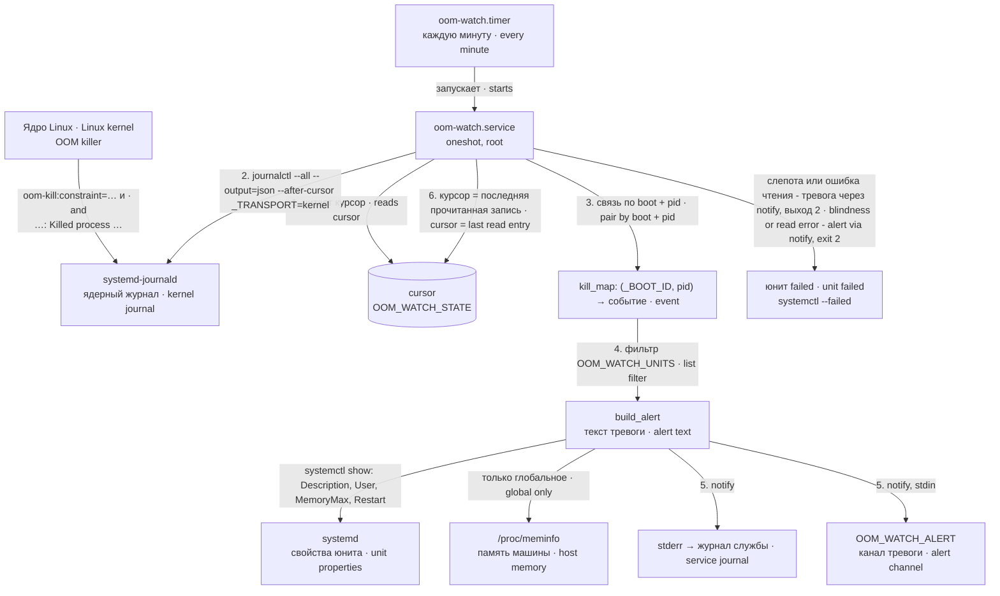
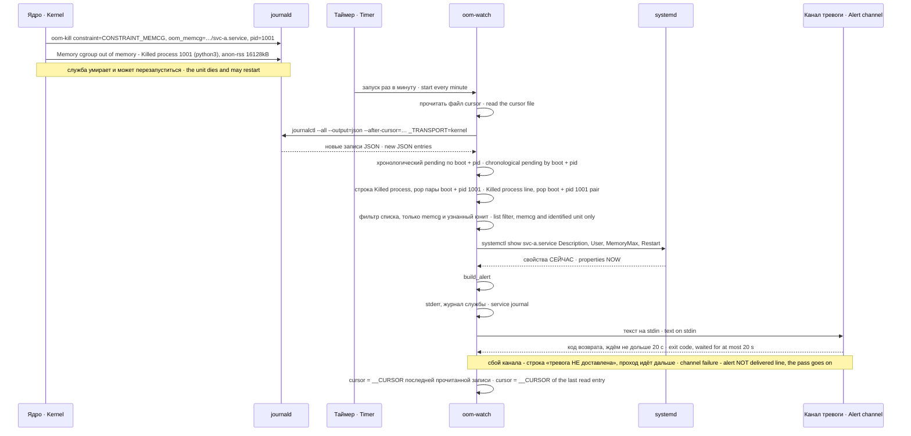
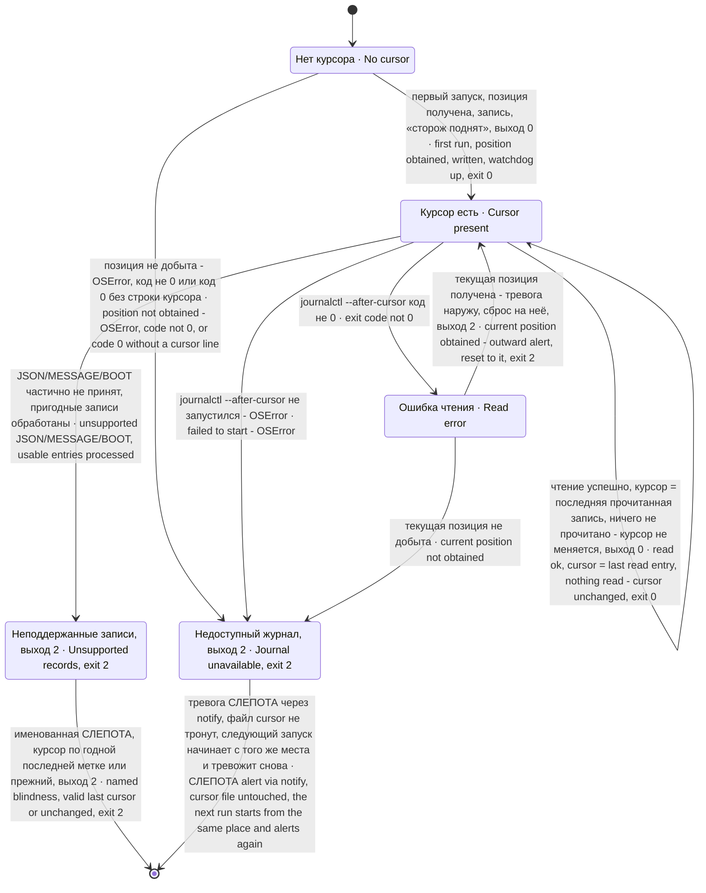

# Устройство oom-watch · oom-watch architecture

Автор · Author: Aleksandr Argelander · Лицензия · License: MIT · Код · Code: `bin/oom-watch` 3.1.4

Этот документ описывает, из чего состоит сторож, как идут данные от ядра до тревоги и как живёт курсор. Всё ниже выведено из кода `bin/oom-watch` и юнитов `systemd/`.

This document describes what the watchdog consists of, how data flows from the kernel to the alert, and how the cursor lives. Everything below is derived from the code of `bin/oom-watch` and the units in `systemd/`.

## Состав · Components

| Часть · Part | Файл · File | Роль · Role |
|---|---|---|
| Сторож · Watchdog | `bin/oom-watch` (ставится в `/usr/local/bin/oom-watch` · installed to) | Один проход по ядерному журналу, разбор, тревога. Python 3, только стандартная библиотека. · One pass over the kernel journal, parsing, alerting. Python 3, standard library only. |
| Служба · Service | `systemd/oom-watch.service` | `Type=oneshot`, от root, без `[Install]`. · `Type=oneshot`, as root, no `[Install]`. |
| Таймер · Timer | `systemd/oom-watch.timer` | `OnCalendar=*-*-* *:*:00`, `Persistent=true`, `WantedBy=timers.target`. |
| Курсор · Cursor | `$OOM_WATCH_STATE/cursor` (умолчание · default `/var/lib/oom-watch/cursor`) | Одна строка — курсор journald, с которого читать в следующий раз. · One line — the journald cursor to read from next time. |
| Канал тревоги · Alert channel | `$OOM_WATCH_ALERT` | Ваш исполняемый файл; получает текст на stdin. · Your executable; gets the text on stdin. |

## Схема взаимодействия · Interaction diagram

## Поток одного события · Flow of one event

Ниже — одно групповое убийство, от ядра до внешнего канала. Для глобального отличаются строки ядра (`CONSTRAINT_NONE`, `global_oom`, `task_memcg`, префикс `Out of memory`) и состав тревоги (нет предела и процента, есть память машины).

Below is one cgroup kill, from the kernel to the external channel. For a global kill the kernel lines differ (`CONSTRAINT_NONE`, `global_oom`, `task_memcg`, prefix `Out of memory`) and so does the alert (no limit or percentage, host memory instead).

## Состояния курсора · Cursor states

Состояние «Нет курсора» — это отсутствие файла `cursor`. Первый запуск не тревожит о прошлом: записывает текущую позицию и пишет в stderr «сторож поднят». Если позицию добыть нельзя — `journalctl` не запустился (`OSError`), ответил ненулевым кодом (нет прав на чтение) или ответил кодом 0 без строки курсора (в том числе совсем пустой ядерный журнал), — это «Слепота»: файл не пишется, выход 2.

The "No cursor" state is the absence of the `cursor` file. The first run does not alert about the past: it records the current position and writes "watchdog is up" to stderr. If the position cannot be obtained — `journalctl` failed to start (`OSError`), exited non-zero (no read permission) or exited 0 without a cursor line (including a completely empty kernel journal) — that is "Blindness": no file is written, exit 2.

«Ошибка чтения» — ненулевой код `journalctl --after-cursor`. По пробе на systemd 255 его дают синтаксически испорченный или пустой курсор (`Failed to seek to cursor: Invalid argument`). Курсор правильного вида, но от вычищенного или чужого журнала, принимается с кодом 0 — тогда переход в «Ошибку чтения» не происходит, чтение продолжается с ближайшего места. В этой ветке сторож тревожит «🔴 OOM-KILL: не удалось прочитать ядерный лог (rc=…)», переписывает курсор на текущую позицию и выходит с кодом 2: окно между старой и новой позицией не проверено, и проход не считается успешным.

"Read error" is a non-zero exit code of `journalctl --after-cursor`. In a probe on systemd 255 it came from a syntactically broken or empty cursor (`Failed to seek to cursor: Invalid argument`). A well-formed cursor from a vacuumed or foreign journal is accepted with code 0 — then there is no transition to "Read error", and reading continues from the nearest place. In this branch the watchdog alerts "🔴 OOM-KILL: не удалось прочитать ядерный лог (rc=…)" (could not read the kernel log), rewrites the cursor to the current position and exits with code 2: the window between the old and the new position was not checked, and the pass does not count as a success.

«Слепота» — не состояние, которое где-то хранится, а исход одного запуска. Сторож отдаёт через `notify` тревогу «СЛЕПОТА: не добыт курсор ядерного журнала: …» (или «СЛЕПОТА: не добыт ядерный журнал: journalctl не запущен», если не запустилось основное чтение) и выходит с кодом 2, юнит становится `failed`. Памяти о том, что тревога уже ушла, нет: следующий запуск таймера (через минуту) пройдёт тот же путь и пошлёт ту же тревогу ещё раз. Подробно — [GUARDS.md](GUARDS.md), проверка 8.

"Blindness" is not a state stored anywhere, but the outcome of one run. The watchdog sends the alert "СЛЕПОТА: не добыт курсор ядерного журнала: …" (BLINDNESS: no kernel-journal cursor obtained) through `notify` (or "СЛЕПОТА: не добыт ядерный журнал: journalctl не запущен" if the main read failed to start) and exits with code 2; the unit becomes `failed`. There is no memory that the alert has already gone out: the next timer run (a minute later) takes the same path and sends the same alert again. Details — [GUARDS.md](GUARDS.md), check 8.

## Разбор строк ядра · Kernel line parsing

Читаются сохранённые записи всех загрузок после курсора: `journalctl --output=json --all --after-cursor=… _TRANSPORT=kernel`; `-k` не используется, потому что ограничивает чтение текущей загрузкой. Первый запуск по-прежнему запоминает текущую позицию без исторических тревог. Записи, которых journald не сохранил или уже вычистил, восстановить нельзя.

Read retained entries across boots after the cursor: `journalctl --output=json --all --after-cursor=… _TRANSPORT=kernel`; omit `-k`, which restricts reading to the current boot. The first run still records the current position without historical alerts. Entries not retained or already vacuumed by journald cannot be recovered.

Записи идут одним хронологическим проходом. Строка `oom-kill:constraint=…` сохраняет вид, unit, task и время по ключу `(_BOOT_ID, pid)`. Строка `Killed process` забирает эту пару через `pop`: повторное использование pid после завершённого события не наследует старый unit, а будущая строка constraint не связывается назад. Boot id — строка из 32 hex-символов; без неё пару не строят. Незавершённая пара не хранится между проходами.

Entries are processed once in chronological order. An `oom-kill:constraint=…` line stores kind, unit, task and time under `(_BOOT_ID, pid)`. A `Killed process` line consumes the pair with `pop`: pid reuse after a completed event does not inherit its old unit, and a future constraint line cannot pair backwards. A boot id must be a 32-character hex string; otherwise no pair is built. An unfinished pair does not survive between passes.

Comm берётся между скобками перед `total-vm:`: пробелы и вложенные `(`/`)` допускаются. Якорь — `: Killed process`, поэтому работают все три префикса ядра. Без пары unit не определён; вид определяется по префиксу (`Memory cgroup…` — memcg, иначе global). Unit системы — последний `.service` сегмент; для пути с `user@N.service` сохраняется весь cgroup-путь, свойства системного manager не запрашиваются. Пользовательский MemoryMax и Restart не проверяются и так называются в тревоге.

Comm is taken between the parentheses before `total-vm:`; spaces and embedded `(`/`)` are allowed. The `: Killed process` anchor supports all three kernel prefixes. Without a pair the unit is unknown; the prefix supplies the kind (`Memory cgroup…` means memcg, otherwise global). A system unit uses the final `.service` segment; a path containing `user@N.service` keeps its full cgroup identity and never queries the system manager. Its MemoryMax and Restart are unchecked and reported as such.

Фильтр — точный, по исходной identity; действует только на узнанный memcg unit. Для user-manager нужен полный cgroup-путь: `foo.service` ему не соответствует. При выводе динамических полей непечатные символы заменяются пробелами, HTML-символы экранируются; исходная identity для lookup/filter не меняется.

The exact filter uses the raw identity and applies only to an identified memcg unit. A user-manager unit needs its full cgroup path; `foo.service` does not match it. Rendering replaces nonprintable characters with spaces and escapes HTML characters; lookup/filter identity stays unchanged.

Неразборчивый JSON, не-объект JSON или MESSAGE не строкой дают именованную «СЛЕПОТУ» и код 2 после обработки пригодных записей. OOM-записи без годного boot id тоже дают код 2. Cursor обновляется только по непустой строковой `__CURSOR` последнего декодированного JSON-объекта; иначе остаётся прежним. Продвижение cursor не означает, что неподдержанные записи проверены, и повторной попытки для пропущенных записей нет.

Invalid JSON, a non-object JSON value or nonstring MESSAGE produces named blindness and exit 2 after usable entries are processed. OOM entries without a valid boot id also produce exit 2. The cursor is updated only from a nonempty string `__CURSOR` in the last decoded JSON object; otherwise it remains unchanged. Cursor advancement does not mean unsupported records were inspected; skipped records are not retried.

## Внешние вызовы · External calls

| Вызов · Call | Когда · When | Таймаут · Timeout | При отказе · On failure |
|---|---|---|---|
| `journalctl --no-pager -n 1 --show-cursor _TRANSPORT=kernel` | первый запуск, сброс после ошибки чтения · first run, reset after a read error | нет · none | `OSError`, код не 0 или код 0 без строки курсора → тревога «СЛЕПОТА», выход 2 · `OSError`, code not 0, or code 0 without a cursor line → «СЛЕПОТА» alert, exit 2 |
| `journalctl --no-pager --all --output=json --after-cursor=… _TRANSPORT=kernel` | каждый проход · every pass | нет · none | `OSError` → тревога «СЛЕПОТА», выход 2; код не 0 → ветка «ошибка чтения», выход 2 · `OSError` → «СЛЕПОТА» alert, exit 2; code not 0 → "read error" branch, exit 2 |
| `systemctl show <unit> -p <name> --value` | на каждую тревогу с узнанным системным юнитом; user-manager не опрашивается · per alert with an identified system unit; user-manager units are not queried | 3 с · 3 s | `None` → «не определено» / `root` для User |
| `$OOM_WATCH_ALERT` (stdin) | на каждую тревогу и служебное сообщение через notify · per alert and service message via notify | 20 с (`ALERT_TIMEOUT`, константа в коде) · 20 s (`ALERT_TIMEOUT`, a code constant) | строка «тревога НЕ доставлена (<причина>)» в stderr, проход идёт дальше; таймаут и любое исключение при запуске перехватываются · an "alert NOT delivered (<reason>)" line on stderr, the pass goes on; the timeout and any launch exception are caught |
| `/proc/meminfo` | глобальное убийство · global kill | — | строка о памяти машины опускается · host-memory line omitted |

## Куда что пишется · Where output goes

Все тревоги и служебные сообщения идут в stderr — это журнал службы (`journalctl -u oom-watch.service`). Во внешний канал через `notify` идут тревоги об убийствах, тревога об ошибке чтения курсора и тревоги «СЛЕПОТА» — последние при каждом слепом запуске, без памяти о том, что уже сказано. Строка «сторож поднят» первого запуска и строки о сбое самого канала («тревога НЕ доставлена») идут **только** в stderr. `notify` возвращает True, если канал принял тревогу, и False во всех остальных случаях (канала нет, путь неисполним, таймаут, исключение, ненулевой код).

All alerts and service messages go to stderr — the service journal (`journalctl -u oom-watch.service`). Through `notify`, the external channel gets kill alerts, the cursor read-error alert and the «СЛЕПОТА» (blindness) alerts — the latter on every blind run, with no memory of what was already said. The first run's "watchdog is up" line and the lines about the channel's own failure ("тревога НЕ доставлена", alert NOT delivered) go to stderr **only**. `notify` returns True if the channel accepted the alert and False in every other case (no channel, non-executable path, timeout, exception, non-zero exit).

Код выхода: 0 — проход отработал, включая недоставку; 2 — чтение/слепота/неподдержанные MESSAGE или _BOOT_ID, неизвестный довод или относительный канал; 1 — неперехваченная ошибка Python (например, недоступное состояние). Отказ конфигурации происходит до прохода; частичная слепота разбора может сдвинуть курсор по годной последней метке.

Exit code: 0 pass completed, including failed delivery;2 read error/blindness/unsupported MESSAGE or _BOOT_ID, unknown argument or relative channel;1 uncaught Python error (e.g. unwritable state). Configuration refuses before a pass; partial parser blindness may advance a valid last cursor.
