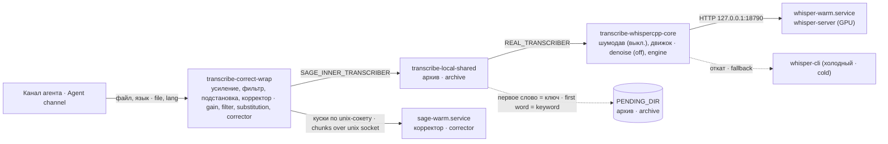

# voice-stack 3.1.1 — локальное распознавание речи для агента · local speech recognition for your agent

Набор обёрток и юнитов systemd, превращающих голосовое сообщение в текст на вашей же машине: whisper.cpp на GPU, необязательное шумоподавление, корректор русского текста и архив голосовых по ключевому слову.

A set of wrappers and systemd units that turn a voice message into text on your own machine: whisper.cpp on a GPU, optional denoising, a Russian text corrector and a keyword-triggered voice archive.

## 1. Что это · What it is

Это **не плагин** оболочки агента, а машинная служба с контрактом в одну строку: `<команда> <аудиофайл> <язык|auto>` → расшифровка в stdout. Использовать её может всё, что умеет запустить команду: канал агента, cron, скрипт.

This is **not a harness plugin**, but a machine service with a one-line contract: `<command> <audio-file> <language|auto>` → transcript on stdout. Anything that can run a command can use it: your agent channel, cron, a script.

```
<command> <audio-file> <language|auto>   →   transcript on stdout
```

## 2. Зачем нужно · Why

Агент слышит голосовые, не отправляя ни байта звука в чужое облако. Модель держится в памяти GPU, поэтому короткая фраза возвращается за доли секунды. Вокруг движка собраны защиты от того, что ломало нам распознавание на практике: тихие записи, галлюцинации на тишине, разорванные на сегменты фразы, самовызов обёртки.

Your agent hears voice messages without sending a single byte of audio to somebody else's cloud. The model stays resident in GPU memory, so a short phrase comes back in fractions of a second. Around the engine sit guards against what actually broke recognition for us: quiet recordings, hallucinations on silence, phrases split into segments, the wrapper calling itself.

## 3. Где место в системе · Where it fits

Канал агента зовёт одну команду. Что стоит за ней, решаете вы: схема показывает полную цепочку, которую дают умолчания кода пакета, если канал зовёт `transcribe-correct-wrap`.

Your agent channel calls one command. What stands behind it is your choice: the diagram shows the full chain the package's code defaults give you when the channel calls `transcribe-correct-wrap`.



Обе стрелки цепочки по умолчанию ведут на файлы этого пакета: `SAGE_INNER_TRANSCRIBER` у `transcribe-correct-wrap` — `/usr/local/bin/transcribe-local-shared`, `REAL_TRANSCRIBER` у `transcribe-local-shared` — `/usr/local/bin/transcribe-whispercpp-core`. Вне пакета по умолчанию остаётся только корректор: клиент `$SAGE_HOME/sage_client.py`, сервер и модель (без них цепочка работает, но без коррекции).

Both chain arrows default to files from this package: `transcribe-correct-wrap`'s `SAGE_INNER_TRANSCRIBER` is `/usr/local/bin/transcribe-local-shared`, `transcribe-local-shared`'s `REAL_TRANSCRIBER` is `/usr/local/bin/transcribe-whispercpp-core`. The only default outside the package is the corrector: the `$SAGE_HOME/sage_client.py` client, the server and the model (without them the chain works, just uncorrected).

Корректор стоит СНАРУЖИ архива нарочно: он меняет ключевое слово архива («паблик» → «публик»), а архив должен решать по сырому тексту.

The corrector sits OUTSIDE the archive on purpose: it changes the archive keyword ("паблик" → "публик"), while the archive must decide on the raw text.

Что здесь и чего здесь нет. Здесь — наша часть: обёртки, юниты systemd, логика отката и знание о порядке установки. Здесь нет чужого ПО: бинарей, весов, исходников. Каждый компонент берётся из своего источника — переиздание чужих артефактов тянет в ваш репозиторий их лицензии, а к вашим пользователям — их ошибки.

What is here and what is not. Here — our part: wrappers, systemd units, fallback logic and the install-order knowledge. Not here — other people's software: binaries, weights, sources. Each component is fetched from its own upstream — republishing someone else's artifacts drags their licenses into your repository and their bugs into your users.

| Компонент · Component | Источник · Upstream | Лицензия · License |
|---|---|---|
| whisper.cpp — движок · recognition engine | `ggml-org/whisper.cpp` | MIT |
| Веса Whisper `ggml-large-v3` · Whisper weights | конверсия OpenAI Whisper · conversion of OpenAI Whisper | MIT |
| Корректор русского текста (необяз.) · Russian corrector (optional) | `ai-forever/sage-fredt5-distilled-95m` | MIT (по прежней редакции README, заново не сверено · per the previous README, not re-checked) |
| Шумодав DPDFNet-2 (необяз.) · DPDFNet-2 denoiser (optional) | пакет Python `dpdfnet` · Python package `dpdfnet` | не установлено · not determined |
| Клиент и сервер корректора · corrector client and server | в пакет не входят · not shipped | — |
| Этот пакет · This package | вы его читаете · you are reading it | MIT |

## 4. Установка · Install

Требования: Linux с systemd, bash, curl, python3; GPU с Vulkan для горячего сервера; ffmpeg (нужен серверу из-за `--convert` и обёртке корректора для усиления); `logger` (util-linux) — им обёртка корректора пишет в журнал системы. Для golos-watch нужны root, espeak-ng с русским голосом, python3-yaml (PyYAML), runuser, timeout, journalctl и исполняемый agent-alert. Его drop-in требует bash-padenie-70 из dsh-storozha-mashiny; agent-alert поставляет dsh-trevogi. Версия платформы DSH и node пакету не нужны: это отдельные исполняемые файлы.

Requirements: Linux with systemd, bash, curl, python3; a Vulkan-capable GPU for the warm server; ffmpeg (needed by the server because of `--convert` and by the corrector wrapper for gain); `logger` (util-linux) — the corrector wrapper uses it to write to the system journal. golos-watch also needs root, espeak-ng with the Russian voice, python3-yaml (PyYAML), runuser, timeout, journalctl and an executable agent-alert. Its drop-in requires bash-padenie-70 from dsh-storozha-mashiny; dsh-trevogi supplies agent-alert. Neither the DSH platform version nor node matter: these are standalone executables.

Порядок не косметический — проверка каждого шага делает осмысленным следующий.

The order is not cosmetic — each step's check is what makes the next one meaningful.

**0. Сначала служебная учётка · Create a dedicated service account first.**

```bash
sudo useradd --system --home-dir /var/lib/voicesvc --create-home --shell /usr/sbin/nologin voicesvc
```

Почему первой: переносить работающий стек потом дороже, чем сразу поставить правильно. Почему вообще: распознавание — единственная часть, которая ест недоверенный ввод; голосовое постороннего доходит до него раньше белого списка. Взлом здесь должен попасть в пустую служебную учётку, а не в вашу.

Why first: moving a working stack later costs more than installing it right. Why at all: recognition is the one component that eats untrusted input — a stranger's voice note reaches it before any allow-list. A compromise there should land in an empty service account, not in your own.

⚠️ Имя `voice` обычно **уже занято** штатной системной группой: `useradd voice` падает с `group voice exists` и кодом 9. Берите другое имя.

⚠️ The name `voice` is usually **already taken** by a stock system group; `useradd voice` fails with `group voice exists` and exit code 9. Pick another name.

**1. Докажите, что GPU доступен,** до любой сборки. Иначе вы молча соберёте стек на CPU и получите секунды вместо долей секунды — и он будет выглядеть рабочим.

**1. Prove the GPU is reachable** before building anything. Otherwise you silently build a CPU stack and get seconds instead of fractions of a second — and it will look like it works.

**2. Соберите движок под Vulkan и скачайте модель** в каталог, принадлежащий службе. Юниты и обёртки ожидают раскладку `/opt/whisper.cpp/build-vulkan/bin/{whisper-server,whisper-cli}` и `/opt/whisper.cpp/models/ggml-large-v3.bin`.

**2. Build the engine for Vulkan and fetch the model** into a directory the service owns. The units and wrappers expect the layout `/opt/whisper.cpp/build-vulkan/bin/{whisper-server,whisper-cli}` and `/opt/whisper.cpp/models/ggml-large-v3.bin`.

**Раскладка юнитов.** В `systemd/` — ровно то, что стоит в бою: базовый `<юнит>.service` и его drop-in в `<юнит>.service.d/` (`10-voice-user.conf` — пользователь `voicesvc` и группы GPU; у `sage-warm` ещё `20-ozhidanie-soketa.conf` — ожидание сокета 180 с; у `whisper-warm` — `10-workdir.conf` и `30-chain.conf`, последний только комментарий). Базовый юнит без drop-in запускает службу от `claude` — ставить их только вместе. ⚠️ Юниты взяты из боя побайтно и НЕ обезличены: `systemd/whisper-warm.service` строки 3–4, `systemd/sage-warm.service.d/20-ozhidanie-soketa.conf` строки 1–3 — до выпуска наружу обезличить (B-N-1771). Сторож `golos-watch` — тоже по раскладке боя: `golos-watch.service` + `golos-watch.timer` и drop-in `golos-watch.service.d/{10-golos-reestr.conf, 60-bash-padenie-70.conf}` (запуск через `bash-padenie-70`); не обезличены строки: `golos-watch.service` 1, 6; `golos-watch.timer` 1; `10-golos-reestr.conf` 1; `60-bash-padenie-70.conf` 1, 7.

**Unit layout.** `systemd/` holds exactly what runs in production: the base `<unit>.service` plus its drop-ins in `<unit>.service.d/` (`10-voice-user.conf` — user `voicesvc` and GPU groups; `sage-warm` also has `20-ozhidanie-soketa.conf` — 180 s socket wait; `whisper-warm` has `10-workdir.conf` and `30-chain.conf`, the latter comments only). The base unit alone runs the service as `claude` — install them together. ⚠️ The units are copied from production byte-for-byte and are NOT depersonalised: `systemd/whisper-warm.service` lines 3–4, `systemd/sage-warm.service.d/20-ozhidanie-soketa.conf` lines 1–3 — depersonalise before any external release (B-N-1771). The `golos-watch` watcher follows the same production layout: `golos-watch.service` + `golos-watch.timer` and drop-ins `golos-watch.service.d/{10-golos-reestr.conf, 60-bash-padenie-70.conf}` (run via `bash-padenie-70`); not depersonalised: `golos-watch.service` lines 1, 6; `golos-watch.timer` 1; `10-golos-reestr.conf` 1; `60-bash-padenie-70.conf` 1, 7.

**3. Поставьте юниты** из `systemd/`, поправив пути, если выбрали другие. Рабочий каталог `whisper-warm` юнит сам не создаёт — создайте его заранее, иначе служба падает на шаге `CHDIR`:

**3. Install the units** from `systemd/`, adjusting paths if you chose different ones. The unit does not create `whisper-warm`'s working directory itself — create it first, otherwise the service fails at the `CHDIR` step:

```bash
sudo install -d -o voicesvc -g voicesvc /var/lib/whisper-warm
sudo cp systemd/*.service /etc/systemd/system/
sudo cp -r systemd/sage-warm.service.d systemd/whisper-warm.service.d /etc/systemd/system/
sudo cp systemd/golos-watch.timer /etc/systemd/system/ && sudo cp -r systemd/golos-watch.service.d /etc/systemd/system/
sudo systemctl daemon-reload && sudo systemctl enable --now whisper-warm
```

**4. Поставьте обёртки** из `bin/` в каталог из `PATH` (документация и умолчания исходят из `/usr/local/bin`) и сделайте их исполняемыми. Бит исполнения обязателен: `transcribe-local-shared` проверяет `REAL_TRANSCRIBER` через `-x` и без бита отказывает с кодом 4.

**4. Install the wrappers** from `bin/` into a directory on `PATH` (docs and defaults assume `/usr/local/bin`) and make them executable. The exec bit is required: `transcribe-local-shared` checks `REAL_TRANSCRIBER` with `-x` and refuses with exit 4 without it.

```bash
sudo install -m 0755 bin/transcribe-* /usr/local/bin/
sudo install -m 0755 bin/golos-watch /usr/local/sbin/
```

**Сторож: сначала зависимости и реестр, затем таймер.** Перед включением установите dsh-storozha-mashiny (bash-padenie-70) и dsh-trevogi (agent-alert), проверьте espeak-ng с русским голосом и PyYAML. Сохраните действующий GOLOS_REESTR: поставляемый drop-in указывает /etc/agent-registry/agents.yaml; на другой машине исправьте путь. Копирование юнитов не включает таймер. После этих проверок:

**Watcher: dependencies and registry first, then the timer.** Before activation, install dsh-storozha-mashiny (bash-padenie-70) and dsh-trevogi (agent-alert), verify espeak-ng with its Russian voice and PyYAML. Preserve the installed GOLOS_REESTR: the shipped drop-in points to /etc/agent-registry/agents.yaml; adjust it for another host. Copying units does not enable the timer. After these checks:

```bash
sudo test -x /usr/local/sbin/golos-watch
sudo test -x /usr/local/bin/bash-padenie-70
sudo test -x /usr/local/bin/agent-alert
sudo test -r /etc/agent-registry/agents.yaml  # путь из вашего GOLOS_REESTR · your GOLOS_REESTR path
sudo systemctl daemon-reload
sudo systemctl enable --now golos-watch.timer
systemctl is-enabled golos-watch.timer
systemctl is-active golos-watch.timer
```

**5. Необязательно: шумодав.** По умолчанию ВЫКЛЮЧЕН (`DENOISE` не задан → 0): наш замер на GPU с `large-v3` пользы не показал. Чтобы включить: venv в `/opt/dfn/venv` с пакетами `soundfile` и `dpdfnet` (каталог меняется `DENOISE_HOME`) и `DENOISE=1` в окружении вызывающего. Пока `DENOISE` не задан, ядро на каждом вызове пишет в stderr одну строку `denoise: выключен по умолчанию …`; явное `DENOISE=0` её убирает.

**5. Optional: the denoiser.** OFF by default (`DENOISE` unset → 0): our measurement on a GPU with `large-v3` showed no benefit. To enable: a venv in `/opt/dfn/venv` with the `soundfile` and `dpdfnet` packages (directory set by `DENOISE_HOME`) and `DENOISE=1` in the caller's environment. While `DENOISE` is unset, the core prints one stderr line `denoise: выключен по умолчанию …` ("off by default") on every call; an explicit `DENOISE=0` removes it.

**6. Необязательно: корректор русского текста.** Имеет смысл, только если пользователи диктуют по-русски: правит пунктуацию и регистр. Сервер, клиент, модель, словарь и отдельный venv с python3 по пути /opt/sage-corrector/venv/bin/python3 кладутся в `/opt/sage-corrector` (их в пакете нет), затем `sudo systemctl enable --now sage-warm`. Туда же — необязательные файлы данных `hallucination-filter.txt` и `zameny.tsv` (форматы — в [docs/SETTINGS.md](docs/SETTINGS.md)). Зависимости venv берутся из требований отдельно установленного сервера корректора: его код и список пакетов сюда не входят. Журнал corrector.log и его каталог принадлежат администратору и группе только вызывающих учёток; файл 0660 или 0664, каталог без записи прочим. Запись для всех (0622/0666) не допускается.

**6. Optional: the Russian corrector.** Only worth it if your users dictate Russian: it fixes punctuation and casing. Server, client, model, glossary and a separate venv providing /opt/sage-corrector/venv/bin/python3 go into `/opt/sage-corrector` (not shipped here), then `sudo systemctl enable --now sage-warm`. The optional data files `hallucination-filter.txt` and `zameny.tsv` go there too (formats in [docs/SETTINGS.md](docs/SETTINGS.md)). Use the separately installed corrector server’s dependency requirements for the venv: neither its code nor its package list is shipped here. Give corrector.log and its directory to the administrator and a group containing only caller accounts; file mode 0660 or 0664, no other-write on the directory. World-write (0622/0666) is not allowed.

## 5. Быстрый старт · Quick start

Самая короткая рабочая цепочка — только ядро. Направьте команду распознавания канала на `/usr/local/bin/transcribe-whispercpp-core` и проверьте на файле с НАСТОЯЩЕЙ речью:

The shortest working chain is the core alone. Point your channel's transcription command at `/usr/local/bin/transcribe-whispercpp-core` and check on a file with REAL speech:

```bash
time /usr/local/bin/transcribe-whispercpp-core speech.ogg auto; echo "rc=$?"
```

Ожидание: осмысленный текст, `rc=0`, доли секунды на короткой фразе и НИ ОДНОЙ строки `falling back to cold run` в stderr. Строка `denoise: выключен по умолчанию …` в stderr — норма, пока `DENOISE` не задан.

Expected: sensible text, `rc=0`, fractions of a second on a short phrase and NO `falling back to cold run` line on stderr. A `denoise: выключен по умолчанию …` line on stderr is normal while `DENOISE` is unset.

С архивом по ключевому слову — направьте канал на `transcribe-local-shared`. `REAL_TRANSCRIBER` задавать не нужно: умолчание уже ведёт на ядро пакета. Создайте конфиг (он исполняется оболочкой, права на запись — только root):

With the keyword archive — point your channel at `transcribe-local-shared`. No need to set `REAL_TRANSCRIBER`: the default already leads to the package's core. Create the config (it is executed by the shell; write access for root only):

```bash
# /etc/voice-archive.conf
PENDING_DIR=/var/lib/voice-archive/pending
DEFAULT_LANG=auto
```

С корректором — направьте канал на `transcribe-correct-wrap`. Умолчания сами соберут цепочку «корректор → архив → ядро»; конфиг архива из предыдущего шага действует и здесь. Язык передавайте из канала явно (`auto` или код): если канал его не передал, обёртка корректора подставит `ru`, и `DEFAULT_LANG` из конфига не сработает.

With the corrector — point your channel at `transcribe-correct-wrap`. The defaults build the "corrector → archive → core" chain by themselves; the archive config from the previous step applies here too. Pass the language from the channel explicitly (`auto` or a code): if the channel passes none, the corrector wrapper substitutes `ru`, and `DEFAULT_LANG` from the config has no effect.

⚠️ Не ставьте `REAL_TRANSCRIBER=/usr/local/bin/transcribe-correct-wrap` в конфиг: при умолчании `SAGE_INNER_TRANSCRIBER` это бесконечная петля, которую защита от самовызова не ловит.

⚠️ Do not put `REAL_TRANSCRIBER=/usr/local/bin/transcribe-correct-wrap` in the config: with the default `SAGE_INNER_TRANSCRIBER` that is an endless loop the self-call guard does not catch.

Приёмка — пять пунктов. Пункты 4 и 5 кажутся педантизмом, пока не выясняется, что файл говорил одно, а живой процесс — другое.

Acceptance — five points. Points 4 and 5 look pedantic until you find out that the file said one thing and the live process another.

| № | Проверка · Check | Ожидание · Expected |
|---|---|---|
| 1 | расшифровка из командной строки на настоящей речи · transcript from the command line on real speech | осмысленный текст · sensible text |
| 2 | время на короткой фразе · timing on a short phrase | доли секунды · fractions of a second |
| 3 | голосовое через ваш канал · a voice message through your channel | агент отвечает по содержанию · the agent answers on the content |
| 4 | `systemctl show whisper-warm -p User --value` | служебная учётка · the service account |
| 5 | `sudo grep ^Groups /proc/<pid>/status` | группы устройств реально есть · device groups are actually there |

## 6. Настройки · Settings

Все настройки — переменные окружения, строки конфига `/etc/voice-archive.conf` или флаги в юнитах. Полный список с типами, умолчаниями и последствиями ошибок — в [docs/SETTINGS.md](docs/SETTINGS.md).

All settings are environment variables, lines in `/etc/voice-archive.conf`, or flags in the units. The full list with types, defaults and failure consequences is in [docs/SETTINGS.md](docs/SETTINGS.md).

| Имя · Name | Где · Where | Умолчание · Default | Кратко · In short |
|---|---|---|---|
| `REAL_TRANSCRIBER` | конфиг · config | `/usr/local/bin/transcribe-whispercpp-core` | кого зовёт архивная обёртка · what the archive wrapper calls |
| `PENDING_DIR` / `VOICE_ARCHIVE_DIR` | конфиг / окружение · config / env | пусто — архив выкл. · empty — archive off | каталог архива · archive directory |
| `KEYWORDS` | конфиг · config | `паблик public паблік` | слова-ключи архива · archive keywords |
| `DEFAULT_LANG` | конфиг / окружение · config / env | `ru` | язык, если не передан · language when none given |
| `VOICE_ARCHIVE_DISABLE` | окружение вызывающего, до конфига · caller env, before config | `0` | `1` — без архива; пусто/не 0 и не 1 — отказ 2 до распознавания · `1` skips archive; empty/anything other than 0 or 1 refuses with exit 2 before recognition |
| `VOICE_ARCHIVE_CONF` | окружение · env | `/etc/voice-archive.conf` | путь конфига · config path |
| `WHISPERCPP_PORT` | окружение · env | `18790` | порт горячего сервера · warm server port |
| `WHISPER_HOME` | окружение · env | `/opt/whisper.cpp` | движок и модель холодного пути · cold-path engine and model |
| `DENOISE`, `DENOISE_HOME` | окружение · env | не задано → `0`, `/opt/dfn` · unset → `0`, `/opt/dfn` | шумодав · denoiser |
| `SAGE_INNER_TRANSCRIBER` | окружение · env | `/usr/local/bin/transcribe-local-shared` | кого зовёт обёртка корректора · what the corrector wrapper calls |
| `SAGE_HOME`, `SAGE_CLIENT`, `SAGE_CLIENT_PY`, `SAGE_SOCK` | окружение · env | `/opt/sage-corrector`, …/`sage_client.py` (нет в пакете · not shipped), `/usr/bin/python3`, `/run/sage-corrector/sage.sock` | корректор · corrector |
| `SAGE_LOG`, `SAGE_HALLUC_FILTER`, `SAGE_ZAMENY` | окружение · env | `$SAGE_HOME/corrector.log`, `$SAGE_HOME/hallucination-filter.txt`, `$SAGE_HOME/zameny.tsv` | журнал, фильтр галлюцинаций, пары подстановки · log, hallucination filter, substitution pairs |
| `SAGE_KUSOK`, `SAGE_BUDZHET`, `SAGE_CLIENT_TIMEOUT` | окружение · env | `600` знаков · chars, `45` с · s, `20` с · s | размер куска, общий бюджет, предел клиента · chunk size, overall budget, client limit |
| `GAIN_THRESHOLD_DB` | окружение · env | `-26` | порог усиления тихих записей · quiet-recording gain threshold |
| `SAGE_DEMO_LOG` | окружение · env | пусто — выкл. · empty — off | журнал RAW→COR · RAW→COR log |

## 7. Как работает · How it works

`transcribe-correct-wrap` — внешняя обёртка корректора. Тихую запись (средняя громкость ниже `GAIN_THRESHOLD_DB`) она нормализует во временный файл и зовёт внутренний распознаватель (по умолчанию `transcribe-local-shared`). Над его текстом: короткую известную галлюцинацию заменяет явным маркером; у длинного текста срезает хвостовую галлюцинацию последнего предложения; подставляет термины из пар `zameny.tsv`; склеивает построчный вывод в одну строку.

`transcribe-correct-wrap` is the outer corrector wrapper. It normalises a quiet recording (mean loudness below `GAIN_THRESHOLD_DB`) into a temporary file and calls the inner transcriber (`transcribe-local-shared` by default). On its text it: replaces a short known hallucination with an explicit marker; on long text cuts a trailing hallucination in the last sentence; substitutes terms from the `zameny.tsv` pairs; joins line-by-line output into one line.

Затем текст режется на куски до `SAGE_KUSOK` знаков (по концу предложения, иначе по запятой, иначе по пробелу), каждый кусок отдаётся клиенту корректора отдельно, швы чинятся. Общий бюджет — `SAGE_BUDZHET` секунд: после него оставшиеся куски идут сырыми; весь шаг жёстко ограничен 70 секундами. Число неисправленных кусков пишется в журнал; если оно не ноль — ещё и в журнал системы. После корректора пары терминов применяются ещё раз. Любой сбой корректора — отдаётся сырой текст, код возврата сохраняется.

Then the text is cut into chunks of up to `SAGE_KUSOK` characters (at a sentence end, else at a comma, else at a space), each chunk goes to the corrector client separately, seams are repaired. The overall budget is `SAGE_BUDZHET` seconds: after it the remaining chunks go raw; the whole step is hard-capped at 70 seconds. The number of uncorrected chunks goes to the log; if it is not zero, also to the system journal. After the corrector the term pairs are applied once more. Any corrector failure returns the raw text; the exit code is preserved.

`transcribe-local-shared` — архивная обёртка. Она читает конфиг, проверяет, что `REAL_TRANSCRIBER` не она сама (код 3) и что он существует и исполняем (код 4), зовёт его и отдаёт его stdout и код возврата без изменений (кроме срезанных хвостовых переводов строк). Только при коде движка 0, если первое слово СЫРОЙ расшифровки — ключевое (`паблик`, `public`, `паблік`), она копирует аудио и `.txt` с текстом в `PENDING_DIR`. Любая ошибка архива глушится: голос важнее архива.

`transcribe-local-shared` is the archive wrapper. It reads the config, checks that `REAL_TRANSCRIBER` is not itself (exit 3) and that it exists and is executable (exit 4), calls it and returns its stdout and exit code unchanged (except stripped trailing newlines). Only with engine exit code 0, if the RAW transcript's first word is a keyword (`паблик`, `public`, `паблік`), it copies the audio and a `.txt` with the text into `PENDING_DIR`. Any archive error is suppressed: the voice matters more than the archive.

`transcribe-whispercpp-core` — ядро. Шумоподавление DPDFNet-2 по умолчанию выключено и включается только `DENOISE=1`; затем запрос к горячему `whisper-server` на `127.0.0.1`, а если тот недоступен или вернул пусто/ошибку — холодный запуск `whisper-cli`. Ошибки шумодава не роняют распознавание.

`transcribe-whispercpp-core` is the core. DPDFNet-2 denoising is off by default and enabled only by `DENOISE=1`; then a request to the warm `whisper-server` on `127.0.0.1`, and if that is unreachable or returns empty/error — a cold `whisper-cli` run. Denoiser errors do not take recognition down.

Два юнита держат модели в памяти: `whisper-warm.service` (распознавание; перезапуск только при сбое, потолок памяти 8 ГБ) и `sage-warm.service` (корректор; перезапуск при любом выходе, потолок памяти 2 ГБ). Оба работают под служебной учёткой и объявляют готовность только после проверки: порт отвечает / сокет появился. Устройство и потоки — в [docs/ARCHITECTURE.md](docs/ARCHITECTURE.md).

Two units keep models resident: `whisper-warm.service` (recognition; restarts only on failure, 8 GB memory cap) and `sage-warm.service` (corrector; restarts on any exit, 2 GB memory cap). Both run under the service account and report ready only after a check: the port answers / the socket appeared. Structure and flows are in [docs/ARCHITECTURE.md](docs/ARCHITECTURE.md).

### Что выглядит успехом, но им не является · Things that look like success and are not

**Служба распознавания, которая отвечает, — ещё не служба, которая распознаёт.** Смотрите на расшифровку, а не на строку статуса. Наш собственный приёмочный прогон вернул пустую строку и предупреждение об откате — потому что пробой был синусоидальный тон, а не речь.

**A recognition service that answers is not a recognition service that recognises.** Check the transcript, not the status line. Our own acceptance run returned an empty string and a fallback warning — because the probe was a sine tone, not speech.

**Доступ к устройству не выдаётся членством в группе, добавленным задним числом.** Работающая служба хранит набор групп, с которым её создали. Поэтому в юнитах явная строка `SupplementaryGroups=video render`.

**Device access is not granted by group membership added after the fact.** A running service keeps the group set it was created with. That is why the units carry `SupplementaryGroups=video render` as an explicit line.

**Служба, читающая файлы из домашнего каталога человека, работает, пока не перестанет.** Когда мы перевели свою на служебную учётку, она сломалась сразу — и правильно. Держите код, модели и словари в каталоге самой службы — и проверяйте обёртки тоже, а не только юнит.

**A service that reads files from a person's home directory works only until it does not.** When we moved ours to a service account it broke instantly, and correctly. Keep code, models and glossaries inside the service's own directory — and check the wrappers too, not just the unit.

**Конфиг, который несёт нагрузку молча, — не настройка, а несущая балка.** Прежние умолчания цепочки указывали на файлы, которых на машине не было, и всё работало только потому, что конфиг их переопределял. Теперь умолчания указывают на файлы пакета, а отсутствующий движок называет себя (код 4), а не выглядит как «голосовое не распозналось».

**A config that silently carries load is a load-bearing beam, not a setting.** The old chain defaults pointed at files absent from the host, and everything worked only because the config overrode them. Now the defaults point at package files, and a missing engine names itself (exit 4) instead of looking like "the voice note was not recognised".

**Синтезированную роботом речь распознаёт плохо.** Проверяя цепочку синтезатором, судите по признаку «появился текст на нужном языке», а не по формулировкам.

**Robot-synthesised speech transcribes badly.** If you test the chain with a speech synthesiser, judge by "text in the right language appeared", not by wording.

**Холодный путь движка может отсутствовать, пока горячий работает.** Наш откатывался на бинарь, который никогда не собирали. Ветка отката заслуживает собственной проверки, иначе она откажет в первый же день, когда горячий сервер ляжет. Проверка: остановите `whisper-warm` и прогоните ядро вручную.

**The engine's cold path can be missing while the warm one works.** Ours fell back to a binary that had never been built. The fallback branch deserves its own test, or it will fail on the first day the warm server is down. Test: stop `whisper-warm` and run the core by hand.

**Язык сохраняется при откате.** Холодный путь передаёт `-l auto` для автоопределения; любой язык передаётся одним доводом, а не набором флагов.

**Fallback preserves the language.** The cold path passes `-l auto` for detection; every language is passed as one argument rather than a list of flags.

## 8. Сторожа и проверки · Guards and checks

Сторож-служба в пакете одна — `golos-watch`: юниты `systemd/golos-watch.service` (oneshot от root, `ExecStart=/usr/local/sbin/golos-watch`) и `systemd/golos-watch.timer` (через 10 минут после загрузки машины и каждый день в 05:20 UTC, `Persistent=true`) ставятся в шаге 3; что он проверяет — раздел «Дополнительные команды». Остальные проверки встроены в обёртки и юниты: защита от самовызова (код 3), проверка наличия движка (код 4), объявление выключенного или непонятного `DENOISE`, откат шумодава, откат с горячего сервера на холодный, проверка холодного бинаря (код 3), усиление тихих записей, фильтр галлюцинаций (громкий при пропаже файла), срез хвостовой галлюцинации, подстановка терминов, предусловия корректора, коррекция кусками с бюджетом и счётом неисправленных кусков, ожидание порта и сокета при старте юнитов. Две проверки пишут в журнал системы с тегом transcribe-correct-wrap; golos-watch читает новые строки с 🔴 и передаёт тревогу через GOLOS_ALERT. Таймер зовёт его ежедневно; промежуток между проверками он не покрывает. Что каждая ловит и чего НЕ ловит — в [docs/GUARDS.md](docs/GUARDS.md). Частые поломки — в [docs/TROUBLESHOOTING.md](docs/TROUBLESHOOTING.md).

The package has one watchdog service — `golos-watch`: the units `systemd/golos-watch.service` (oneshot as root, `ExecStart=/usr/local/sbin/golos-watch`) and `systemd/golos-watch.timer` (10 minutes after machine boot and daily at 05:20 UTC, `Persistent=true`) are installed in step 3; what it checks is in "Additional commands". The other checks are built into the wrappers and units: self-call guard (exit 3), engine existence check (exit 4), announcing an unset or unknown `DENOISE`, denoiser fallback, warm-to-cold fallback, cold binary check (exit 3), quiet-recording gain, hallucination filter (loud when the file is missing), trailing-hallucination cut, term substitution, corrector preconditions, chunked correction with a budget and a count of uncorrected chunks, port and socket wait at unit start. Two checks write to the system journal with the transcribe-correct-wrap tag; golos-watch reads new 🔴 lines and sends an alert via GOLOS_ALERT. Its timer calls it daily; it does not cover the interval between scans. What each catches and what it does NOT catch is in [docs/GUARDS.md](docs/GUARDS.md). Common failures are in [docs/TROUBLESHOOTING.md](docs/TROUBLESHOOTING.md).

## 9. Границы · Limits

Пакет не полон сам по себе. Не входят: клиент `sage_client.py`, сервер `sage_warm_server.py`, модель корректора, словарь, файл фильтра галлюцинаций, файл пар подстановки, venv шумодава, сборка whisper.cpp и её модель. Цепочка распознавания из частей пакета собирается умолчаниями; без корректора она работает без коррекции.

The package is not complete on its own. Not shipped: the `sage_client.py` client, the `sage_warm_server.py` server, the corrector model, the glossary, the hallucination-filter file, the substitution-pairs file, the denoiser venv, the whisper.cpp build and its model. The recognition chain from the package's parts is assembled by the defaults; without the corrector it works uncorrected.

Архив только складывает файлы: он не публикует, не чистит каталог по сроку и не пишет журнал. Неудачная копия пропадает молча. Оригинал ищется по соглашению об именах `audio.*` одного конкретного канала в каталоге того файла, который архив получил; в общем временном каталоге может быть взят чужой файл. После усиления выбор зависит от TMPDIR: если это каталог одного сообщения (как у dsh-telegram-multiagent), рядом остаётся audio.ogg/opus и архив берёт оригинал; в общем TMPDIR без audio.* берёт нормализованный .wav. Новые каталоги архива создаются 0700, файлы 0600 (umask 077); существующие каталоги и файлы не переправляются — их права проверяет администратор. Общий каталог требует явной группы вызывающих и запрета доступа прочим.

The archive only drops files: it does not publish, does not expire the directory, and does not log. A failed copy disappears silently. The original is found by the `audio.*` naming convention of one particular channel in the directory of the file the archive received; in a shared temporary directory someone else's file may be taken. After gain, selection depends on TMPDIR: in a per-message directory (as used by dsh-telegram-multiagent), audio.ogg/opus remains alongside and the archive takes the original; in a shared TMPDIR without audio.* it takes the normalised .wav. New archive directories use 0700, files 0600 (umask 077); existing directories and files are not changed — their modes need administrator review. A shared directory needs an explicit caller group and no access for others.

Порт `18790`, путь модели, путь сокета и подкаталог `build-vulkan` записаны в коде и юнитах числом и строкой; согласованность между юнитом и обёрткой — ваша забота. Рассчитано на одну машину: сервер слушает только `127.0.0.1`. Юнит `whisper-warm` выбирает GPU с индексом 0 (`GGML_VK_VISIBLE_DEVICES=0`).

Port `18790`, the model path, the socket path and the `build-vulkan` subdirectory are written literally in code and units; keeping unit and wrapper consistent is your job. Single-host by design: the server listens on `127.0.0.1` only. The `whisper-warm` unit selects GPU index 0 (`GGML_VK_VISIBLE_DEVICES=0`).

Фильтр галлюцинаций целиком смотрит только тексты до 120 символов; у длинных срезается лишь хвост последнего предложения. Регистронезависимое сравнение кириллицы в фильтре зависит от локали вызывающего: обёртка корректора `LANG` больше не трогает (язык у неё в `YAZ`), но при локали без UTF-8 кириллица без учёта регистра не сравнивается.

The hallucination filter looks at whole texts only up to 120 characters; on long ones only the tail of the last sentence is cut. Case-insensitive Cyrillic matching in the filter depends on the caller's locale: the corrector wrapper no longer touches `LANG` (it keeps the language in `YAZ`), but under a non-UTF-8 locale Cyrillic is not matched case-insensitively.

Коррекция ограничена по времени: длинное голосовое может прийти частично исправленным (куски после бюджета `SAGE_BUDZHET` — сырые) или целиком сырым (сработал жёсткий предел 70 с). Предел 70 с в код зашит: поднятый `SAGE_BUDZHET` упрётся в него.

Correction is time-bounded: a long voice note may come back partly corrected (chunks after the `SAGE_BUDZHET` budget are raw) or entirely raw (the hard 70 s limit fired). The 70 s limit is hard-coded: a raised `SAGE_BUDZHET` runs into it.

Конфиг `/etc/voice-archive.conf` исполняется оболочкой с правами вызывающего; ошибки в нём не видны. Корректор рассчитан на русский язык.

The `/etc/voice-archive.conf` config is executed by the shell with the caller's rights; errors in it are invisible. The corrector targets Russian only.

## 10. Лицензия и автор · License and author

Наша часть (обёртки, юниты, документация) — MIT. Чужие компоненты — по лицензиям своих источников (таблица выше).

Our part (wrappers, units, documentation) is MIT. Third-party components are under their upstream licenses (table above).

Автор: Aleksandr Argelander. История изменений — [CHANGELOG.md](CHANGELOG.md). Общая документация системы — в каталоге пакетов рядом (например, канал [`dsh-telegram-multiagent`](../dsh-telegram-multiagent) зовёт эту цепочку через настройку `transcribeCommand`).

Author: Aleksandr Argelander. Change history — [CHANGELOG.md](CHANGELOG.md). General system documentation lives alongside in the packages directory (e.g. the [`dsh-telegram-multiagent`](../dsh-telegram-multiagent) channel calls this chain through its `transcribeCommand` setting).

## Дополнительные команды · Additional commands

`bin/golos-watch` проверяет все DSH-записи YAML-реестра, узнаваемую фразу от каждой учётки и новые тревоги корректора. Для реального обхода нужны root, espeak-ng с русским голосом, ffmpeg, PyYAML, runuser, timeout, journalctl, чтение профилей, общий движок и исполняемый GOLOS_ALERT. Ручной запуск не от root — СЛЕПОТА 2 до проб. Запускает его таймер пакета `golos-watch.timer` → `golos-watch.service` (через 10 минут после загрузки и каждый день в 05:20 UTC); подъём службы агента таймер не ловит — после него сторожа зовут рукой: `sudo systemctl start golos-watch.service`. Юнит зовёт `/usr/local/sbin/golos-watch`, а drop-in `10-golos-reestr.conf` задаёт `GOLOS_REESTR=/etc/agent-registry/agents.yaml`. Коды: 0 исправно, 1 ошибки и слепота читателя журнала, 2 общая слепота, 3 не доставлена тревога. Секреты команды не принимает.

`bin/golos-watch` checks every DSH record in a YAML registry, a recognizable phrase as each account, and new corrector alerts. A real scan needs root, espeak-ng with its Russian voice, ffmpeg, PyYAML, runuser, timeout, journalctl, readable profiles, the shared engine and an executable GOLOS_ALERT. A manual non-root run returns blindness 2 before any probe. The package's timer starts it: `golos-watch.timer` → `golos-watch.service` (10 minutes after boot and daily at 05:20 UTC); the timer does not catch an agent service restart — after one, call the watcher by hand: `sudo systemctl start golos-watch.service`. The unit calls `/usr/local/sbin/golos-watch`, and the `10-golos-reestr.conf` drop-in sets `GOLOS_REESTR=/etc/agent-registry/agents.yaml`. Exit codes: 0 healthy, 1 failures or journal-reader blindness, 2 shared-probe blindness, 3 undelivered alert. The command accepts no credentials.

| Настройка · Setting | Умолчание · Default | Назначение · Meaning |
|---|---|---|
| GOLOS_REESTR | /etc/voice-stack/agents.yaml | YAML agenty/namerenie: имя, платформа dsh, дом и системная учётка (ключи imya/platforma/dom/polzovatel) · name, dsh platform, home and system account |
| GOLOS_ALERT | /usr/local/bin/agent-alert | исполняемый отправитель сообщения · executable alert sender |
| GOLOS_DVIZHOK | /usr/local/bin/transcribe-whispercpp-core | общий контроль распознавания · shared recognizer check |
| GOLOS_PREDEL_PROBY | 150 | секунд на одну пробу; задайте ещё предел всего обхода снаружи · seconds per trial; also bound the whole scan externally |
| GOLOS_KURSOR | /var/lib/golos-watch/korrektor.cursor | курсор чтения журнала · journal read cursor |

Для сохранения установленной раскладки явно задайте GOLOS_REESTR прежним путём в окружении вызывающего. Пример нейтральной структуры: `examples/agents.yaml`. Репозиторий хранит самостоятельные команды; установка из локального дерева или tar-архива, без npm. Версия пакета — 3.1.1. Собственный код — MIT · Aleksandr Argelander.

To retain an installed layout, explicitly carry its existing GOLOS_REESTR path into the caller environment. A neutral shape example is in `examples/agents.yaml`. The repository stores standalone commands; install from a local tree or tar archive, without npm. Package version — 3.1.1. Own code: MIT · Aleksandr Argelander.

Переходник command-STT `bin/hermes-stt-command` снят из пакета 07.10.2026 вместе с его пробами (см. CHANGELOG). Стенд `test/stend-voice-tools.py` теперь гоняет только `bin/golos-watch`: 15 прогонов с подставными нижними командами (синтез, перевод, `runuser`, журнал, канал тревоги, движок, команда агента), без GPU, служб и настоящего журнала — исправные агенты, нет или дважды задан `transcribeCommand`, нет профиля или учётки, неузнанная фраза, упавшая проба, общая слепота, пустой и нечитаемый реестр, сбой синтеза, 🔴 корректора и слепой журнал, недоставленная тревога, неизвестный довод. На каждый прогон — строка `OK <имя>`, в конце `PASS 15/15`; любое несовпадение — `AssertionError`.

The command-STT adapter `bin/hermes-stt-command` was removed from the package on 2026-10-07 together with its probes (see CHANGELOG). `test/stend-voice-tools.py` now runs only `bin/golos-watch`: 15 runs with stubbed lower-level commands (synthesis, conversion, `runuser`, journal, alert channel, engine, agent command), without GPU, services or the real journal — healthy agents, `transcribeCommand` missing or set twice, missing profile or account, unrecognised phrase, failed probe, shared blindness, empty and unreadable registry, synthesis failure, a corrector 🔴 and a blind journal, undelivered alert, unknown argument. One `OK <name>` line per run, `PASS 15/15` at the end; any mismatch — `AssertionError`.

При пустом итоговом `PENDING_DIR` обёртка на каждом вызове пишет в stderr «архив голосовых выключен: PENDING_DIR не задан». Это уведомление об отключённом архиве; распознавание продолжается с прежними stdout и кодом возврата. Конфиг может задать `PENDING_DIR`, окружение — `VOICE_ARCHIVE_DIR`. Выключить архив может и вызывающий: `VOICE_ARCHIVE_DISABLE=1` в окружении (так канал выключает архив гостевым собеседникам, B-N-1691) — архив не зовётся, в stderr строка «архив голосовых выключен: VOICE_ARCHIVE_DISABLE=1», распознавание идёт как обычно. Флаг читается до конфига, конфиг его не меняет. Умолчание — `0`; любое значение кроме `0`/`1` — отказ «неверный VOICE_ARCHIVE_DISABLE (ожидается 0 или 1)» и код 2 до любого ввода-вывода.

When the final `PENDING_DIR` is empty, the wrapper writes “архив голосовых выключен: PENDING_DIR не задан” (“voice archive disabled: PENDING_DIR is unset”) to stderr on every call. This reports disabled archiving; transcription continues with its existing stdout and exit code. The config can set `PENDING_DIR`; the environment can set `VOICE_ARCHIVE_DIR`. The caller can switch the archive off too: `VOICE_ARCHIVE_DISABLE=1` in the environment (this is how the channel switches the archive off for guest interlocutors, B-N-1691) — the archive is not called, stderr gets “архив голосовых выключен: VOICE_ARCHIVE_DISABLE=1” (“voice archive disabled”), transcription runs as usual. The flag is read before the config, and the config does not change it. Default — `0`; any value other than `0`/`1` — refusal “неверный VOICE_ARCHIVE_DISABLE (ожидается 0 или 1)” (invalid VOICE_ARCHIVE_DISABLE, expected 0 or 1) and exit code 2 before any I/O.

Стенд python3 test/stend-runtime-contract.py выполняет настоящие обёртки на синтетических файлах: фильтр с начальным дефисом, холодные auto и язык одним доводом, HTTP multipart со сложным путём, архив/права/opt-out, разрезку, порог awk, выбор оригинала по TMPDIR и сторожа при C-локали. Внешние модели, синтез, учётки, журналы и тревоги подставлены; HTTP — только собственный сервер на loopback. stend-voice-tools требует root (иначе СЛЕПОТА 2); два остальных стенда root не требуют. Эти пробы не доказывают качество распознавания/GPU и права живой службы.

The python3 test/stend-runtime-contract.py stand executes the real wrappers on synthetic files: a dash-leading filter, cold auto and a single language argument, HTTP multipart with a complex path, archive/modes/opt-out, chunking, awk threshold, TMPDIR source selection and the watcher under the C locale. External models, synthesis, accounts, journals and alerts are substituted; HTTP uses its own loopback server only. stend-voice-tools requires root (otherwise blindness 2); the other two stands need no root. These probes do not prove recognition quality/GPU or live-service permissions.
