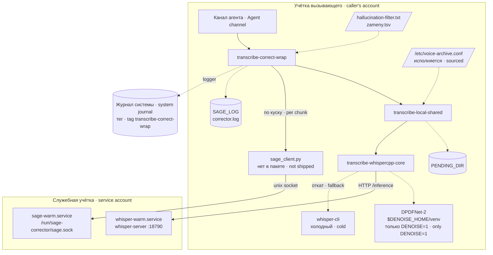
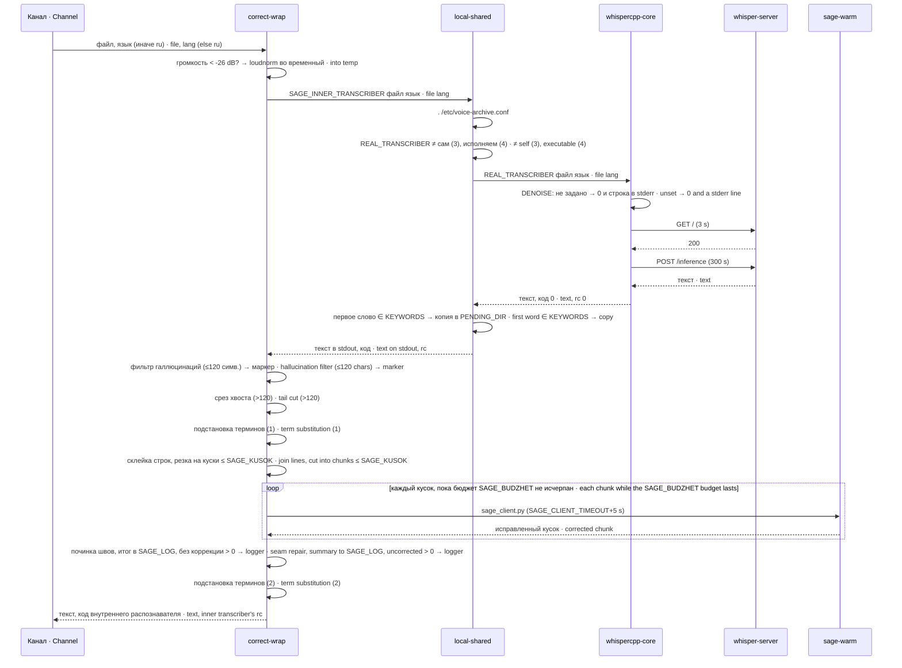
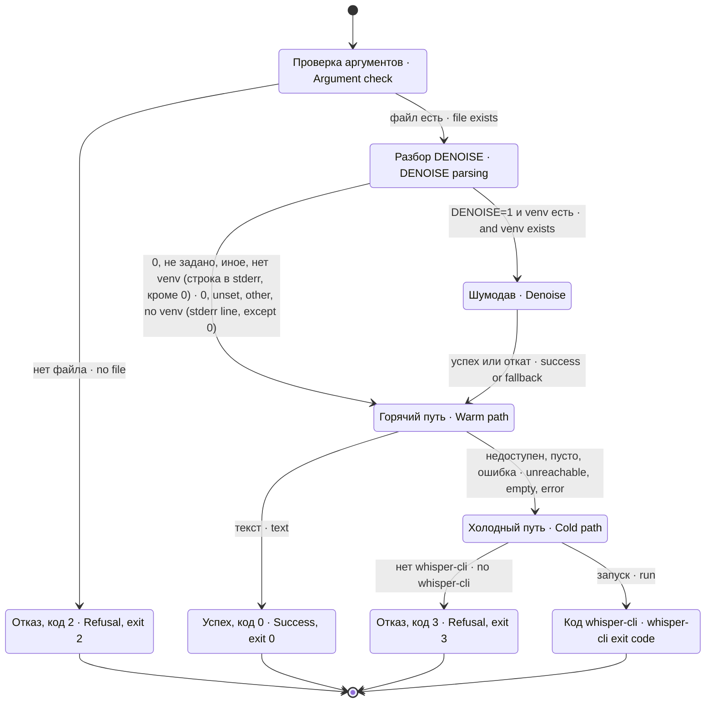

# Устройство voice-stack · voice-stack architecture

Документ описывает, из чего состоит пакет, как части зовут друг друга и что происходит с одним голосовым сообщением. Всё выведено из кода `bin/*` и `systemd/*`; то, чего в пакете нет, помечено.

This document describes what the package consists of, how the parts call each other and what happens to a single voice message. Everything is derived from the code in `bin/*` and `systemd/*`; what is not in the package is marked.

## Части · Components

| Часть · Part | Вид · Kind | Роль · Role | Зовёт · Calls |
|---|---|---|---|
| `bin/transcribe-correct-wrap` | bash | усиление, фильтр, срез хвоста, подстановка терминов, корректор кусками · gain, filter, tail cut, term substitution, chunked corrector | `ffmpeg`, `SAGE_INNER_TRANSCRIBER`, `python3` (встроенные помощники · embedded helpers), `sage_client.py`, `logger` |
| `bin/transcribe-local-shared` | bash | архивная обёртка · archive wrapper | `REAL_TRANSCRIBER`, `python3` |
| `bin/transcribe-whispercpp-core` | bash | шумодав (по умолчанию выкл.) и движок · denoiser (off by default) and engine | `$DENOISE_HOME/venv/bin/python`, `curl`, `whisper-cli` |
| `systemd/whisper-warm.service` | юнит · unit | горячий `whisper-server` на `127.0.0.1:18790` · warm `whisper-server` | — |
| `systemd/sage-warm.service` | юнит · unit | горячий корректор на unix-сокете · warm corrector on a unix socket | `sage_warm_server.py` (нет в пакете · not shipped) |

Каждая обёртка подчиняется одному контракту: `<команда> <файл> <язык>` → текст в stdout, диагностика в stderr, код возврата значим. Умолчания кода собирают цепочку `transcribe-correct-wrap` → `transcribe-local-shared` → `transcribe-whispercpp-core`; переменные `SAGE_INNER_TRANSCRIBER` и `REAL_TRANSCRIBER` позволяют укоротить её (например, канал прямо на архив или прямо на ядро). Обратный порядок (архив снаружи корректора) при умолчаниях даёт петлю.

Every wrapper obeys one contract: `<command> <file> <language>` → text on stdout, diagnostics on stderr, a meaningful exit code. The code defaults build the chain `transcribe-correct-wrap` → `transcribe-local-shared` → `transcribe-whispercpp-core`; the `SAGE_INNER_TRANSCRIBER` and `REAL_TRANSCRIBER` variables let you shorten it (e.g. the channel straight at the archive or straight at the core). The reverse order (archive outside the corrector) makes a loop with the defaults.

## Взаимодействие · Interaction

Обёртки работают от имени того, кто их вызвал, а не под служебной учёткой. Значит, вызывающему нужны: право исполнять `whisper-cli` и читать модель (холодный путь), право дописывать в `SAGE_LOG` (иначе выключаются подстановка терминов и срез хвоста, а итог корректора не пишется; сама коррекция работает) и право писать в сокет корректора (задаётся сервером, в пакете не определено). Если обёртку зовут несколько учёток, журнал должен быть доступен на запись им всем.

The wrappers run as whoever called them, not as the service account. So the caller needs: permission to execute `whisper-cli` and read the model (cold path), permission to append to `SAGE_LOG` (otherwise term substitution and the tail cut are disabled and the corrector summary is not written; correction itself still works) and permission to write to the corrector socket (set by the server, not defined in this package). If several accounts call the wrapper, the log must be writable by all of them.

## Поток одного голосового · One voice message

Порядок важен в трёх местах. Первое: архив стоит ВНУТРИ корректора и решает по СЫРОМУ тексту движка — нарочно, потому что корректор меняет ключевое слово («паблик» → «публик»). Маркер галлюцинации создаётся снаружи и в архив не попадает. Второе: усиление громкости идёт до шумодава, потому что обёртка корректора стоит снаружи ядра. Третье: пары терминов применяются дважды — до корректора (он искажает сырой термин раньше, чем пара его поймает) и после (возвращают термин, если корректор его испортил).

Order matters in three places. First: the archive sits INSIDE the corrector and decides on the engine's RAW text — on purpose, because the corrector changes the keyword ("паблик" → "публик"). The hallucination marker is created outside and never reaches the archive. Second: gain runs before denoising, because the corrector wrapper sits outside the core. Third: the term pairs are applied twice — before the corrector (it distorts the raw term before the pair can catch it) and after (they restore a term the corrector spoiled).

Какой файл копирует архив. `transcribe-local-shared` ищет `audio.*` (кроме `.wav`) в каталоге того файла, который ЕЙ передали. Без усиления это путь канала — копируется исходное аудио. Если сработало усиление, ей передан временный нормализованный файл из `$TMPDIR`: выбор зависит от каталога: при TMPDIR задания (dsh-telegram-multiagent) рядом есть audio.ogg/opus и копируется оригинал; в общем TMPDIR без audio.* — нормализованный .wav. Очищенный шумодавом файл в архив не попадает никогда: он создаётся внутри ядра.

Which file the archive copies. `transcribe-local-shared` looks for `audio.*` (other than `.wav`) in the directory of the file passed TO IT. Without gain that is the channel's path — the source audio is copied. If gain fired, it was passed the temporary normalised file from `$TMPDIR`: selection depends on the directory: per-message TMPDIR (dsh-telegram-multiagent) contains audio.ogg/opus and the original is copied; shared TMPDIR without audio.* yields the normalised .wav. The denoised file never reaches the archive: it is created inside the core.

## Состояния ядра · Core states

## Коды возврата · Exit codes

| Код · Code | Кто · Who | Значение · Meaning |
|---|---|---|
| 0 | все · all | текст получен (или пустой текст от движка) · text obtained (or empty text from the engine) |
| 2 | local-shared | VOICE_ARCHIVE_DISABLE пусто/не 0 и не 1; до распознавания · VOICE_ARCHIVE_DISABLE empty/other than 0 or 1; before recognition |
| 2 | whispercpp-core | нет аргумента или файла · missing argument or file |
| 3 | whispercpp-core | горячий путь не дал текста, `whisper-cli` нет · warm path gave no text, no `whisper-cli` |
| 3 | local-shared | `REAL_TRANSCRIBER` указывает на саму обёртку · `REAL_TRANSCRIBER` points at the wrapper itself |
| 4 | local-shared | `REAL_TRANSCRIBER` не найден или не исполняем · `REAL_TRANSCRIBER` not found or not executable |
| 127 | correct-wrap | `SAGE_INNER_TRANSCRIBER` не существует (оболочка) · `SAGE_INNER_TRANSCRIBER` does not exist (shell) |
| прочие · other | local-shared / correct-wrap | пробрасываются от вложенной команды · passed through from the nested command |

Код 3 у двух частей значит разное. Различайте по stderr: `САМОВЫЗОВ` против `cold fallback impossible`. `transcribe-correct-wrap` своих кодов не имеет: он всегда возвращает код внутреннего распознавателя, даже когда отдаёт маркер галлюцинации или сырой текст.

Exit 3 means different things in the two parts. Tell them apart by stderr: `САМОВЫЗОВ` versus `cold fallback impossible`. `transcribe-correct-wrap` has no codes of its own: it always returns the inner transcriber's code, even when it returns the hallucination marker or raw text.

## Временные файлы и журналы · Temporary files and logs

| Что · What | Где · Where | Кто удаляет · Who removes |
|---|---|---|
| нормализованная запись · normalised recording | `mktemp -t asrnorm-XXXXXX.wav` (в `$TMPDIR` или `/tmp`) | correct-wrap после распознавания · after recognition |
| итог корректора · corrector summary | `mktemp -t korr-XXXXXX` | correct-wrap сразу после переноса в `SAGE_LOG` · right after copying into `SAGE_LOG` |
| очищенная запись · denoised recording | `mktemp -t denoised-XXXXXX.wav` | whispercpp-core, `trap … EXIT` |
| журнал корректора · corrector log | `SAGE_LOG`, иначе `$SAGE_HOME/corrector.log` | этот пакет не чистит и не ротирует · not pruned or rotated by this package |
| журнал системы · system journal | тег `transcribe-correct-wrap`: пропажа фильтра, куски без коррекции · tag `transcribe-correct-wrap`: missing filter, uncorrected chunks | systemd-journald |
| demo-журнал · demo log | `$SAGE_DEMO_LOG` (если задан · if set) | этот пакет не чистит · not pruned by this package |
| архив · archive | `PENDING_DIR/<время>-<pid>-<random>.{ext,txt}` | не этот пакет · not this package |

Если `transcribe-correct-wrap` убить сигналом между созданием и удалением своих временных файлов, они останутся: ловушки на выход у него нет.

If `transcribe-correct-wrap` is killed by a signal between creating and removing its temporary files, they stay behind: it has no exit trap.

## Дополнительные инструменты · Additional tools

Внешний расписатель зовёт golos-watch; он читает реестр, запускает голосовую пробу для каждого профиля, читает journalctl с курсором и зовёт GOLOS_ALERT при ошибке.

An external scheduler calls golos-watch, which reads the registry, probes each profile, reads journalctl with a cursor, and calls GOLOS_ALERT on failure.
